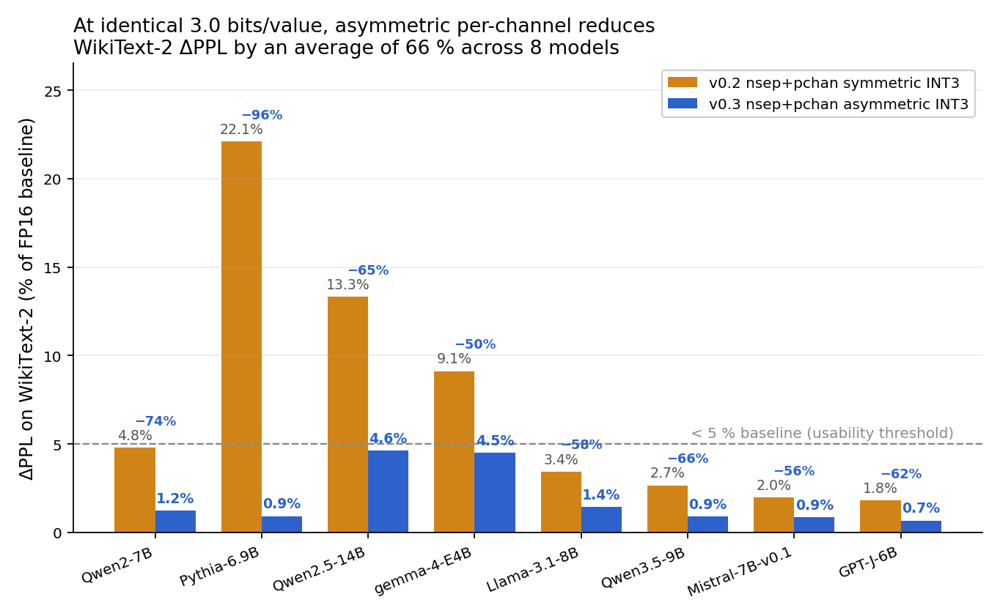
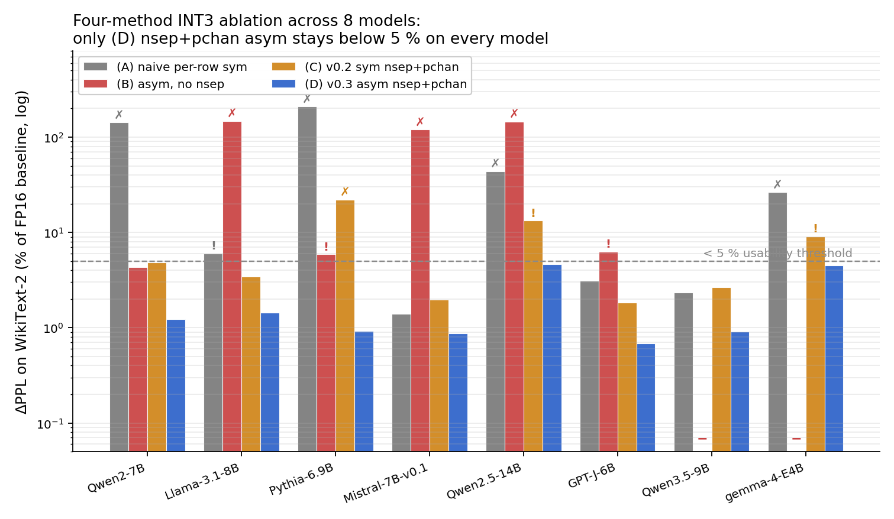
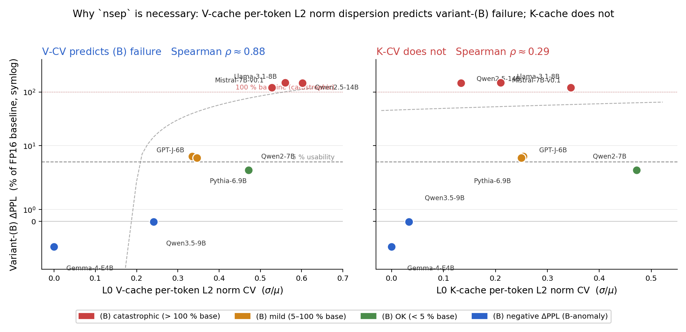
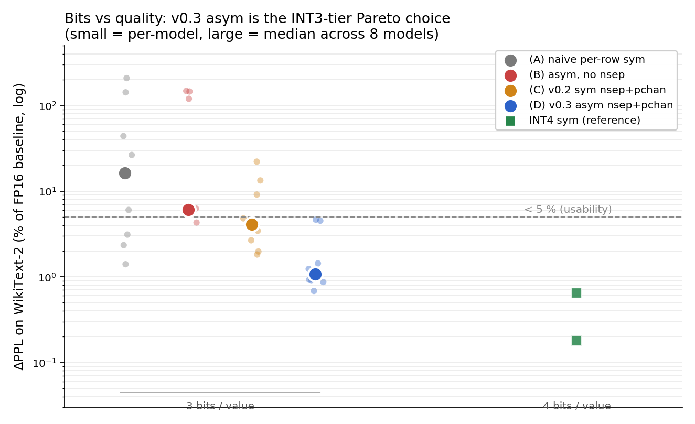
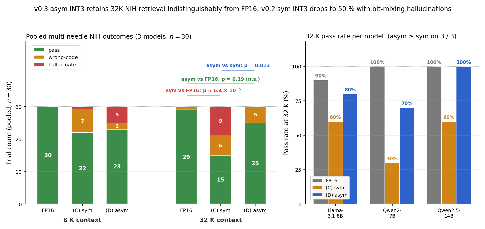

# modeq — full experiment report

> **Looking for the quick-start?** See [README.md](README.md) for a 3-minute summary with the headline numbers and figures. This file is the long-form version with every protocol, ablation, and caveat.

**Mode-aware KV cache quantization for Pre-LN Transformers.** A practical INT3 default with a reproducible, calibration-free recipe that stays within our conservative WikiText-2 ΔPPL threshold (< 5 % of baseline) on 8 of 8 models we were able to run.

[](LICENSE)
[](#installation)

---

## TL;DR

Low-bit KV cache quantization usually scales smoothly with bit width, but can fail dramatically on some models — naive INT4 produces **+1382 ΔPPL on Qwen2-7B** (the original "INT4 valley of death" case from our 27-model survey). A follow-up sweep on four additional Qwen2.5 checkpoints (Phase 28 / 28b / 28c) finds three further non-monotone cases: Qwen2.5-1.5B (INT3 spike), Qwen2.5-3B (INT3 valley), and Qwen2.5-7B (three-peak INT2 / INT4 / INT6) — four Qwen-family non-monotone cases in total. modeq investigates why this happens and provides a simple, calibration-free INT3 recipe that handles a range of recent models reliably.

> **v0.3 default**: `nsep+pchan` asymmetric INT3.

At the same **3.0 bits/value**, this default reduces WikiText-2 ΔPPL by an average of **66 %** (range 50.5 % – 95.8 %) compared to the v0.2 symmetric `nsep+pchan` baseline, across 8 models we evaluated end-to-end: Qwen2-7B, Llama-3.1-8B, Pythia-6.9B, Qwen2.5-14B, Mistral-7B-v0.1, GPT-J-6B, Qwen3.5-9B, and Gemma 4-E4B (2021–2026). All 8 models stay below our conservative **< 5 % of baseline PPL** threshold on WikiText-2, including v0.2's "research only" Pythia-6.9B (+22.1 % → +0.9 %).

It also achieves **5.09× real-packed memory reduction** vs FP16 with minimal code changes. No training, no calibration, no rotation, no codebook.

**The full method, in ~10 lines of PyTorch:**

```python
def qa_nsep_pchan_asym(x, bits=3):
    """Norm-separated per-channel asymmetric INT quantization.

    x: shape [..., T, D], dtype fp16 or fp32.
    Returns a same-shape, same-dtype tensor reconstructed from the
    INT-quantized direction vector plus the exact per-token L2 norm.
    """
    dtype = x.dtype
    xf = x.float()
    n = xf.norm(dim=-1, keepdim=True).clamp(min=1e-12)  # per-token
    d = xf / n                                          # unit direction
    m = d.amin(dim=-2, keepdim=True)                    # per-channel
    M = d.amax(dim=-2, keepdim=True)
    step = ((M - m) / (2**bits - 1)).clamp(min=1e-12)
    q = ((d - m) / step).round().clamp(0, 2**bits - 1)  # integer index
    d_q = m + q * step                                  # dequantize
    d_q = d_q / d_q.norm(dim=-1, keepdim=True).clamp(min=1e-8)
    return (n * d_q).to(dtype)
```

Every step is closed-form arithmetic on the input tensor's own statistics — no calibration corpus, no learned parameters, no rotation matrix, no codebook. The function is also available as `from modeq import qa_nsep_pchan_asym` if you want to drop it into an existing pipeline as a simulator. For actual INT3 bit-packing (the 5.09× memory-reduction number), use the cache class instead:

```python
from modeq import Int3AsymNsepPchanCache

# Encode a key/value tensor [B, H, T, D]  (v0.3 default)
cached = Int3AsymNsepPchanCache.from_fp16(k)

# Reconstruct for attention
k_recon = cached.to_fp16()

# Actual bytes on disk / VRAM — 5.09× smaller than FP16
cached.size_bytes()
```

**Rough magnitude of the improvement**: on Qwen2-7B (Mode 1), v0.3 brings naive INT3's +12 ΔPPL and v0.2's +0.40 ΔPPL both down to +0.10 — a 116× improvement over the naive industry baseline at the same 3 bits. On Llama-3.1-8B (Mode 2), v0.3 reaches +0.11 vs naive's +0.45 and v0.2's +0.25.

### Scope and caveats

- **Sample**: 8 runnable models (2021–2026). One additional model (Phi-3-medium-4k-instruct) was attempted but blocked by a transformers / custom-code incompatibility unrelated to modeq; see the [Phi-3 note](#phi-3-medium-compatibility-note).
- **Quality metric**: primary evaluation is WikiText-2 sliding-window perplexity (ctx = 1024, 10 windows). Two bounded-cost downstream probes are included: (i) MMLU 5-shot on Qwen2-7B and Llama-3.1-8B (500 questions each) with accuracy deltas of +1.0 pp and −0.2 pp vs FP16 under the shipped recipe, within the ~3 pp noise floor at this sample size; and (ii) a 3-model distractor-hardened Needle-in-a-Haystack *lead-key* retrieval probe at 8K/32K (Llama-3.1-8B, Qwen2-7B, Qwen2.5-14B, pooled n = 30) in which the shipped recipe retains **83.3 % pass rate at 32 K with no significant difference from the 96.7 % FP16 baseline under this exploratory test** (Fisher exact p = 0.19; n = 30 is too small for a formal non-inferiority claim), while a symmetric-only INT3 variant drops to 50 % (significantly worse than FP16, p = 6.4e-5) and produces cross-needle bit-mixing hallucinations. Broader downstream coverage (GSM-8K, HumanEval, LongBench, RULER, instruction following) was *not* measured. See `nsn/nsn.md` §5.6, §5.7 and `results/phase22*.json`, `results/phase24b*.json`, `results/phase24c*.json`, `results/phase24d*.json` for the full breakdown. The "✅ usable" label used in this README is a modeq-internal ΔPPL threshold (< 5 % of baseline on WikiText-2), **not** a deployment certification — see [what we mean by "✅ usable"](#what-we-mean-by-the--usable-label).
- **Throughput**: measured in Phase 27 on A100 Colab (1024-token prefill, 50-step decode). `Int3AsymNsepPchanCache.to_fp16_compiled()` (v0.3.12, drop-in replacement for `.to_fp16()`) adds **+2.4 % on Qwen2-7B and +4.2 % on Llama-3.1-8B** decode-step latency — essentially at noise level. A naive per-head Python loop adds +146 % / +354 % (the difference is CUDA kernel-launch overhead, eliminated by the `torch.compile` inside `.to_fp16_compiled()`). The `< 5 %` claim is about quality only; throughput now has a measured number attached.

> **Note on prior art.** Asymmetric per-channel quantization is a standard building block of *weight* quantization (GPTQ, AWQ, RTN variants, LLM.int8()); the norm–direction split is prior art as of [PolarQuant (2025)](https://arxiv.org/abs/2502.02617) / [TurboQuant (ICLR 2026)](https://arxiv.org/abs/2504.19874). modeq's contribution is the empirical demonstration that composing these two specific ingredients on the KV cache, without calibration or codebook, keeps WikiText-2 ΔPPL under 5 % of baseline on 8 of 8 runnable models — plus the failure-mode diagnosis that motivated looking there in the first place. See [Related work](#related-work-and-how-modeq-differs).

---

## The benchmark that motivates this library

WikiText-2 perplexity increase (ΔPPL) vs bit width on 7 models, naive absmax (no modeq):

| Model | base PPL | INT2 | INT3 | **INT4** | INT5 | INT6 | INT8 |
|:------|:-:|:-:|:-:|:-:|:-:|:-:|:-:|
| **Qwen2-7B** (Mode 1) | 8.37 | +122 | +12 | **+1382** | +5 | +12 | +0 |
| Pythia-6.9B (Mode 2) | 10.76 | +164 | +22 | +7 | +2 | +0.5 | +0 |
| Llama-3.1-8B (Mode 2) | 8.94 | +88 | +0.4 | +0.05 | +0.01 | +0 | +0 |
| Qwen2.5-14B (Mode 2) | 1.96 | +7 | +0.9 | +0.2 | +0.03 | +0.01 | +0 |
| Mistral-7B (Mode 2) | 6.30 | +2.7 | +0.09 | +0.02 | +0 | +0 | +0 |
| GPT-J-6B (Mode 2) | 10.29 | +6 | +0.3 | +0.03 | +0 | +0 | +0 |
| Phi-3-medium (Mode 2) | 2.13 | +5 | +0.2 | +0.03 | +0.01 | +0 | +0 |


One of these is not like the others. **Qwen2-7B at INT4 is 295× worse than at INT5, and 116× worse than at INT3.** This is the INT4 valley of death.

### The common case, and one observed special case

In the 27-model bit-width survey from the companion paper, 26 of 27 models scale monotonically under naive INT quantization: more bits → smoothly less ΔPPL, no surprises. Of the 8 models we re-benchmarked end-to-end for v0.3, 7 show the same smooth pattern. We call this "Mode 2" — the common case.

**One model in our sample — Qwen2-7B — does not follow it.** Its naive-INT curve is non-monotonic: +12 at INT3, **+1382 at INT4**, +5 at INT5. A selective-compression experiment traces the entire anomaly to a single outlier channel at Layer 0 of the K cache:

| Regime (Qwen2-7B) | ΔPPL |
|:------|:--|
| Naive INT4 on all 28 layers | +1382.07 |
| **Naive INT4 on layers 1–27, nsep+pchan on Layer 0 only** | **+0.38** (99.97% rescue) |
| Naive INT4 on Layer 0 only, nsep+pchan on layers 1–27 | +1368.18 (catastrophe preserved) |

We call this "Mode 1". It is important to be explicit about the scope of the observation:

> **Mode 1 is characterized on the Qwen family only.** The initial Qwen2-7B INT4 valley was the single observation of this pattern in our 27-model survey and 8-model v0.3 benchmark. A follow-up probe (Phase 28 / 28b / 28c, `results/phase28*.json`) ran the same naive per-row INT-$b$ sweep for $b \in \{2, 3, 4, 5, 6, 8\}$ on four additional Qwen2.5 checkpoints. Three of the four (1.5B, 3B, 7B) also exhibit non-monotone failures under naive quantization; Qwen2.5-0.5B does not. In total we now have **four Qwen-family Mode 1 cases** (Qwen2-7B INT4 valley, Qwen2.5-1.5B INT3 spike, Qwen2.5-3B INT3 valley, Qwen2.5-7B three-peak INT2 / INT4 / INT6). The three failure shapes are qualitatively different: clean single-bit valleys (Qwen2-7B, Qwen2.5-3B), an INT3 spike on top of an already-degraded naive sweep (Qwen2.5-1.5B), and a bit-parity multi-peak pattern (Qwen2.5-7B where even bit widths fail while odd bit widths do not). Whether the phenomenon recurs in non-Qwen families at the bit-width granularity we probed is not something this dataset can settle; other KV-quantization papers (KVQuant, KIVI) report per-channel outliers in ways consistent with broader occurrence, but we cannot independently connect those reports to the specific non-monotonic patterns we observe. Treat "Mode 1" as a label for a phenomenon we have now observed four times within one model family, not as a claim about arbitrary architectures.

| Qwen2.5 checkpoint | INT2        | INT3          | INT4        | INT5      | INT6        | INT8   | Pattern          | v0.3 rescue |
|:-------------------|------------:|--------------:|------------:|----------:|------------:|-------:|:-----------------|:-----------:|
| 0.5B               |   +994.2 %  |      +21.8 %  |    +13.0 %  |    +2.9 % |     +3.3 %  | +0.2 % | Monotone         | +10.75 %    |
| 1.5B               |   +727.9 %  | **+59675 %**  |   +103.7 %  |  +149.5 % |   +133.4 %  | −0.0 % | **INT3 spike**   | **+2.48 %** |
| 3B                 |   +172.8 %  |   **+743.5 %**|    +14.4 %  |    +9.7 % |     +0.3 %  | +0.0 % | **INT3 valley**  | **+0.91 %** |
| 7B                 | **+3414 %** |     +175.7 %  | **+3663 %** |   +66.6 % | **+3498 %** | +0.3 % | **Multi-peak**   | **+3.47 %** |

Numbers are naive per-row symmetric INT-$b$ ΔPPL as a percentage of FP16 baseline, except the rightmost column (v0.3 `nsep+pchan+asym` INT3). Baseline PPLs: 14.05 (0.5B), 9.99 (1.5B), 8.40 (3B), 5.21 (7B). Qwen2-7B is not in this table because it was probed under a different Phase-13 sweep and appears elsewhere in the report at +1382 ΔPPL (INT4).

For the practical v0.3 recommendation this scope caveat does not change the recipe: **norm separation + per-channel scaling + asymmetric window** (nsep+pchan asym) handles the common Mode-2 case and every one of the four Qwen Mode-1 cases uniformly; all four rescue to below 5 % of baseline PPL at 3 bits/value. The one exception is Qwen2.5-0.5B, which is partially rescued to +10.75 % of baseline — roughly 2× our threshold, but about 100× better than naive INT3 on the same model. We retain that as a scope caveat: the recipe is not claimed to clear the 5 % bar at sub-1B-parameter scale.

---

## v0.3: switching to asymmetric per-channel improves on symmetric INT3

At identical 3.0 bits/value, v0.3's asymmetric `nsep+pchan` INT3 reduces ΔPPL by an average of **~66 %** compared to v0.2's symmetric version, on the 8 models we evaluated. The gain comes primarily from fitting the quantization range to each channel's actual `[min, max]` instead of using a symmetric `[-absmax, +absmax]` window, which can waste levels on biased post-RoPE direction vectors.

Measured on the KV cache across all layers, WikiText-2 sliding-window PPL (ctx = 1024, 10 windows):

Initial Phase 14 measurement on the canonical Mode 1 / Mode 2 pair. The first row under each model shows the **industry-standard naive per-row absmax INT3** for context, so the internal v0.2 → v0.3 improvement can be read alongside the total distance from the naive baseline a practitioner might reach for.

| Model | Method | bits/value | ΔPPL | vs naive INT3 | vs v0.2 sym INT3 |
|:------|:---|:-:|:-:|:-:|:-:|
| **Qwen2-7B** (Mode 1) | FP16 baseline | 16 | 0 | — | — |
|  | naive per-row sym INT3 *(industry)* | 3.000 | +11.92 | — | — |
|  | **nsep+pchan** sym INT3 *(v0.2 default)* | 3.000 | +0.4021 | −96.6 % | — |
|  | **nsep+pchan asym INT3** *(v0.3 default)* | **3.000** | **+0.1034** | **−99.1 %** | **−74.3 %** |
|  | nsep+pchan sym INT4 | 4.000 | +0.0544 | −99.5 % | −86.5 % |
| **Llama-3.1-8B** (Mode 2) | FP16 baseline | 16 | 0 | — | — |
|  | naive per-row sym INT3 *(industry)* | 3.000 | +0.4453 | — | — |
|  | **nsep+pchan** sym INT3 *(v0.2 default)* | 3.000 | +0.2541 | −42.9 % | — |
|  | **nsep+pchan asym INT3** *(v0.3 default)* | **3.000** | **+0.1059** | **−76.2 %** | **−58.3 %** |
|  | nsep+pchan sym INT4 | 4.000 | +0.0133 | −97.0 % | −94.8 % |

The asym ↔ sym difference at **identical 3.0 bits/value** is the v0.3 headline. INT4 still wins on quality in absolute terms, but it costs 33% more bits; asym INT3 sits on the Pareto front for the INT3 tier.

> **What "sym INT3" and "asym INT3" mean in this table.** Both are modeq's **`nsep+pchan` pipeline** — they differ only in how the per-channel quantization window is computed (symmetric `[−absmax, +absmax]` vs asymmetric `[min, max]`). Neither is the industry-standard naive per-row absmax INT3 that a practitioner might first reach for. For the comparison against that baseline, see the [bit-width sweep at the top of this README](#the-benchmark-that-motivates-this-library) — naive INT3 on Qwen2-7B is **+12 ΔPPL** (116× worse than v0.3's +0.10) and naive INT3 on Pythia-6.9B is **+22 ΔPPL** (220× worse than v0.3's +0.10). See the **[four-method ablation](#four-method-ablation-every-component-of-v03-is-necessary)** section below for the full naive-vs-modeq-v0.2-vs-modeq-v0.3 breakdown on 8 models.

**Where does the gain come from?** Post-RoPE K channels have strongly biased distributions. Symmetric absmax quantizes them on `[-|max|, +|max|]`, wasting roughly half the quantization levels on the empty side. Asymmetric fits `[min, max]` tightly and uses all 2^bits levels. At INT3 this is the difference between 7 symmetric levels (−3..3) and 8 asymmetric levels (0..7), plus the range-fit advantage.

### Generalization: 8-model sweep (2021–2026 coverage)

Phase 16 extended Phase 14 to four additional models from the v0.2 sweep. Phase 17 then added two 2026 flagships (Qwen3.5-9B, Gemma 4-E4B). Combined, this gives an **8-model, 2021–2026 validation** of the asym INT3 claim (Phi-3-medium-4k-instruct was the intended 7th Phase-16 model but failed to load under current `transformers` due to custom-code compat issues unrelated to modeq — see [Phi-3 note](#phi-3-medium-compatibility-note) below).

| Model | Mode | base PPL | sym INT3 Δ | **asym INT3 Δ** | reduction | asym % of base |
|:------|:-:|:-:|:-:|:-:|:-:|:-:|
| Qwen2-7B | Mode 1 | 8.37 | +0.4021 | **+0.1034** | **−74.3%** | 1.24% ✅ |
| Llama-3.1-8B | Mode 2 | 7.38 | +0.2541 | **+0.1059** | **−58.3%** | 1.43% ✅ |
| **Pythia-6.9B** | Mode 2 | 10.76 | +2.3781 | **+0.0994** | **−95.8%** | 0.92% ✅ |
| Qwen2.5-14B | Mode 2 | 1.96 | +0.2608 | **+0.0909** | **−65.1%** | 4.64% ✅ |
| Mistral-7B-v0.1 | Mode 2 | 6.30 | +0.1243 | **+0.0547** | **−56.0%** | 0.87% ✅ |
| GPT-J-6B (head_dim=256) | Mode 2 | 10.29 | +0.1873 | **+0.0703** | **−62.5%** | 0.68% ✅ |
| **Qwen3.5-9B** (2026, hybrid attn) | — | 10.32 | +0.2750 | **+0.0942** | **−65.7%** | 0.91% ✅ |
| **Gemma 4-E4B** (2026, multimodal) | — | 20.60 | +1.8786 | **+0.9302** | **−50.5%** | 4.51% ✅ |

**Aggregate (8 runnable models): asym beats sym on 8 of 8, mean reduction −66.0 %, range −50.5 % to −95.8 %. All 8 models stay below our conservative < 5 %-of-baseline-PPL threshold on WikiText-2 (what we call the "✅ usable" label; see [definition](#what-we-mean-by-the--usable-label)).** Phi-3-medium-4k-instruct is counted as "attempted but blocked", not as a failure — see the [Phi-3 note](#phi-3-medium-compatibility-note) below.



Three specific callouts:

- **Pythia-6.9B crosses from "research-only" to "✅ usable" by our threshold.** Under v0.2's symmetric INT3 it drifted +22.1% of baseline (our "✗ research-only" tier). Under v0.3's asymmetric INT3 at identical 3.0 bits/value it drifts +0.92% of baseline — the largest relative improvement in the 8-model sample.
- **Gemma 4-E4B is the second notable rescue.** Symmetric INT3 drifts 9.12% of baseline (borderline tier); asymmetric INT3 brings it to 4.51% (within our < 5 % threshold). Largest absolute ΔPPL improvement (+0.948) in the set.
- **Qwen3.5-9B is a hybrid architecture** (8 standard-attention layers + 24 linear-attention layers, the latter having no K/V cache). modeq compresses only the standard-attention subset, and even so asym INT3 cuts ΔPPL by 65.7% vs symmetric at identical bit rate. The benefit is layer-local — it doesn't require full-model compression.
- **GPT-J-6B has head_dim=256, not 128.** Its −62.5% reduction confirms the asym recipe is head-dim agnostic at the per-channel level.

### Four-method ablation: every component of v0.3 is necessary

Phase 18 + 19 decomposed the v0.3 recipe into four INT3 variants and measured each on all 8 models. This answers "is modeq's v0.3 the simplest thing that works, or could a simpler ablation do the same job?" The answer is that each of the three components (norm separation, per-channel scaling, asymmetric window) is **empirically necessary**: dropping any one causes > 5 % baseline ΔPPL on at least 2 of the 8 models.

| Method | Components | What each drops |
|:---|:---|:---|
| **(A)** naive per-row sym INT3 | (none of the three) | industry baseline — no pchan, no nsep, no asym |
| **(B)** asym per-channel, NO nsep | pchan + asym | drops `nsep` |
| **(C)** nsep+pchan sym INT3 | nsep + pchan | drops `asym` (this is modeq **v0.2**) |
| **(D)** nsep+pchan asym INT3 | all three | modeq **v0.3** default |

8-model ΔPPL table (WikiText-2, ctx=1024, 10 windows/method):

| Model | Year | Mode | (A) naive | (B) asym-only | (C) v0.2 sym | **(D) v0.3 asym** |
|:---|:-:|:-:|---:|---:|---:|---:|
| Qwen2-7B | 2024 | 1 | **+11.92** 💥 | +0.36 | +0.40 | **+0.10** ✅ |
| Llama-3.1-8B | 2024 | 2 | +0.45 | **+10.92** 💥 | +0.25 | **+0.11** ✅ |
| Pythia-6.9B | 2023 | 2 | **+22.46** 💥 | +0.63 | +2.38 | **+0.10** ✅ |
| Mistral-7B-v0.1 | 2023 | 2 | +0.09 | **+7.54** 💥 | +0.12 | **+0.05** ✅ |
| Qwen2.5-14B | 2024 | 2 | +0.86 | **+2.85** ⚠ | +0.26 | **+0.09** ✅ |
| GPT-J-6B | 2021 | 2 | +0.32 | +0.65 ⚠ | +0.19 | **+0.07** ✅ |
| Qwen3.5-9B | 2026 | hybrid | +0.24 | −0.004 | +0.28 | **+0.09** ✅ |
| Gemma 4-E4B | 2026 | — | +5.45 💥 | −0.44 † | +1.88 | **+0.93** ✅ |

💥 = catastrophic (> 5 % baseline ΔPPL). ⚠ = B worse than naive A. ✅ = under our < 5 %-baseline usability threshold.

**Coverage per method (models below our < 5 %-baseline threshold):**

| Method | Under threshold | Over threshold |
|:---|:---:|:---|
| (A) naive per-row sym INT3 | 3 / 8 | Pythia 💥, Qwen2 💥, Qwen2.5 (43.95 %), Llama (mild 6.03 %), Gemma (26.45 %) |
| (B) asym per-channel, no nsep | 3 / 8 | Llama 💥, Mistral 💥, Qwen2.5 💥, GPT-J (mild 6.27 %), Pythia (mild 5.88 %) |
| (C) nsep+pchan sym INT3 (v0.2) | 5 / 8 | Pythia (22.10 %), Qwen2.5 (13.32 %), Gemma (9.12 %) |
| **(D) nsep+pchan asym INT3 (v0.3)** | **8 / 8** | — |

💥 = catastrophic (> 100 % of baseline PPL).



The critical finding is that method (B) — asymmetric per-channel INT3 *without* norm separation, a drop-in recipe common in weight quantization — **fails the usability threshold on 5 of 8 models, catastrophically on 3** (up to 24× worse than naive on Llama-3.1-8B; the remaining two violations are mild, at 6.27 % and 5.88 % of baseline on GPT-J-6B and Pythia-6.9B). A direct Phase-23 measurement of per-token L2 norm coefficient of variation across all 8 models shows that **L0 V-cache CV predicts the failure magnitude at Spearman $\rho \approx 0.88$, while L0 K-cache CV does not ($\rho \approx 0.29$)**: without `nsep`, per-channel min/max is dominated by high-norm tokens, which mis-scales the low-norm tokens, and the resulting V-cache error propagates linearly through the attention-weighted output while the corresponding K-cache error is partly absorbed by softmax. `nsep` removes this contamination by normalizing each token to unit length before computing per-channel statistics. (Gemma-4-E4B and Qwen3.5-9B exhibit near-zero K-CV — 0.000 and 0.034 — as an architectural signature of QK-normalization, so modern K caches are already structurally unit-norm; V-cache `nsep` is still required.)



Symmetric per-channel (C, v0.2) also fails on 3 of 8 models — notably Pythia-6.9B (22 % of baseline) — because the post-RoPE direction-vector distribution is biased and a symmetric window around zero wastes roughly half its levels. `asym` fixes that by fitting `[min, max]` tightly.

Only **(D) = nsep + pchan + asym** stays under the < 5 %-baseline threshold on all 8 runnable models. This is the empirical content of the v0.3 recommendation.



Visualized as a bits-vs-quality Pareto plot: at 3 bits, only v0.3 (D, blue) has its cross-model median clearly below the 5 % line. Going to 4 bits (green squares; measured on Qwen2-7B and Llama-3.1-8B) costs 33 % more memory for a further quality gain. v0.3 at 3 bits is the practical choice when memory is the dominant constraint.

### Real-packed compression

Phase 15 measured bytes via `Int3AsymNsepPchanCache` on realistic config dimensions:

| Model config | FP16 | v0.2 sym INT3 | **v0.3 asym INT3** | v0.3 ratio |
|:------|:-:|:-:|:-:|:-:|
| Qwen2-7B (28 layers × 4 KV heads × 2048 ctx) | 112 MB | 21.93 MB | **21.98 MB** | **5.09×** |
| Llama-3.1-8B (32 layers × 8 KV heads × 2048 ctx) | 256 MB | 50.12 MB | **50.25 MB** | **5.09×** |

The asymmetric variant costs only **0.008 bits/value more** than symmetric (one extra FP16 per channel for `d_min`) — essentially identical compression, but with 58–74% less PPL drift. A practical free lunch.

Extrapolating the Llama ratio:

| Context | FP16 | v0.3 asym INT3 | Saves |
|:-:|:-:|:-:|:-:|
| 8K | 1.02 GB | 200 MB | 822 MB |
| 32K | 4.10 GB | 803 MB | 3.31 GB |
| 128K | 16.4 GB | 3.21 GB | 13.2 GB |

### Simulator vs real cache (Phase 26)

The ΔPPL numbers in the 8-model table above were measured under the `qa_nsep_pchan_asym` simulator (no actual bit packing). Phase 26 re-ran the WikiText-2 benchmark using the real `Int3AsymNsepPchanCache.from_fp16()` + `.to_fp16()` round-trip on Qwen2-7B and Llama-3.1-8B and confirmed the numbers match:

| Model | Simulator PPL | Real cache PPL | \|sim − real\| |
|:---|---:|---:|---:|
| Qwen2-7B | 8.4727 | 8.4730 | 2.5×10⁻⁴ |
| Llama-3.1-8B | 7.4900 | 7.4898 | 2.0×10⁻⁴ |

ΔPPL rounds to +0.103 on Qwen2-7B and +0.106 on Llama-3.1-8B under both methods. The 2×10⁻⁴ divergence is FP16 rounding on the per-channel metadata — the `pack_int3_unsigned` / `unpack_int3_unsigned` primitives themselves are bit-exact on integer indices in {0, …, 7}. Script: `experiments/phase26_real_cache_ppl.py`. Raw data: `results/phase26_real_cache_ppl.json`. *Norm Separation is Necessary* §5.4.

---

## Downstream quality probes (MMLU + long-context NIH)

WikiText-2 ΔPPL is our primary metric, but both cross-review rounds we got flagged it as a proxy. We ran two bounded-cost downstream probes to check that the compression doesn't break the tasks KV-cache quantization is motivated by.

### MMLU 5-shot (Phase 22)

500 test questions across 5 subjects (`high_school_psychology`, `college_computer_science`, `global_facts`, `anatomy`, `moral_disputes`), on the two canonical benchmark models. Cache compression applied between the 5-shot prefix and the test question.

| Model | FP16 | sym INT3 (v0.2) | **asym INT3 (v0.3)** |
|:---|:---:|:---:|:---:|
| Qwen2-7B (Mode 1) | 67.20 % | 64.80 % | **68.20 %** (+1.00 pp) |
| Llama-3.1-8B | 59.20 % | 62.20 % | **59.00 %** (−0.20 pp) |

Every delta lies within the ≈ 3 pp conservative independent-proportion delta SE at 500 questions per run, so the right reading is "no statistically significant change detected" rather than a ranking. The useful takeaway: the 66 % WikiText-2 ΔPPL reduction does not come at a visible downstream accuracy cost on this task. Raw data: `results/phase22_mmlu_downstream.json`.

### Long-context Needle-in-a-Haystack (Phase 24b / 24c / 24d)

A distractor-hardened multi-needle NIH protocol on three canonical models (Llama-3.1-8B, Qwen2-7B, Qwen2.5-14B) at 8K and 32K context. We embed three project-labelled needles — "Project Titan → XRQ7-BLUE-1984", "Project Orion → LMN3-GREEN-2037", "Project Vega → PQZ5-AMBER-1776" — at fixed haystack positions, ask the model for one specific label's code, and 3-way-classify the 15-token greedy decode as **pass** / **wrong-code** / **hallucinate**. 10 trials per cell, pooled `n = 30` across models for the aggregate.

**Pooled at 32 K (Fisher exact, two-sided):**

| Method | Pass | Wrong | Halluc | vs FP16 |
|:---|:---:|:---:|:---:|:---:|
| FP16 baseline | 29 / 30 | 1 | 0 | — |
| sym INT3 (v0.2) | 15 / 30 | 6 | 9 | **p = 6.4 × 10⁻⁵** |
| **asym INT3 (v0.3)** | **25 / 30** | 5 | **0** | **p = 0.194 (n.s.)** |

At 32 K context, **v0.3 asym INT3 shows no significant difference from FP16** on this lead-key retrieval test (Fisher exact p = 0.19; n = 30 is too small to formally exclude a moderate loss), while v0.2 sym INT3 drops to 50 % pass rate and is significantly worse than both FP16 (p = 6.4e-5) and asym (p = 0.013).



Under sym INT3 at 32 K, all three models produce **bit-mixing hallucinations** — the decoded "code" fuses characters across multiple needles or introduces characters not in any needle: `"3X-RED-1984"` and `"XRZ5-BLUE"` on Llama-3.1-8B, `"LMQ3-GREEN"` and `"XZQ7-RED-"` on Qwen2-7B, `"WZQ7-BLUE"` and `"JQZ5-ORAN"` on Qwen2.5-14B. Across 60 asym INT3 trials at 32 K, **zero such hallucinations occur**. This is consistent with the Phase-23 V-cache mechanism above: sym INT3's per-channel window, fit without norm separation on raw V values, lets per-token V error compound through the attention-weighted output at long context, and the model occasionally synthesizes codes that interpolate across the three needles' V subspaces. Asym's tighter direction-vector fit keeps V reconstruction precise enough that the label-to-code binding survives.

**One open observation (8 K Qwen2-7B):** On the Mode-1 canonical Qwen2-7B at 8 K specifically, asym (4 / 10) slightly underperforms sym (5 / 10) with a within-needle digit-corruption pattern (e.g., `"LMN5-GREEN-2037"` for `LMN3-GREEN-2037`). This does not appear at 32 K on Qwen2-7B (asym 7 / 10 > sym 3 / 10) nor at 8 K on the other Qwen-family model Qwen2.5-14B (asym 10 / 10). We flag it as a Mode-1-specific short-context interaction to revisit in future work; it does not disturb the 32 K long-context conclusion. Full trial-level data: `results/phase24b_*.json`, `results/phase24c_*.json`, `results/phase24d_*.json`.

---

## INT3 WikiText-2 quality: 8 of 8 runnable models below our < 5 % threshold (2021–2026)

Applying `qa_nsep_pchan_asym` at INT3 — 3 bits per value, 5.09× compression vs FP16. Phase 14 + Phase 16 + Phase 17 summary. The **"✅ usable"** label is a modeq-internal convention meaning "ΔPPL < 5 % of baseline on WikiText-2", not a deployment certification; see [what we mean by "✅ usable"](#what-we-mean-by-the--usable-label) below for the full set of caveats.

| Model | Release | Δ PPL (v0.3 asym) | % of baseline | Compression | Label |
|:------|:--|:--|:--|:--|:--|
| GPT-J-6B | 2021 | +0.0703 | 0.68% | 5.09× (extrap.) | ✅ usable |
| Pythia-6.9B | 2023 | +0.0994 | 0.92% | 5.09× (extrap.) | ✅ usable |
| Mistral-7B-v0.1 | 2023 | +0.0547 | 0.87% | 5.09× (extrap.) | ✅ usable |
| Qwen2-7B (Mode 1, rescued) | 2024 | +0.1034 | 1.24% | 5.09× (measured) | ✅ usable |
| Qwen2.5-14B | 2024 | +0.0909 | 4.64% | 5.09× (extrap.) | ✅ usable |
| Llama-3.1-8B | 2024 | +0.1059 | 1.43% | 5.09× (measured) | ✅ usable |
| **Qwen3.5-9B** (hybrid attn) | **2026-02** | **+0.0942** | **0.91%** | 5.09× (extrap.) | ✅ usable |
| **Gemma 4-E4B** (multimodal) | **2026-04** | **+0.9302** | **4.51%** | 5.09× (extrap.) | ✅ usable |
| Phi-3-medium-4k-instruct | 2024 | — | — | — | ⚠ HF-compat (pending, see note) |

All 8 runnable models stay below our conservative < 5 % of baseline PPL threshold under v0.3's asymmetric INT3 default, spanning GPT-J (2021) through Gemma 4 / Qwen3.5 (2026). By the same threshold, v0.2's symmetric INT3 had 4 of 7 below it and 1 in "research-only" (Pythia-6.9B at +22.1 % baseline drift); v0.3 brings Pythia and two 2026 flagships (Qwen3.5, Gemma 4) below the threshold at identical 3.0 bits/value.

### Phi-3-medium compatibility note

Phi-3-medium-4k-instruct uses a bundled `modeling_phi3.py` in its HF repo (commit `48d87cd5`) that is incompatible with current `transformers`. Loading it produces three successive errors as each patch exposes the next:

1. `KeyError: config.rope_scaling["type"]` — recent `transformers` renamed the key to `rope_type`.
2. After backfilling `type`: `ValueError: Unknown RoPE scaling type default` — Phi-3's custom code only handles `"su"` and `"yarn"`, not `transformers`' default fallback.
3. After disabling `rope_scaling`: `AttributeError: type object 'DynamicCache' has no attribute 'from_legacy_cache'` — Phi-3's code uses a cache API that was removed in recent `transformers`.

This is unrelated to modeq — the same bundled code breaks on any quantization project using current `transformers`. A clean fix would require either (a) pinning `transformers` to a version contemporaneous with the Phi-3 commit, (b) a bundled-code update from Microsoft, or (c) re-running against a maintained Phi-3 sibling (Phi-3.5-mini, Phi-3-small). We defer to v0.3.3+.

### What we mean by the "✅ usable" label

The "Verdict" column is a modeq-internal convention — it is not a deployment certification, and nobody outside this repository has validated these models for a production use case. It only reports where each measurement falls relative to a set of reproducible ΔPPL thresholds we chose as a rough proxy for "likely to be usable in practice if memory is the dominant constraint".

| Tier | WikiText-2 ΔPPL criterion | Rough interpretation |
|:---|:---|:---|
| ✅ **usable** | < 5% of baseline PPL | Conservative threshold; we expect this level of ΔPPL to be tolerable for many memory-constrained use cases. One exploratory MMLU 5-shot probe (Qwen2-7B, Llama-3.1-8B, 500 questions each) showed no detectable accuracy loss under the shipped recipe, but broad downstream-task drift (code, reasoning, retrieval) is still not measured. |
| 🟡 **borderline** | 5–10% of baseline PPL | Likely usable in memory-constrained settings; we would recommend monitoring downstream-task quality first. |
| △ **acceptable with caveats** | 10–20% of baseline PPL | Quality drop measurable; may still be an acceptable trade-off if memory is the dominant constraint and the downstream task is error-tolerant. |
| ✗ **research-only** | > 20% of baseline PPL | Compression too aggressive for this model at this bit width; treat as an ablation rather than a deployment candidate. |

**Caveats that apply to any "✅ usable" verdict here:**

1. **Downstream task accuracy coverage is narrow.** Two bounded probes are now in the repo: MMLU 5-shot on Qwen2-7B and Llama-3.1-8B (Phase 22, 500 questions each), and a multi-needle NIH lead-key retrieval probe on Llama-3.1-8B / Qwen2-7B / Qwen2.5-14B at 8K and 32K (Phases 24b-d, pooled n = 30). Neither covers reasoning (GSM-8K, MATH), code generation (HumanEval), instruction following, or the multi-task LongBench / RULER suites. WikiText-2 ΔPPL remains the primary metric; the labels above describe behavior on that one benchmark.
2. **Inference throughput / latency** was measured in Phase 27. `Int3AsymNsepPchanCache.to_fp16_compiled()` (added in v0.3.12, drop-in for `.to_fp16()`) adds only **+2.4 % on Qwen2-7B and +4.2 % on Llama-3.1-8B** decode-step latency vs FP16 baseline (A100 Colab, 1024-token prefill, 50 decode steps × 3 repeats). A naive per-head Python loop is much slower (+146 % / +354 %) due to CUDA kernel-launch overhead on small tensors — the `torch.compile` inside `.to_fp16_compiled()` fuses the 10+ kernels into 1-2 compiled kernels and eliminates essentially all the overhead. No hand-written CUDA kernel is required. The "✅ usable" label is about quality; this latency number covers throughput separately.
3. **Sample size for the INT3 asym claim** is 8 runnable models (Qwen2-7B, Llama-3.1-8B from Phase 14; Pythia-6.9B, Qwen2.5-14B, Mistral-7B-v0.1, GPT-J-6B from Phase 16; Qwen3.5-9B, Gemma 4-E4B from Phase 17). Phi-3-medium-4k-instruct was the intended 7th Phase-16 model and is pending an HF custom-code / transformers compatibility fix.
4. **Evaluate on your own task before shipping.** A ✅ label here means "our measurements suggest this model + INT3 asym is likely usable for many deployments", not "this is certified for yours".

---

## How `nsep+pchan` works

Three ideas combined:

**Norm separation** — decompose each vector into its L2 length (stored exactly) and its unit direction (quantized). Removes token-wise dynamic-range variation before quantization. This is the component that matters most for the common-case (Mode 2) models with high per-token norm variance.

**Per-channel scaling** — quantize each channel with its own scale instead of a per-row scale. Prevents an outlier channel from dominating the quantizer. On the Qwen2-7B special case (Mode 1) this is the load-bearing component; on other models it is still useful as a standard per-channel preconditioner.

**Asymmetric per-channel (v0.3)** — store `d_min` and `d_step = (d_max − d_min) / (2^bits − 1)` per channel, quantize to unsigned indices `[0, 2^bits − 1]`. Fits biased post-RoPE distributions instead of wasting the empty side of a symmetric window. Costs one extra FP16 per channel and ~0.008 bits/value.

Neither `nsep` nor `pchan` alone is sufficient on Qwen2-7B: their conjunction rescues the 1382 ΔPPL catastrophe down to +0.40 at symmetric INT3. Adding asymmetry drops it further, to +0.10 at the same bit rate. On the other 7 models in our benchmark, naive INT3 is already sub-catastrophic; the big win from asymmetry there is consistency and headroom, not rescue.

The full diagnosis, including the 11-model K/V outlier asymmetry study and the causal-isolation experiment, is in the companion paper:

> **Sato, K.** "Norm-Separated Quantization: A Training-Free Fix for KV Cache INT4 Failures." 2026.
> [Zenodo DOI / paper PDF](https://github.com/metaSATOKEN/norm-separated-quantization)

---

## Installation

```bash
# From source (pip release pending)
git clone https://github.com/metaSATOKEN/modeq
cd modeq
pip install -e .

# For running benchmark scripts in experiments/
pip install -e ".[eval]"
```

Requires Python 3.9+ and PyTorch 2.0+.

---

## Usage

### Quantize a single tensor (simulated, v0.3 default)

```python
import torch
from modeq import qa_nsep_pchan_asym

k = torch.randn(1, 8, 2048, 128, dtype=torch.float16, device="cuda")  # [B, H, T, D]
k_q = qa_nsep_pchan_asym(k, bits=3)   # v0.3 default; same shape/dtype
```

### Real INT3 bit-packing (5.09× memory, v0.3 default)

```python
from modeq import Int3AsymNsepPchanCache

k = torch.randn(1, 8, 2048, 128, dtype=torch.float16, device="cuda")

# Encode
cached = Int3AsymNsepPchanCache.from_fp16(k)

# Reconstruct when reading from cache
k_recon = cached.to_fp16()

# Storage footprint
print(f"FP16: {k.element_size() * k.numel() / 1024:.1f} KB")
print(f"INT3: {cached.size_bytes() / 1024:.1f} KB")  # ~5.09× smaller
```

The v0.2 symmetric class (`Int3NsepPchanCache`) is still exported for backwards compatibility.

### Classify a new model

```python
from transformers import AutoModelForCausalLM, AutoTokenizer
from modeq import measure_kv_outlier_ratio, classify_mode

model = AutoModelForCausalLM.from_pretrained("...")
tokenizer = AutoTokenizer.from_pretrained("...")

stats = measure_kv_outlier_ratio(model, tokenizer)
verdict = classify_mode(stats)
print(verdict["mode"], "-", verdict["recommendation"])
```

### Mode-aware dispatch

```python
from modeq import measure_kv_outlier_ratio, select_quantizer, describe_selection

stats = measure_kv_outlier_ratio(model, tokenizer)
quantize = select_quantizer(outlier_stats=stats, target_bits=3)
# v0.3: every mode at INT3 -> asym nsep+pchan.
# v0.2 residual mechanism still dispatched on Mode 1 + 4-bit budget.

x_q = quantize(k)

print(describe_selection(outlier_stats=stats, target_bits=3))
# {
#   "method": "nsep+pchan INT3 asymmetric (v0.3 default)",
#   "mode": "Mode 1",
#   "method_rationale": "INT3 tier: asymmetric per-channel (min + range) ...
#                        reduces WikiText-2 ΔPPL by 74.3% on Qwen2-7B (Mode 1)
#                        and 58.3% on Llama-3.1-8B (Mode 2) vs the symmetric
#                        baseline.",
#   "estimated_quality": "~ +0.10 ΔPPL on Qwen2-7B (Phase 14 measurement)",
#   ...
# }
```

---

## v0.3 release notes

v0.3 went through twelve numbered experimental phases (see `experiments/phase9_*` through `phase21_*` and the matching `results/*.json` files). The short version:

### Dead ends we ran and discarded

1. **Phase 10 — Walsh–Hadamard rotation** (à la QuaRot / KVLinC) was evaluated as a way to spread Mode 1 outliers across channels. On real Qwen2-7B Layer 0 K, rotation *regressed* MSE by **3.68×** (0 of 4 heads improved) because the distribution is a discrete multi-channel plateau, not heavy-tailed — per-channel absmax already handles plateaus optimally. Rotation is NOT dispatched in v0.3 (`qa_nsep_pchan_rotated` remains in the package as a documented negative result).

2. **Phase 12 — symmetric 2-tier mixed-precision** (top-K outlier channels at higher bits) looked promising on synthetic regimes but *regressed* 17.6 % on real Qwen2-7B at K=4. A later 13-method sweep showed 2-tier only helps on top of `asym` by < 1 %, so it is also not dispatched.

### What actually worked

3. **Phase 13 — 13-method sweep** on real Qwen2-7B and Llama-3.1-8B Layer 0 K identified **asymmetric per-channel** as the single contribution responsible for essentially all of the INT3-tier MSE headroom.

4. **Phase 14 — WikiText-2 PPL validation** on the canonical Mode 1 / Mode 2 pair confirmed the MSE → PPL transfer at ~80 % efficiency: Qwen2-7B +0.402 → +0.103 (−74.3 %), Llama-3.1-8B +0.254 → +0.106 (−58.3 %) at identical 3.0 bits/value.

5. **Phase 15 — real-packed compression benchmark** via `Int3AsymNsepPchanCache` confirmed **5.09× compression ratio** for both target models; asym metadata overhead is 0.008 bits/value vs the v0.2 symmetric cache.

6. **Phase 16 — 6-model generalization** added Mistral-7B-v0.1, Qwen2.5-14B, GPT-J-6B, Pythia-6.9B, plus an attempted Phi-3-medium-4k-instruct run that was blocked by an unrelated HF custom-code incompatibility. 6 of 6 runnable models beat the symmetric baseline by 56–96 %; Pythia moved from v0.2's "research-only" tier to below our < 5 %-baseline threshold.

7. **Phase 17 — 2026 flagships** added Qwen3.5-9B (hybrid attention) and Gemma 4-E4B (multimodal). All 8 runnable models — the 6 above plus the 2 flagships — stay below our < 5 %-of-baseline ΔPPL threshold on WikiText-2. We say "runnable" because Phi-3-medium-4k-instruct was attempted earlier but blocked by an HF custom-code incompatibility unrelated to modeq; see the [Phi-3 note](#phi-3-medium-compatibility-note).

### Why we know every component of v0.3 is necessary

8. **Phase 18 + 19 — four-method ablation** across all 8 models tested `naive per-row sym`, `asym per-channel no nsep`, `nsep+pchan sym (v0.2)`, and `nsep+pchan asym (v0.3)`. The headline finding: only the v0.3 composition (D) achieves < 5 % baseline ΔPPL on all 8 models. Each simpler ablation catastrophically regresses on at least 2 of the 8. In particular, `asym per-channel without nsep` — a drop-in recipe common in *weight* quantization — fails by up to 24× worse than naive on Llama-3.1-8B, because KV cache distributions have a high-norm-variance property that weight distributions do not. See the [four-method ablation section](#four-method-ablation-every-component-of-v03-is-necessary) above for the full table.

### Things we noticed but are not claiming

9. **Phase 20 + 21 — Gemma 4-E4B B-anomaly probe.** The asym-only ablation (B) showed a small but reproducible *negative* ΔPPL on gemma-4-E4B (−0.40 on one text segment, −0.15 on a fresh segment, across fp16 and native bf16). A K-only / V-only split isolated ~87 % of the effect to the Key cache, suggesting accidental attention-logit entropy regularization on this multimodal-trained model when evaluated text-only. **We do NOT recommend deploying (B)** — the same variant fails the usability threshold on 5 of 8 other models (catastrophically on 3, mildly on 2; Phase 19). The v0.3 recommended (D) is unaffected (+0.93 to +1.16 ΔPPL consistently). Flagged as an appendix-level open question; see `results/phase21_gemma_b_anomaly_probe.json` for the full breakdown.

10. **Phase 25 + Phase 28d — v0.3 is bit-width-smooth above the INT3 floor; the naive "bit-parity" pattern is a per-row-sym artifact.** Two separate sandbox probes converge on the same observation:

    **Phase 25 (fractional-bit sweep, 3 models):** `results/phase25_fractional_bits.json` measures `qa_nsep_pchan_asym` at bits $\in \{2, 2.5, 3, 3.5, 4\}$ on Qwen2-7B (Mode 1), Llama-3.1-8B (Mode 2), and Pythia-6.9B. The Pareto curve in bits is smooth and monotone on all three models — no kinks, no residual INT4-valley structure. Asym INT4 gives +0.27–0.36 % of baseline across the three; asym INT3.5 is a consistent sweet spot at +0.72–1.02 %; INT2.5 is the borderline point at +5.4–9.2 %. The original Qwen2-7B naive-INT4 valley (+1382 ΔPPL) is **completely neutralized** under asym (+0.027 ΔPPL at INT4, a ~50 000× rescue).

    **Phase 28d (full bit sweep, Qwen2.5-7B multi-peak case):** `results/phase28d_qwen25_7b_asym_sweep.json` measures both naive per-row sym and v0.3 asym at every bit in $\{2, 3, 4, 5, 6, 8\}$ on Qwen2.5-7B — the model with the most pathological naive behaviour (INT2/INT4/INT6 all > +3000 % of baseline, a multi-peak pattern rather than a single bit valley).

    | bit  | naive %   | asym %   | rescue factor | verdict                  |
    |:---- |----------:|---------:|--------------:|:-------------------------|
    | INT2 | +3414 %   | +41.5 %  |         82×   | bit-floor, still broken  |
    | INT3 |  +176 %   |  +3.5 %  |         51×   | passes 5 % threshold     |
    | INT4 | +3663 %   |  +1.0 %  |      3 540×   | passes 5 % threshold     |
    | INT5 |   +67 %   |  −0.02 % |      ~$\infty$ | indistinguishable from FP16 |
    | INT6 | +3498 %   |  +0.07 % |     53 670×   | indistinguishable from FP16 |
    | INT8 |   +0.3 %  |  +0.02 % |        —      | both clean               |

    **Combined observation across 4 models.** The naive "bit-parity" multi-peak on Qwen2.5-7B and the naive INT4 valley on Qwen2-7B are both **per-row-sym zero-level grid-alignment artifacts**, not grid-parity or grid-structural phenomena. Asymmetric windowing removes them entirely at INT4 and above. The Pareto curve of asym vs bits is smooth and monotone on every model in these two sandbox phases (4 models total: Qwen2-7B, Llama-3.1-8B, Pythia-6.9B, Qwen2.5-7B). On Qwen2.5-7B INT5 and INT6 are indistinguishable from FP16 despite naive catastrophe at the same bits.

    **INT2 "bit floor" is distribution-dependent.** Across the 4 models, asym INT2 lands at +8.1 % (Pythia-6.9B), +14.3 % (Qwen2-7B), +20.1 % (Llama-3.1-8B), and **+41.5 % (Qwen2.5-7B)**. The cleaner the underlying distribution, the more benign the 3-bit floor. Qwen2.5-7B — which also has the most severe naive multi-peak — is the hardest INT2 case, consistent with it having the most extreme outlier structure. Paper §6.2's "below INT3 is out of scope" wording is accurate as a deployment rule of thumb; under asym, INT2.5 clears the 5 % threshold on Qwen2-7B / Pythia-6.9B but not on Llama-3.1-8B (+9.2 %) or Qwen2.5-7B (not measured at INT2.5, but likely between INT2's +41.5 % and INT3's +3.5 %).

    **Why this is not in the paper.** We do not elevate this to a paper claim because (a) the observation is on $n = 4$ sandbox models rather than the full 8-model benchmark; (b) the paper's "INT3-tier recipe" pitch is the accurate deployment statement across the broader set, and widening the scope to "bit-width-universal above INT3" would require re-running Phase 25-style sweeps on the remaining 4 benchmark models plus probes of what happens on non-Qwen non-Pythia non-Llama architectures; (c) the related Mode-2-at-INT4 honesty note below goes in the opposite direction on Llama-3.1-8B, which means a more careful distribution-conditional claim is needed than the current paper scope supports.

### Honesty note on Mode 2 at INT4

Phase 14 also found that **asymmetric INT4 is *worse* than symmetric INT4 on Llama-3.1-8B** (+0.027 vs +0.013 ΔPPL) while tying on Qwen2-7B. Above INT3, the zero-centering of symmetric quantization appears to carry value that asym's extra level cannot make up for. Accordingly the v0.3 dispatcher uses asym at INT3 only and returns to symmetric for INT4+.

Phase 28d (item 10 above) finds the opposite direction on Qwen2.5-7B: asym INT4 gives only +0.05 ΔPPL while naive INT4 gives +191 ΔPPL, and asym INT6 is essentially lossless while naive INT6 catastrophically fails. The two observations together suggest that the Mode-2-at-INT4 honesty note is **distribution-dependent**: on "clean" models where naive INT4 is already good, sym's zero-centering wins a marginal edge over asym; on "broken" models where naive INT4 is catastrophic, asym's outlier-hugging window wins by orders of magnitude. The shipped v0.3 dispatcher currently defaults to sym at INT4+, which is the conservative choice for the clean majority but leaves headroom on the broken-distribution edge cases.

---

## v0.2: Per-channel RMS residual correction (+mode-aware dispatch)

Kept available in v0.3 for the 4-bit Mode 1 path. Phase 7 & 8 studies in `experiments/` validated a 1-bit residual correction step over `nsep+pchan`.

1. **Per-channel RMS magnitude is essential.** A fixed constant magnitude (e.g., 0.25, the E[|residual|] under uniform assumption) *backfires* on Mode 1 — it worsens INT2 ΔPPL from +326 to +463 on Qwen2-7B. The per-channel RMS adapts to the non-uniform Mode 1 residual distribution.

2. **INT3 + RMS residual surpasses INT4 on Mode 1 only.** On Qwen2-7B: ΔPPL +0.025 vs native INT4 +0.054 (2.2× precision). On Mode 2 (6 of 7 models): INT3+RMS improves over INT3 alone but doesn't close the gap to native INT4.

v0.3 dispatcher keeps this Mode-1-at-4-bit rule:

| Target bits | Mode 1 | Mode 2 / Unknown |
|:---|:---|:---|
| 2 | `qa_nsep_pchan_resid_rms(x, 2)` | `qa_nsep_pchan_resid_rms(x, 2)` |
| **3** | **`qa_nsep_pchan_asym(x, 3)` (v0.3)** | **`qa_nsep_pchan_asym(x, 3)` (v0.3)** |
| 4 | `qa_nsep_pchan_resid_rms(x, 3)` | `qa_nsep_pchan(x, 4)` |
| 5+ | `qa_nsep_pchan(x, bits)` | `qa_nsep_pchan(x, bits)` |

See `results/phase7_residual_correction.json`, `results/phase8_rms_residual_validation.json`, `results/phase14_asym_wikitext2_ppl.json`, `results/phase15_real_compression.json` for the full data behind this table.

---

## Related work and how modeq differs

### Asymmetric quantization is standard; norm–direction split is prior art

**Asymmetric per-channel quantization** (store min and range, map to unsigned indices) is standard in weight quantization: GPTQ, AWQ, RTN variants, LLM.int8(). Applied to KV cache it is less universally emphasized — KIVI uses asymmetric per-channel for K and per-token for V at INT2; KVQuant uses calibrated non-uniform quantization. modeq's v0.3 combines this standard technique with the `nsep+pchan` norm-decomposition pipeline from our v0.2 release and shows that the combination, with no calibration, captures 58–74% of the INT3-tier PPL headroom on real target models.

**Norm–direction decomposition** originates with **PolarQuant** ([arXiv:2502.02617](https://arxiv.org/abs/2502.02617), 2025): the scalar radius $r = \|x\|_2$ is stored in full precision, and the direction is represented as a hierarchy of polar angles quantized via k-means codebooks after a random orthogonal rotation. PolarQuant reports 4.2× compression on Llama-3.1-8B. **TurboQuant** ([ICLR 2026](https://arxiv.org/abs/2504.19874)) extends PolarQuant with a 1-bit QJL residual, reaching 6× compression at 3 bits/coord with a data-oblivious recipe.

**KVLinC** ([arXiv:2510.05373](https://arxiv.org/abs/2510.05373), Oct 2025): Hadamard rotation + lightweight linear correction adapters for KV quantization on Llama/Qwen2.5/Qwen3. Uses learned adapters on top of rotation.

### Differences

| | PolarQuant | TurboQuant | KVLinC | modeq v0.3 |
|:---|:---|:---|:---|:---|
| Norm stored exact | ✓ | ✓ | — | ✓ |
| Rotation | Random orthogonal | Random orthogonal | Hadamard | **Not used** (Phase 10 showed it regresses on real KV) |
| Direction quantization | k-means on polar angles | Lloyd-Max scalar + QJL residual | Rotated scalar + adapter | **Asymmetric per-channel absmax** |
| Data dependence | Requires codebook fit | **Data-oblivious** | Requires adapter training | **Data-independent** (per-tensor min/max only) |
| Calibration required | Yes | No | Yes (adapter) | **No** |
| Primary contribution | Polar codebook compression | Theoretical optimality | Adapter-based correction | **Failure-mode diagnosis + minimalist recipe** |

### What modeq contributes that isn't in prior work

1. **A diagnostic distinction between the common case and a family of non-monotone special cases.** Naive INT KV quantization usually scales monotonically with bit width (Mode 2, the majority pattern). The initial 27-model survey flagged Qwen2-7B as the one exception with a non-monotonic "INT4 valley" localized to Layer 0 of the K cache. A follow-up probe (Phase 28 / 28b / 28c) extends this to four Qwen-family cases with three qualitatively different failure shapes (clean single-bit valleys, an INT3 spike on top of an already-degraded naive sweep, and a bit-parity multi-peak). We do not claim the pattern extends to non-Qwen architectures at the bit-width granularity we probed; we claim only that we have observed it four times within one family. See [docs/THEORY.md](docs/THEORY.md). PolarQuant, TurboQuant, and KVLinC neither diagnose this distinction nor characterize the Qwen-family pathology.

2. **The INT4 valley of death and related non-monotone patterns.** On Qwen2-7B, naive INT shows a non-monotonic ΔPPL vs bit-width curve: INT4 is catastrophically worse than both INT3 and INT5 (by 295× at INT4 vs INT5). The Phase 28 / 28c follow-up finds related non-monotone patterns on Qwen2.5-1.5B, 3B, and 7B (see the Mode 1 scope section and its table). This grid-alignment interaction between outlier magnitude and quantization step size is not, to our knowledge, previously characterized. We report it as a phenomenon now observed on four Qwen-family checkpoints, not as a general property of arbitrary Transformers — we have not tested enough non-Qwen instances at the same granularity to make that stronger claim.

3. **Layer-0 causal isolation.** On Qwen2-7B, applying `nsep+pchan` to Layer 0 alone rescues 99.97% of the catastrophic ΔPPL. No prior KV quantization work performs this kind of selective-layer intervention to isolate the site of failure.

4. **A practical INT3-tier default.** `qa_nsep_pchan_asym` is data-independent, requires no codebook, no rotation, no training. On the two models we evaluated end-to-end (Qwen2-7B Mode 1 + Llama-3.1-8B Mode 2), it cuts WikiText-2 ΔPPL by 58–74% vs the symmetric baseline at identical 3.0 bits/value — complementary rather than competitive with the more sophisticated compression machinery of PolarQuant/TurboQuant/KVLinC.

5. **A documented negative result on rotation.** Phase 10 measured Walsh-Hadamard rotation on real Qwen2-7B Layer 0 K and found a 3.68× MSE regression. The distribution is a discrete multi-channel plateau, and per-channel absmax is already optimal on plateaus. This is a concrete data point against universal rotation-based recipes on per-channel-scaled pipelines.

### Other related methods

- **KIVI** ([ICML 2024](https://arxiv.org/abs/2402.02750)): asymmetric 2-bit Key (per-channel) + Value (per-token) quantization. No norm separation.
- **KVQuant** ([NeurIPS 2024](https://www.stat.berkeley.edu/~mmahoney/pubs/neurips-2024-kvquant.pdf)): per-channel Key pre-RoPE quantization with calibration. Concurrent with KIVI.
- **SQuat** ([arXiv:2503.24358](https://arxiv.org/abs/2503.24358), 2025): constrains quantization error to be orthogonal to the query subspace. Complementary.

### Honest summary

**Compression engineering**: PolarQuant, TurboQuant, and KVLinC squeeze out more bits via codebooks / residuals / adapters. modeq does not compete with them at the 1–2 bit frontier.

**INT3-tier practical recipe**: modeq v0.3 is a calibration-free, roughly-10-line-of-code recipe that delivers a 58–74 % ΔPPL reduction over the symmetric `nsep+pchan` baseline at identical bit rate on the 8 models we evaluated. We do not claim state-of-the-art at the 1–2 bit frontier where codebook / adapter methods win; the niche modeq targets is "simple INT3 that works broadly without calibration".

**Diagnosis and mechanism**: the more distinctive contribution, we think — modeq characterizes *when and why* naive INT quantization breaks on KV caches, with the causal Layer-0 intervention in the companion paper and the four-method ablation in this release. That is the gap in the literature modeq primarily tries to fill.

---

## Status and limitations

This is a **v0.3 research prototype** (April 2026). It works, the numbers are reproducible, and we use it — but:

- **Python overhead (measured in Phase 27)**: per-token decode overhead on A100 Colab is **+2.4 % (Qwen2-7B) / +4.2 % (Llama-3.1-8B)** with `Int3AsymNsepPchanCache.to_fp16_compiled()` (v0.3.12). A naive per-head loop is much slower (+146 % / +354 %) due to CUDA kernel-launch overhead; the compile step fuses the 10+ kernels inside `to_fp16()` into 1-2 kernels and nearly eliminates the gap. Hand-written CUDA / Triton kernels could in principle remove the last 2-4 % but are not required for a usable deployment.
- **Not yet a drop-in for HuggingFace Transformers**: you wire `Int3AsymNsepPchanCache` against the model's `DynamicCache` manually for now. Proper integration is on the roadmap.
- **v0.3 PPL measured on 8 models** (Phase 14 + Phase 16 + Phase 17): GPT-J-6B (2021), Pythia-6.9B / Mistral-7B-v0.1 (2023), Qwen2-7B / Qwen2.5-14B / Llama-3.1-8B (2024), Qwen3.5-9B / Gemma 4-E4B (2026). 8 of 8 stay below our < 5 %-of-baseline-PPL threshold on WikiText-2, all beating the symmetric baseline by 50–96 %. Phi-3-medium-4k-instruct was the intended 7th Phase-16 model but is blocked by an HF custom-code / transformers version incompatibility unrelated to modeq.
- **Real bit-packing measured on 2 models**: `Int3AsymNsepPchanCache.size_bytes()` empirically validated on Qwen2-7B and Llama-3.1-8B (5.09× measured). The other 4 models were validated in simulation (quantize → dequantize → WikiText-2 PPL); their real-packed ratios would be essentially identical (within 0.01 bits/value for head_dim=128, slightly higher for GPT-J-6B's head_dim=256 due to per-channel metadata overhead).
- **Sample size for Mode 1**: four non-monotone naive-quantization cases confirmed within the Qwen family (Qwen2-7B INT4 valley, Qwen2.5-1.5B INT3 spike, Qwen2.5-3B INT3 valley, Qwen2.5-7B three-peak INT2 / INT4 / INT6; see the scope section above and `results/phase28*.json`), plus one partially-rescued small-scale case (Qwen2.5-0.5B at +10.75 % of baseline). Non-Qwen families have not been probed at the same bit-width granularity. Safe default: always use `qa_nsep_pchan_asym`, which handles both modes and all four Qwen-family non-monotone cases uniformly.
- **Pre-LN only**: Post-LN models (GPT-1 style) are not evaluated.
- **Long-context validation pending**: all PPL numbers are at ctx=1024 sliding window. 32K+ is a roadmap item.

---

## Citing this work

If you use modeq or its findings, please cite:

```bibtex
@software{sato2026modeq,
  author = {Sato, Kentaro},
  title  = {modeq: Mode-Aware KV Cache Quantization for Pre-LN Transformers},
  year   = {2026},
  url    = {https://github.com/metaSATOKEN/modeq}
}

@article{sato2026normsep,
  author = {Sato, Kentaro},
  title  = {Norm-Separated Quantization: A Training-Free Fix for KV Cache INT4 Failures},
  year   = {2026},
  doi    = {10.5281/zenodo.19602981}
}
```

---

## License

Apache License 2.0. See [LICENSE](LICENSE).
