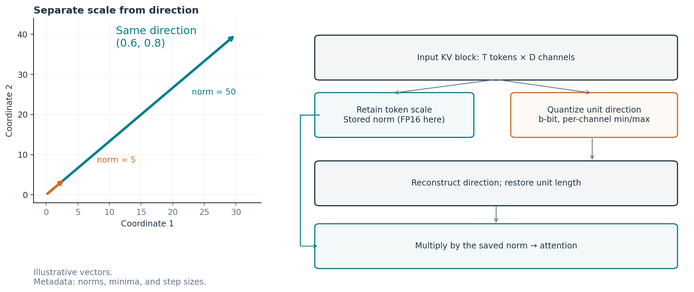

# NSN：ノルムと方向を分けるKV量子化

**LLMの予測品質を保ちながら、KVキャッシュをどこまで小さくできるか。そして、その容量削減を推論時の利益に変えるには何が必要か。**

LLMは、過去の情報を毎回計算し直さずに参照するため、キーと値を**KVキャッシュ**に保存します。このメモリは文脈が長くなるほど増えます。少ないビットで表す量子化は容量を減らせますが、attentionで使う値が変わり、その値を復元する処理も必要になります。

本研究で開発・評価する**非対称NSN**は、ベクトルの大きさを別に保存し、方向を少数の整数で表す方法です。統合研究では、その予測品質・実際の保存量・実行コストをつなげて調べました。モデルの構造をまたいで使える設定を探し、圧縮した表現を実際のattentionで使うところまで追っています。

[日本語の統合論文](papers/nsn-integrated/NSN-2026-10-29-JA-v2.0.md) · [English README](README.md) · [English paper](papers/nsn-integrated/NSN-2026-10-29-EN-v2.0.md) · [融合GPUカーネル](experiments/ac08/source/loop_kv_vf01_kernel.py) · [カーネルの読み方](#gpuカーネルを読む) · [実験一覧](experiments/README.md)

## この研究で分かったこと

**1．非対称NSNを選ぶ根拠と、精度を調整する方法を示した。** 四つの3bit構成を比べた主条件では、非対称NSNだけが**8モデルすべて**でPPL悪化5%未満に収まりました。ここでの利点は、一つの構成で広く条件を満たせたことです。個別のモデルでは、他の構成の方がPPLが低い場合もあります。同じ方法のビット数を増やすこともでき、**5bit設定**では、**SSM＋attentionやMoEを含む4モデル**で平均PPL変化が±0.5%以内でした。符号の大きさと精度を調整する選択肢が得られています。

**2．再帰型Transformerで、実際に圧縮したキャッシュを使って予測を続けられた。** **OuroとNanbeige**へ3bitの符号をビット単位で詰めた表現を接続し、キャッシュ更新と、周回・層・ヘッドの対応を扱いました。終端のKV保存量は、**Ouroで67.68%、Nanbeigeの継続評価で64.39%減少**しました。補助情報と未圧縮の末尾を含めた実測値で、その圧縮表現を後続の予測に使っています。

**3．復元した値をその場で使うと、読出し時間を短縮できた。** 二つの経路で、同じ圧縮済みV（attentionが重み付けして足し合わせる値）を、同じ算術で復元しました。比較用の経路（橋渡し対照）は、過去の全位置のVをいったん配列に書き出し、attentionがそれを読みます。融合カーネルはVを小さな区画ごとに復元し、その場で重み付き和に使うため、全長配列への書き出しと読み直しを省けます。この部品比較では、融合経路の処理時間が橋渡し対照より**28.28%短く**なりました。[橋渡し対照と融合経路のコード](experiments/ac08/source/loop_kv_vf01_kernel.py)を直接確認できます。[下の案内](#gpuカーネルを読む)に、読む関数をまとめています。

ここでいう品質は、与えた文章を予測する性能を測る**PPLの診断基準**で、悪化5%を目安にしています。四方式の比較単位は構成全体です。複合モデルの評価は、各評価窓全体から量子化範囲を求め、attentionのK/Vへ適用したものです。別に行った実packed評価は、正解の文章を入力し続けるteacher forcingで、**各モデル4文章、Ouroは各255予測、Nanbeigeの継続評価は各256予測**を対象としました。長い自由生成や外部の量子化手法との性能順位は、今後の評価対象です。

## なぜ「大きさ」と「方向」を分けるのか

`(3, 4)`と`(30, 40)`は同じ方向を向いていますが、長さは5と50です。元のKVをそのままチャネル別に量子化すると、大きなベクトルが範囲を広げ、小さなベクトルに使える目盛りが粗くなる場合があります。

非対称NSNは、この二つを分けて扱います。

1. **大きさを残す：** 各tokenのベクトルの長さ（ノルム）を別に保存します。
2. **方向を圧縮する：** ベクトルを正規化し、各チャネルで観測した最小値から最大値までに整数の目盛りを割り当てます。範囲をゼロの周りで対称にする必要はありません。
3. **attention用に復元する：** 方向を復元し、丸めで変わった長さを正規化してから、保存したノルムを掛けます。

量子化器は入力ブロックの統計だけを使い、追加の量子化器学習や別の校正コーパスを必要としません。ビット数は調整可能で、3bitなら8段階、5bitなら32段階の目盛りを使えます。



### 非対称NSNの計算の核を10行で

論文に掲載した、**3bit設定で量子化して復元する計算の核**です。入力`x`は検査済みの浮動小数点KVブロックで、形は`[..., 64, 128]`（64 token × ヘッド内128次元）。値が有限で、補助情報がFP16の保存範囲内にあることを前提とし、入力と同じ形・dtypeの復元値を返します。

```python
import torch

def nsn_int3_qdq(x):
    a = x.float()
    n = torch.linalg.vector_norm(a, dim=-1, keepdim=True)
    d = a / n.clamp_min(1e-12)
    m = d.amin(dim=-2, keepdim=True)
    s = (d.amax(dim=-2, keepdim=True) - m) / 7
    q = ((d - m) / torch.where(s == 0, torch.ones_like(s), s)).round().clamp(0, 7).to(torch.uint8)
    n, m, s = (t.half().float().contiguous() for t in (n, m, s))
    d = (m + s * q.float().contiguous()).contiguous()
    y = n * (d / torch.linalg.vector_norm(d, dim=-1, keepdim=True).clamp_min(1e-12))
    return torch.where(n == 0, torch.zeros_like(y), y).to(x.dtype)
```

この例は量子化して浮動小数点へ復元する計算を示します。ビット詰め・キャッシュ更新・attentionへの接続は、それぞれの実装を参照してください。[同じ参照関数](papers/nsn-integrated/code/nsn_int3_core.py)／[方式と算術の説明（§2.4）](papers/nsn-integrated/NSN-2026-10-29-JA-v2.0.md)／[カーネルとモデル接続の案内](#gpuカーネルを読む)。

## GPUカーネルを読む

**まずは、[Ouroで使用したpacked K/V融合attentionの本体](experiments/ac08/source/loop_kv_vf01_kernel.py)を開いてください。** 上の知見3に対応するV融合の比較は、`pipeline()`から読むと追いやすくなります。`TILE_MATERIALIZE`は`restore_v()`で全長V配列を書き出してからattentionを実行し、`V_FUSED`は`launch()`を通じてattention内部でVを復元して使います。Vの復元には、両方とも`read_v()`を使います。`initialize()`内の`partial()`が区画ごとのscore・softmax重み・重み付き和を計算し、[共通の`merge()`カーネル](experiments/ac08/source/loop_kv_af01_kernel.py)が区画の結果を結合します。

| 確認したい処理 | ソースへの直リンクと読む関数 |
| --- | --- |
| Ouroのpacked 3bit K/V復元＋attention融合 | [V融合カーネル](experiments/ac08/source/loop_kv_vf01_kernel.py)：`read_v()`、`partial()`、`restore_v()`、`launch()`、`pipeline()` |
| NanbeigeのGQA対応 | [GQAカーネル](experiments/nb06/source/loop_kv_nb06_kernel.py)：`partial()`の`kh = h // GROUP`で48 query headを8 KV headへ対応づけ、`merge()`で区画を結合。`pipeline()`が融合と全量復元＋SDPAの経路を選択 |
| モデルの逐次処理からカーネルを呼ぶ箇所 | [Ouro接続部](experiments/ac08/source/loop_kv_ac08_attention.py)／[Nanbeige接続部](experiments/nb06/source/loop_kv_nb06_attention.py)：`install()`と`make_cache()`でattentionを接続し、逐次処理時のKV全量復元を遅延 |
| 整数符号の保存とキャッシュ更新 | [Nanbeige codec](experiments/nb06/source/loop_kv_nb06_codec.py)：`pack3()`、`unpack3()`、`encode_group()`／[packedキャッシュ](experiments/nb06/source/loop_kv_nb06_packed.py)：`make_packed_cache()` |
| 入力検査と数値照合 | [Ouroの検査](experiments/ac08/source/loop_kv_vf01_checks.py)／[Nanbeigeの検査](experiments/nb06/source/loop_kv_nb06_checks.py)、保存出力の検証器：[Ouro](experiments/ac08/source/verify_loop_kv_ac08.py)／[Nanbeige](experiments/nb06/source/verify_loop_kv_nb06.py) |

小さな**K復元→QK scoreの部品実装**を読む場合は、[`_fused_score_kernel()`](experiments/kernels/phase_k1c_triton_fused_kernel.py)と[実験案内](experiments/kernels/README.md)を参照してください。この部品は1符号を1個の`uint8`に保存します。上のOuro／Nanbeigeのカーネルは、実際に3bitずつ詰めた符号を読み出します。

ソースは結果ZIPを取得せずGitHub上で読めます。GPUで実行する際の環境と起動手順は、[Ouro](experiments/ac08/README.md)／[Nanbeige](experiments/nb06/README.md)の案内にまとめています。

## 小さく保存できることは、いつ実行上の利益になるか

Nanbeigeの測定では、その違いが具体的に見えました。

| 評価 | 観測したこと |
| --- | --- |
| 初回の8 step継続 | 融合経路の逐次処理は検査付き非圧縮より**約3%短時間**でしたが、prefillと初期圧縮を含む合計は**約15%長時間**でした。 |
| 4回の圧縮更新を含む256 stepへの延長 | KV保存量は**64.39%減少**し、初期・更新費用を含む合計時間は検査付き非圧縮と**ほぼ同じ**になりました。 |

この処理条件では、圧縮による容量の利益が得られました。それを時間の利益へつなげるには、**復元・入力検査・初期圧縮・更新**まで含めた設計が必要でした。また、GPUにはモデルの重みや一時配列も残るため、論文ではKV保存量とGPU全体のピークメモリも別々に測っています。こうした内訳から、実装のどの部分を改善すればよいかを考えられます。

## 読みたいところから進む

| 知りたいこと | 入口 |
| --- | --- |
| 手法・発見・成立する範囲 | 図と付録を含む統合論文：[日本語](papers/nsn-integrated/NSN-2026-10-29-JA-v2.0.md)／[English](papers/nsn-integrated/NSN-2026-10-29-EN-v2.0.md)・[英語PDF](papers/nsn-integrated/NSN_Integrated_EN_v2.0.pdf) |
| GPUカーネルの関数とモデルへの接続 | [カーネルの読み方](#gpuカーネルを読む)・[Ouro本体](experiments/ac08/source/loop_kv_vf01_kernel.py)・[Nanbeige GQA本体](experiments/nb06/source/loop_kv_nb06_kernel.py) |
| 再帰型モデルのキャッシュとカーネルの実装 | [Loopedモデルの詳細稿](papers/loop-kv/README.md)・[英語PDF](papers/loop-kv/Loop-kv_NSN_EN_v1.0.pdf) · [DOI](https://doi.org/10.5281/zenodo.23970816) |
| 実験のコード | [可読Pythonと実験一覧](experiments/README.md) |
| 結果の根拠になった測定 | [データ一覧](data/README.md)と[証拠の収録範囲](DATA_COVERAGE.md) |
| 旧版や従来のライブラリAPI | [旧版とライブラリの案内](LEGACY.md) |

統合論文はNSNの説明から始めています。実験コードも展開済みのPythonなので、圧縮OneCellを解読する必要はありません。

## 検証・再計算する

このリポジトリに論文・図・コード・集計表・設計書・読めるログを収録しています。大きな保存配列は、[integrated-v1.0 Release](https://github.com/metaSATOKEN/nsn/releases/tag/integrated-v1.0)の**17 ZIP（計6.30 GB）とSHA256SUMS**に分けています。17本を改名せず同じディレクトリへ取得してください。GitHubが自動生成するソースアーカイブに入るのは、リポジトリ本体だけです。

単独で取得したコピーでは、[RUNNING.md](RUNNING.md)に従い、そのルートの`.venv`を使います。

```sh
.venv/bin/python -B tools/verify_package.py
```

これはモデルを実行せず、ファイルの同一性を確認するコマンドです。別配布ZIPの照合、新しい作業コピーへの復元、必要な依存環境での再計算は[再現手順](REPRODUCIBILITY.md)にまとめています。[release-assets.json](metadata/release-assets.json)には、ファイル名・容量・ハッシュ・取得URLを記載しています。

## 版・引用・ライセンス

Kentaro Sato · 独立研究者 · [info@metaclan.jp](mailto:info@metaclan.jp)

統合稿のMarkdown版は**2026年10月29日・v2.0**です。既報[*Norm Separation is Necessary*](https://doi.org/10.5281/zenodo.19724817)の再集計に、後続の実装評価と再帰型モデルでの評価を統合しています。統合稿v2.0の版別DOIは [10.5281/zenodo.23938878](https://doi.org/10.5281/zenodo.23938878) です。引用情報は[CITATION.cff](CITATION.cff)にあります。

コードは[Apache-2.0](LICENSE)、著者作成の論文・図・データは[CC BY 4.0](LICENSES/CC-BY-4.0.txt)。第三者資料の条件は[LICENSES.md](LICENSES.md)に保持しています。
