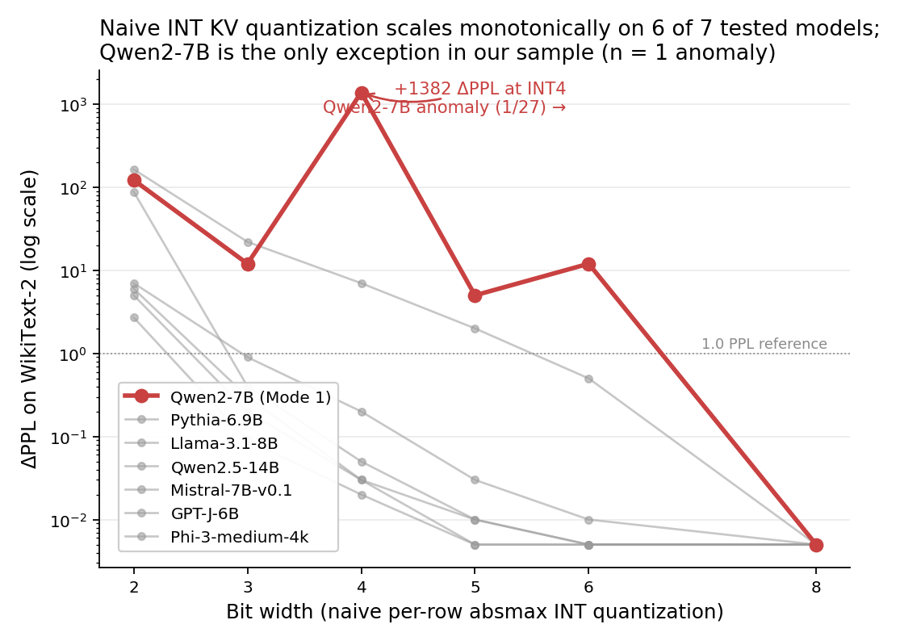
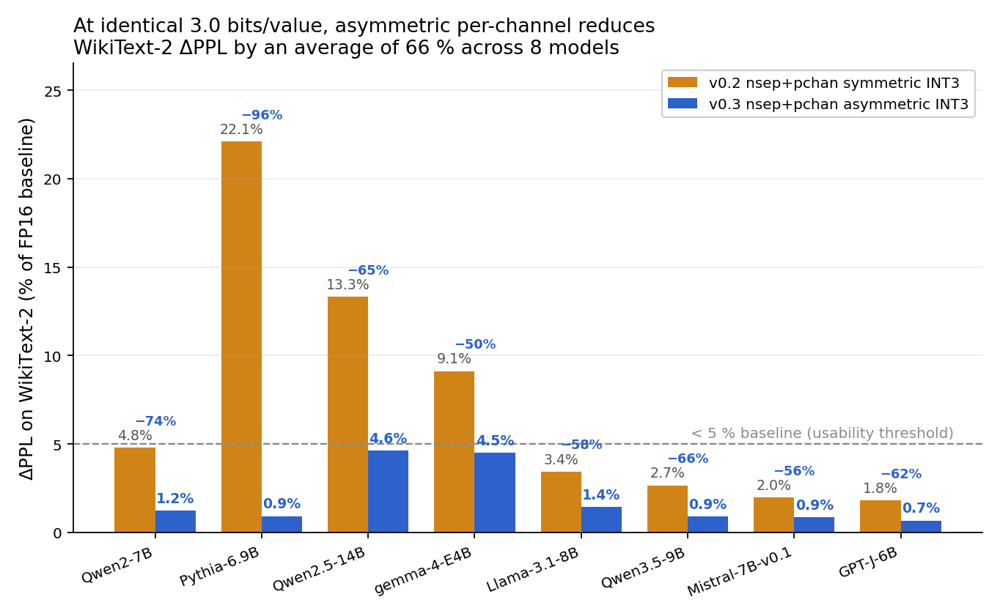
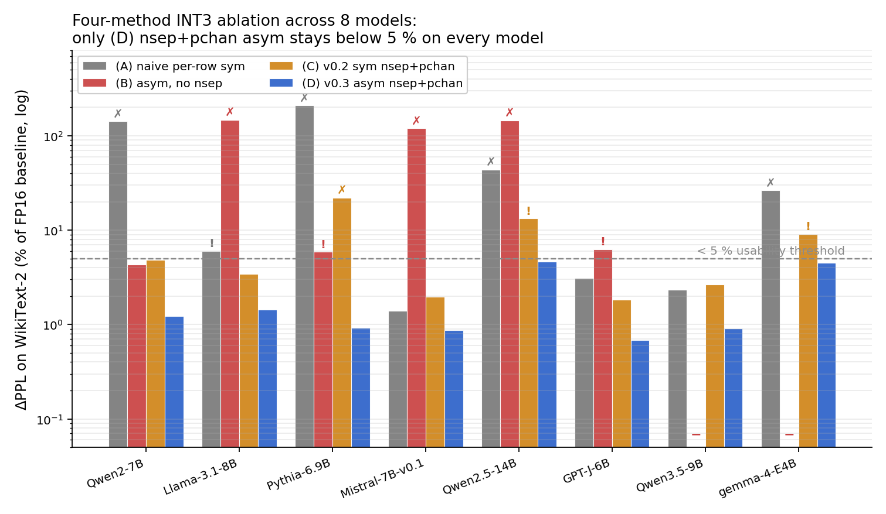
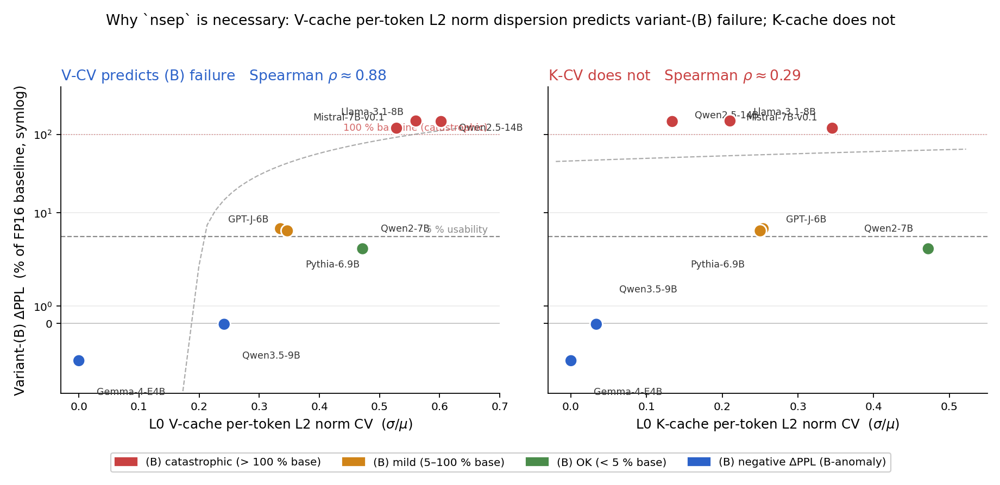
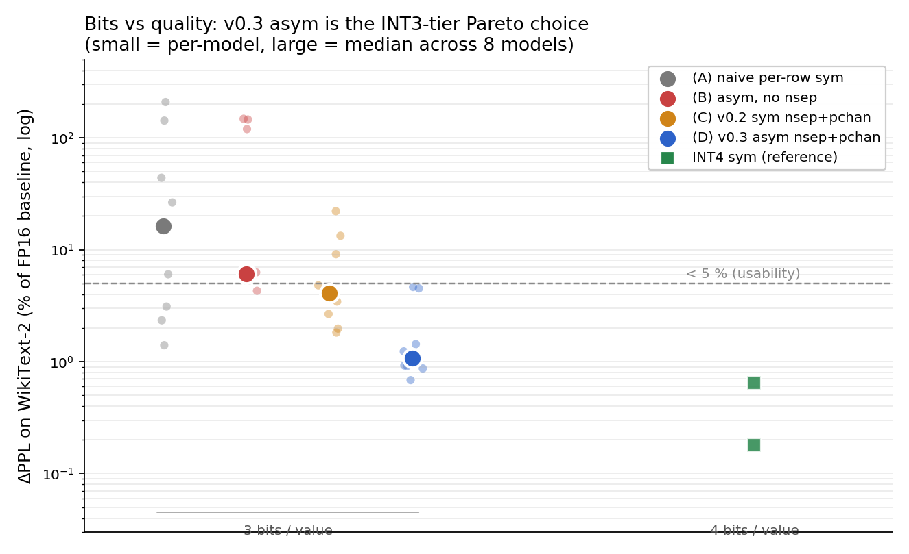

# modeq

**Mode-aware KV cache quantization for Transformers.**
Drop-in INT3, calibration-free, ~10 lines of Python, **5.09× memory reduction** at < 5 % ΔPPL on 8 of 8 open-weight models we tested (2021–2026).

[](LICENSE)
[](#install)
[](https://doi.org/10.5281/zenodo.19724817)

---

## Install

```bash
pip install git+https://github.com/metaSATOKEN/modeq.git
```

Requires Python 3.9+ and PyTorch 2.0+. *PyPI registration is pending — tracked for the v0.5 / Zenodo-paper release. See [EXPERIMENT_REPORT.md](EXPERIMENT_REPORT.md#installation) for the git-clone + editable-install path if you plan to run experiments locally.*

## The method, in one function

```python
def qa_nsep_pchan_asym(x, bits=3):
    """Norm-separated per-channel asymmetric INT quantization.

    x: shape [..., T, D], dtype fp16 or fp32.
    Returns a same-shape tensor reconstructed from the INT-quantized
    direction vector plus the exact per-token L2 norm.
    """
    dtype = x.dtype
    xf = x.float()
    n = xf.norm(dim=-1, keepdim=True).clamp(min=1e-12)  # per-token
    d = xf / n                                          # unit direction
    m = d.amin(dim=-2, keepdim=True)                    # per-channel min
    M = d.amax(dim=-2, keepdim=True)
    step = ((M - m) / (2**bits - 1)).clamp(min=1e-12)
    q = ((d - m) / step).round().clamp(0, 2**bits - 1)  # integer index
    d_q = m + q * step                                  # dequantize
    d_q = d_q / d_q.norm(dim=-1, keepdim=True).clamp(min=1e-8)
    return (n * d_q).to(dtype)
```

Closed-form arithmetic on the input's own statistics. No training, no calibration, no rotation, no codebook.

## Use the real bit-packed cache

```python
from modeq import Int3AsymNsepPchanCache

cached = Int3AsymNsepPchanCache.from_fp16(k)  # pack to 3-bit storage
k_recon = cached.to_fp16()                    # reconstruct for attention
cached.size_bytes()                           # 5.09× smaller than FP16
```

## Production decode: torch.compile in one line

```python
# +2.4 % (Qwen2-7B) / +4.2 % (Llama-3.1-8B) decode-step overhead vs FP16 baseline,
# measured on A100 Colab (1024-token prefill, 50 decode steps, 3 repeats).
# First call triggers a few-second JIT compile; subsequent calls are effectively
# free. Numerically matches to_fp16() within FP16 rounding.

k_recon = cached.to_fp16_compiled()   # drop-in replacement, torch.compile'd
```

Added in **v0.3.12**. See [Phase 27](experiments/phase27_decode_latency.py) for the five-regime benchmark (naive per-head loop = +146–354 %; per-layer batched = +33–37 %; torch.compile-fused = +2–4 %). No hand-written CUDA or Triton kernel required.

---

## The problem this solves

Low-bit KV cache quantization *usually* scales smoothly with bit width — except when it doesn't. Naive INT4 produces **+1382 ΔPPL on Qwen2-7B**, while INT3 on the same model gives just +12 and INT5 gives +5. This is the **INT4 valley of death** — and a follow-up sweep (`results/phase28*.json`) finds three further non-monotone cases in the Qwen family (Qwen2.5-1.5B / 3B / 7B):



modeq's v0.3 recipe handles the valley and the common case under the same bit budget at **3 bits/value with no calibration data** and no model-specific configuration.

---

## Headline: 8 models, 5.09× compression, no breakage

At **3.0 bits/value**, the v0.3 recipe reduces WikiText-2 ΔPPL by an average of **66 %** vs a symmetric INT3 baseline, and stays below a conservative 5 %-of-baseline threshold on **all 8 runnable models**:

| Model | Year | Baseline PPL | asym INT3 ΔPPL | % of baseline |
|:------|:-:|:-:|:-:|:-:|
| GPT-J-6B        | 2021    | 10.29 | +0.0703 | 0.68 % |
| Pythia-6.9B     | 2023    | 10.76 | +0.0994 | 0.92 % |
| Mistral-7B-v0.1 | 2023    |  6.30 | +0.0547 | 0.87 % |
| Qwen2-7B        | 2024    |  8.37 | +0.1034 | 1.24 % |
| Qwen2.5-14B     | 2024    |  1.96 | +0.0909 | 4.64 % |
| Llama-3.1-8B    | 2024    |  7.38 | +0.1059 | 1.43 % |
| Qwen3.5-9B      | 2026-02 | 10.32 | +0.0942 | 0.91 % |
| Gemma-4-E4B     | 2026-04 | 20.60 | +0.9302 | 4.51 % |



---

## Why each piece matters (four-method ablation)

Every ingredient of the recipe — **norm separation**, **per-channel scaling**, and **asymmetric window** — is empirically necessary. The naive transplant of "asymmetric per-channel" from weight quantization (GPTQ / AWQ) to KV cache **fails on 5 of 8 models, catastrophically (> 100 % of baseline PPL) on 3 of them**:



Only the full combination (`nsep + pchan + asym`) succeeds across all 8.

---

## Mechanism: V-cache dispersion drives the failure, not K-cache

A direct per-token L2 norm measurement on all 8 models localizes the catastrophic-(B) failure to **V-cache** per-token norm dispersion — the Layer-0 V-CV correlates with failure magnitude at **Spearman ρ ≈ 0.88**, while the analogous K-cache statistic does not (ρ ≈ 0.29):



Intuition: V-cache error propagates *linearly* into the attention-weighted output, while K-cache error is partly absorbed by softmax normalization. Norm separation removes the V-cache dispersion. *(See [EXPERIMENT_REPORT.md](EXPERIMENT_REPORT.md) or [paper/nsn.pdf](paper/nsn.pdf) §5.3 for the first-order math and the confounder caveat.)*

---

## Long-context: 32K retrieval matches FP16

A 3-model distractor-hardened Needle-in-a-Haystack probe at 8 K and 32 K context (Llama-3.1-8B, Qwen2-7B, Qwen2.5-14B; pooled n = 30 per cell) shows no significant difference between v0.3 asym and FP16 on lead-key retrieval, while v0.2 sym drops to 50 %:

| Context | FP16 | sym INT3 | **asym INT3** | asym vs FP16 (Fisher exact) |
|:---:|:---:|:---:|:---:|:---:|
|  8 K | 30 / 30 | 22 / 30 | **23 / 30** | p = 1.00 (saturated) |
| 32 K | 29 / 30 | 15 / 30 | **25 / 30** | **p = 0.194 (n.s.)** |


Under v0.2 symmetric INT3 at 32 K, all three models produce **bit-mixing hallucinations** (cross-needle character fusion); v0.3 asym produces zero such hallucinations across 30 trials.

---

## Pareto summary

At 3 bits/value, only v0.3 (D) has its cross-model median clearly below 5 % baseline:



Going to 4 bits costs 33 % more memory for a further quality gain; v0.3 at 3 bits is the practical choice when memory is the dominant constraint.

---

## Want the full story?

- **[EXPERIMENT_REPORT.md](EXPERIMENT_REPORT.md)** — casual long-form writeup (~540 lines): full protocols, dead-ends (Walsh–Hadamard rotation, top-K mixed precision), MMLU downstream probe, Phase 23 mechanism math, all the gory details
- **[paper/nsn.pdf](paper/nsn.pdf)** — formal paper (27 pages, Zenodo-ready): academic writeup with full citations, Fisher-exact analyses, confounder caveats, 6 appendices
- **[docs/THEORY.md](docs/THEORY.md)** — two-failure-modes background and the v0.2 → v0.3 update
- **[paper_c/](paper_c/)** — Paper C (LAB): a Lyapunov-aware bit allocator for state-space model state quantisation. Closed-form per-state-group bit allocation driven by spectral radius and output coupling; 2.6× state-cache compression at +2.5–5.2% PPL on the state-spaces Mamba-1 family. See [paper_c/README.md](paper_c/README.md) for the summary, [paper_c/paper_c.pdf](paper_c/paper_c.pdf) for the preprint, and [paper_c/EXPERIMENT_REPORT.md](paper_c/EXPERIMENT_REPORT.md) for the full 16-phase research log

## Scope and honesty notes (quick)

- Primary quality metric is **WikiText-2 sliding-window perplexity**. Two bounded downstream probes (MMLU 5-shot on 2 models, NIH on 3 models at 8K/32K) show no degradation; reasoning / code / instruction-following / LongBench are *not* yet measured.
- **Throughput**: measured. `Int3AsymNsepPchanCache.to_fp16_compiled()` (v0.3.12) adds **+2.4 % (Qwen2-7B) / +4.2 % (Llama-3.1-8B)** per-token decode overhead vs FP16 baseline on A100 Colab (Phase 27). A naive per-head Python loop is much slower (+146 / +354 %); the `torch.compile` inside `.to_fp16_compiled()` fuses the small kernels into 1-2 compiled kernels and removes essentially all overhead. No hand-written CUDA kernel required.
- **Non-monotone naive-quantization failures**: characterized in detail on four Qwen checkpoints (Qwen2-7B INT4 valley, Qwen2.5-1.5B INT3 spike, Qwen2.5-3B INT3 valley, Qwen2.5-7B three-peak INT2 / INT4 / INT6). All rescued by the v0.3 recipe. Non-Qwen families have not been probed at the same bit-width granularity; we don't claim the pattern generalizes beyond Qwen.
- **`usable` label**: a modeq-internal threshold (< 5 % of baseline WikiText-2 ΔPPL), **not** a deployment certification.

## Citation

```bibtex
@misc{sato2026nsn,
  author       = {Sato, Kentaro},
  title        = {Norm Separation is Necessary: A Minimalist Calibration-Free
                  INT3 Recipe for KV Cache Quantization},
  year         = {2026},
  howpublished = {Zenodo preprint},
  doi          = {10.5281/zenodo.19724817},
  url          = {https://doi.org/10.5281/zenodo.19724817},
}
```

## Contact & Collaboration

Feedback, bug reports, and collaboration proposals welcome.

- Issues / Discussions on this repository
- Email: info@metaclan.jp
- X: [@RecyncAI](https://x.com/RecyncAI)

## Acknowledgments

This work was conducted with substantial assistance from large language models (Claude, Anthropic) for experiment design, code generation, debugging, data analysis, and manuscript drafting. All experimental results were produced by executing code on real hardware (NVIDIA A100 via Google Colab) and verified by the author. The author takes full responsibility for the scientific claims and any errors in this work.

## License

Apache 2.0. See [LICENSE](LICENSE).
