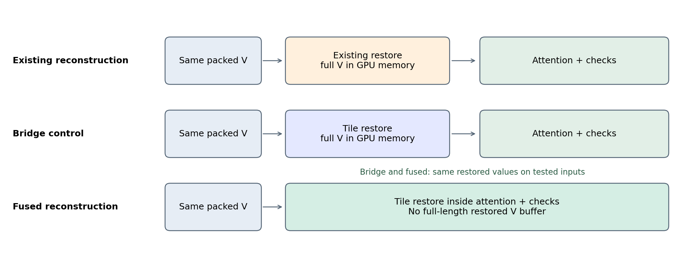
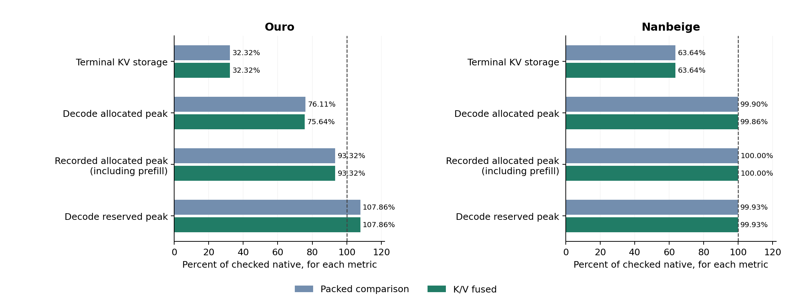
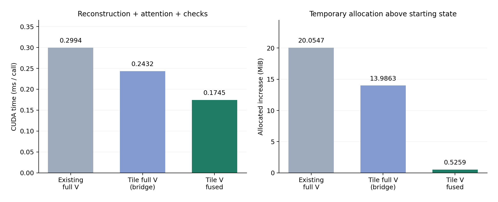
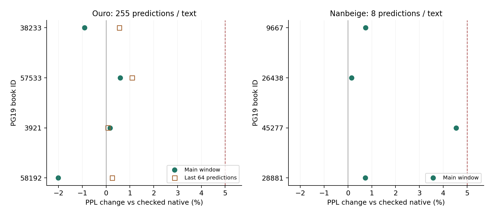
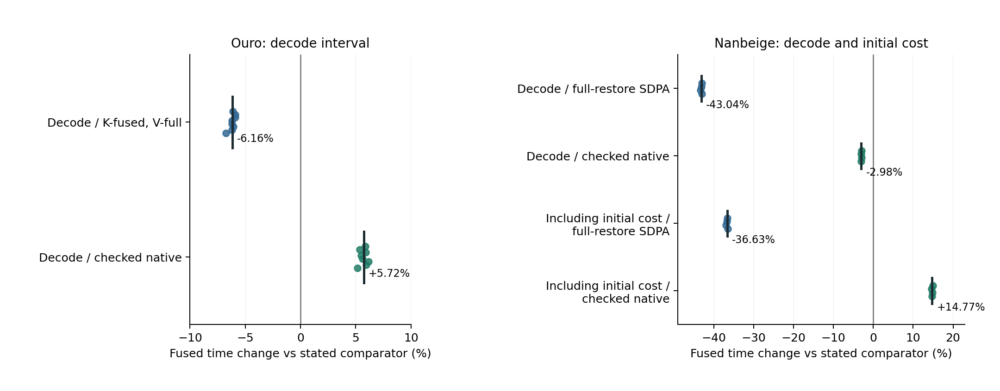
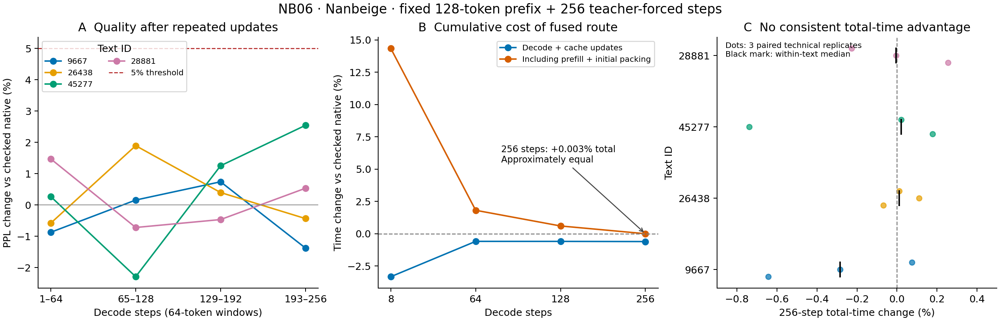

# Applying NSN-Based 3-Bit KV Compression to Looped Transformers

## Evaluating Actual Storage, Prediction Quality, and Fused Readout Costs

**Kentaro Sato**  
Independent Researcher  
Contact: info@metaclan.jp  
October 8, 2026 · English manuscript v0.3

Publication metadata updated October 29, 2026: licenses, author declarations and navigation are synchronized with the current package. Measured values and scientific conclusions are unchanged from the original edition.

## Abstract

**We applied NSN, an existing norm-separation-based KV compression method, to two recurrent Transformers: Ouro-1.4B and Nanbeige4.2-3B-Base.** Without changing model weights, we implemented and verified a path from actual packed 3-bit storage of K/V for each recurrence and layer through reconstruction, attention, and subsequent prediction. We then compared reconstruction inside attention with full-array reconstruction to relate storage savings to the cost of using the compressed cache.

With implementations and sequence lengths fixed, teacher-forcing evaluations covered four texts per model: 255 predictions per text for Ouro, and an initial 8-prediction evaluation plus an extension to 256 predictions on the same four Nanbeige texts. The fused path remained within the prespecified 5% diagnostic threshold for relative PPL degradation in every designated window. Terminal KV storage decreased by 67.68% for Ouro and 64.39% in the extended Nanbeige evaluation. In a component comparison using identical reconstructed values, moving V reconstruction inside attention reduced time and temporary allocation. Decoding in the integrated models was also shorter than in their respective compressed comparators that materialized the full V array. The Nanbeige extension met the quality criterion with four additional compression updates, but total time for 256 steps including initialization was approximately equal to checked uncompressed execution.

These results demonstrate that NSN-based compression can be connected to two recurrent Transformers with different attention-head configurations, reducing KV storage while keeping PPL changes within the prespecified diagnostic threshold over the short intervals measured. Evaluating the practical benefit requires separate measurements of compressed storage, fused readout time, initialization and update costs, and model-wide memory use.

**Keywords:** KV cache quantization; looped Transformers; NSN; fused attention; numerical verification; inference cost

## 1. Problem: What Does It Cost to Use a Smaller Cache?

Transformers retain keys and values for previously processed tokens in a KV cache and use them in attention for subsequent tokens. Recurrent Transformers can deepen computation by repeatedly applying the same layer weights. Implementations that retain distinct K/V for each recurrence also require storage for those states. Ouro and Nanbeige are publicly available models that reuse layers in this way [1, 2].

Low-bit quantization reduces KV storage. Yet reconstructing the entire compressed cache as floating-point arrays before each attention call adds computation and intermediate storage. Fusing reconstruction into attention may avoid some of these costs. Even when readout becomes faster, the initial compression cost and the memory used during uncompressed prefill remain.

Our first contribution is **applying existing NSN-based compression to the recurrence- and layer-specific KV caches of two recurrent Transformers and verifying that prediction can continue from an actual packed 3-bit representation**. We connected it to conventional multi-head attention in Ouro and grouped-query attention in Nanbeige. We then compared implementations that fuse reconstruction into attention and measured prediction quality, storage, and execution cost.

We examine **the correspondence between retaining the compressed representation, reconstructing values, and using them in the model**, rather than collapsing these properties into a single compression success rate. Table 1 summarizes the questions that distinguish the demonstrated scope, benefits, and costs.

**Table 1. Questions and comparisons in this study**

|Question|Unit of comparison|Main observation|
|---|---|---|
|Can NSN-based compression be applied to recurrent-model KV caches?|Recurrence- and layer-specific integration in two models; four texts per model not previously used in this study|Prediction continued from actual 3-bit storage, with PPL degradation within the 5% diagnostic threshold in each evaluation window|
|How do NSN storage savings appear in model memory use across execution phases?|Actual KV storage and phase-specific allocated/reserved memory in the same trajectories|KV storage decreased, but its reduction did not match the reduction in model-wide peaks|
|Can moving reconstruction into attention be distinguished from changing its arithmetic?|Three component paths given identical packed inputs|Fusion reduced time and temporary allocation even relative to a bridge control using identical reconstructed values|
|Do local time savings persist in another model and in texts not previously used in this study?|Fixed paths, texts, and prediction intervals for each model|Readout savings persisted, but the comparison with the uncompressed path depended on the measurement interval|

These four questions organize the findings of an adaptive exploratory series. Materials, decision rules, and stopping conditions were fixed before each individual comparison, but the entire series was not planned from the outset as a confirmatory study of these four questions. The main text organizes evidence by question; the appendices and [Supplement S1](evidence-index-en-v0.3-2026-10-08.md) map it to experiment identifiers and development history.

## 2. Related Work and Scope

Quantization studies of recurrent Transformers can be usefully divided into work on **low-bit representations of reused weights and activations** and work on **reducing storage for the KV states produced by each recurrence**. For general KV quantization, KIVI combines different quantization axes for K and V, a high-precision tail, and fusion of reconstruction with matrix multiplication [3]. KVQuant connects quantization placement, nonuniform codes, and outlier handling to dedicated kernels [4]. FlashAttention addresses attention computation with explicit consideration of memory traffic [5].

On the weight and activation side, Hyperloop Transformers evaluates GPTQ quantization using activation statistics collected across recurrences [9]. LoopQ combines recurrence-specific activation scales, transformations, adapters, and trajectory-based calibration [10]. Li separates recurrent exposure to quantization error from limitations of calibration coverage in recurrent-model weight quantization, and also evaluates execution with an actual INT4 kernel on Huginn [11]. Our study retains BF16 weights and targets KV states generated during execution.

Closely related KV work includes **low-dimensional representations across recurrences** and **quantization of cross-recurrence residuals**. Looped Latent Attention maps K/V from multiple recurrences into a shared low-dimensional representation and reconstructs the K/V needed for a particular recurrence [12]. FlashLoop represents K/V with a base and cross-recurrence residuals, using packed values within the QK product and weighted sum of V [6]. The former includes low-bit KV methods in its comparisons; the latter also compares against KIVI applied directly to each recurrence's KV states. Thus, prior work on recurrent-model KV quantization provides direct comparison targets for this application.

**Table 2. Compression targets and relevant comparison axes**

|Study|Main compression or computation target|Comparison axis for this study|
|---|---|---|
|Hyperloop / LoopQ / Li [9–11]|Quantization of reused weights, or of weights and activations|We leave weights unchanged and measure KV storage and reconstruction|
|Looped Latent Attention [12]|Low-dimensional representation and reconstruction across recurrences|Cross-recurrence representation sharing versus NSN storage applied separately to each recurrence and layer|
|FlashLoop [6]|Cross-recurrence residual quantization and fused readout, with sparse updates and attention|Changing the stored representation and computation target versus changing the readout path for a fixed representation|
|KIVI / KVQuant [3, 4]|Low-bit KV representations and execution kernels|Candidates for matched comparisons of quantization methods|
|FlashAttention [5]|Reducing attention intermediates and memory traffic|Execution cost after adding reconstruction and its validation|
|The author's prior NSN [7]|Norm separation, directional quantization, and renormalization|Connecting actual 3-bit storage and fused readout to two recurrent models|

We apply the same NSN rule to K/V in each recurrence and layer without calibration data or codec training. The focus is on **holding the stored representation fixed while distinguishing reconstruction arithmetic, placement, and validation, and relating them to quality, actual storage, and model-wide cost**. Performance ranking against other methods requires matched comparisons. Existing NSN and the author's unpublished SADP implementation served as starting points; measurements from those earlier experiments are not pooled with the measurements reported here.

## 3. Methods

### 3.1 Separating Norm and Direction for Storage

Our NSN implementation decomposes each 128-dimensional K or V vector into magnitude and direction. A block contains 64 tokens. For token position \(t\) and channel \(j\), we compute

\[
 n_t=\lVert x_t\rVert_2,\qquad d_{tj}=x_{tj}/\max(n_t,\epsilon)
\]

and retain the within-block minimum \(m_j\) for each channel and a step size \(s_j\) equal to one seventh of its range. Directional components are rounded to integers from 0 to 7:

\[
 q_{tj}=\operatorname{clip}_{[0,7]}\!\left(\operatorname{round}\frac{d_{tj}-m_j}{s_j}\right).
\]

Integer codes are formed using \(m,s\) computed in FP32. Metadata are stored in FP16 and read back into FP32 for reconstruction. Define these values as

\[
 \bar n_t=\operatorname{FP32}(\operatorname{FP16}(n_t)),\qquad
 \bar m_j=\operatorname{FP32}(\operatorname{FP16}(m_j)),\qquad
 \bar s_j=\operatorname{FP32}(\operatorname{FP16}(s_j)).
\]

Reconstruction then uses

\[
 \widetilde d_{tj}=\bar m_j+\bar s_jq_{tj},\qquad
 \widehat x_t=\operatorname{BF16}\!\left(
 \bar n_t\frac{\widetilde d_t}{\max(\lVert\widetilde d_t\rVert_2,\epsilon)}\right).
\]

Because the stored norm is also rounded, this implementation restores magnitude using the stored norm; it does not exactly preserve the original real-valued norm.

Channels with \(s_j=0\) receive code 0, and vectors with zero norm are reconstructed as zero. We use \(\epsilon=10^{-12}\). Quantization and intermediate reconstruction operations use FP32; norms, minima, and step sizes are stored in FP16; reconstructed values passed to attention use BF16. Checks detect nonfinite values and nonzero norms or step sizes that round to zero during storage. K is quantized after the positional transformation used by the model for attention. The same basic recipe is applied separately to K and V.

**Listing 1. The NSN quantization–reconstruction core used here (10-line function body)**

The last two axes of input `x` are 64 tokens × 128 dimensions. The code extracts norms, quantizes directions, renormalizes the reconstructed directions, and reapplies the norms. On the seventh line of the function body, `half().float()` reproduces the rounding incurred when FP16 metadata are read back into FP32.

```python
import torch


def nsn_int3_qdq(x):
    a = x.float()
    n = torch.linalg.vector_norm(a, dim=-1, keepdim=True)
    d = a / n.clamp_min(1e-12)
    m = d.amin(dim=-2, keepdim=True)
    s = (d.amax(dim=-2, keepdim=True) - m) / 7
    q = ((d - m) / torch.where(s == 0, torch.ones_like(s), s)).round().clamp(0, 7).to(torch.uint8)
    n, m, s = (t.half().float().contiguous() for t in (n, m, s))
    d = (m + s * q.float().contiguous()).contiguous()
    y = n * (d / torch.linalg.vector_norm(d, dim=-1, keepdim=True).clamp_min(1e-12))
    return torch.where(n == 0, torch.zeros_like(y), y).to(x.dtype)
```

This quantize–dequantize (QDQ) excerpt is intended for blocks that pass the experiment's checks for finiteness, shape, and metadata representability. The array `q` uses uint8; the excerpt does not include the 3-bit packing described below, tail management, input validation, or fused kernels. The [short executable implementation](code/nsn_int3_core.py) matched the frozen reference arithmetic bit for bit in 24 synthetic CPU conditions. [Supplement S1](evidence-index-en-v0.3-2026-10-08.md) describes the scope of that check and links to the experimental code. Listing 1 shows the frozen reference QDQ arithmetic. The fused candidate uses tile-based reconstruction arithmetic and is evaluated through agreement with a bridge control using the same arithmetic and through the stage-specific error budgets in Appendix B, rather than through a blanket requirement for bitwise agreement with the reference reconstruction.

Eight integer codes are packed into 3 bytes, without retaining a hidden copy of the original floating-point K/V. One block of 1 head × 64 tokens × 128 dimensions contains 3,072 bytes of codes, 640 bytes of FP16 metadata, and a 12-byte header for positions and related information: **3,724 bytes** in total. The corresponding BF16 block occupies 16,384 bytes. “3-bit” refers to the codes; including metadata, the effective size is approximately 3.64 bits per element. Recent tokens remain in a BF16 tail, so the reduction for the entire cache also depends on the fraction represented by compressed blocks.

### 3.2 Changing Readout While Retaining the Storage Format

The fused path reads packed K while computing its product with the query, then computes softmax and the weighted sum of V. Required V tiles are also reconstructed internally, avoiding a write of the full reconstructed V array to GPU memory. Storage slots retain their recurrence and layer assignments; no cross-recurrence residual representation or token subsampling is introduced.

Changing the reconstruction implementation can change rounding through operation order, even when the formulas are the same. We therefore used three paths in the V-fusion component comparison:

1. Materialize the full V array with the existing reconstruction routine, then pass it to attention.
2. Materialize the full V array using the same tile-based reconstruction arithmetic as the fused candidate, then pass it to attention. This is **a bridge control using the same reconstruction arithmetic**, abbreviated below as the *bridge control*.
3. Perform the same tile-based reconstruction inside attention.



**Figure 1.** All paths receive identical packed inputs. The bridge-versus-fused comparison concerns the complete readout paths, including validation and call structure. Direct checks of reconstructed values and outputs distinguish numerical changes introduced by the reconstruction implementation from those introduced by moving it inside attention.

### 3.3 Integration Conditions for the Two Models

**Table 3. Conditions for the initial model comparisons on new study materials (continuation evaluation in §3.6)**

|Item|Ouro-1.4B|Nanbeige4.2-3B-Base|
|---|---|---|
|Layers × fixed recurrences|24 × 8|22 × 2|
|KV storage slots|192|44|
|Q heads / KV heads / head dimension|16 / 16 / 128|48 / 8 / 128|
|Initial input|768 tokens|128 tokens|
|Subsequent teacher-forced steps|255|8|
|Main quality predictions per text|255|8|
|Initial and subsequent compression|704 tokens initially, then 3 additions of 64 tokens|First 64 tokens compressed once|
|Terminal compressed prefix + BF16 tail|896 + 127 tokens|64 + 72 tokens|
|Texts × technical replicates|4 × 2|4 × 3|
|Main comparator for the fused path|K reconstructed internally; V fully materialized|K/V fully materialized and passed to official SDPA|

All conditions used batch 1, BF16 weights, and no training. SDPA denotes the scaled dot-product attention implementation interface. Each model also had a checked uncompressed path that matched its official incremental path when processing the same tokens in the same order. This is distinct from the BF16 full-input versus incremental-input check in the initial exploration (Appendix B). For Nanbeige, we implemented the GQA mapping in which 6 query heads share 1 KV head.

The two columns in Table 3 cover different integration conditions. Context length, recurrence count, comparator, and compressed fraction differ, so PPL and speed reductions are not directly ranked across models. The short Nanbeige trajectory was chosen as a small integration check for a different cache and GQA configuration.

### 3.4 Fixing Materials Before Comparing Identical Inputs

Materials were the beginnings of English books selected from a fixed list of books in the PG19 training split [8]. Selection used a fixed seed and a hash-based ordering of book identifiers, excluding 24 books already used in this study for Ouro and 28 for Nanbeige. Only duplication and insufficient token count were exclusion criteria; the first four candidates in each comparison were all accepted. Token sequences and planned execution orders for all texts were fixed before loading model weights, without substitutions based on results. “New texts” means texts not previously used in this study.

Each method started with a fresh cache. We used teacher forcing throughout so that free generation would not cause inputs to diverge. Method order was fixed before measurement and rotated or reversed across replicates. Technical replicates check computation and timing for identical inputs; they are not independent texts. PG19 files were read as UTF-8 without removing or reformatting their beginnings after download. Prefixes were tokenized with a fixed tokenizer revision and `add_special_tokens=False`. S1 provides source URLs, token sequences, evaluated positions, and pinned revisions.

### 3.5 Evaluating Quality, Time, and Memory Separately

**Quality.** In the initial two-model comparisons, token negative log-likelihood (NLL) was recomputed on the CPU from saved logits, and PPL was obtained by exponentiating mean NLL over the evaluation window. Relative change was \(100\{\exp(\overline{\ell}_{q}-\overline{\ell}_{0})-1\}\). This is window-specific PPL for each model's subword tokens, not an official benchmark score for the full PG19 test set or for word-level tokenization. Ouro was evaluated over all 255 predictions and over the last 64. Nanbeige's main window comprised 8 predictions after compression; the 9 predictions including the pre-compression prediction were aggregated separately. Descriptive cross-text aggregates average each text's mean NLL once before exponentiation.

Each main comparison prespecified a diagnostic threshold of at most 5% PPL degradation relative to the uncompressed path. Improvement was not required. This was neither a non-inferiority test nor a guarantee of quality across applications. We report individual texts and windows rather than relying only on an average to judge threshold compliance.

**Time.** All shapes were exercised before measurement. We recorded CUDA Event time and synchronized wall time, and checked that the Triton compilation cache did not grow during the main measurements. Ouro's main interval contained 240 token positions, including incremental forward passes and subsequent compression. The first 8 positions and 8 input-capture positions were excluded across methods. Their first position overlaps, giving 255−8−8+1=240 positions; S1 lists the exact sets. Prefill and initial compression are excluded from this main interval. For Nanbeige, we measured both the 8 incremental forward passes and the sum of prefill, initial compression, and those forward passes. Measurements include all model layers, MLPs, logits, and checks on the execution path. Evidence transfer to the CPU, saving, verification, and loading are outside the timing intervals.

Time ratios were computed within the same text and replicate. Ouro reports the median of 8 paired ratios. Nanbeige first takes the median of 3 paired ratios within each text, then the median across 4 texts. Ratios of separately reported median times need not equal the reported paired ratios.

**Memory.** Actual GPU storage bytes holding the KV cache were checked against codes, metadata, headers, and the BF16 tail. We also recorded phase-specific memory allocated by PyTorch for tensors and related objects, and memory reserved by its allocator. Component measurements use the increase in allocated memory relative to immediately before the call. These are different quantities and are not replaced by a single measure of total GPU utilization.

**Numerical checks.** Reconstruction, QK-product, and context checks measure implementation consistency against references constructed from the same compressed input. Quality changes relative to the uncompressed path are measured separately through PPL. Tables B1 and B2 specify the references, prespecified error measures and thresholds, observed maxima, and numbers of checked points.

### 3.6 Evaluating Continuation and Compression Updates on the Same Texts

We retained the four texts and 128-token prefix from the initial Nanbeige comparison and extended teacher-forced continuation to 256 steps. Reconstruction arithmetic, the fused kernel, 64-token blocks, numerical budgets, and pinned model/tokenizer versions were inherited unchanged. The first 385 tokens supply 256 prediction targets at zero-based indices 129–384. Retrieved-text hashes and agreement with the previous 137-token inputs were checked before loading model weights. This comparison examines continuation and updates on the same materials, rather than adding four new texts.

Initially, the first 64 tokens are compressed. Each forward pass appends new KV to the BF16 tail and performs attention and prediction; afterward, another 64 old tokens are compressed at steps 64, 128, 192, and 256. Existing packed blocks are unchanged. Terminal storage contains 320 compressed tokens and a 64-token BF16 tail. All four updates count toward time and storage; the first three are also consumed by subsequent attention.

Checked uncompressed execution, full reconstruction plus SDPA, and GQA fusion were measured with three technical replicates per text. Quality over all 256 predictions, the first 8, and four nonoverlapping 64-prediction blocks, together with cumulative time at steps 8, 64, 128, and 256, was fixed before measurement. All routes time forward and post-forward processing with the same boundaries; the uncompressed post-processing call is a no-op control. Decoding including updates sums these two components; time including initialization additionally sums prefill and initial compression. Diagnostic capture and evidence saving are outside timing. Aggregation takes the median of three paired ratios within each text, then the median across four texts. The initial 8-prediction comparison and the extension are reported as separate measurements.

## 4. Results: Actual KV Storage and Model Memory Peaks Differ

For both models, actual GPU storage matched the specified packed representation. Terminal KV storage decreased by 67.68% for Ouro and 36.36% for Nanbeige. The code format for compressed blocks was shared; the different reductions reflect the compressed fractions in Table 3.

**Table 4. Memory in the main comparisons, in MiB (1 MiB = 2²⁰ bytes)**

|Model and measurement scope|Uncompressed|Compressed comparator|K/V fused|
|---|---:|---:|---:|
|Ouro: terminal KV storage|1,534.500|495.984|495.984|
|Ouro: main decoding allocated peak|4,314.771|3,283.872|3,263.589|
|Ouro: main decoding reserved peak|4,404.000|4,750.000|4,750.000|
|Ouro: maximum allocated memory over recorded phases, including prefill|4,314.771|4,026.656|4,026.656|
|Nanbeige: terminal KV storage|23.375|14.875|14.875|
|Nanbeige: decoding allocated peak|8,079.747|8,071.813|8,068.144|
|Nanbeige: decoding reserved peak|8,246.000|8,240.000|8,240.000|
|Nanbeige: maximum allocated memory over recorded phases, including prefill and compression|8,197.590|8,197.590|8,197.590|

The compressed comparator is K fusion plus full V reconstruction for Ouro, and full K/V reconstruction plus SDPA for Nanbeige. Within each comparison, the listed values were identical across texts and replicates. The maximum over recorded phases is not a whole-process peak that includes model loading or other processes on the GPU.



**Figure 2.** Each quantity is expressed relative to its own checked uncompressed baseline, set to 100% and labeled “checked native” in the figure. Large savings in KV storage do not imply proportional reductions in the allocated maximum including prefill or in reserved memory. Rows have different denominators; bars cannot be added as components of a memory total. Blue denotes the compressed comparator in Table 4, and green denotes K/V fusion. Context length and compressed fraction differ between the models.

For Ouro, fusion reduced the decoding allocated peak by 20.28 MiB relative to the full-V reconstruction path, but the maximum including prefill was identical for the two compressed paths. Both compressed paths reserved more memory than the uncompressed path. For Nanbeige, KV storage decreased by 8.50 MiB, while the change in the allocated peak including weights and other allocations was small. The maximum including prefill was identical across all methods.

**Actual storage savings were verified. Their effect on model-wide GPU memory depends on other resident allocations and on the phase that determines the peak.**

## 5. Results: Fusion Changes Execution Cost Even with Identical Reconstructed Values

### 5.1 A Bridge Comparison Using the Same Arithmetic

We used saved Ouro K/V from 2 previously used texts at 3 locations each, supplying 3 nonzero synthetic queries to each text–location pair. Method ratios were calculated from the median of 5 timing calls per query and aggregated within each pair before comparing the 6 pairs. Synthetic queries, storage locations, and repeated calls were not counted as independent texts.

**Table 5. Component comparison from V reconstruction to attention output**

|Readout path|Median CUDA time (ms)|Allocated-memory increase per call (MiB)|
|---|---:|---:|
|Existing reconstruction → full V → attention|0.299447|20.0547|
|Tile reconstruction → full V → attention (bridge control)|0.243244|13.9863|
|Tile reconstruction inside attention|0.174514|0.5259|



**Figure 3.** Table 5 is displayed separately for time and allocated-memory increase. The bridge control materializes full V using the same reconstruction arithmetic as fusion; fusion performs that arithmetic inside attention. The left panel shows median time for each path; the right shows allocated-memory increase relative to before the call. These are not error bars or confidence intervals. Percentage reductions in the text aggregate paired ratios for identical inputs and should be distinguished from ratios of bar heights.

The median paired fused/bridge time ratio was 0.717196, a **28.28% reduction**. Fusion was faster for all 6 pairs, with ratios ranging from 0.710908 to 0.718996. Synchronized wall time showed the same direction. This range is the observed minimum and maximum across 6 pairs, not a confidence interval.

Across 52 conditions combining valid fixtures and saved inputs, the bridge control and fused path had identical reconstructed V, FP32 context, and final BF16 output. Small rounding differences remained between the existing reconstruction routine and the candidate: 108 of 17,688,576 V elements differed in saved inputs after removing duplicate queries. The final output also differed in 5 of 73,728 elements, but those same differences appeared in the bridge control.

This localized the observed numerical differences to the change in reconstruction implementation; moving that arithmetic inside attention introduced no additional differences in the tested conditions. Time and temporary allocation nevertheless decreased when reconstructed values were held constant. The measured paths also include kernel launches and checks, so the entire reduction is not attributed solely to memory bandwidth.

One invalid-fixture type was constructed incorrectly and did not reach the intended validator. The component test's validation-coverage objective remains unmet; a separate follow-up check addressed that gap (Appendix B).

### 5.2 Input Validation Is Part of Execution Cost

In a separate component comparison, we consolidated existing finiteness checks in Triton and processed the same 64 valid and invalid fixture types and 18 inputs saved from the model. All 192 fixture decisions matched the fixed rules, and path outputs for all 54 saved-input combinations matched the original outputs bit for bit.

**Table 6. Consolidating input checks while retaining the validation requirements. Median CUDA time (ms)**

|Measurement scope|Existing checks|Grouped PyTorch checks|Grouped Triton checks|Triton reduction relative to existing checks|
|---|---:|---:|---:|---:|
|Input validation only|0.193007|0.183847|0.043072|77.68%|
|V reconstruction, checks, attention, and output validation|0.400946|0.392564|0.245767|38.78%|

Times and reductions were aggregated over the 18 saved inputs; reductions use paired ratios for identical inputs. Checks remained within the same call and were completed before computation proceeded, rather than being deferred. The reduction for validation alone was smaller when measured over the path including surrounding computation.

This result shows that validation structure contributes to the cost of using compressed data. Inputs and paths differ from those in Table 5, so the percentage reductions cannot be added or directly applied to model-wide time.

## 6. Results: Effects After Model Integration and the Boundary Set by Initial Cost

### 6.1 Prediction Loss on Texts Not Previously Used in This Study

**Table 7. Window-specific PPL by text. Parentheses show the K/V-fused change relative to the uncompressed path**

|Model / PG19 book ID|Uncompressed|Compressed comparator|K/V fused|
|---|---:|---:|---:|
|Ouro / 38233|13.511404|13.330482|13.388516 (−0.910%)|
|Ouro / 57533|9.419985|9.488617|9.475571 (+0.590%)|
|Ouro / 3921|7.848236|7.859491|7.861095 (+0.164%)|
|Ouro / 58192|8.516335|8.303405|8.344860 (−2.013%)|
|Nanbeige / 9667|1.735868|1.758961|1.748765 (+0.743%)|
|Nanbeige / 26438|1.480436|1.489423|1.482638 (+0.149%)|
|Nanbeige / 45277|28.972401|30.253405|30.287877 (+4.540%)|
|Nanbeige / 28881|1.218774|1.220106|1.227694 (+0.732%)|

For Ouro's full 255-prediction window, some texts improved and others degraded. Changes over the last 64 predictions were +0.556%, +1.095%, +0.073%, and +0.258%, respectively. All 16 comparisons—full and final windows × four texts × two replicates—were within the 5% diagnostic threshold. Descriptive changes computed from mean NLL across the four texts were −0.547% overall and +0.495% for the final window.

Nanbeige degraded on all four texts over the 8 post-compression predictions, with a maximum of +4.540%. Aggregating each text once gave a relative PPL change of +1.526%. In both models, technical replicates of the same method produced identical saved logits and NLL. Repetition does not increase the number of texts or broaden the quality evaluation.



**Figure 4.** PPL change for the fused path relative to the checked uncompressed path. Negative values indicate improvement and positive values degradation. The dashed line is the prespecified 5% diagnostic threshold for degradation, not a confidence bound. Circles indicate the main evaluation window; squares for Ouro indicate the last 64 predictions. Each point represents one text; identical technical replicates are not plotted repeatedly. The horizontal scale is shared, but tokenization and evaluation lengths differ between models.

Both models passed integration checks against their official paths and numerical checks using captured model queries. At Ouro's 192 main measurement points, the bridge control and fused path agreed in reconstruction and output, whereas final BF16 outputs differed from the existing reconstruction path in 2 of 393,216 elements. Nanbeige's 16 points were also within the fixed stage-specific error budgets. These local checks and Table 7's PPL serve different purposes: checking numerical implementation consistency and measuring its effect on prediction.

### 6.2 Shorter Readout Can Still Mean a Longer Total Trajectory

**Table 8. Paired model-time ratios. Negative changes indicate shorter time for the fused path**

|Model and measurement scope|Comparator for fusion|Time ratio|Relative change|
|---|---|---:|---:|
|Ouro: main decoding interval|K fusion + full V reconstruction|0.938378|−6.162%|
|Ouro: main decoding interval|Checked uncompressed|1.057221|+5.722%|
|Nanbeige: 8 decoding steps|Full K/V reconstruction + SDPA|0.569601|−43.040%|
|Nanbeige: 8 decoding steps|Checked uncompressed|0.970156|−2.984%|
|Nanbeige: prefill + initial compression + 8 decoding steps|Full K/V reconstruction + SDPA|0.633702|−36.630%|
|Nanbeige: prefill + initial compression + 8 decoding steps|Checked uncompressed|1.147655|+14.765%|

Ouro's 6.16% reduction corresponds to changing from internal K reconstruction plus full V reconstruction to internal K/V reconstruction. Nanbeige's 43.04% reduction corresponds to changing from full K/V reconstruction plus SDPA to GQA fusion. These are not model-specific effect sizes for the same intervention; they compare complete checked execution paths within each model.

For Ouro, fusion was faster than full V reconstruction in all 8 text–replicate combinations. Reductions ranged from 5.923% to 6.752%, and a median reduction of 5.883% remained over the timing interval corresponding to the last 64 predictions. In contrast, fusion was slower than the uncompressed path in all 8 combinations.

For Nanbeige, fused decoding was faster than both full reconstruction and the uncompressed path in all 12 combinations. However, initial compression for the fused path took approximately 54.8–55.3 ms by the per-text medians. Summing prefill, compression, and 8 decoding steps made fusion slower than the uncompressed path in all 12 combinations. Synchronized wall time showed the same direction.



**Figure 5.** Change in fused execution time relative to the comparator stated on each row. Negative values indicate reductions; positive values indicate increases. Ouro's points are 8 paired ratios from 4 texts × 2 replicates. Nanbeige's points are 4 per-text medians of 3 paired ratios each. Thick short lines indicate the reported medians, not confidence intervals. Horizontal scales differ between panels. Technical replicates are not independent texts; each row must be interpreted with its own comparator and timing interval.

The initial eight-step comparison showed faster readout without recovery of initial cost. Section 6.3 directly measures longer continuation, including the additional compression that it triggers.

### 6.3 Continuing Compression Updates Narrows the Gap from Initial Cost

**Extending the same four texts to 256 predictions retained the quality criterion and KV savings, while total time including initialization and updates was approximately equal to checked uncompressed execution.** Equal-text-weighted fused relative PPL was +0.152% over all 256 predictions and +0.308% over the final 64. Both compressed routes stayed within the 5% threshold for every text and prespecified window.

**Table 9. Continuation evaluation: fused PPL change relative to uncompressed execution**

|PG19 ID|All 256 predictions|Final 64 predictions|
|---|---:|---:|
|9667|−0.339%|−1.374%|
|26438|+0.317%|−0.432%|
|45277|+0.429%|+2.545%|
|28881|+0.203%|+0.535%|
|Four-text aggregate|+0.152%|+0.308%|

The aggregate row gives equal weight to each text's mean NLL before conversion to relative PPL. The full 256 and first 8 predictions contain different target tokens; their difference does not establish a quality-improvement effect of longer continuation.

**Table 10. Continuation evaluation: changes from paired cumulative CUDA-time ratios (%)**

|Continuation steps|Decode + updates / uncompressed|Including initialization / uncompressed|Decode + updates / full reconstruction|
|---|---:|---:|---:|
|8|−3.323%|+14.334%|−43.219%|
|64|−0.589%|+1.815%|−42.632%|
|128|−0.592%|+0.602%|−42.598%|
|256|−0.604%|+0.003%|−42.500%|

All rows come from the same continuation run, rather than treating a between-run difference from the initial 8-prediction comparison as a length effect. The initialization-inclusive ratio at 256 steps was 1.000032. Text-level medians were faster for two texts and slower for two; among all 12 paired replicates, six were faster and six slower. No aggregate ratio at the four fixed checkpoints fell below 1. We describe the small +0.003% difference at 256 steps as **approximately equal observed time**, not evidence of a speed advantage or statistical equivalence.

An additive mean cost breakdown from saved records (a post hoc description across four texts × three replicates) showed that fused forward passes saved 296.27 ms relative to uncompressed execution. Initial compression added 54.71 ms and post-processing took 233.15 ms, versus 1.64 ms for uncompressed execution, offsetting most of those savings. Of fused post-processing, 230.99 ms, or 99.07%, occurred at the four update steps. This breakdown locates costs and does not replace the primary paired-median metric.

Terminal KV storage fell from 69,206,016 to 24,642,816 bytes (66.000 to 23.501 MiB), a 64.392% reduction. Fused decoding peak allocated memory was also 42.089 MiB lower, but the all-phase peak remained 8,197.590 MiB during prefill for all three routes. **Continuation spreads initial cost over more steps, while compression-update costs recur.** Assessing execution benefits from storage reduction therefore includes both readout and updates.



**Figure 6. Quality and continuation cost on the same four texts.** Left: fused PPL change relative to uncompressed execution in nonoverlapping 64-prediction blocks; the dashed line is the 5% diagnostic threshold. Middle: changes in decoding time including updates and total time including initialization at the fixed 8-, 64-, 128-, and 256-step checkpoints, displayed at equally spaced horizontal positions. Right: all 12 paired total-time ratios at 256 steps and text-level medians. Points and medians describe technical replicates, not confidence intervals.

## 7. Discussion: Boundaries in Evaluating Compression Benefits

### 7.1 Linking Storage, Reconstruction, and Use to the Same Evidence

We connected checks of actual packed storage, reconstruction comparisons for identical inputs, replay of model queries, and NLL recalculation from saved logits. This permits separate answers to whether the intended bit representation was stored, whether a changed computation path met its validation requirements, and how that path affected subsequent prediction.

KV savings in Table 4, temporary-allocation savings in Table 5, and time changes in Tables 8 and 10 are different quantities. For Nanbeige, KV storage decreased while prefill kept the all-phase allocated peak unchanged. Time including initialization was longer over 8 steps and approximately equal over 256 steps. Recurring update costs remain after extension, separating readout savings from benefits across the whole trajectory.

### 7.2 The Bridge Control Separates Numerical Changes from Placement Changes

Even when the reconstruction formula is unchanged, implementations may differ in the order of norm accumulation and the points at which rounding occurs. Comparing only the existing reconstruction routine and a fused kernel mixes those changes with fusion. Our bridge control first produces the same reconstructed values as the fused candidate, then passes them as a full-length array. It localizes the numerical differences observed here while measuring time and temporary-allocation differences that remain when reconstructed values are identical.

This offers a way to identify the stage where differences arise and then evaluate prediction loss, rather than imposing bitwise agreement with the existing reconstruction routine everywhere. It depends on retaining the prespecified numerical requirements and original outcomes, rather than adjusting results that exceed a tolerance.

### 7.3 NSN-Based Compression Worked with Different Head Configurations in Recurrent Models

Transferring from Ouro to Nanbeige required changes to the mapping between layers, recurrences, and storage slots; the Q and KV head counts; and the connection to official attention. Under those conditions, checks covered actual storage, numerical consistency, main-path execution time, and a short quality diagnostic on texts not previously used in this study.

The demonstrated result is that NSN storage and fused readout could be connected to models with different attention-head configurations. This did not test compression of cross-recurrence redundancy or isolate recurrence effects against a nonrecurrent model. Broader conclusions require evaluation on relevant downstream tasks and sequence-length or batch conditions; they do not follow automatically from successful integration.

## 8. Limitations and Future Work

**Quality scope.** New study materials comprise four texts per model. Nanbeige extends the same four texts from 8 to 256 post-compression predictions and checks use after additional compression. Subword PPL at book openings does not represent performance in free generation, reasoning tasks, instruction following, or long-range retrieval. Continuation windows and technical replicates do not count as independent new materials; we report the prespecified 5% threshold and individual values.

**Implementation and timing.** Main measurements used batch 1 on an RTX PRO 6000 Blackwell Server Edition. The uncompressed control, although matching official outputs, also includes research checks. Table 8 therefore does not establish superiority over the fastest uncompressed serving implementation. Comparators and timing intervals also differ between the two models. Technical replicates within one warmed-up runtime do not measure variability across GPUs or runtimes.

**Mechanisms.** The bridge control holds reconstructed values constant, but kernel launches, retrieval of validation results, and temporary arrays change together. Full profiling of their separate contributions and matched comparisons with FlashLoop, KIVI, and KVQuant remain future work. This series did not re-evaluate the superiority of NSN's individual components.

**Future work.** Comparisons with other methods should match effective storage, high-precision tails, calibration costs, and evaluation lengths to distinguish quantization-method differences from execution-path differences. The continuation evaluation identifies component-level separation of compression-update costs as a concrete next target. Multi-thousand-token contexts, free generation, downstream tasks, multiple batch sizes and GPUs, and causal comparisons of recurrence counts remain application-dependent evaluation targets.

## 9. Conclusion

We applied existing NSN-based compression to Ouro-1.4B and Nanbeige4.2-3B-Base and continued prediction with recurrence- and layer-specific KV states actually stored in 3-bit form. On four fixed texts per model, the fused path reduced KV storage while keeping PPL degradation within the 5% diagnostic threshold in every evaluation window. A control using identical reconstructed values showed reductions in time and temporary allocation when V reconstruction was moved inside attention. Time savings for that path also persisted in integrated-model comparisons on texts not previously used in this study.

Extending the same Nanbeige materials to 256 predictions retained the quality criterion and KV savings through recurring compression updates. The initialization-inclusive time gap narrowed, but total time including updates was approximately equal to uncompressed execution. Smaller KV storage, faster readout, and a shorter total including initialization and updates could thus be assessed separately. **This study presents an implementation and measurement case study for NSN-based compression in two recurrent models, specifying the conditions under which its storage, quality, and execution-cost results hold.**

## Research Resources and Author's Role

Designs, original execution records, distributed code, numerical recalculations, and their correspondence to the tables are indexed in [Supplement S1](evidence-index-en-v0.3-2026-10-08.md). The release candidate contains pinned code, materials, logs, and hashes, with large saved arrays in companion ZIPs. Author-owned papers, figures, and data use CC BY 4.0, code uses Apache-2.0, and third-party materials retain their original terms (see [licenses](../../LICENSES.md)). The repository is [https://github.com/metaSATOKEN/nsn](https://github.com/metaSATOKEN/nsn); [README](../../README.md) records its access status and the availability of companion ZIPs. A permanent archive DOI for the integrated paper has not been assigned.

The author determined the research direction, authorized runs, executed experiments in Colab, and made manuscript decisions. LLM assistance was used in design, implementation, analysis, and writing. Returned results were also recalculated within the same project using an independently implemented verifier that had been preserved before the experiment package was distributed. This is a within-project verification, not replication by an independent researcher. The work used publicly available books and model weights and did not involve a study with human participants. The research was self-funded by the author and received no external funding. The author declares no competing interests.

## References

1. Zhu, R.-J., et al. *Scaling Latent Reasoning via Looped Language Models.* arXiv:2510.25741, v5, 2026 (first version 2025). [Paper](https://arxiv.org/abs/2510.25741v5). Model: [ByteDance/Ouro-1.4B](https://huggingface.co/ByteDance/Ouro-1.4B).
2. Nanbeige Lab, et al. *Nanbeige4.2-3B: Unlocking Agentic Capabilities in a Compact Model.* arXiv:2607.22083v2, 2026. [Paper](https://arxiv.org/abs/2607.22083v2). Model used: [Nanbeige4.2-3B-Base](https://huggingface.co/Nanbeige/Nanbeige4.2-3B-Base).
3. Liu, Z., Yuan, J., et al. *KIVI: A Tuning-Free Asymmetric 2bit Quantization for KV Cache.* arXiv:2402.02750v1, 2024. [Primary text](https://arxiv.org/html/2402.02750v1).
4. Hooper, C., et al. *KVQuant: Towards 10 Million Context Length LLM Inference with KV Cache Quantization.* NeurIPS 2024; arXiv:2401.18079v6, 2025. [Primary text](https://arxiv.org/html/2401.18079v6).
5. Dao, T., Fu, D. Y., Ermon, S., Rudra, A., and Ré, C. *FlashAttention: Fast and Memory-Efficient Exact Attention with IO-Awareness.* arXiv:2205.14135v2, 2022. [Paper](https://arxiv.org/abs/2205.14135v2).
6. Yang, W., and Liu, S. *FlashLoop: Fast and Memory-Efficient Looped Transformers via Lazy Updates.* arXiv:2609.29812v2, 2026. [Primary text](https://arxiv.org/html/2609.29812v2).
7. Sato, K. *Norm Separation is Necessary: A Minimalist Calibration-Free INT3 Recipe for KV Cache Quantization.* 2026. [Archived manuscript used in this study](https://doi.org/10.5281/zenodo.19724817). Public DOI stated in that manuscript: 10.5281/zenodo.19724817. Correspondence with Zenodo v1.0.0 was verified in the [publication provenance record](../../metadata/publication-provenance/README.md).
8. Rae, J. W., Potapenko, A., Jayakumar, S. M., Hillier, C., and Lillicrap, T. P. *Compressive Transformers for Long-Range Sequence Modelling.* 2019. Materials source: [Official PG19 documentation](https://github.com/google-deepmind/pg19).
9. Zeitoun, A., Torroba-Hennigen, L., and Kim, Y. *Hyperloop Transformers.* arXiv:2604.21254v3, 2026. [Primary text](https://arxiv.org/html/2604.21254v3).
10. Fang, R., Chen, H.-W., and Chen, M.-S. *LoopQ: Quantization for Recursive Transformers.* arXiv:2605.16343v1, 2026. [Primary text](https://arxiv.org/html/2605.16343v1).
11. Li, N. *Quantizing Looped Transformers: Feedback Exposure and Calibration Blindness.* arXiv:2609.30820v1, 2026. [Primary text](https://arxiv.org/html/2609.30820v1).
12. O’Neill, J., and Reid, F. *Looped Latent Attention: Cross-Loop KV Compression for Looped Transformers.* arXiv:2607.15456v2, 2026. [Primary text](https://arxiv.org/html/2607.15456v2).

## Appendix A. Roles of the Experiment Groups

The following mapping lets readers trace the evidence without following the series chronologically. Experiment identifiers are index labels; understanding the paper does not require reading every experiment in order.

|Role in the paper|Experiment group|Treatment|
|---|---|---|
|Exploration of numerical criteria and quantization placement|P0 group, P1 group, KV01, LP01, LC01 / LC02|Preliminary work distinguishing fake-quantization quality from actual packed-storage cost; original reports linked from S1|
|Diagnosis of actual storage and reconstruction cost|PK01, PD01, PU01 / PU02, RF01|Evidence supporting implementation development and checks of actual storage and reconstruction cost|
|Connecting K reconstruction, attention, and validation|QK01, AC01 / AC02, AD01, AF01, AC03, DC01, IV01, AC04–AC06|The input-validation comparison is included in Section 5.2; other records document integration and auditing|
|Isolating V fusion and the fixed Ouro comparison|VF01, NC01, AC07, AC08|Central evidence in Sections 4–6; development materials distinguished from four texts not previously used in this study|
|Integration with another model|NB01–NB05|NB01–04 are integration checks; NB05 provides the main results on four texts not previously used in this study|

An earlier recurrence-placement comparison held total recurrences at 8 and compressed volume constant, quantizing K or V in recurrences 1–2 or 7–8. Across 8 previously used texts, all mean between-position NLL differences fell within the prespecified ±0.005 nats/token range. The result did not support a recurrence-specific prescription premised on a large placement effect. In a separate continuous-compression comparison on 8 texts not previously used in this study and 2,048 tokens, mean relative PPL change over the final 256 predictions was +0.347% (comparison-specific, text-level bootstrap 95% interval: −0.218% to +0.877%). These preliminary experiments used fake quantization, retaining reconstructed values in floating-point form, and are separate from the actual packed-storage timing and memory results. S1 links to LP01 and LC02 reports with exact interval definitions, individual values, and fixed conditions.

We do not report a pooled sample size across experiments. Reusing the same texts or saved K/V in another comparison does not add independent samples.

## Appendix B. Numerical Checks and Unmet Criteria

### B.1 References and Prespecified Error Budgets

Structural checks cover dtype, shape, device, contiguous layout, position, and finiteness. The following numerical requirements apply to inputs that passed those checks. Values were transcribed from the frozen code; no new thresholds were introduced after review.

In Table B1, \(e\) is the tested value minus its reference, and RMS is the root mean square over the indicated axes. Here \(q_j\) denotes a component of the actual query, not the quantization code in Section 3.1. Maximum absolute differences summarize observations; they do not replace the scale-dependent thresholds.

**Table B1. References and decision criteria for implementation consistency**

|Target|Reference and error scale|Prespecified requirement|
|---|---|---|
|Reconstructed K/V|BF16 values \(X^*\) obtained from the same packed input with the frozen reconstruction routine; within-token maximum and within-head RMS errors|For each token, \(\max_j\lvert e_{tj}\rvert\le10^{-6}+2^{-7}\max_j\lvert X^*_{tj}\rvert\); for each head, \(\mathrm{RMS}(e)\le10^{-6}+2^{-8}\mathrm{RMS}(X^*)\)|
|QK score|FP64 inner product of the actual Q and reconstructed K: \(s_t^*=\sum_j q_jk^*_{tj}/\sqrt{128}\), \(A_t=\sum_j\lvert q_jk^*_{tj}\rvert/\sqrt{128}\)|For each element, \(\lvert e_t\rvert\le10^{-6}+2^{-7}A_t\); for each head, \(\mathrm{RMS}_t(e)\le10^{-6}+2^{-8}\mathrm{RMS}_t(s^*)\)|
|Context|\(p_t\) from FP64 softmax of the saved FP32 score, and V reconstructed by that path: \(c_j^*=\sum_t p_tv_{tj}\), \(A_j=\sum_t\lvert p_tv_{tj}\rvert\)|For each element, \(\lvert e_j\rvert\le2\times10^{-6}+2\times10^{-6}A_j\)|
|Ouro context including reference-V differences|The same \(p_t\) and V from the frozen reconstruction routine, \(v^*\); add \(B_j=\sum_t p_t\lvert v_{tj}-v^*_{tj}\rvert\) to the budget using \(A_j\) above|For each element, \(\lvert e_j\rvert\le2\times10^{-6}+2\times10^{-6}A_j+B_j\)|
|Nanbeige SDPA output|FP64 attention computed from the actual Q and the reconstructed K/V used by each SDPA path: \(A_j=\sum_t\lvert p_t^*v_{tj}\rvert\)|For each element, \(\lvert e_j\rvert\le10^{-6}+2^{-7}A_j\); for each head, \(\mathrm{RMS}(e)\le10^{-6}+2^{-8}\mathrm{RMS}(A)\)|
|Final fused BF16 output and replay|Saved FP32 context rounded to BF16, plus ordinary-call and actual-forward outputs for the same input|Bitwise agreement of corresponding arrays|
|Token NLL|FP64 log-sum-exp recalculation from saved logits: stored BF16 bits for Ouro, FP32 arrays for Nanbeige|Ouro: absolute error \(\le2\times10^{-5}\). Nanbeige: \(\lvert a-b\rvert\le\max(10^{-12},10^{-12}\max(\lvert a\rvert,\lvert b\rvert))\)|

Ouro's score reference uses K from the frozen reconstruction routine. Nanbeige's fused-score reference uses K reconstructed and saved by the fused path itself; differences from the frozen reconstruction routine are checked separately through the K/V reconstruction criteria. The FP64 GQA reference uses the same 6-to-1 head mapping as the implementation. The context reference is built **from saved scores**, so QK computation errors are assessed separately by the score criteria. These references are not the original uncompressed K/V.

### B.2 Observed Values and Coverage

**Table B2. Maximum absolute differences for the main paths using actual model queries**

|Check|Ouro: 192 main points|Nanbeige: 16 points|
|---|---:|---:|
|V relative to the frozen reconstruction routine|0.00390625|0.0078125|
|K relative to the frozen reconstruction routine|Not separately aggregated in this table|0.015625|
|QK score relative to its FP64 reference|0.0163139|0.00000352161|
|Context relative to the reference using saved scores and that path's V|0.000000460004|0.00000398752|
|Context difference including reference V|0.0000143115|Not a separate decision criterion|
|Nanbeige SDPA relative to its FP64 reference (both reconstruction paths)|Not applicable|0.0657810|

All entries met their corresponding scale-dependent budgets in Table B1. No tested element, token, or head exceeded its applicable threshold. Because references and value scales differ, the raw maxima do not rank accuracy across models. Ouro's count is 4 texts × 2 replicates × 8 positions × 3 slots; Nanbeige's is 4 texts × 2 positions × 2 slots. Each model has 4 distinct texts. Ouro's additional 24 warmup points are stored separately from its 192 main points.

Bitwise agreement with the same-arithmetic bridge control held for V, context, and final output in the V component comparison's 16 valid fixtures plus 36 saved-input/query conditions, and in Ouro's 192 main actual-query points. Nanbeige's bridge and fused reconstructions matched for K/V at 16 points; final-output bitwise agreement was not required because the attention implementation also changed. The maximum final-output difference of 0.125 between Nanbeige fusion and full reconstruction plus SDPA, and the difference of 0.0000152587890625 between Ouro fusion and the existing reconstruction path, are descriptive values; no additional pass/fail threshold was imposed after measurement. Fused-output BF16 rounding and agreement with ordinary calls and actual forward passes were checked for both models.

NLL cross-checks using an independently implemented verifier within the same project found a maximum difference of \(3.901\times10^{-14}\) over Ouro's 8,925 predictions. For Nanbeige, recalculation from saved raw logits covered 48 trajectories and 432 predictions, with a maximum difference of \(7.106\times10^{-15}\). These counts include gate and preparation trajectories and are numerical-check counts, not independent sample sizes for the quality evaluation. Accuracy of recalculation from saved logits is also distinct from the 5% threshold for PPL degradation relative to the uncompressed path.

Table B2 was extracted from saved diagnostic summaries. Nanbeige's maximum NLL difference was recalculated from saved logits on the CPU during preparation of Japanese v0.4. S1 links to detailed values, code, and hashes. Reproducing tables and figures, verifying numerical evidence such as raw logits, and rerunning the GPU experiments are separate reproduction procedures.

### B.3 Numerical Checks and Evidence Coverage in the Continuation Evaluation

The Nanbeige continuation evaluation (NB06) retained the references and budgets in Table B1. Actual queries were captured at 32 points: four texts × steps 1, 65, 193, and 256 × slots 0 and 43. All points passed. The maxima below were extracted from saved diagnostics and met the scale-dependent thresholds in Table B1.

**Table B3. Maximum absolute differences at the 32 actual-query points in the continuation evaluation**

|Check / reference|Maximum absolute difference|
|---|---:|
|K reconstruction / frozen reconstruction|0.0625|
|V reconstruction / frozen reconstruction|0.0078125|
|QK score / FP64 using that reconstructed K|3.5216029e-06|
|Context / FP64 using saved scores and that V|2.4317108e-06|
|Both SDPA routes / route-specific FP64 reference|0.060067921|

K/V reconstruction agreed between the arithmetic-matched bridge and fusion. BF16 rounding of fused context, ordinary-call replay, and actual-forward replay also agreed. Bitwise agreement between SDPA and fused attention outputs was not required.

The main comparison comprises 36 trajectories: four texts × three routes × three replicates. All 60 trajectories and 15,420 forward calls, including official-path checks, diagnostics, and full-length warmup, completed. FP64 loss components (maximum logit, exponential sum, and target logit) and full-vocabulary logit hashes were retained at every position; NLL was recomputed from those components. Raw full-vocabulary FP32 logits were retained for 384 rows: steps 0, 1, 8, 64, 65, 129, 193, and 256 × 48 non-warmup trajectories. Recalculation from raw logits covers those rows; other positions support component and hash checks, not raw-logit recalculation. All-position logit hashes matched across the three technical replicates within each route.

Book IDs are 9667, 26438, 45277, and 28881. Model/tokenizer revisions and preprocessing match the initial Nanbeige comparison. The first 385 tokens were fixed: indices 0–127 for prefill and 129–384 for primary prediction targets, excluding the prefill target at 128. Additional compression occurs after the forward pass at steps 64, 128, 192, and 256, with post-processing timed for every route. The terminal update counts toward final storage and cost, but no prediction after that update was measured. Evidence entry points below identify inputs, budgets, implementation, and original results.

### B.4 Records of Unmet Criteria

In the initial BF16 full-input versus incremental-input agreement check, 8 of the 11 comparisons saved in LC02 exceeded the original threshold. That unmet criterion is retained. Later agreement with the official path under the same incremental execution does not count as resolving the earlier check.

Failures in the auditing procedure are also retained. AC01 stopped at the softmax check, and the first IV01 run failed during Triton compilation. Those original runs remain inconclusive. In VF01, an intended noncontiguous fixture based on a length-1 axis was actually contiguous, so it did not exercise the intended check. The subsequent NC01 used strided inputs with preserved values and separately checked 9 valid and 9 noncontiguous inputs. Later success does not overwrite the outcomes of earlier runs.

## Appendix C. Pinned Versions and Reaggregation

|Item|Pinned value|
|---|---|
|Ouro model revision|`fcfcfbc429c7b10ee73dfc718033351d8936d2a8`|
|Nanbeige model revision|`4a38e817c14b9f2c4b69b1e05cbda90395872f6b`|
|GPU for main results|NVIDIA RTX PRO 6000 Blackwell Server Edition|
|PyTorch / CUDA / Triton|2.11.0+cu128 / 12.8 / 3.6.0|
|Transformers|Ouro 4.56.2; Nanbeige 4.45.1|
|Material-selection seed|2026093001 (fixed tokenizer for each model)|
|Original formal summaries and paper extraction|[S1](evidence-index-en-v0.3-2026-10-08.md), [paper data](data/paper-data-v0.3-2026-10-08.json)|
|Figure and paper-data generation|[Python code](code/build_paper_assets_v0_2.py)|

The paper code extracts and reaggregates previously verified summaries without executing a model. It checks source-file SHA256 hashes, storage formulas, aggregation counts, and the scope of numerical-check success. S1 also links to the original verifiers that recalculated results from raw logits.

### C.1 Continuation Evidence and Regeneration of the Supplemented Edition

The continuation comparison was fixed before measurement as NB06. Entry points are the [design](../../plans/loop-kv-nb06-design-v0.1-2026-10-08.md), [prespecified card](../../plans/prespecified/loop-kv-nb06-v0.1-2026-10-08.md), [input contract](../../plans/loop-kv-nb06-input-contract-v0.1-2026-10-08.json), [implementation](../../scripts/loop_kv_nb06.py), [fixed verifier](../../scripts/verify_loop_kv_nb06.py), [original results](../../runs/loop-kv-nb06-20261008-075410-5621380a/summary.json), and [input tokens](../../runs/loop-kv-nb06-20261008-075410-5621380a/materials.json).

The quality, timing, and mean_additive_cost_cuda_ms fields of the [reaggregated results](../../reports/nb06-results-v0.1-2026-10-08.json) map to the quality table, cumulative-time table, and descriptive cost breakdown. The [reaggregation code](../../scripts/analyze_loop_kv_nb06_results.py) checks values against original step records. The 32 actual-query diagnostics are in books[].actual_q of the original summary; memory is in books[].memory_peak_bytes and terminal_kv_bytes. The [verification record](../../data/validation/nb06/verification-summary.json) and [paper-level NB06 numerical table](data/numerical-audit-nb06-v0.1-2026-10-08.json) are also retained.

The [reproduction guide](../../REPRODUCIBILITY.md) describes how to check the saved logits and regenerate the continuation table data and Figure 6. The materials are the same four texts; quality and timing are not pooled with NB05. Original ZIP SHA256: 2ef013414a6a7130bb55ddd0ff32328698b965a1f3347fa023b2400d5d2246fa. Original summary SHA256: 6da2ac29e8490ef5a36364b5637ce56d47bc00554605674a38f3ec93bd4ddc8a.
