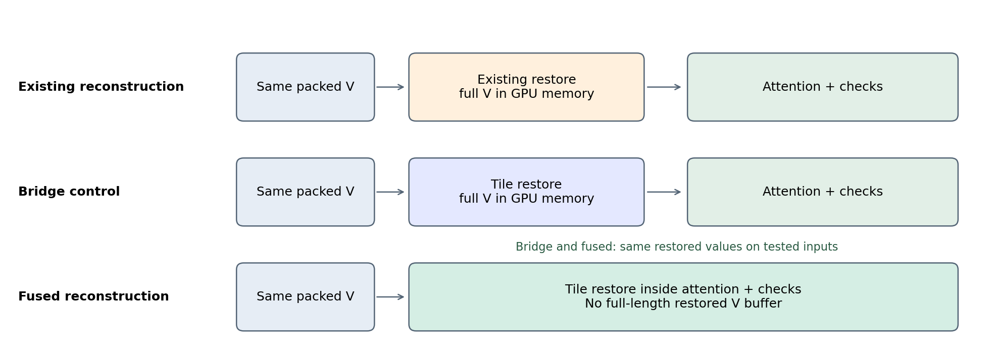
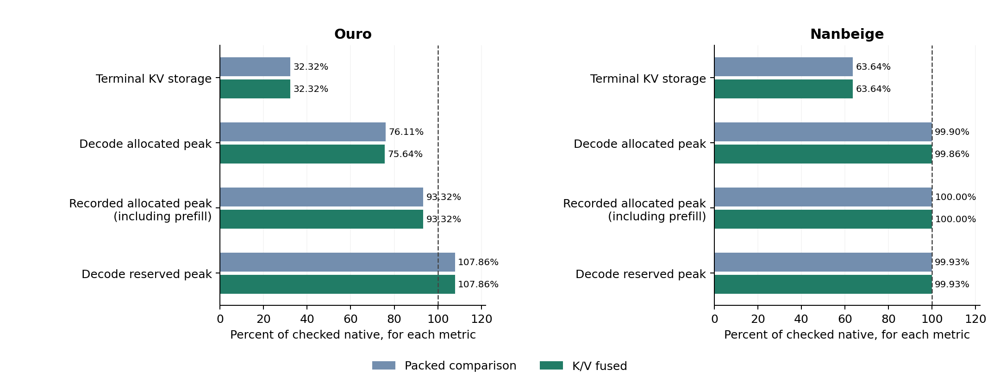
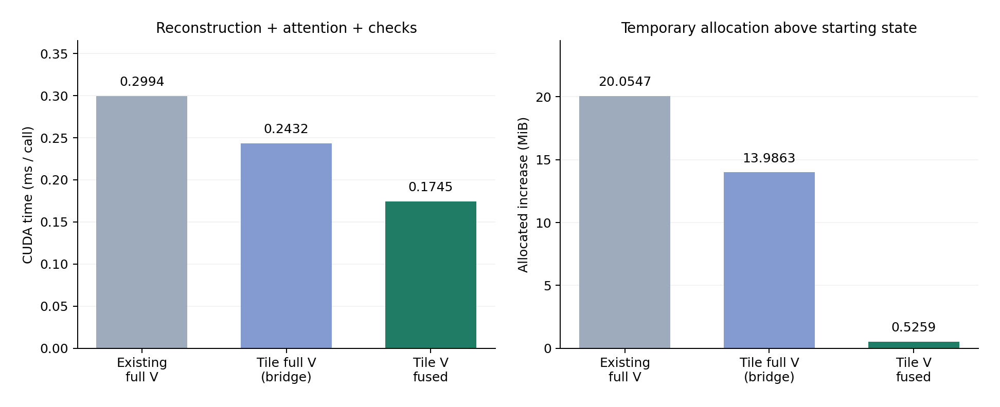
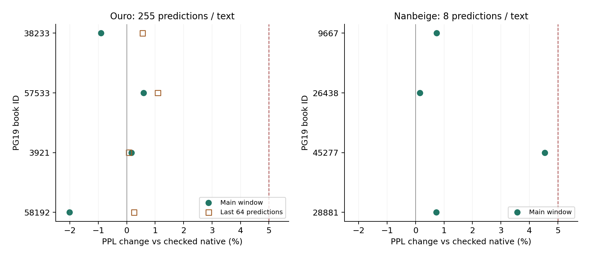
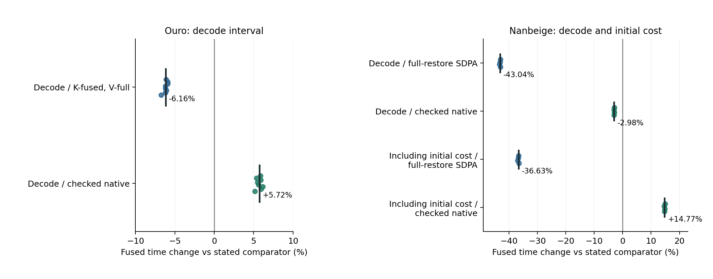
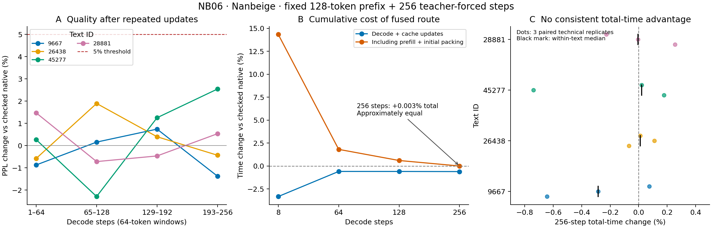

# 再帰型TransformerへのNSN型3bit KV圧縮の適用

## 実保存量・予測品質・融合読み出し費用の検証

**Kentaro Sato**  
独立研究者（Independent Researcher）  
連絡先：info@metaclan.jp  
2026年10月8日 · 日本語草稿 v0.5

公開用案内更新：2026年10月29日。利用条件・著者申告・参照先を現行パッケージへ同期した。測定値と科学的な結論は元の版から変更していない。

## 要旨

**本研究は、既存のノルム分離型KV圧縮方式NSNを、再帰型TransformerであるOuro-1.4BとNanbeige4.2-3B-Baseへ適用した。** モデル重みを変更せず、各周回・各層のK/Vを3bitで実保存し、復元・attention・後続予測まで動作する経路を実装・検証した。さらに、復元をattention内部へ組み込む経路と全量復元する経路を比較し、保存量の削減を実際の利用費用へ結び付けた。

実装と長さを固定した各モデル4文章のteacher-forcing評価では、Ouroは各255予測、Nanbeigeは初回の各8予測と、同じ4文章を各256予測まで延ばした評価を行った。融合経路の相対PPL悪化はすべての事前指定評価窓で5%以内だった。終端KV保存量は、非圧縮比でOuroが67.68%、Nanbeigeの延長評価が64.39%減少した。同じ復元値を使う部品比較では、V復元をattention内部へ移すことで時間と一時領域が減り、実モデルでも、それぞれの全量V復元を含む圧縮経路より逐次処理が短かった。Nanbeigeの延長評価では追加圧縮を4回含めても品質目安を満たしたが、初期費用込みの256 step総時間は検査付き非圧縮とほぼ同じだった。

本結果は、異なるhead構成を持つ二つの再帰型TransformerにNSN型圧縮を接続し、測定した短区間のPPL変化を事前目安内に抑えながらKV保存量を削減できることを示す。その実用上の利点を評価するには、圧縮表現そのものの大きさ、融合による読み出しの短縮、初期・更新費用、モデル全体のメモリを分けて測る必要がある。

**キーワード：** KVキャッシュ量子化、再帰型Transformer、NSN、融合attention、数値検証、推論費用

## 1. 問題設定：小さく保存した情報を、いくらで使えるか

Transformerは、既に処理したtokenのkeyとvalueをKVキャッシュへ保持し、後続tokenのattentionで利用する。再帰型Transformerでは、同じ層の重みを繰り返し使って計算を深くできるが、周回ごとに異なるKVを保持する実装では、その分の保存領域も必要になる。OuroとNanbeigeはこの種の層再利用を行う公開モデルである［1, 2］。

低bit量子化はKVの保存量を減らす。しかし、圧縮値を毎回すべて浮動小数へ戻してからattentionへ渡すと、復元演算と中間配列の費用が加わる。復元をattention内へ融合すれば、その一部を省ける可能性がある。さらに、読み出しが短縮されても、最初に圧縮する時間や、圧縮前のprefillで生じるメモリ使用量は残る。

本研究の第一の貢献は、**既存のNSN型圧縮を二つの再帰型Transformerの周回・層別KVへ適用し、3bitの実保存状態から後続予測を継続できることを確かめた点**にある。Ouroの通常のmulti-head attentionと、Nanbeigeのgrouped-query attentionにそれぞれ接続した。そのうえで、復元をattentionへ融合する実装を比較し、品質、保存量、利用費用を評価した。

これらを一つの「圧縮の成功率」へまとめず、**圧縮した状態を保持し、数値を復元し、モデルが利用するまでの対応**として調べる。表1に、本稿が明らかにする適用範囲と、その便益・費用を区別する問いを示す。

**表1　本稿の問いと、それを確かめる比較**

|問い|比較の単位|主要な観測|
|---|---|---|
|NSN型圧縮を再帰型モデルのKVへ適用できるか|二モデルの周回・層別KVへの接続と、各四つの新しい文章|実3bit保存から予測を継続し、各評価窓のPPL悪化は5%目安内|
|NSNの実保存量削減は、各区間のモデルメモリにどう現れるか|同じ系列のKV実storageと、区間別allocated／reserved|KVは減少したが、減少率はモデル全体のpeakと一致しない|
|復元をattentionへ移す効果を、復元計算の変更から分けられるか|同じpacked入力への三つの部品経路|同じ復元値の橋渡し対照に対しても、融合で時間と一時領域が減少|
|局所的な短縮は、別モデルと新しい文章でも残るか|モデルごとに固定した経路・文章・予測区間|読み出しの短縮は残ったが、非圧縮との優劣は測定範囲で変わる|

この四点は、適応的に進めた探索結果を統合する観点である。個別比較の材料・判定規則・停止条件はそれぞれ測定前に固定したが、系列全体を最初からこの四つの問いの確認研究として計画したわけではない。本文では問いに沿って証拠を配置し、実験IDと開発上の経緯は付録および[補足資料S1](evidence-index-v0.5-2026-10-08.md)で対応づける。

## 2. 関連研究と本稿の位置

再帰型Transformerの量子化研究は、**繰り返し使う重み・活性値を低bit化する研究**と、**各周回で生じるKVの保存量を減らす研究**に分けると、本稿との関係が明確になる。一般のKV量子化では、KIVIがK/V別の量子化軸と高精度末尾、復元と行列積の融合を組み合わせる［3］。KVQuantは量子化位置・非一様符号・外れ値処理を専用kernelへ接続し［4］、FlashAttentionはメモリ転送を考慮したattention計算を示した［5］。

重み・活性値側では、Hyperloop Transformersが周回を通じた活性値統計を用いるGPTQ量子化を評価し［9］、LoopQが周回別の活性値スケールや変換・adapter・軌跡を用いた校正を組み合わせる［10］。Liは再帰型モデルの重み量子化について、誤差の再帰的な入力と校正範囲の問題を分け、Huginnでは実際のINT4 kernelによる実行も確認している［11］。これらに対し、本稿はBF16重みを保ち、実行中のKVを対象とする。

KV側の近接研究には、**周回方向を低次元化する方法**と、**周回間の残差を量子化する方法**がある。Looped Latent Attentionは、複数周回のKVを共有する低次元表現へ写し、必要な周回のKVを復元する［12］。FlashLoopは基底と周回間残差でKVを表し、packed値をQK積とVの重み付き和の内部で利用する［6］。前者は低bit KV、後者は各周回のKVを直接量子化するKIVIも比較対象に含めている。したがって、再帰型モデルへのKV量子化には、今回の適用と直接比較すべき先行事例がある。

**表2　圧縮対象と、本稿との比較軸**

|研究|圧縮・計算の中心|本稿との比較軸|
|---|---|---|
|Hyperloop／LoopQ／Li［9–11］|再利用する重み、または重みと活性値の量子化|本稿は重みを変更せず、KV保存・復元を測る|
|Looped Latent Attention［12］|周回方向の低次元表現と復元|周回間の表現共有と、各周回・層を独立に保存するNSNの違い|
|FlashLoop［6］|周回間残差の量子化と融合読み出し。疎な更新・attentionも利用|保存表現と計算対象を変える効果と、固定表現の読み出し経路を変える効果|
|KIVI／KVQuant［3, 4］|低bit KVの表現と実行kernel|量子化方式を同条件で比較する際の候補|
|FlashAttention［5］|attentionの中間表現とメモリ転送の削減|復元とその検査を追加したときの実行費用|
|著者の既存NSN［7］|ノルム分離・方向成分の量子化と再正規化|再帰型二モデルへの実3bit保存・融合読み出しの接続|

本稿は、校正用データやcodecの学習を用いず、各周回・層のK/VにNSNの同じ規則を適用する。その**保存表現を固定したまま、復元の算術・配置・検査を区別し、品質・実保存量・モデル全体の費用へ対応づける**ことに焦点を置く。外部手法との性能順位は同条件の比較課題に残す。既存NSNと著者の未公開SADP実装を出発点とし、旧実験の数値は今回の測定へ合算していない。

## 3. 方法

### 3.1 ノルムと方向を分けて保存する

本稿のNSN実装は、各KまたはVの128次元ベクトルを大きさと方向へ分解する。64 tokenを一つの区画とし、token位置を \(t\)、チャネルを \(j\) とすると、

\[
 n_t=\lVert x_t\rVert_2,\qquad d_{tj}=x_{tj}/\max(n_t,\epsilon)
\]

を求める。各チャネルについて区画内の最小値 \(m_j\) と、最大値から最小値までを7等分する幅 \(s_j\) を保持し、方向成分を0〜7の整数へ丸める。

\[
 q_{tj}=\operatorname{clip}_{[0,7]}\!\left(\operatorname{round}\frac{d_{tj}-m_j}{s_j}\right).
\]

整数符号はFP32で求めた \(m,s\) から作る。補助情報をFP16で保存し、復元時にFP32へ読み戻した値を

\[
 \bar n_t=\operatorname{FP32}(\operatorname{FP16}(n_t)),\qquad
 \bar m_j=\operatorname{FP32}(\operatorname{FP16}(m_j)),\qquad
 \bar s_j=\operatorname{FP32}(\operatorname{FP16}(s_j))
\]

とすると、復元は次の値を使う。

\[
 \widetilde d_{tj}=\bar m_j+\bar s_jq_{tj},\qquad
 \widehat x_t=\operatorname{BF16}\!\left(
 \bar n_t\frac{\widetilde d_t}{\max(\lVert\widetilde d_t\rVert_2,\epsilon)}\right).
\]

保存ノルムにも丸めが入るため、元の実数ノルムの厳密保存ではなく、保存後のノルムを使って大きさを戻す実装である。

\(s_j=0\) のチャネルの符号を0とし、ノルム0のベクトルは0へ戻す。\(\epsilon=10^{-12}\)。量子化計算と復元時の中間演算はFP32、ノルム・最小値・幅の保存はFP16、attentionへ渡す復元値はBF16である。非有限値や非ゼロのノルム・幅が保存時に0へ落ちる場合は検出する。Kはモデルがattention用に構成した位置表現適用後の値を対象とし、KとVに同じ基本recipeを別々に適用した。

**コード1　今回のNSN量子化・復元の核（関数本体10行）**

入力`x`の末尾2軸を64 token × 128次元とする。ノルムを取り出し、方向を整数化し、方向を再正規化してノルムを戻す処理を示す。7行目の`half().float()`は、FP16で保存した補助情報をFP32へ読み戻す丸めに対応する。

```python
import torch


def nsn_int3_qdq(x):
    a = x.float()
    n = torch.linalg.vector_norm(a, dim=-1, keepdim=True)
    d = a / n.clamp_min(1e-12)
    m = d.amin(dim=-2, keepdim=True)
    s = (d.amax(dim=-2, keepdim=True) - m) / 7
    q = ((d - m) / torch.where(s == 0, torch.ones_like(s), s)).round().clamp(0, 7).to(torch.uint8)
    n, m, s = (t.half().float().contiguous() for t in (n, m, s))
    d = (m + s * q.float().contiguous()).contiguous()
    y = n * (d / torch.linalg.vector_norm(d, dim=-1, keepdim=True).clamp_min(1e-12))
    return torch.where(n == 0, torch.zeros_like(y), y).to(x.dtype)
```

この抜粋は、実験の有限性・形状・補助情報の表現範囲の検査を通る区画向けの量子化・復元（QDQ）である。`q`はuint8配列であり、下記の3bit packing、末尾の管理、入力検査、融合kernelは含まない。[短い実行コード](code/nsn_int3_core.py)と凍結済み参照算術の出力をCPU上の合成24条件で照合し、各条件でbit一致した。この照合の範囲と実験用コードは[補足資料S1](evidence-index-v0.5-2026-10-08.md)に示す。コード1は凍結した参照QDQの算術を示す。融合候補は区画単位の復元算術を用いるため、参照器との全bit一致を一律に要求せず、同算術の橋渡し対照との一致と、付録Bの工程別予算で評価する。

整数は8個を3 byteへ詰め、浮動小数の元KVを隠れたコピーとして残さない。1 head・64 token・128次元の1区画は、符号3,072 byte、FP16補助情報640 byte、位置等のheader 12 byteで、合計**3,724 byte**となる。対応するBF16区画は16,384 byteである。「3bit」は符号部を指し、補助情報を含む実効量は約3.64 bit／要素となる。最近の末尾はBF16のまま残すため、キャッシュ全体の削減率は圧縮区画の比率にも依存する。

### 3.2 保存形式を保って、読み出し方を変える

融合経路はpacked Kを読みながらqueryとの積を求め、softmaxとVの重み付き和まで計算する。Vも必要な区画を内部で復元し、全長の復元済みV配列をGPUメモリへ書き戻す工程を省く。周回・層に対応する保存場所は維持し、周回間残差やtokenの間引きは導入しない。

復元実装を変えると、同じ数式でも演算順序による丸め差が生じ得る。このため、V融合の部品比較では次の三経路を置いた。

1. 既存の復元器で全長Vを作り、attentionへ渡す。
2. 融合候補と同じ区画単位の復元計算で全長Vを作り、attentionへ渡す。これを**橋渡し対照**と呼ぶ。
3. 同じ区画単位の復元計算をattention内部で行う。



**図1。** 全経路に同じpacked入力を渡す。橋渡し対照と融合の比較は、検査・呼出し構成を含む読み出し経路の比較である。両者の復元値と出力を直接照合し、既存復元器から変わった数値と、内部へ移したことで生じる数値を区別する。

### 3.3 二モデルの接続条件

**表3　初回の新文章を用いた二モデル比較の条件（継続評価は§3.6）**

|項目|Ouro-1.4B|Nanbeige4.2-3B-Base|
|---|---|---|
|層数 × 固定周回数|24 × 8|22 × 2|
|KV保存場所の数|192|44|
|Q head／KV head／head次元|16／16／128|48／8／128|
|初期入力|768 token|128 token|
|正解tokenを逐次与える回数|255|8|
|主品質の予測位置数／文章|255|8|
|初期圧縮と追加圧縮|704 tokenを圧縮し、3回の64 token追加|先頭64 tokenを一度圧縮|
|終端の圧縮部分＋BF16末尾|896＋127 token|64＋72 token|
|文章数 × 技術反復|4 × 2|4 × 3|
|融合の主比較相手|Kは内部復元、Vは全量復元する経路|K/Vを全量復元して公式SDPAへ渡す経路|

全条件はbatch 1、BF16重み、学習なしで実行した。SDPAはscaled dot-product attentionの実装インターフェースを指す。各モデルで、同じtokenを同じ順序で処理する公式の逐次経路と一致する、検査付き非圧縮経路も置いた。これは初期探索の一括入力／逐次入力間のBF16一致検査とは区別する（付録B）。Nanbeigeでは6個のquery headが1個のKV headを参照するGQAに合わせて、head対応を実装した。

表3の二列は接続範囲の異なる試験である。文脈長、周回数、比較相手、圧縮比率が違うため、モデル間のPPLや短縮率を直接順位づけしない。Nanbeigeの短い系列は、異なるcacheとGQAへ移せるかを小さく確認するために選んだ。

### 3.4 材料を先に決め、同じ入力で比較する

材料はPG19 trainの固定一覧から選んだ英語書籍の冒頭である［8］。固定seedと書籍IDのhash順を用い、Ouroでは研究内で既に扱った24冊、Nanbeigeでは28冊を除外した。重複と必要token数不足のみを除外理由とし、各比較の先頭四候補がそのまま採用された。全文章のtoken列・予定した実行順をモデル重みのロード前に固定し、結果による差替えは行っていない。「新しい文章」は本研究内で未使用という意味である。

各方式は新しいcacheから開始する。自由生成によって入力が分岐しないよう、以後も正解tokenを与えるteacher forcingを用いた。方式順は測定前に決め、反復で巡回・反転させた。技術反復は同じ入力に対する計算と計時の点検であり、独立文章として数えない。入力はPG19配布テキストをUTF-8で読み、取得後の冒頭除去や整形をせず、固定revisionのtokenizerで`add_special_tokens=False`として先頭から切り出した。原URL、token列、対象位置と固定版はS1に示す。

### 3.5 品質・時間・メモリを別々に評価する

**品質。** 初回の二モデル比較では保存logitsからCPUでtokenごとの負の対数尤度（NLL）を再計算し、評価窓の平均NLLを指数化してPPLを得る。相対変化は \(100\{\exp(\overline{\ell}_{q}-\overline{\ell}_{0})-1\}\) とする。これはモデル固有のsubword tokenに対する区間PPLであり、PG19全testや単語単位の公式benchmark値ではない。Ouroでは全255予測に加え終盤64予測も確認する。Nanbeigeでは圧縮後の8予測を主とし、圧縮前の1予測を含む9予測は別集計とする。複数文章の参考集計は、文章の平均NLLを一度ずつ平均してから指数化する。

各主要比較では、非圧縮比のPPL悪化5%以内を取得前の診断目安とした。改善は要求せず、非劣性検定や用途全般への品質保証としては扱わない。各窓・文章の値を示し、平均だけで目安への適合を判断しない。

**時間。** 全形状の事前実行を済ませたうえでCUDA Eventと同期wallを記録し、主測定中にTritonのコンパイルcacheが増えないことを確認した。Ouroの主区間は逐次forwardと追加圧縮を含む240 tokenで、初期8 tokenと実入力保存の8位置を共通に除外する。二つの除外集合は最初の位置で重なるため、位置数は255−8−8＋1＝240となる。正確な位置集合はS1に示す。prefillと最初の圧縮は主時間に含まない。Nanbeigeは8回の逐次forwardに加え、prefill・初期圧縮・逐次forwardを足した時間も比較する。モデルの全層・MLP・logits・経路上の検査を含み、CPUへの証拠転送、保存、検証、ロード等は計時外とする。

時間比は同じ文章・同じ反復内で計算する。Ouroは8対応比の中央値、Nanbeigeは文章内3対応比の中央値を取ってから4文章の中央値を求める。本文の時間中央値同士の割算と、報告する対応比は必ずしも一致しない。

**メモリ。** KVを保持するGPU storageの実byte数を、符号、補助情報、header、BF16末尾から照合する。これに加え、PyTorchがtensor等に実際に割り当てているallocatedと、allocatorが確保しているreservedを区間別に記録する。部品単独では呼出し直前からのallocated増分を使う。これらは異なる測定対象であり、GPU全体の使用率という一指標へ置き換えない。

**数値検査。** 復元・QK積・contextの検査は、同じ圧縮入力から作る参照との実装整合性を測る。非圧縮に対する品質変化は、上記のPPL比較で別に測る。参照の作り方、取得前の誤差尺度・閾値、観測最大と確認点数を付録Bの表B1・B2にまとめた。

### 3.6 同じ文章で継続と圧縮更新を評価する

初回のNanbeige比較と同じ4文章・初期128 tokenを使い、teacher forcingの継続を256 stepへ延ばした。復元算術、融合kernel、64-token区画、数値予算、モデル・tokenizerの固定版を継承する。先頭385 tokenを使い、予測対象は0始まりの添字129–384の256個とした。取得本文のhashと旧入力137 tokenの一致を、モデル重みをロードする前に確認した。これは新たな4文章ではなく、同じ材料の継続・更新を調べる比較である。

初期圧縮は先頭64 token。各forwardで新KVをBF16末尾へ追記し、attentionと予測を終えた後、step 64・128・192・256で古い64 tokenを追加圧縮する。既存のpacked区画は変更しない。終端は圧縮320＋BF16末尾64 tokenとなる。4回の更新を費用と保存量へ含め、そのうち最初の3回は後続attentionでの利用まで観測した。

非圧縮、全量復元＋SDPA、GQA融合を各文章3技術反復で測定した。全256、最初8、重ならない64予測×4区間の品質と、8・64・128・256 step時点の累積時間を取得前に固定した。全方式でforwardとその後の処理を同じ境界で計時し、非圧縮の後処理は無処理対照とする。「更新込みdecode」は両者の和、「初期費用込み」はさらにprefillと初期圧縮を足した値である。診断用捕捉・証拠保存は計時外とし、時間の集約は文章内3対応比の中央値、次に4文章の中央値とした。初回8予測の値と継続評価の値は別の測定として報告する。

## 4. 結果：実保存量とモデルのメモリpeakは異なる

両モデルで、予定したpacked保存形式とGPU上の実storageが一致した。終端KVの保存量はOuroで67.68%、Nanbeigeで36.36%減少した。圧縮区画の符号形式は共通であり、削減率の差には表3の圧縮対象割合が反映されている。

**表4　主要比較のメモリ。単位はMiB（1 MiB = 2²⁰ byte）**

|モデル・測定範囲|非圧縮|比較用の圧縮経路|K/V融合|
|---|---:|---:|---:|
|Ouro：終端KV実storage|1,534.500|495.984|495.984|
|Ouro：主逐次区間のallocated peak|4,314.771|3,283.872|3,263.589|
|Ouro：主逐次区間のreserved peak|4,404.000|4,750.000|4,750.000|
|Ouro：prefillを含む記録区間のallocated最大値|4,314.771|4,026.656|4,026.656|
|Nanbeige：終端KV実storage|23.375|14.875|14.875|
|Nanbeige：逐次区間のallocated peak|8,079.747|8,071.813|8,068.144|
|Nanbeige：逐次区間のreserved peak|8,246.000|8,240.000|8,240.000|
|Nanbeige：prefill・圧縮を含む記録区間のallocated最大値|8,197.590|8,197.590|8,197.590|

比較用の圧縮経路は、OuroではK融合＋V全量復元、NanbeigeではK/V全量復元＋SDPAである。表の各値は当該比較内で文章・反復によらず同じだった。記録区間の最大値はモデルロードやGPU上の他processまで含む全プロセスpeakではない。



**図2。** 各測定項目の検査付き非圧縮経路を100%とした比率。KV自体の削減が大きくても、prefillを含むallocated最大値やreservedが同じ比率で減るわけではない。各行の分母は異なり、棒を足してメモリの内訳にすることはできない。青は表4の比較用圧縮経路、緑はK/V融合。二モデルは文脈長と圧縮対象割合が異なる。

Ouroの融合経路はV全量復元経路より逐次allocated peakを20.28 MiB減らしたが、prefillを含めた最大値は両圧縮方式で同じだった。reservedは両圧縮方式とも非圧縮より大きい。NanbeigeではKVそのものは8.50 MiB減った一方、重み等を含むallocated peakの変化は小さく、prefillを含む最大値は全方式で同じだった。

**実保存量の削減は確認できた。その効果がGPUメモリ全体へ現れる大きさは、他の常駐領域と、どの区間が最大値を作るかで決まる。**

## 5. 結果：同じ復元値でも、融合によって利用費用は変わる

### 5.1 同じ算術を用いた橋渡し比較

Ouroから保存した既知2文章×3か所のKVを使い、各組に3種類の非ゼロ合成queryを与えた。各queryの5回の計時中央値から方式間比を求め、組内で集約した後、6組を比較した。合成query、保存場所、繰返し呼出しを独立文章数としては数えない。

**表5　V復元からattention出力までの部品比較**

|読み出し経路|CUDA時間中央値（ms）|呼出しによるallocated増分（MiB）|
|---|---:|---:|
|既存復元 → 全長V → attention|0.299447|20.0547|
|区画復元 → 全長V → attention（橋渡し対照）|0.243244|13.9863|
|区画復元をattention内で実行|0.174514|0.5259|



**図3。** 表5を時間とallocated増分に分けて表示した。橋渡し対照は融合と同じ復元計算を使って全長Vを作り、融合はその計算をattention内部で行う。左は各経路の時間中央値、右は呼出し前からのallocated増分で、誤差棒や信頼区間ではない。本文の短縮率は同じ入力の対応比から集計するため、棒の高さ同士の割算とは区別する。

融合／橋渡し対照の対応時間比中央値は0.717196、すなわち**28.28%短縮**だった。6組すべてで短く、比の範囲は0.710908〜0.718996である。同期wallでも同方向だった。この範囲は観測した6組の最小・最大で、信頼区間ではない。

正常fixtureと保存入力を合わせた52条件で、橋渡し対照と融合の復元V・FP32 context・最終BF16出力が一致した。既存復元器と候補の間には微小な丸め差があり、保存入力のVでは重複queryを除く17,688,576要素中108要素が異なった。最終出力も73,728要素中5要素が異なったが、その差は橋渡し対照にも同じように現れた。

これにより、今回観測した数値差は復元実装を変更した段階に位置づけられ、attention内部へ移す段階では増えていないことが分かった。一方、時間と一時領域は同じ復元値の比較でも減少した。測定経路にはkernel起動と検査も含むため、短縮のすべてをメモリ帯域だけへ帰属させない。

異常fixtureの1種類は作成に失敗し、予定した検査器へ到達しなかった。この部品試験の検査coverage目標は未達として保持し、後続の独立した小確認で補った（付録B）。

### 5.2 入力検査も利用費用の一部である

別の部品比較では、既存の有限性検査をTritonでまとめ、同じ64種類の正常・異常fixtureと、モデルから保存した18入力を処理した。全192のfixture判定は固定規則と一致し、保存入力の経路出力も全54組合せで元の出力とbit一致した。

**表6　同じ検査条件を保った入力検査の集約。CUDA時間中央値（ms）**

|測定範囲|既存の検査|PyTorchで集約|Tritonで集約|Tritonの既存比短縮率|
|---|---:|---:|---:|---:|
|入力検査のみ|0.193007|0.183847|0.043072|77.68%|
|V復元・検査・attention・出力確認|0.400946|0.392564|0.245767|38.78%|

時間と短縮率は保存した18入力から集約し、短縮率には同じ入力の対応比を使った。検査を後回しにせず、同じ呼出しで確認してから演算へ進む条件を維持している。検査単独で得た短縮は、前後の演算を含む経路では小さくなった。

この結果は、圧縮データを利用する費用に検査の構成も含まれることを示す。表5とは入力と経路が異なるため、短縮率を足し合わせたり、そのままモデル全体の短縮率へ掛けたりはしない。

## 6. 結果：モデル接続で残った効果と、初期費用の境界

### 6.1 新しい文章での予測損失

**表7　文章ごとの区間PPL。括弧内はK/V融合の非圧縮比変化**

|モデル／PG19書籍ID|非圧縮|比較用の圧縮経路|K/V融合|
|---|---:|---:|---:|
|Ouro／38233|13.511404|13.330482|13.388516（−0.910%）|
|Ouro／57533|9.419985|9.488617|9.475571（＋0.590%）|
|Ouro／3921|7.848236|7.859491|7.861095（＋0.164%）|
|Ouro／58192|8.516335|8.303405|8.344860（−2.013%）|
|Nanbeige／9667|1.735868|1.758961|1.748765（＋0.743%）|
|Nanbeige／26438|1.480436|1.489423|1.482638（＋0.149%）|
|Nanbeige／45277|28.972401|30.253405|30.287877（＋4.540%）|
|Nanbeige／28881|1.218774|1.220106|1.227694（＋0.732%）|

Ouroの全255予測では文章によって改善と悪化が分かれた。終盤64予測では順に＋0.556%、＋1.095%、＋0.073%、＋0.258%だった。全体と終盤×四文章×二反復の16比較が5%目安内である。四文章の平均NLLから算出した参考変化は、全体−0.547%、終盤＋0.495%となった。

Nanbeigeは圧縮後の8予測で全四文章が悪化し、最大は＋4.540%だった。四文章を一度ずつ集計した相対PPL変化は＋1.526%である。同じ方式の技術反復は、両モデルとも保存logitsとNLLが一致した。反復を重ねたことは、文章数や品質評価範囲の拡大にはならない。



**図4。** 融合経路の検査付き非圧縮比PPL変化。負は改善、正は悪化を表す。破線は取得前に固定した悪化5%の診断目安で、信頼境界ではない。丸は主評価窓、Ouroの四角は終盤64予測。各点は一つの文章の値であり、同一だった技術反復を重ねて表示していない。横軸は共通だが、二モデルのtoken化と評価長は異なる。

両モデルで公式経路との接続検査と、捕捉した実queryによる数値検査が成立した。Ouroの本測定192点では、橋渡し対照と融合の復元・出力は一致したが、既存復元器との最終BF16出力は393,216要素中2要素が異なった。Nanbeigeの16点も固定した工程別予算内だった。これらの局所検査と表7のPPLは、数値実装の妥当性と予測への影響を別々に確認する役割を持つ。

### 6.2 読み出しが短くても、系列の合計は長くなり得る

**表8　モデル時間の対応比。負の変化は融合経路の短縮**

|モデル・測定範囲|融合の比較対象|時間比|相対変化|
|---|---|---:|---:|
|Ouro：主逐次区間|K融合＋V全量復元|0.938378|−6.162%|
|Ouro：主逐次区間|検査付き非圧縮|1.057221|＋5.722%|
|Nanbeige：8回の逐次処理|K/V全量復元＋SDPA|0.569601|−43.040%|
|Nanbeige：8回の逐次処理|検査付き非圧縮|0.970156|−2.984%|
|Nanbeige：prefill＋初期圧縮＋8回の逐次処理|K/V全量復元＋SDPA|0.633702|−36.630%|
|Nanbeige：prefill＋初期圧縮＋8回の逐次処理|検査付き非圧縮|1.147655|＋14.765%|

Ouroの6.16%短縮は「K内部復元＋V全量復元」から「K/V内部復元」への変更、Nanbeigeの43.04%短縮は「K/V全量復元＋SDPA」から「GQA融合」への変更に対応する。二つは同じ操作のモデル別効果量ではなく、各検査付き経路一式の比較である。

Ouroでは、8つの文章・反復の組合せすべてで融合がV全量復元より短かった。短縮幅は5.923〜6.752%で、終盤64予測に対応する計時区間でも中央値5.883%の短縮が残った。一方、非圧縮に対しては全8組合せで長かった。

Nanbeigeでは、全12組合せで融合が全量復元と非圧縮の逐次時間を下回った。しかし、融合の初期圧縮には文章ごとの中央値で約54.8〜55.3 msを要した。prefill・圧縮・8回の逐次処理を足すと、全12組合せで非圧縮より長かった。同期wallでも同じ方向だった。



**図5。** 各行に示す比較相手に対する融合の時間変化。負は短縮、正は増加を表す。Ouroの点は4文章×2反復の8対応比、Nanbeigeの点は文章内3対応比の中央値を取った4文章の値。太い短線は報告する中央値であり、信頼区間ではない。左右で横軸の範囲が異なる。技術反復を独立文章数として数えず、各行の比較相手と計時範囲に沿って読む。

初回の8 step比較では、読み出しが短くなっても初期費用を回収しなかった。§6.3では、継続を延ばして生じる追加圧縮も含め、より長い利用区間を直接測定する。

### 6.3 圧縮更新を続けると、初期費用との差は縮まる

**同じ4文章を256予測まで延ばしても品質目安とKV削減は成立したが、初期・更新費用込みの総時間は検査付き非圧縮とほぼ同じだった。** 融合の4文章を等重みとした相対PPLは全256予測で+0.152%、終盤64で+0.308%。両圧縮経路とも全文章・全指定窓で5%目安内だった。

**表9　継続評価：融合対非圧縮の相対PPL変化**

|PG19 ID|全256予測|終盤64予測|
|---|---:|---:|
|9667|−0.339%|−1.374%|
|26438|+0.317%|−0.432%|
|45277|+0.429%|+2.545%|
|28881|+0.203%|+0.535%|
|4文章集約|+0.152%|+0.308%|

集約行は文章ごとの平均NLLを等重みで平均してから相対PPLへ変換した。全256と最初8予測は対象tokenが異なるため、両者の差を「長くすれば品質が改善する」効果とはしない。

**表10　継続評価：累積CUDA時間の対応比による変化（%）**

|継続step|更新込みdecode／非圧縮|初期費用込み／非圧縮|更新込みdecode／全量復元|
|---|---:|---:|---:|
|8|−3.323%|+14.334%|−43.219%|
|64|−0.589%|+1.815%|−42.632%|
|128|−0.592%|+0.602%|−42.598%|
|256|−0.604%|+0.003%|−42.500%|

この表の全行は同じ継続実行から取り、初回の8予測比較とのrun間差を長さの効果に使わない。256 stepの初期費用込み比は1.000032で、文章中央値は短い2冊・長い2冊、全12反復では短い6・長い6だった。固定4時点の集約比は1未満にならなかったが、256 stepの+0.003%という小さい差は**ほぼ同時間という記述**として扱い、速度優位や統計的同等性を示す値とはしない。

保存記録の加算可能な平均内訳（4文章×3反復の事後記述）では、融合forwardは非圧縮より296.27 ms短かった。一方、初期圧縮54.71 msと後処理233.15 ms（非圧縮は1.64 ms）が加わり、forward側の節約の大部分と釣り合った。融合後処理の230.99 ms、99.07%は4更新stepに集中した。この内訳は費用の所在を示し、主指標の対応中央値を置換しない。

終端KVは69,206,016から24,642,816 byte（66.000から23.501 MiB）へ、64.392%減少した。融合のdecode allocated peakも42.089 MiB低かったが、全工程allocated peakはprefill時の8,197.590 MiBで3方式とも同じだった。**継続によって初期費用は薄まる一方、圧縮更新の費用は繰り返し発生する。** 容量削減を実行上の利益へ変える条件は、読み出しと更新を合わせて評価できる。



**図6　同じ4文章で測った品質と継続費用。** 左：重ならない64予測区間ごとの融合対非圧縮PPL変化。破線は5%診断目安。中央：固定した8・64・128・256 stepの更新込みdecodeと初期費用込み時間の変化。横軸は測定時点を等間隔に置く。右：256 step総時間の全12対応比と文章別中央値。点と中央値は技術反復の記述であり、区間推定ではない。

## 7. 考察：圧縮の効用を評価する境界

### 7.1 保存、復元、利用を同じ証拠へ結び付ける

本研究では、実packed storageの照合、同じ入力の復元比較、実queryの再演、保存logitsからのNLL再計算を結び付けた。そのため、「予定したbit数で保存したか」「計算経路を変えても検査条件を満たすか」「その経路が次の予測をどう変えたか」を別々に回答できる。

表4のKV削減、表5の一時領域削減、表8・10の処理時間変化は、同じ量の別名ではない。NanbeigeではKV保存量が減っても全工程allocated peakはprefillにより変わらず、初期費用込みの合計は短い8 stepでは増え、256 stepではほぼ同じになった。延長後も更新費用が残るため、読み出しだけの短縮と系列全体の利点を分けて評価できる。

### 7.2 橋渡し対照は数値の変更と配置の変更を分ける

低bit値を復元する式が等しくても、normの加算順や丸めの位置は実装によって変わり得る。既存復元器と融合kernelだけを比較すると、その差と融合の差を同時に見てしまう。本研究の橋渡し対照は、融合候補と同じ復元値を先に作り、全長配列として渡す。この対照により、今回の数値差の所在を絞りながら、復元値が同じ場合にも残る時間と一時領域の差を測れた。

この切り分けは、既存復元器とのbit一致を一律に要求する代わりに、差の発生工程を特定してから予測損失へ接続する方法となる。許容値を超えた結果を都合よく補正する用途ではなく、取得前に固定した数値条件と元の結果を保持することで成立する。

### 7.3 異なるhead構成の再帰型モデルでNSN型圧縮を利用できた

OuroからNanbeigeへの移植では、層・周回と保存場所の対応、QとKVのhead数、公式attentionへの接続を変更した。その条件下で、実保存、数値検査、主経路の処理時間、新文章の短い品質診断までが成立した。

この到達点は、異なるhead構成でもNSNの保存形式と融合読み出しを接続できたことにある。周回間の冗長性を圧縮した実験ではなく、再帰回数の効果を非再帰モデルから分離した実験でもない。次の一般化は、接続が通ったことから自動的に導くのではなく、目的に応じた下流課題や長さ・batch条件で評価する必要がある。

## 8. 限界と今後の課題

**品質の範囲。** 新材料は各モデル四文章である。Nanbeigeは同じ四文章を圧縮後8予測から256予測へ延長し、追加圧縮後の利用を確認した。書籍冒頭のsubword PPLは、自由生成、推論課題、指示追従、長距離検索の性能を代表しない。継続区間と技術反復を独立した新材料として数えず、事前の5%目安と個別値を示す。

**実装と計時。** 主結果はRTX PRO 6000 Blackwell Server Edition上のbatch 1測定である。公式出力に一致する非圧縮対照にも研究用の検査があるため、表8は非圧縮の最速serving実装に対する優位を示さない。二モデルで比較相手と計時範囲も異なる。warmup後の同一ランタイム内の技術反復では、別GPU・別ランタイムの変動まで評価していない。

**機構。** 橋渡し対照は復元値をそろえるが、kernel起動、検査結果の回収、一時配列などは一式として変わる。各費用の寄与を完全に分解したprofileや、FlashLoop・KIVI・KVQuantとの同条件実測は今後の課題である。NSNの構成要素そのものの優位性は、この系列では再検証していない。

**今後の課題。** 外部方式との比較では、実効保存量・高精度末尾・校正費用・評価長をそろえ、量子化方式の違いと実行経路の違いを分ける。今回の継続評価により、圧縮更新の費用を分解する部品比較が次の具体的な対象となった。数千token文脈、自由生成、下流課題、複数batch・別GPU、周回数の因果比較も、用途に応じて評価する。

## 9. 結論

既存のNSN型圧縮をOuro-1.4BとNanbeige4.2-3B-Baseへ適用し、周回・層別のKVを実際に3bitで保存した状態から後続予測を継続できた。固定した各四文章の評価では、融合経路のPPL悪化が全評価窓で5%目安内に収まり、KV保存量を削減した。同じ復元値を使う対照との比較で、V復元をattention内部へ移すことによる時間・一時領域の削減を確認し、その経路の短縮は新しい文章を用いた実モデル比較にも残った。

同じNanbeige材料を256予測まで延ばし、圧縮更新を繰り返しても品質目安とKV削減は成立した。初期費用込みの時間差は縮まったが、更新費用を含む総時間は非圧縮とほぼ同じだった。KVを小さく保存すること、読み出しを短くすること、初期処理・更新込みの合計を短くすることを別々に評価できた。**本稿は、NSN型圧縮の再帰型二モデルへの適用を実装と測定で示し、その保存量・品質・利用費用が成立する範囲を具体化した。**

## 研究資源・著者の役割

設計、原実行記録、配布時のコード、数値再計算、本文の表との対応は[補足資料S1](evidence-index-v0.5-2026-10-08.md)に整理した。公開候補には固定したコード・材料・ログ・hash一覧を収録し、大きな保存配列は別配布ZIPとした。著者作成の論文・図・データはCC BY 4.0、コードはApache-2.0、第三者資料は元の条件に従う（[利用条件](../../LICENSES.md)）。リポジトリは[https://github.com/metaSATOKEN/nsn](https://github.com/metaSATOKEN/nsn)。公開範囲と別配布ZIPの提供状況は[README](../../README.ja.md)に記録する。統合稿の恒久アーカイブDOIは未割当である。

研究方針と実行承認、Colabでの実行、原稿の判断は著者が行い、設計・実装・分析・執筆にLLM支援を用いた。返却結果は配布前から保持していた検証器でも再計算した。この「別実装での照合」は同一プロジェクト内の確認であり、第三者による独立追試を意味しない。公開書籍と公開重みを用いた計算実験で、人間参加者を対象とする調査は実施していない。本研究は著者個人の自己資金で実施し、外部からの資金提供を受けていない。著者に申告すべき利益相反はない。

## 参考文献

1. Zhu, R.-J., et al. *Scaling Latent Reasoning via Looped Language Models.* arXiv:2510.25741, v5, 2026（初版2025）. [論文](https://arxiv.org/abs/2510.25741v5). モデル：[ByteDance/Ouro-1.4B](https://huggingface.co/ByteDance/Ouro-1.4B).
2. Nanbeige Lab, et al. *Nanbeige4.2-3B: Unlocking Agentic Capabilities in a Compact Model.* arXiv:2607.22083v2, 2026. [論文](https://arxiv.org/abs/2607.22083v2). 使用モデル：[Nanbeige4.2-3B-Base](https://huggingface.co/Nanbeige/Nanbeige4.2-3B-Base).
3. Liu, Z., Yuan, J., et al. *KIVI: A Tuning-Free Asymmetric 2bit Quantization for KV Cache.* arXiv:2402.02750v1, 2024. [一次本文](https://arxiv.org/html/2402.02750v1).
4. Hooper, C., et al. *KVQuant: Towards 10 Million Context Length LLM Inference with KV Cache Quantization.* NeurIPS 2024; arXiv:2401.18079v6, 2025. [一次本文](https://arxiv.org/html/2401.18079v6).
5. Dao, T., Fu, D. Y., Ermon, S., Rudra, A., and Ré, C. *FlashAttention: Fast and Memory-Efficient Exact Attention with IO-Awareness.* arXiv:2205.14135v2, 2022. [論文](https://arxiv.org/abs/2205.14135v2).
6. Yang, W., and Liu, S. *FlashLoop: Fast and Memory-Efficient Looped Transformers via Lazy Updates.* arXiv:2609.29812v2, 2026. [一次本文](https://arxiv.org/html/2609.29812v2).
7. Sato, K. *Norm Separation is Necessary: A Minimalist Calibration-Free INT3 Recipe for KV Cache Quantization.* 2026. [本研究で参照した保存稿](https://doi.org/10.5281/zenodo.19724817). 保存稿記載の公開DOI：10.5281/zenodo.19724817。Zenodo v1.0.0との一致を[版対応記録](../nsn-integrated/publication-provenance-v0.1-2026-10-03.md)で確認済み。
8. Rae, J. W., Potapenko, A., Jayakumar, S. M., Hillier, C., and Lillicrap, T. P. *Compressive Transformers for Long-Range Sequence Modelling.* 2019. 本稿の材料出所：[PG19公式データ説明](https://github.com/google-deepmind/pg19).

9. Zeitoun, A., Torroba-Hennigen, L., and Kim, Y. *Hyperloop Transformers.* arXiv:2604.21254v3, 2026. [一次本文](https://arxiv.org/html/2604.21254v3).
10. Fang, R., Chen, H.-W., and Chen, M.-S. *LoopQ: Quantization for Recursive Transformers.* arXiv:2605.16343v1, 2026. [一次本文](https://arxiv.org/html/2605.16343v1).
11. Li, N. *Quantizing Looped Transformers: Feedback Exposure and Calibration Blindness.* arXiv:2609.30820v1, 2026. [一次本文](https://arxiv.org/html/2609.30820v1).
12. O’Neill, J., and Reid, F. *Looped Latent Attention: Cross-Loop KV Compression for Looped Transformers.* arXiv:2607.15456v2, 2026. [一次本文](https://arxiv.org/html/2607.15456v2).

## 付録A　実験群の役割と証拠の配置

本文中の結果を、系列の時系列へ戻さずに辿れるよう対応を示す。実験名は索引用であり、本文を理解するために全試験を順番に読む必要はない。

|本文での役割|実験群|扱い|
|---|---|---|
|数値基準と量子化位置の探索|P0群、P1群、KV01、LP01、LC01／LC02|fake quantの品質と実packedの費用を区別する前段。S1から原報告へ参照|
|実保存と復元費用の診断|PK01、PD01、PU01／PU02、RF01|実storageと復元費用を確かめた実装形成の証拠|
|K復元・attentionと検査の接続|QK01、AC01／AC02、AD01、AF01、AC03、DC01、IV01、AC04〜AC06|入力検査比較を§5.2へ採用。その他は接続・監査経緯として保存|
|V融合の切り分けとOuroの固定比較|VF01、NC01、AC07、AC08|§4〜6の中心。既知材料の開発と未使用四文章を分離|
|別モデルへの接続|NB01〜NB05|NB01〜04は接続確認、NB05は未使用四文章の主結果|

前段の周回位置比較では、総8周と圧縮量をそろえ、1〜2周目または7〜8周目のK／Vを量子化した。既知8文章での平均NLL位置差はいずれも事前の±0.005 nats/token内であり、大きな位置差を前提にした周回別処方を支持しなかった。また、未使用8文章・2,048 tokenの継続圧縮比較では、終盤256予測の平均相対PPL変化が＋0.347%だった（文章単位の比較別bootstrap 95%区間：−0.218〜＋0.877%）。この前段は復元値を浮動小数として保持するfake quantであり、実packedの速度・メモリ結果とは分ける。詳細な区間定義・個別値・固定条件はS1のLP01／LC02報告に保持した。

個別試験の結果を合算した総標本数は作らない。同じ文章や保存KVを再利用した比較は、別の独立標本を追加したことにはならない。

## 付録B　数値検査と未成立記録

### B.1 参照と取得前の誤差予算

構造検査ではdtype、形状、device、連続配置、位置、有限性を確認する。以下は、その検査を通った入力の数値条件である。値は既存の凍結コードから転記した。査読後に新しい閾値を設定したものではない。

表B1の \(e\) は比較値から参照値を引いた誤差、RMSは指定軸での二乗平均平方根とする。表B1の \(q_j\) は実query成分であり、§3.1の量子化符号とは区別する。最大絶対差は観測値の表示に使い、尺度付きの閾値の代わりにはしない。

**表B1　実装の整合性を確認する参照と判定条件**

|対象|参照・誤差尺度|取得前の条件|
|---|---|---|
|復元K/V|同じpacked入力を凍結復元器で戻したBF16値 \(X^*\)。token内最大差とhead内RMS差|各tokenで \(\max_j\lvert e_{tj}\rvert\le10^{-6}+2^{-7}\max_j\lvert X^*_{tj}\rvert\)、各headで \(\mathrm{RMS}(e)\le10^{-6}+2^{-8}\mathrm{RMS}(X^*)\)|
|QK score|実Qと復元後のKによるFP64内積。\(s_t^*=\sum_j q_jk^*_{tj}/\sqrt{128}\)、\(A_t=\sum_j\lvert q_jk^*_{tj}\rvert/\sqrt{128}\)|各要素で \(\lvert e_t\rvert\le10^{-6}+2^{-7}A_t\)、各headで \(\mathrm{RMS}_t(e)\le10^{-6}+2^{-8}\mathrm{RMS}_t(s^*)\)|
|context|保存されたFP32 scoreをFP64 softmaxへ渡した \(p_t\) と、当該経路の復元V。\(c_j^*=\sum_t p_tv_{tj}\)、\(A_j=\sum_t\lvert p_tv_{tj}\rvert\)|各要素で \(\lvert e_j\rvert\le2\times10^{-6}+2\times10^{-6}A_j\)|
|Ouroの参照Vまで含むcontext|同じ \(p_t\) と凍結復元V \(v^*\)。上の \(A_j\) に、\(B_j=\sum_t p_t\lvert v_{tj}-v^*_{tj}\rvert\) を追加|各要素で \(\lvert e_j\rvert\le2\times10^{-6}+2\times10^{-6}A_j+B_j\)|
|NanbeigeのSDPA出力|各SDPA経路が実際に使う復元K/Vと実QからFP64でattentionを計算。\(A_j=\sum_t\lvert p_t^*v_{tj}\rvert\)|各要素で \(\lvert e_j\rvert\le10^{-6}+2^{-7}A_j\)、各headで \(\mathrm{RMS}(e)\le10^{-6}+2^{-8}\mathrm{RMS}(A)\)|
|融合の最終BF16出力・再演|保存FP32 contextをBF16へ丸めた値、および同じ入力の通常呼出し・実forward出力|対応する配列のbit一致|
|token NLL|保存logitsをFP64 log-sum-expで再計算。OuroはBF16の保存bit、NanbeigeはFP32配列から読む|Ouro：絶対差 \(\le2\times10^{-5}\)。Nanbeige：\(\lvert a-b\rvert\le\max(10^{-12},10^{-12}\max(\lvert a\rvert,\lvert b\rvert))\)|

Ouroのscore参照Kは凍結復元器の値であり、Nanbeigeの融合score参照Kは当該融合経路で復元・保存した値である。後者では、凍結復元器との差をK/V復元の条件で別途検査する。GQAのFP64参照は実装と同じ6対1のhead対応を使う。context参照は**保存scoreから**作るので、QK計算の誤差はscoreの条件で別に扱う。これらの参照は非圧縮の元KVではない。

### B.2 観測値と確認範囲

**表B2　実Qに対する主要経路の観測最大絶対差**

|検査対象|Ouro：主192点|Nanbeige：16点|
|---|---:|---:|
|凍結復元器に対するV|0.00390625|0.0078125|
|凍結復元器に対するK|この表では別集計なし|0.015625|
|QK scoreのFP64参照との差|0.0163139|0.00000352161|
|保存score・当該Vによるcontext参照との差|0.000000460004|0.00000398752|
|参照Vまで含むcontextの差|0.0000143115|独立の判定としては置かない|
|Nanbeige SDPAのFP64参照との差（両復元経路）|該当なし|0.0657810|

各欄は表B1の対応する尺度付き予算内で、各検査で対象とした要素・token・headの閾値超過は0だった。異なる参照・値の尺度を使うため、二モデルの最大絶対差をそのまま精度順位にはしない。Ouroの点数は4文章×2反復×8位置×3 slot、Nanbeigeは4文章×2位置×2 slotであり、独立文章数は各4である。Ouroの追加warmup24点は主192点と分けて保存している。

同算術の橋渡しとのbit一致は、V部品比較の正常fixture16条件＋保存入力・query36条件、Ouroの実Q主192点でV・context・最終出力に成立した。Nanbeigeでは橋渡しと融合の復元K/Vが16点で一致したが、attention実装も変わるため最終出力のbit一致は要求していない。融合と全量復元＋SDPAの最終差0.125、Ouroの融合と既存復元経路の最終差0.0000152587890625は記述値であり、別の合否閾値を事後に置いていない。融合出力のBF16丸めと通常呼出し・実forwardとの一致は、両モデルで確認した。

token NLLの独立照合では、Ouroの8,925予測で最大差 \(3.901\times10^{-14}\)、Nanbeigeのraw logitsを保存した48系列・432予測で最大差 \(7.106\times10^{-15}\) だった。これらはgate・準備系列等も含む数値照合の件数であり、本文の品質評価の独立標本数ではない。保存logitsからの再計算精度と、非圧縮比PPL悪化5%の品質目安も別の条件である。

表B2は保存済み診断集計から抽出し、NanbeigeのNLL最大差は本改訂で保存logitsからCPU再計算した。詳細値・コード・hashはS1の数値照合入口へ置いた。図表の再生成、原logits等の数値検証、GPUでの再実行を別の再現手順として区別する。

### B.3 継続評価の数値検査と保存範囲

Nanbeige継続評価（NB06）は、表B1の参照と予算をそのまま使った。4文章×step 1・65・193・256×slot 0・43の32点で実Qを捕捉し、全点が成立した。下表は保存された診断からの最大値であり、いずれも表B1の尺度付き閾値内だった。

**表B3　継続評価の実Q32点における最大絶対差**

|検査対象／参照|最大絶対差|
|---|---:|
|K復元／凍結復元器|0.0625|
|V復元／凍結復元器|0.0078125|
|QK score／当該復元KのFP64参照|3.5216029e-06|
|context／保存score・当該VのFP64参照|2.4317108e-06|
|両SDPA経路／各経路のFP64参照|0.060067921|

同算術の橋渡しと融合のK/V復元、融合contextのBF16丸め、通常呼出しと実forwardの再演は一致した。SDPAと融合出力のbit一致は要求しない。

主比較は4文章×3方式×3反復の36系列。公式経路との一致、診断、全長warmupを含めた全60系列・15,420 forwardも完了した。全位置のFP64損失成分（最大logit、指数和、正解logit）と全語彙logit hashを保存し、成分からNLLを再計算した。FP32の全語彙生logitsを保存したのは、step 0・1・8・64・65・129・193・256×48非warmup系列の384行であり、この範囲で生logitsからの照合も行った。その他の位置は成分とhashの点検であり、生logitsからの再計算範囲には含めない。同方式3反復は全位置のlogit hashが一致した。

4冊は9667・26438・45277・28881。モデル・tokenizer revisionと前処理は初回Nanbeige比較と同じで、先頭385 tokenを固定し、初期0–127、主予測129–384とした（prefillの予測先128は主品質から除外）。step 64・128・192・256のforward後に追加圧縮し、全方式で後処理を計時に含める。末尾の更新も終端保存量と費用へ含むが、その更新後の予測は測定していない。原入力・予算・実装・原結果は下記の証拠入口から辿れる。

### B.4 未成立記録

初期のBF16一括入力／逐次入力の一致検査では、LC02に保存された11比較中8件が元の閾値外だった。この検査の未達を保持し、以後の同一逐次経路の公式一致を、その検査の回復として数えていない。

監査手続き自体の不備も保存した。AC01はsoftmax照合で停止し、IV01初回はTritonコンパイルに失敗した。これらの原runは未確定のまま残す。VF01では長さ1の軸を使う非連続fixtureが実際には連続のままで、予定した検査へ到達しなかった。後続NC01は値を保ったstride付き入力を作り、正常9件・非連続9件を別途確認した。後続の成立を使って、先行runの判定を書き換えていない。

## 付録C　固定版と再集計

|対象|固定値|
|---|---|
|Ouroモデルrevision|`fcfcfbc429c7b10ee73dfc718033351d8936d2a8`|
|Nanbeigeモデルrevision|`4a38e817c14b9f2c4b69b1e05cbda90395872f6b`|
|主要結果のGPU|NVIDIA RTX PRO 6000 Blackwell Server Edition|
|PyTorch／CUDA／Triton|2.11.0+cu128／12.8／3.6.0|
|Transformers|Ouro 4.56.2、Nanbeige 4.45.1|
|材料選定seed|2026093001（モデルごとの固定tokenizerを使用）|
|元の正式集計と本文用抽出|[S1](evidence-index-v0.5-2026-10-08.md)、[本文用データ](paper-data-v0.3-2026-10-08.json)|
|図と本文用データの生成|[Pythonコード](code/build_paper_assets_v0_2.py)|

本文用コードは既存の検証済み集計から抽出・再集約するもので、新しいモデル実行は行わない。入力ファイルのSHA256、storageの算式、集計対象数、数値検査の成立範囲を点検する。原logitsからの再計算を行った元検証器への入口もS1に残す。

### C.1 継続評価の証拠と追補の再生成

本文の継続評価はNB06として取得前に固定した。[設計](../../plans/loop-kv-nb06-design-v0.1-2026-10-08.md)、[取得前カード](../../plans/prespecified/loop-kv-nb06-v0.1-2026-10-08.md)、[入力契約](../../plans/loop-kv-nb06-input-contract-v0.1-2026-10-08.json)、[実装](../../scripts/loop_kv_nb06.py)、[固定検証器](../../scripts/verify_loop_kv_nb06.py)、[原結果](../../runs/loop-kv-nb06-20261008-075410-5621380a/summary.json)、[入力token](../../runs/loop-kv-nb06-20261008-075410-5621380a/materials.json)に対応する。

[結果再集計](../../reports/nb06-results-v0.1-2026-10-08.json)のquality・timing・mean_additive_cost_cuda_msが、本文の品質表、累積時間表、記述的費用内訳の入口である。[再集計コード](../../scripts/analyze_loop_kv_nb06_results.py)は原stepから値を照合する。32実Q点の診断は原summaryのbooks[].actual_q、メモリはbooks[].memory_peak_bytesとterminal_kv_bytesから確認できる。[照合記録](../../data/validation/nb06/verification-summary.json)と[本文用NB06数値表](numerical-audit-nb06-v0.1-2026-10-08.json)も保持する。

初回の表と図1–5は従来の測定を保持し、追補は別節・図6・別版JSONへ加える。[追補生成器](../../scripts/build_nb06_paper_supplements.py)と[固定差分原稿](../../scripts/nb06_paper_supplements_v0_1.json)は、基準本文・保存集計・原summary・図6のhashを照合し、日英本文、図、本文用JSONを新しい出力先へ再生成する。研究ルートで次を実行する。

~~~bash
python3 scripts/build_nb06_paper_supplements.py \
  --research-root . --output-dir /tmp/nb06-paper-regeneration
~~~

これは本文と表・図の再生成である。生logits・数値検査の再実行には原runの作業コピーと上記固定検証器を使う。取得元は同じ4文章で、旧NB05との品質・時間のプールは行わない。原ZIP SHA256は2ef013414a6a7130bb55ddd0ff32328698b965a1f3347fa023b2400d5d2246fa、原summary SHA256は6da2ac29e8490ef5a36364b5637ce56d47bc00554605674a38f3ec93bd4ddc8a。
