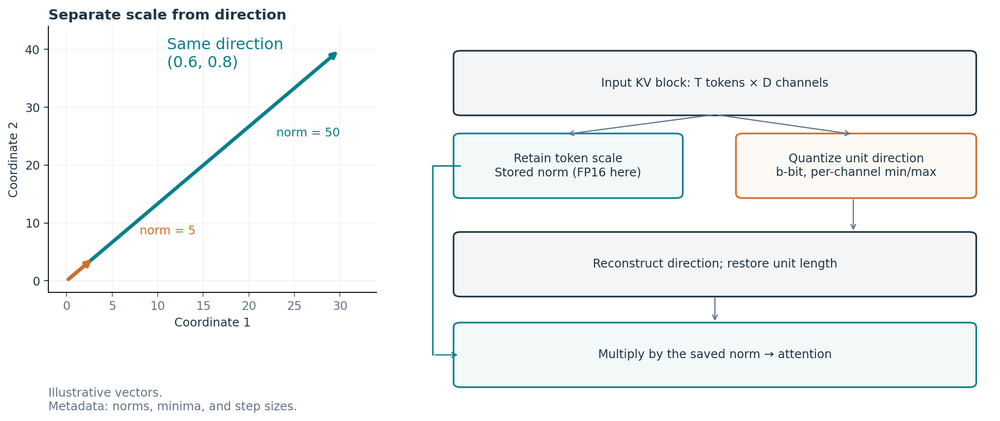
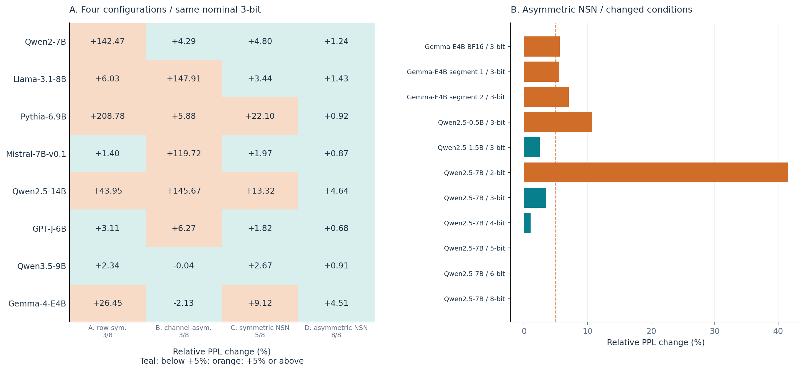
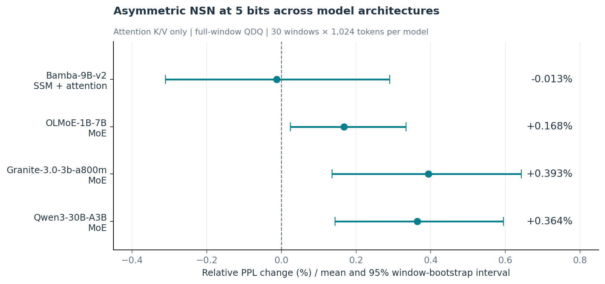
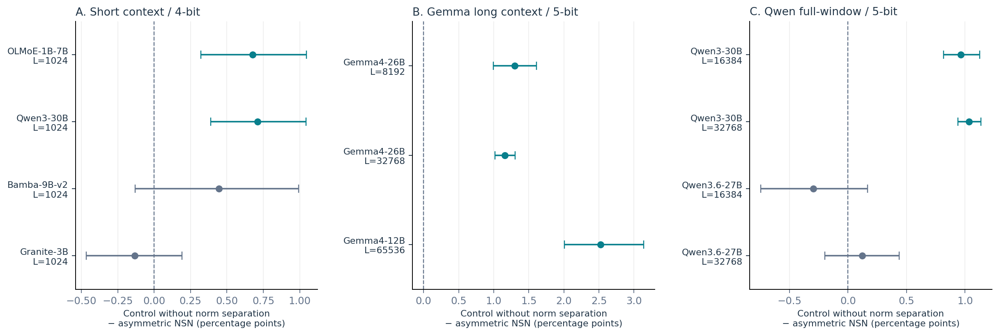
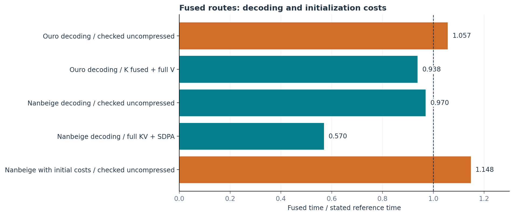
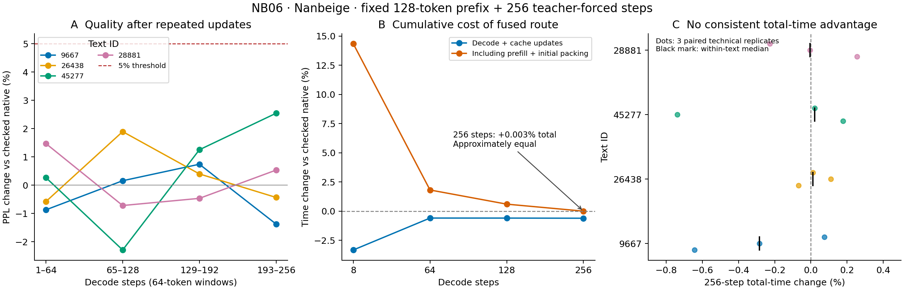

# NSN: KV Quantization by Separating Norm and Direction

## Configuration, Applicability, and the Cost of Using Compressed Representations

**Kentaro Sato**  
Independent Researcher  
Contact: info@metaclan.jp  
October 29, 2026 · English version v1.0

## Abstract

Asymmetric NSN stores each KV vector's magnitude (norm) separately, applies per-channel asymmetric quantization to direction, and renormalizes it after reconstruction. This paper identifies settings that keep PPL degradation within a 5% diagnostic threshold—termed quality-preserving settings here—and examines the conditions and costs involved in turning reduced KV storage into execution benefits. The representation uses input-block statistics alone, without additional quantizer training or a separate calibration corpus.

In a four-method comparison at 3 bits, asymmetric NSN alone kept PPL degradation below 5% for all 8 models under the primary conditions. We also compared 3, 4, and 5 bits in 4 models with SSM-plus-attention or MoE architectures, demonstrating applicability with the precision-oriented 5-bit setting. An actual packed 3-bit representation was connected to two looped Transformers, Ouro and Nanbeige. Teacher-forcing evaluations covered 4 texts per model: 255 predictions per text for Ouro, and an extension from 8 to 256 predictions on the same 4 Nanbeige texts. The latter evaluation included compression updates and met the prespecified 5% diagnostic threshold. Final KV storage decreased by 67.68% for Ouro and 64.39% in the extended Nanbeige evaluation.

With a bridge control using the same reconstruction arithmetic, reconstruction fused into attention was faster than the route that materialized a full-length reconstructed array. The time reduction persisted in comparisons between compressed routes in the actual models. For Nanbeige, the time gap relative to uncompressed execution, including initialization, narrowed between 8 and 256 steps; total time at 256 steps was approximately equal. Initial compression and recurring compression updates offset most of the forward-pass savings. Relating quality-preserving settings to execution conditions that account for reconstruction, validation, initialization, and updates supports decisions about compressed representations in terms of quality, capacity, and cost.

**Keywords:** KV cache, norm separation, low-bit quantization, looped Transformers, fused attention, inference cost

## 1. Introduction

When a language model predicts the next token, it need not recompute every past input. A Transformer stores previously computed keys (K) and values (V) and combines them with a new query (Q). This storage is the KV cache. K participates in determining where to attend in the past, whereas V supplies the information retrieved according to the attention weights. Reducing storage can create room for longer contexts or more requests within limited GPU memory.

Quantization rounds fine-grained floating-point values to a small set of representative values. For example, a 3-bit integer has only 8 possible values, allowing the codes to occupy less space than values stored directly at 16 bits. Information lost through rounding cannot be recovered completely, however, and metadata such as quantization step sizes and norms must also be stored. Reconstructing the compact values into a form usable by attention also takes time and memory.

**Asymmetric NSN**, the author's proposed method examined here, compresses KV vectors by separating magnitude from direction. Each token's vector is first divided by its length, or L2 norm, to obtain a unit direction. The norm is stored separately, while directional components are mapped to a small set of integers over the minimum-to-maximum range of each coordinate, or channel. This range is not constrained to be symmetric about zero, hence the term asymmetric. To use the representation, directional components are reconstructed from the integers, renormalized to unit length after rounding, and multiplied by the stored norm. This separates differences in magnitude across tokens from the encoding of direction.

The central task is to **identify settings in which asymmetric NSN preserves quality and examine the conditions and obstacles involved in turning its storage reduction into execution benefits**. The evaluation follows a configuration that meets the quality criterion through storage and use inside attention.

The paper makes two contributions. First, it provides evidence for choosing asymmetric NSN from the four-method comparison and characterizes applicability across bit widths, model architectures, context lengths, and intervention locations. The K/V diagnostics support mechanistic hypotheses about these conditional differences. Second, it measures costs from actual packing through reconstruction, validation, and fusion. A bridge control using the same reconstruction arithmetic and comparisons in actual models identify where capacity reductions translate into benefits during use.

The paper explains asymmetric NSN (§2) and the common evaluation methods (§3), then examines quality-preserving settings (§4), the cost of using compressed representations (§5), and their combination in actual-model evaluations (§6). Section 7 relates configuration differences to other research. Appendix D.5 maps the published NSN study [12] and additional evaluations to the evidence used here; Appendix D provides access to original records, verification, and regeneration.

## 2. KV Compression and the NSN Method

### 2.1 Where K and V are used

Consider one attention head. Let \(t\) denote a past token position and \(D\) the head dimension. Scores are computed from the inner products of the query \(Q\) with each key \(K_t\), then transformed by softmax into weights \(p_t\):

\[
a_t=Q^\top K_t/\sqrt D,\qquad
p_t=\frac{\exp(a_t)}{\sum_u\exp(a_u)},\qquad
c=\sum_t p_tV_t.
\]

Softmax turns scores into weights that sum to 1, and \(c\) is the weighted sum of past information. Changes in K affect the weighting; changes in V affect the information retrieved. Consequently, equal-sized numerical errors in K and V need not have equal effects on predictions.

For a conventional dense cache, approximate KV storage is the product of batch size, number of layers holding KV, number of KV heads, context length, head dimension, and bytes per element, multiplied by 2 for K and V. Looped Transformers reuse the same layer weights across depth. In implementations that retain KV separately for each loop, however, the number of KV storage locations also increases with the loop count. Weight sharing and KV sharing are separate design choices.

### 2.2 Separating a vector's magnitude from its direction

Consider vectors \(x=(3,4)\) and \(x'=(30,40)\). Their lengths, or L2 norms, are 5 and 50, but dividing by their lengths gives the same direction, \((0.6,0.8)\). Numerical differences can thus reflect either different directions or different magnitudes along the same direction.

Asymmetric NSN stores this magnitude separately for each token and quantizes the remaining direction. When the original KV is quantized directly per channel without norm separation, a large-norm token can widen the channel range and make the quantization steps relatively coarse for a small-norm token. Norm separation removes this scale difference from directional quantization.

Next, levels are assigned between the minimum and maximum of each directional channel, or coordinate, within the block. Unlike using one range for all coordinates within a token, per-channel ranges adapt to the distribution of each coordinate. An asymmetric range allocates codes to the interval actually occupied by that channel rather than a range symmetric around zero. A width of \(b\) bits provides \(2^b\) levels: 8 at 3 bits and 32 at 5 bits.

Rounding a direction also changes its length from 1. Renormalizing the reconstructed direction to unit length before multiplying by the stored norm corrects this length change. These are the design roles of norm storage, per-channel asymmetric quantization, and renormalization. Section 4.1 connects this combination to the measured configuration differences.



**Figure 1. Asymmetric NSN and the role of each stage.** The arrows are illustrative vectors. Norms are retained separately, and each directional channel is assigned \(b\)-bit codes. Reconstruction normalizes the direction and restores the stored norm. FP16 metadata is the setting used in the actual packed implementation in this paper.

### 2.3 Mathematical formulation

Let \(X\in\mathbb{R}^{T\times D}\) be a block from one KV head, where \(T\) is the number of tokens in the block and \(D\) is the vector dimension. For token position \(t\) and channel \(j\), decompose the values as

\[
n_t=\lVert x_t\rVert_2,\qquad d_{tj}=x_{tj}/\max(n_t,\epsilon)
\]

For bit width \(b\), let the largest code be \(L=2^b-1\). Define the per-channel minimum and step size as

\[
m_j=\min_t d_{tj},\qquad
s_j=(\max_t d_{tj}-m_j)/L
\]

The integer codes are

\[
z_{tj}=\operatorname{clip}_{[0,L]}
\left(\operatorname{round}\frac{d_{tj}-m_j}{s_j}\right)
\]

For a channel with \(s_j=0\), set \(z_{tj}=0\). We use \(z\) for the code to distinguish it from the attention query \(Q\).

Actual storage also rounds the metadata. In the actual packed 3-bit implementation used here, \(n,m,s\) are computed in FP32, stored in FP16, and read back in FP32 for reconstruction. Denoting these values by \(\bar n,\bar m,\bar s\), we reconstruct as

\[
\bar n=\operatorname{FP32}(\operatorname{FP16}(n)),\quad
\bar m=\operatorname{FP32}(\operatorname{FP16}(m)),\quad
\bar s=\operatorname{FP32}(\operatorname{FP16}(s)),
\]

\[
\widetilde d_{tj}=\bar m_j+\bar s_jz_{tj},\qquad
\widehat x_t=\operatorname{cast}
\left(\bar n_t\frac{\widetilde d_t}
{\max(\lVert\widetilde d_t\rVert_2,\epsilon)}\right)
\]

Here, \(\operatorname{cast}\) rounds to the floating-point format accepted by attention. Inputs with zero norm reconstruct to zero. Magnitude is reconstructed from the norm stored at finite precision.

### 2.4 The computational core and implementation differences

Code 1 instantiates asymmetric NSN, which supports a general bit width, at 3 bits for the reference quantization and reconstruction used by the two looped models. The last two input axes are 64 tokens × 128 dimensions. Intermediate calculations use FP32, and metadata is stored in FP16. Inputs are assumed to have passed checks for non-finite values and representable storage ranges.

**Code 1. NSN 3-bit quantization and reconstruction (10-line function body)**

```python
import torch

def nsn_int3_qdq(x):
    a = x.float()
    n = torch.linalg.vector_norm(a, dim=-1, keepdim=True)
    d = a / n.clamp_min(1e-12)
    m = d.amin(dim=-2, keepdim=True)
    s = (d.amax(dim=-2, keepdim=True) - m) / 7
    q = ((d - m) / torch.where(s == 0, torch.ones_like(s), s)).round().clamp(0, 7).to(torch.uint8)
    n, m, s = (t.half().float().contiguous() for t in (n, m, s))
    d = (m + s * q.float().contiguous()).contiguous()
    y = n * (d / torch.linalg.vector_norm(d, dim=-1, keepdim=True).clamp_min(1e-12))
    return torch.where(n == 0, torch.zeros_like(y), y).to(x.dtype)
```

The code performs quantize–dequantize (QDQ): it creates codes and reconstructs floating-point values. Bit packing without gaps, cache updates, input validation, and attention kernels are separate operations. Storage also differs by experiment: the Ouro/Nanbeige integrations use bit-packed 3-bit codes, whereas the isolated QK-score component measurements (§5.2) store one uint8 element per code. Fused routes also change where reconstruction arithmetic is performed and the order of reductions, so we evaluate them using the arithmetic-matched controls and numerical checks described below.

The quantizer itself uses only statistics of the input block; it requires neither a learned codebook nor calibration on a separate corpus. Model-specific evaluation is still needed to choose suitable bit widths and block sizes. The exploratory process used to develop the method in this study is part of that evaluation.

### 2.5 Storage including codes, metadata, and tails

The term 3-bit describes the width of the integer codes. If \(T\) norms and \(D\) minima and step sizes are all stored in FP16, a block that requires no padding to byte boundaries occupies

\[
B_{\mathrm{block}}=bTD/8+2(T+2D)+B_{\mathrm{header}}
\]

A 64×128 block at 3 bits contains 3,072 bytes of codes, 640 bytes of metadata, and a 12-byte header: 3,724 bytes in total, or 3.63671875 effective bits per element. This is smaller than the 16,384 bytes required by the same block in FP16, but not by the simple ratio 3/16. A tail retained at high precision further changes the reduction in total cache storage.

## 3. Comparisons and Evaluation Methods

### 3.1 Measuring configuration, applicability, and cost separately

To evaluate quality-preserving settings and the cost of using the resulting representation, we use three comparison groups: configuration, applicability, and storage and use (Table 1). Each group consists of separately designed and collected exploratory results; its controls, bit widths, and evaluation units are retained in aggregation.

**Table 1. Comparison groups and measurement targets**

| Comparison group | Primary targets | Intervention and evaluation unit | Primary metrics |
| --- | --- | --- | --- |
| Configuration comparison | 8 models and follow-ups with changed conditions | Four methods applied to saved prefix KV; short WikiText-2 windows | PPL relative to uncompressed execution; differences between configurations |
| Applicability comparison | SSM-plus-attention, MoE, and other models; 1,024–65,536 tokens | 3-/4-/5-bit evaluation and method families with or without norm separation; blocks, high-precision tails, and intervention locations; 30 windows each | Mean window-level PPL changes and paired differences |
| Storage and use comparison | Synthetic components, Qwen2/Llama, and Ouro/Nanbeige | Actual packing, reconstruction methods, input validation, fusion, and model integration | Actual bytes, numerical consistency, PPL, time, and memory |

Appendix C specifies the implementation conditions, and Appendix D describes reaggregation from saved records and the scope of numerical verification.

### 3.2 Materials and scoring for the configuration comparison

Nonempty lines from the WikiText-2 test split [1] were concatenated, and the first 48,000 characters were tokenized. Windows of 1,024 tokens were advanced with a stride of 512, up to 10 windows. The first 512 tokens were used for prefill, their KV was quantized, and the following 512 predictions were scored. Because logits for the first target token were computed before compression, the remaining 511 scored predictions in each window passed through attention after compression. Each method was applied to both K and V.

### 3.3 Comparing bit widths, architectures, blocks, and intervention locations

The architecture applicability comparison targeted attention K/V projection outputs in Bamba-9B-v2 (SSM plus attention) and OLMoE-1B-7B, Granite-3.0-3b-a800m, and Qwen3-30B-A3B (MoE). MoE routes tokens to selected experts. Attention KV within each model was quantized, while SSM states and expert weights were retained. Quality was evaluated with whole-window QDQ, using the full 1,024-token window to determine ranges. These results characterize representation quality under full-window range estimation; they do not establish the same quality under an online cache-compression policy. Section 6 separately evaluates sequential use over short spans through actual packed integration.

This comparison evaluated INT3, INT4, and INT5 on the same four models and evaluation windows. The integer codes provide 8, 16, and 32 levels, respectively; increasing bit width provides a finer grid in exchange for more code bits. The original design included INT5 as a conservative, precision-oriented candidate. From these existing results, this paper presents 5 bits in detail as a common higher-precision setting and includes the 3- and 4-bit results in Table 6.

The method-family comparisons use the following two procedures.

- **Asymmetric NSN (abbreviated as NSN in the comparison tables below):** For both K and V, separate each token's norm and apply per-channel asymmetric quantization to direction. Renormalize the reconstructed direction and multiply by the stored norm.
- **The control without norm separation (plain):** Quantize the original vectors directly, using per-channel asymmetric quantization for K and asymmetric quantization within each token and head for V. No norm is stored separately, and no renormalization follows reconstruction. This is a quantized control, distinct from the uncompressed baseline.

Both use asymmetric quantization. Whereas method B in the configuration comparison (§4.1) quantized both K and V per channel, plain quantizes V per token. Beyond whole-window conditions, we compare 128-token K blocks, retention of the last 128 tokens at high precision, and intervention after K RMS normalization when the model has that operation. RMS normalization adjusts vector scale within the model, so the distribution being quantized changes across this location.

NSN V uses the same block and tail rules as K, whereas plain V is quantized per token over all tokens. The main NSN operations use FP32; parts of plain range and reconstruction arithmetic use the input dtype. K interventions are before RoPE, while the cache intervention in §3.2 is after RoPE. These are therefore comparisons between method families including K/V processing, tail rules, and intermediate precision. Appendix C.1 maps the implementations.

Each model and setting uses 30 windows selected with a fixed seed, and relative PPL changes are averaged across windows. The table notation “plain − NSN” is a subtraction, not a method name: the relative PPL change for plain minus that for asymmetric NSN in the same window. It is measured in percentage points (pp); positive values indicate a smaller PPL change for asymmetric NSN. We reproduce the original 95% percentile intervals from 5,000 window-level resamples. Windows can overlap in token range, so these window-bootstrap intervals are distinguished from estimates based on 30 independent texts. Overlap counts and seeds appear in Appendices A.2 and C.5.

### 3.4 Connecting actual packed representations to two looped models

Ouro-1.4B and Nanbeige4.2-3B-Base reuse layer weights [2, 3]. We keep weights in BF16 and compress K/V separately for each loop and layer. Ouro uses 8 loops, 24 layers, and 16 query and KV heads. Nanbeige uses 2 loops and 44 KV storage locations, with grouped-query attention (GQA): its 48 query heads share 8 KV heads, so 6 query heads refer to each KV head. Both models have a head dimension of 128.

**Table 2. Fixed conditions for the initial two-model comparisons using actual packed representations (continuation evaluation in §3.4.1)**

| Item | Ouro | Nanbeige |
| --- | --- | --- |
| Materials | 4 texts from the PG19 training split | 4 different texts from the same split |
| prefill | 768 tokens | 128 tokens |
| Primary quality evaluation | 255 predictions per text | 8 predictions per text |
| Technical replicates per text | 2 | 3 |
| Initially compressed tokens | 704 | 64 |
| Additional compression | 3 additions of 64 tokens | None in the primary span |
| Final compressed tokens / high-precision tail | 896 / 127 tokens | 64 / 72 tokens |
| Compressed-route control | Internal K reconstruction + full-length V reconstruction | Full-length K/V reconstruction + SDPA |

PG19 is a book-level dataset [4]. The texts had not previously been used in this study; this does not imply that they were absent from model pretraining. The retrieved openings were tokenized with a fixed tokenizer and `add_special_tokens=False`, without custom removal of front matter or whitespace.

We use teacher forcing, supplying the same ground-truth token sequence to every route. This does not evaluate feeding model-generated text back as subsequent input. Ouro's primary timing covers 240 positions after excluding the union of initial positions and diagnostic capture positions. Nanbeige's timing covers 8 positions after compression. Measurements including initialization sum prefill, initial compression, and decoding.

### 3.4.1 Evaluating Continuation and Compression Updates on the Same Texts

We retained the four texts and 128-token prefix from the initial Nanbeige comparison and extended teacher-forced continuation to 256 steps. Reconstruction arithmetic, the fused kernel, 64-token blocks, numerical budgets, and pinned model/tokenizer versions were inherited unchanged. The first 385 tokens supply 256 prediction targets at zero-based indices 129–384. Retrieved-text hashes and agreement with the previous 137-token inputs were checked before loading model weights. This comparison examines continuation and updates on the same materials, rather than adding four new texts.

Initially, the first 64 tokens are compressed. Each forward pass appends new KV to the BF16 tail and performs attention and prediction; afterward, another 64 old tokens are compressed at steps 64, 128, 192, and 256. Existing packed blocks are unchanged. Terminal storage contains 320 compressed tokens and a 64-token BF16 tail. All four updates count toward time and storage; the first three are also consumed by subsequent attention.

Checked uncompressed execution, full reconstruction plus SDPA, and GQA fusion were measured with three technical replicates per text. Quality over all 256 predictions, the first 8, and four nonoverlapping 64-prediction blocks, together with cumulative time at steps 8, 64, 128, and 256, was fixed before measurement. All routes time forward and post-forward processing with the same boundaries; the uncompressed post-processing call is a no-op control. Decoding including updates sums these two components; time including initialization additionally sums prefill and initial compression. Diagnostic capture and evidence saving are outside timing. Aggregation takes the median of three paired ratios within each text, then the median across four texts. The initial 8-prediction comparison and the extension are reported as separate measurements.

### 3.5 Interpreting quality, storage, and time

Quality is measured by the negative log-likelihood (NLL) of the ground-truth tokens and perplexity (PPL), obtained by exponentiating mean NLL. Lower values indicate that the model assigned higher probabilities to the ground-truth tokens in the evaluation sequence. Relative change is

\[
r=100\left(\frac{\mathrm{PPL}_{\mathrm{quant}}}{\mathrm{PPL}_{\mathrm{base}}}-1\right)
\]

Positive values indicate degradation and negative values improvement. A 5% increase in PPL is not a 5-percentage-point decline in accuracy.

The configuration comparison uses ratios of saved aggregate PPL values, whereas the applicability comparison uses the mean of window-level relative changes. For the two models using actual packed KV representations, technical replicates of a text are not counted as additional independent materials: NLL differences are averaged with equal weight for each of the 4 texts and converted back to relative PPL. We do not combine these three calculations into a single overall PPL. The 5% value is a prespecified diagnostic threshold for the configuration comparison and the two-model diagnostics, not the result of a statistical non-inferiority test. A separate 0.5% criterion is defined explicitly in Appendix A.

Storage is measured in actual bytes for integer codes, metadata, headers, and tails. GPU allocated memory is memory assigned to tensors and related objects; reserved memory is memory held by the allocator. Neither is the same as the storage occupied by KV alone. Timing separates warmed-up components, model decoding, and execution including initial compression. The latter model comparisons compare routes that include input validation, not the fastest native implementations in general.

## 4. Quality: Evidence for Choosing Asymmetric NSN and Its Applicability

The quality evaluation first establishes the evidence for choosing asymmetric NSN from the four configurations, then characterizes its scope across bit widths, models, and application conditions. The final K/V diagnostics provide supporting evidence for explaining differences across conditions.

### 4.1 Why the four-method comparison supports choosing asymmetric NSN

We compared two methods that quantize the original KV without separating norms and two that store norms separately and quantize direction. Each method was applied to both K and V in 8 models, and PPL changes were evaluated against the same model's uncompressed baseline.

The four methods combine the components shown in Table 3. Symmetric quantization uses 7 levels from −3 to 3 around zero; asymmetric quantization maps the minimum-to-maximum range to 8 levels from 0 to 7. Both are nominally 3-bit, but their numbers of levels and metadata requirements differ.

**Table 3. Methods in the configuration comparison**

| Method | Norm separation | Axis used to determine quantization range | Integer range | Reconstructed-direction renormalization |
| --- | --- | --- | --- | --- |
| A: per-row symmetric | No | Within each token vector | −3 to 3 | No |
| B: per-channel asymmetric | No | Across tokens in the same channel | 0 to 7 | No |
| C: symmetric NSN | Yes | Across tokens in the same directional channel | −3 to 3 | Yes |
| D: asymmetric NSN | Yes | Across tokens in the same directional channel | 0 to 7 | Yes |

Asymmetric NSN was the only one of the four methods to keep PPL degradation below 5% for all 8 models under the primary conditions (Table 4 and Figure 2, left). Symmetric NSN did so for 5 models, while row-wise symmetric quantization and per-channel asymmetric quantization without norm separation each did so for 3. Even at the same nominal 3 bits, coverage differed substantially between these configurations.

**Table 4. Relative PPL change for the four methods (%, against the same model's uncompressed baseline)**

| Model | A: per-row symmetric | B: per-channel asymmetric | C: symmetric NSN | D: asymmetric NSN |
| --- | --- | --- | --- | --- |
| Qwen2-7B | +142.471 | +4.294 | +4.804 | +1.236 |
| Llama-3.1-8B | +6.030 | +147.912 | +3.441 | +1.435 |
| Pythia-6.9B | +208.777 | +5.879 | +22.103 | +0.924 |
| Mistral-7B-v0.1 | +1.402 | +119.720 | +1.974 | +0.868 |
| Qwen2.5-14B | +43.949 | +145.665 | +13.323 | +4.644 |
| GPT-J-6B | +3.107 | +6.271 | +1.821 | +0.683 |
| Qwen3.5-9B | +2.341 | -0.037 | +2.665 | +0.913 |
| gemma-4-E4B | +26.451 | -2.132 | +9.118 | +4.515 |
| Below +5% | 3/8 | 3/8 | 5/8 | 8/8 |

The unit of comparison is the complete configuration. Quantization axis, norm separation, range, number of levels, and renormalization change in combination, so their individual effects are not isolated. We use the scope achieved by each configuration as evidence for choosing a method.

Using per-channel ranges alone, asymmetric quantization without norm separation (B) did not cover all 8 models. On Llama, B gave +147.912%, compared with +1.435% for asymmetric NSN (D). This difference corresponds to the motivation for separating variation in token magnitude from directional quantization. The rank correlation between V-norm variation and B's degradation (Appendix A.1) is also consistent with range interference caused by scale differences.

Symmetric NSN (C) includes norm separation and renormalization, yet gave +22.103% on Pythia. D gave +0.924% on the same model, showing that the range and number of codes used for direction also matter to configuration choice. Asymmetric NSN allocates levels to the min/max range occupied by each directional channel; this combination covered all models under the primary conditions.

B had lower PPL than D on Qwen3.5 and Gemma. The basis for choosing D is the breadth of the tested model set it brought within a common quality threshold. The roles of norm storage, direction coding, and renormalization are considered together with this observation about the complete configuration.



**Figure 2. Quality of the four configurations and condition-specific quality of asymmetric NSN.** Left: the 8 models × 4 methods in Table 4; cells give relative PPL changes (%) and are colored by whether they are below +5%. Right: conditions in Table 5, with a dashed line at +5%. Model, material, and bit-width conditions are identified by row.

### 4.2 Quality across bit widths and evaluation conditions

We examine how far the quality observed under the primary conditions extends when bit width, dtype, model size, and text segment change.

Gemma showed +4.515% under the primary conditions, but +5.632% in the BF16 comparison and +5.521% and +7.052% in other segments. The latter were configured for up to 30 windows, while actual counts corresponding to the saved numbers of scored tokens were 20 and 22 windows. Asymmetric INT3 for Qwen2.5-0.5B also showed +10.755%, compared with +2.484% for the 1.5B model.

**Table 5. Applicability observed outside the primary conditions**

| Target and condition | Method | Relative PPL % | Scoring unit |
| --- | --- | --- | --- |
| Gemma-4-E4B/bf16 | Asymmetric NSN 3-bit | +5.632 | Up to 10 windows; actual count unrecorded |
| Gemma-4-E4B other segment 1 | Asymmetric NSN 3-bit | +5.521 | 20 windows / 10,240 predictions |
| Gemma-4-E4B other segment 2 | Asymmetric NSN 3-bit | +7.052 | 22 windows / 11,264 predictions |
| Qwen2.5-0.5B | Asymmetric NSN 3-bit | +10.755 | Up to 10 windows; actual count unrecorded |
| Qwen2.5-1.5B | Asymmetric NSN 3-bit | +2.484 | Up to 10 windows; actual count unrecorded |
| Qwen2.5-7B | Asymmetric NSN 2-bit | +41.536 | Up to 10 windows; actual count unrecorded |
| Qwen2.5-7B | Asymmetric NSN 3-bit | +3.474 | Up to 10 windows; actual count unrecorded |
| Qwen2.5-7B | Asymmetric NSN 4-bit | +1.035 | Up to 10 windows; actual count unrecorded |
| Qwen2.5-7B | Asymmetric NSN 5-bit | -0.017 | Up to 10 windows; actual count unrecorded |
| Qwen2.5-7B | Asymmetric NSN 6-bit | +0.065 | Up to 10 windows; actual count unrecorded |
| Qwen2.5-7B | Asymmetric NSN 8-bit | +0.021 | Up to 10 windows; actual count unrecorded |

Within Qwen2.5-7B, the bit-width comparison changed from +41.536% at 2 bits to +3.474% at 3 bits, +1.035% at 4 bits, and −0.017% at 5 bits. Values at 6 and 8 bits were +0.065% and +0.021%, respectively. Asymmetric NSN thus offers bit width as a choice between precision and code size. In this evaluation, 3 bits and above met the 5% threshold; results from other models, dtypes, and text segments further inform the choice of application conditions.


### 4.3 Adjusting bit width for attention KV within hybrid and MoE models

To examine applicability across computational architectures, we compared the same asymmetric NSN at 3, 4, and 5 bits in Bamba's SSM-plus-attention architecture and three MoE models (Table 6). Reading the means against the common 5% diagnostic threshold, Granite and Qwen3 exceeded it at 3 bits, while all four models were within it at 4 bits. At 5 bits, mean relative PPL changes ranged from −0.013% to +0.393% (Figure 3). Presenting the precision-oriented 5-bit results alongside those using fewer code bits makes the model-dependent choices between precision and code size visible.

**Table 6. Mean relative PPL changes for asymmetric NSN by bit width and model architecture (whole-window QDQ; 30 windows × 1,024 tokens per model)**

| Model | Architecture | 3-bit mean (%) | 4-bit mean (%) | 5-bit mean (%) | 5-bit 95% window-bootstrap interval (%) |
| --- | --- | --- | --- | --- | --- |
| Bamba-9B-v2 | SSM + attention | +0.424 | +0.501 | -0.013 | [-0.310, +0.291] |
| OLMoE-1B-7B | MoE | +4.671 | +0.886 | +0.168 | [+0.024, +0.334] |
| Granite-3.0-3b-a800m | MoE | +14.222 | +1.940 | +0.393 | [+0.135, +0.643] |
| Qwen3-30B-A3B | MoE | +5.345 | +1.058 | +0.364 | [+0.144, +0.595] |

At each bit width, the same procedure was applied to all four models. INT5 illustrates a common precision-oriented setting; it does not establish a minimum bit width required by hybrid or MoE models. All four 5-bit means were within ±0.5%. The intervals in the table refer to 5 bits; Appendix A.2 explains the interval-based reading and the existing band criteria.



**Figure 3. INT5 asymmetric NSN applicability.** Points are mean window-level relative PPL changes; lines are 95% window-bootstrap intervals. The same 5-bit setting is applied to attention K/V within each model. Zero indicates no PPL change from the uncompressed baseline; positive values indicate degradation.

### 4.4 Comparisons across lengths and intervention locations show conditional differences between method families

Beyond bit width, we compare quality under settings that combine block size, high-precision tails, and intervention location. Table 7 presents the adopted settings and results from comparisons varying these conditions. At short lengths, the paired-difference intervals were positive for OLMoE and Qwen3 and included zero for Bamba and Granite. In the three long-context Gemma conditions, relative PPL changes were smaller for NSN.

**Table 7. Relative PPL and differences between method families at the adopted settings**

| Model @ length | bit | Setting | Asymmetric NSN % | plain (no norm separation) % | plain − NSN, pp | 95% window-bootstrap interval for the difference |
| --- | --- | --- | --- | --- | --- | --- |
| OLMoE-1B-7B@1024 | 4 | 128-token blocks + high-precision tail | +0.447 | +1.124 | +0.677 | [+0.321, +1.047] |
| Qwen3-30B@1024 | 4 | 128-token blocks and tail + post-K-normalization | +0.072 | +0.783 | +0.711 | [+0.388, +1.044] |
| Bamba-9B-v2@1024 | 4 | 128-token blocks + high-precision tail | +0.429 | +0.874 | +0.445 | [-0.131, +0.993] |
| Granite-3B@1024 | 4 | 128-token blocks + high-precision tail | +0.724 | +0.592 | -0.133 | [-0.465, +0.192] |
| Gemma4-26B@8192 | 5 | 128-token blocks and tail + post-K-normalization | -0.024 | +1.273 | +1.296 | [+0.993, +1.610] |
| Gemma4-26B@32768 | 5 | 128-token blocks and tail + post-K-normalization | +0.074 | +1.234 | +1.160 | [+1.016, +1.305] |
| Gemma4-12B@65536 | 5 | 128-token blocks and tail + post-K-normalization | -0.243 | +2.282 | +2.526 | [+2.006, +3.139] |

The difference is the control without norm separation minus asymmetric NSN (pp). Short-context comparisons use 4 bits and long-context Gemma comparisons 5 bits. The setting column describes K-side processing (V is described in §3.3). For OLMoE, post-normalization plain produced non-finite values in all 30 windows, so we adopted the preceding setting with a high-precision tail.

In a separate whole-window INT5 comparison, positive differences remained at lengths 16,384 and 32,768 for Qwen3, while intervals included zero at the same lengths for Qwen3.6 (Figure 4). This comparison identifies the models and lengths at which differences between method families persist.



**Figure 4. Window-level relative PPL differences between the control without norm separation (plain) and asymmetric NSN.** Points show means and lines show the original 95% window-bootstrap intervals. Positive values indicate smaller changes for NSN. Each panel identifies its bit width and intervention conditions.

Placing conditions in which the NSN family yielded lower PPL changes alongside those in which differences could not be distinguished makes its scope more concrete. The correlation between V-norm dispersion and quality degradation is one candidate explanation for these conditional differences and is presented in Appendix A.

### 4.5 K/V diagnostics examine the sources of quality changes

As a supporting diagnostic for explaining applicability, we examine separately whether errors enter through K or V.

In diagnostics on other Gemma segments, method B without norm separation was applied to K only, V only, or both. K-only quantization improved PPL in both segments, with relative changes of −2.029% and −0.959%. V-only changes were −0.512% and +0.399%, changing direction across segments. Quantizing both gave −2.339% and −1.103% (Appendix A.5). These observations show that an aggregate result from quantizing both sides does not explain which side changed or how.

By contrast, in Ouro's prefix-only NSN3 diagnostic with 8 loops, K-only PPL degradation was +0.491% and V-only degradation +0.173%. Ground-truth token loss was slightly larger on the K side, but KL divergence over the full vocabulary distribution was larger on the V side. The breakdown changes with the model, method, and evaluation target. It is therefore useful to explain the separate paths through which errors enter attention rather than impose a single K/V ranking. Section 8.1 examines this distinction through the error paths within attention.

## 5. Implementation: From Storage Reduction to Cost of Use

After selecting a representation that meets the quality criterion, its integer codes must still be packed, stored, and supplied to attention. This section compares storage including metadata, reconstruction and validation costs, and fusion into computation to examine implementation factors that determine the benefit of compression.

### 5.1 Actual packing checks storage and reconstructed values

In a synthetic actual-packing measurement, a 2048×128 block stored as codes and FP16 metadata occupied 3.140625 effective bits per element, without a header. Scaling this storage to the model shape gives an 80.371% reduction relative to FP16. In contrast, the actual models use 64×128 blocks with 3.63671875 effective bits per element, plus an uncompressed tail. Smaller blocks increase the metadata fraction, so actual storage differs even with the same 3-bit codes.

Integer pack/unpack can recover the original integers, but reconstruction that includes metadata rounding need not be bit-identical to simulated QDQ. In the synthetic check, 223,471/262,144 elements differed, with a maximum absolute difference of 0.005859375. For model PPL, the absolute differences between actual packing and simulated QDQ were 0.000247 for Qwen2 and 0.000197 for Llama.

These results illustrate that differences in reconstructed values can coexist with small PPL differences. Checking integer storage, reconstruction arithmetic, and final predictions separately identifies where changes introduced by storage remain.

### 5.2 Reconstruction and validation methods change the cost of use

Table 8 compares reconstruction implementations during model decoding with an existing packed prefix, alongside an uncompressed baseline. The reconstruction routes operate head by head, batch heads within a layer, or compile batched reconstruction.

**Table 8. Reconstruction-route comparison during model decoding (ms/token; initial packing excluded)**

| Model | Uncompressed | Per-head reconstruction | Batched-head reconstruction | Compiled reconstruction |
| --- | --- | --- | --- | --- |
| Qwen2-7B | 13.61 | 33.52 | 18.17 | 13.94 |
| Llama-3.1-8B | 14.29 | 64.86 | 19.64 | 14.90 |

Values are medians of 3 technical replicates on an A100. Prefill used 1,024 tokens, followed by 50 timed decoding steps. Warmup used 5 steps for the usual routes and 10 for the compiled route, so cache lengths at the start of timing also differed.

In the synthetic QK-score comparison, the timing of the fused NSN5 route relative to the FP16 route also depended on shape. For the Gemma shape, NSN5 was faster than FP16 in 15/15 paired cells, with a median FP16/NSN5 time ratio of 1.494. For the Qwen shape, it was faster in 7/16 cells, with a median ratio of 0.993. 

Input validation also has a cost. Across 18 saved inputs, the Triton route that grouped finite-value checks was faster than the route with separate checks. Median paired ratios indicated reductions of 77.68% for validation alone and 38.78% for the full compressed readout path. Detection behavior was checked over 64 synthetic fixture conditions × 3 methods. The time reduction came from grouping validation operations, not removing the checks.

### 5.3 Comparing fusion costs with matched reconstructed values

When the arithmetic differs between the existing reconstructor and a fused kernel, evaluating fusion mixes a change in operation placement with a change in reconstructed values. We therefore compared three routes using the same packed V:

1. Construct full-length V with the existing reconstructor and pass it to attention.
2. Construct full-length V with the same block-level reconstruction arithmetic as the fused route and pass it to attention.
3. Execute that same block-level arithmetic inside attention, using V without constructing a full-length array.

We call the second route **a bridge control using the same reconstruction arithmetic**. The third route was 28.280% faster than the bridge control and required no full-length reconstructed V array. This value aggregates paired ratios for the same queries and samples over 6 primary samples from 2 texts. The difference from the existing reconstructor was 41.721%, but that comparison also includes a change in reconstruction arithmetic.

The bridge control and fused route matched in V, context, and output on the checked inputs. Appendix B specifies the numerical references, tolerances, and checked input scope. This control isolates costs of routes that use the same compressed representation.

## 6. Evaluating Quality, Capacity, and Cost Together in Actual Models

Actual packed integration into Ouro and Nanbeige tests whether the savings observed in components persist at the model level. We relate quality, final KV storage, decoding time, and time including initialization within the same executions.

### 6.1 Actual packed representations supported subsequent predictions

Both models connected actual 3-bit codes to subsequent predictions while preserving the mapping among loops, layers, and heads. We evaluated 4 texts with 255 predictions each for Ouro and 4 texts with 8 predictions each for Nanbeige. Fused-route PPL degradation stayed within the 5% diagnostic threshold in the fixed evaluation windows. Equal-text-weighted relative PPL changes were −0.547% and +1.526%, respectively. Text-level values are given in Appendix A.

**Table 9. Results of the initial two-model comparison**

| Measure | Ouro | Nanbeige |
| --- | --- | --- |
| Texts × predictions | 4×255 | 4×8 |
| Fused relative PPL % | -0.547 | +1.526 |
| Uncompressed → compressed KV bytes | 1,609,039,872 → 520,077,312 | 24,510,464 → 15,597,824 |
| Final KV storage reduction | 67.678% | 36.363% |
| Decoding time relative to compressed control % | -6.162 | -43.040 |
| Decoding time relative to uncompressed execution % | +5.722 | -2.984 |

Final KV storage is actual storage, including metadata and the high-precision tail. Ouro ends with 896 compressed tokens and a 127-token high-precision tail; Nanbeige ends with 64 compressed tokens and a 72-token high-precision tail. The different reduction rates also reflect these different compressed fractions.

### 6.2 Where fusion saves time and how initialization changes the result

Ouro's fused route was 6.162% faster than its compressed control, which reconstructs K internally and V as a full-length array. It was nevertheless 5.722% slower than uncompressed execution with input validation. Nanbeige's fused route was 43.040% faster than its compressed control, which reconstructs full-length K/V and passes them to SDPA. Its decoding was also 2.984% faster than checked uncompressed execution.

However, Nanbeige's total time for prefill, initial compression, and 8 decoding steps was 14.765% longer than uncompressed execution. Over this short continuation, savings during decoding did not offset the initial cost. Since the compressed controls differ between Ouro and Nanbeige, 6.162% and 43.040% are not model-specific effect sizes for the same intervention.



**Figure 5. Fused-route time divided by the reference time specified in each row.** Ratios below 1 indicate faster fused execution. Ouro uses the primary 240 timed positions; Nanbeige uses 8 positions after compression. Only the bottom row includes prefill and initial compression. Ouro aggregates 8 paired ratios; Nanbeige aggregates 4 text-level ratios after first summarizing 3 paired ratios within each text.

### 6.3 Separating KV storage from whole-GPU peak memory

Reductions of 67.678% and 36.363% in final KV storage do not directly translate into the same reductions in whole-GPU peak memory. Model weights, temporary reconstruction and attention arrays, and prefill before compression remain. For Ouro's fused route, peak allocated memory during decoding decreased by approximately 24.36% relative to uncompressed execution, while reserved memory increased. For Nanbeige, the recorded peak allocated memory including prefill did not change, and the reduction in decoding peak was small.

Obtaining a smaller stored representation and running the target workload on a smaller GPU are therefore separate stages that can be measured independently. In this implementation, we observed both the reduction in the former and the stages constraining the latter.

### 6.4 Continuing Compression Updates Narrows the Gap from Initial Cost

**Extending the same four texts to 256 predictions retained the quality criterion and KV savings, while total time including initialization and updates was approximately equal to checked uncompressed execution.** Equal-text-weighted fused relative PPL was +0.152% over all 256 predictions and +0.308% over the final 64. Both compressed routes stayed within the 5% threshold for every text and prespecified window.

**Table 9a. Continuation evaluation: fused PPL change relative to uncompressed execution**

|PG19 ID|All 256 predictions|Final 64 predictions|
|---|---:|---:|
|9667|−0.339%|−1.374%|
|26438|+0.317%|−0.432%|
|45277|+0.429%|+2.545%|
|28881|+0.203%|+0.535%|
|Four-text aggregate|+0.152%|+0.308%|

The aggregate row gives equal weight to each text's mean NLL before conversion to relative PPL. The full 256 and first 8 predictions contain different target tokens; their difference does not establish a quality-improvement effect of longer continuation.

**Table 9b. Continuation evaluation: changes from paired cumulative CUDA-time ratios (%)**

|Continuation steps|Decode + updates / uncompressed|Including initialization / uncompressed|Decode + updates / full reconstruction|
|---|---:|---:|---:|
|8|−3.323%|+14.334%|−43.219%|
|64|−0.589%|+1.815%|−42.632%|
|128|−0.592%|+0.602%|−42.598%|
|256|−0.604%|+0.003%|−42.500%|

All rows come from the same continuation run, rather than treating a between-run difference from the initial 8-prediction comparison as a length effect. The initialization-inclusive ratio at 256 steps was 1.000032. Text-level medians were faster for two texts and slower for two; among all 12 paired replicates, six were faster and six slower. No aggregate ratio at the four fixed checkpoints fell below 1. We describe the small +0.003% difference at 256 steps as **approximately equal observed time**, not evidence of a speed advantage or statistical equivalence.

An additive mean cost breakdown from saved records (a post hoc description across four texts × three replicates) showed that fused forward passes saved 296.27 ms relative to uncompressed execution. Initial compression added 54.71 ms and post-processing took 233.15 ms, versus 1.64 ms for uncompressed execution, offsetting most of those savings. Of fused post-processing, 230.99 ms, or 99.07%, occurred at the four update steps. This breakdown locates costs and does not replace the primary paired-median metric.

Terminal KV storage fell from 69,206,016 to 24,642,816 bytes (66.000 to 23.501 MiB), a 64.392% reduction. Fused decoding peak allocated memory was also 42.089 MiB lower, but the all-phase peak remained 8,197.590 MiB during prefill for all three routes. **Continuation spreads initial cost over more steps, while compression-update costs recur.** Assessing execution benefits from storage reduction therefore includes both readout and updates.



**Figure 6. Quality and continuation cost on the same four texts.** Left: fused PPL change relative to uncompressed execution in nonoverlapping 64-prediction blocks; the dashed line is the 5% diagnostic threshold. Middle: changes in decoding time including updates and total time including initialization at the fixed 8-, 64-, 128-, and 256-step checkpoints, displayed at equally spaced horizontal positions. Right: all 12 paired total-time ratios at 256 steps and text-level medians. Points and medians describe technical replicates, not confidence intervals.

## 7. Related Work and Positioning

### 7.1 KV representations that separate magnitude and direction

Asymmetric NSN combines per-token norm storage, per-channel min/max scalar quantization of direction, and renormalization after reconstruction, using only input-block statistics. We compare what is encoded and at what unit with related magnitude–direction representations.

MiniCache interpolates and shares similar directions between adjacent layers, then restores each layer's norms [13]. PolarQuant applies random preconditioning, transforms vectors into polar coordinates, and quantizes the resulting angles [14]. TurboQuant uses rotation of unit directions and scalar codebooks, stores norms separately for nonunit vectors, and distinguishes MSE-oriented and inner-product-oriented constructions [15]. FibQuant maps rotated direction subvectors to a common codebook in a fixed-rate representation with a norm header [17]. OCTOPUS separates a global norm and uses octahedral coordinates for rotated triples [24].

**Table 10. Conceptual comparison with related magnitude–direction methods**

| Study | Magnitude and direction | Main compression operation | Comparison axis for NSN |
| --- | --- | --- | --- |
| MiniCache [13] | Separates direction and norm | Interpolates and shares directions across adjacent layers | Sharing across depth versus lowering precision within each block |
| PolarQuant [14] | Transforms to radius and angles | Quantizes angles after recursive polar transformation | Angular representation versus Cartesian direction components |
| TurboQuant [15] | Stores non-unit norms separately | Rotation and scalar codebooks, with objective-specific residual treatment | Fixed codebooks versus input-block minima and maxima |
| FibQuant [17] | Norm header and unit direction | Encodes rotated subvectors with a common codebook | Vector versus scalar coding; storage including metadata |
| OCTOPUS [24] | Separates global norm and local directions | Encodes rotated triples in octahedral coordinates | Alternative coordinates and reconstruction cost inside attention |
| Asymmetric NSN [12] and this paper | Stores a norm per token | Per-channel min/max quantization of direction, followed by reconstruction and renormalization | Configuration without rotation or learned codebooks, applicability across bit widths and architectures, actual storage, and cost |

With these shared ideas in view, this paper provides empirical evidence for the configuration choice and applicability of the author's asymmetric NSN, and evaluates its compressed representation from storage through use inside attention.

### 7.2 Quantization axes and error objectives

KIVI quantizes K per channel and V per token, retaining a high-precision tail [5]. KVQuant addresses K intervention location, nonuniform representations, and outliers [6]. QuaRot extends rotations to weights, activations, and KV [19], whereas Coupled Quantization encodes multiple channels jointly [21]. Comparisons of NSN's block-statistics-based scalar configuration with methods using rotation or vector codebooks must account for these changes as well.

The error objectives also differ. QJL estimates inner products from sketches of K [18]. AsymKV examines K/V error paths and assigns different precisions across layers [20]. NOVA-KV uses calibration statistics, including queries, to construct attention-preserving transforms [22]. KVarN combines Hadamard rotation with variance normalization across token and channel axes to address token-scale errors during autoregressive decoding [16]. Variance normalization differs from NSN's storage and restoration of each token's L2 norm. These methods provide comparison points for examining our K/V diagnostics and mechanistic hypotheses in terms of where errors arise and what is evaluated.

### 7.3 The cost of using compressed representations

FlashAttention introduces a computation order that reduces attention memory transfers [7], and FlashInfer provides templates and runtime support for different cache formats and attention operations [23]. Fusing reconstruction with computation also appears in KIVI [5], and OCTOPUS reconstructs packed values inside Triton attention [24]. SPHERICAL KV includes a route that computes similarities in the angular-code domain of K, distinct from locally reconstructing Cartesian values in NSN [25].

Our bridge control uses the same reconstruction arithmetic to separate arithmetic changes from placement changes, then relates them to model-level costs including input validation and initial compression. Measuring actual KV storage, reconstruction temporaries, allocated/reserved/peak memory, decoding time, and time including initial costs separately identifies the spans over which benefits remain in this NSN implementation.

### 7.4 Application to looped Transformers

Hyperloop addresses weight quantization using cross-loop statistics, and LoopQ addresses weight and activation quantization [8, 9]. Li examines where weight errors enter recurrence and which recurrence steps calibration observes [26]. On the KV side, Looped Latent Attention uses a shared low-dimensional representation across loops [10], while FlashLoop combines cross-loop residuals with skipped updates and fused readout [11].

Our integration retains model weights and applies the same NSN rule separately to KV for each loop and layer, an applicability axis distinct from sharing representations across loops. This supplies a route for reducing the separately retained KV at each loop and reconstructing it locally for use, which can be compared with these approaches.

## 8. Discussion and Scope of Applicability

### 8.1 Configuration scope and K/V error paths

Asymmetric NSN covered all 8 models in the four-method comparison, and INT5 was applicable to attention KV in different model architectures. Separating scale differences and assigning levels to the directional distribution, as described in §§2.2 and 4.1, are mechanistic hypotheses explaining this configuration. The correlation with V-norm variation provides a supporting observation. Further separating individual contributions requires comparisons that manipulate norm variation or quantization ranges within the same model.

Within each K/V diagnostic, prediction effects differed depending on whether K or V was quantized, while the quantization rule was held fixed. K changes the weights assigned to references, while V changes the information mixed with those weights. A K-induced score change common to all tokens disappears under softmax, whereas relative score changes redistribute weights. V errors can also be attenuated or cancel under the weighting. Appendix A.4 gives the equations for these local relationships.

AsymKV reports greater sensitivity to K-side quantization errors under its examined conditions [20], and NOVA-KV incorporates distortion objectives using queries into its design [22]. In our Gemma and Ouro diagnostics, the breakdown also differed between PPL and full-vocabulary KL. K/V sensitivity is therefore characterized jointly by model, method, intervention location, and error objective.

One candidate explanation for the PPL improvement from K-only quantization in Gemma is that perturbing K relaxes attention concentration. The corresponding records do not measure attention entropy or concentration. This remains an untested attention-regularization hypothesis and motivates a diagnostic that records score differences and weight changes together. KVarN's evaluations of sequential quantization history and generation tasks [16] also provide a comparison axis for examining error accumulation.

### 8.2 Practical benefit requires three conditions

First, predictions from the compressed representation must meet the quality criterion for the intended use. Second, storage including metadata and tails must suit the target. Third, the complete workload, including reconstruction, validation, initial compression, and updates, must be able to use that storage benefit. This series identifies concrete conditions under which these three requirements do not hold simultaneously.

An arithmetic-matched bridge control helps investigate the transition from the second requirement to the third. It distinguishes a speed change due to a different representation or quality from a change in how the same values are supplied to computation. Including input validation in timing also makes the difference between an idealized kernel alone and a checked execution route explicit.

### 8.3 Usage conditions to examine next

Further comparisons should examine external methods at matched effective storage, K/V and configuration components separately, and longer sequential use across batch sizes and GPUs. Performance rankings against external methods in the same environment have not been measured here. Such comparisons should budget norms, min/max values, codebooks, rotation information, and high-precision tails, while matching calibration and weight-change requirements and timing from initialization through decoding.

The actual-packing comparisons are batch-1 teacher-forcing diagnostics. Nanbeige now includes 256 continuation steps after a 128-token prefix and measures costs from recurring compression updates. Further work can separate the costs of compressing, concatenating, and validating new blocks, or examine multi-thousand-token contexts, free generation, and downstream tasks according to the intended use. Continuation on the same four texts does not expand the material count; break-even behavior beyond the measured span remains untested.

## 9. Conclusion

By storing norms separately and combining per-channel asymmetric quantization of direction with renormalization, asymmetric NSN provided quality-preserving options across the examined bit widths and model architectures. Under the primary 3-bit comparison conditions, all 8 models met the common 5% threshold; comparisons varying bit width and application conditions further characterized its scope.

Transferring these quality-preserving options to actual packed representations reduced KV storage in two looped Transformers while keeping quality within the diagnostic threshold over the short spans measured. A bridge control enabled comparison of execution routes while holding the V reconstruction arithmetic fixed; time reductions from fusion also persisted in comparisons between compressed routes in the actual models.

Execution benefits depend on the costs of continuing to use the reduced KV representation. For Nanbeige, extending continuation from 8 to 256 steps narrowed the initialization-inclusive time gap, but total time at 256 steps, including recurring updates, was approximately equal to uncompressed execution. Prefill before compression also remained in whole-GPU peak usage. The design implication is to **select quality-preserving settings of asymmetric NSN together with usage conditions in which their capacity benefits remain across initialization, updates, and readout**.

## 10. Data Availability and Author's Role

The figures and tables are regenerated from retained records, with links to original value locations and hashes in Appendix D. The release candidate contains fixed code, records, figures, and separately distributed saved arrays. Author-owned papers, figures, and data are licensed under CC BY 4.0, and code under Apache-2.0; third-party materials retain their original terms (see [licenses](../../LICENSES.md)). The repository is [https://github.com/metaSATOKEN/nsn](https://github.com/metaSATOKEN/nsn); [README](../../README.md) records its access status and the availability of companion ZIPs. A permanent archive DOI for the integrated paper has not been assigned. Appendix D.5 identifies the published NSN version and the scope adopted here.

Kentaro Sato was responsible for research design, interpretation, and final decisions. LLM assistance was used for code, aggregation, and writing. Numerical checks used deterministic verifiers and recomputation of saved outputs. Appendix D.3 describes the scope of verification and the reproduction procedures. These are computational experiments using public texts and existing models, not research involving newly recruited human participants. The research was self-funded by the author and received no external funding. The author declares no competing interests.

## References

1. Merity, S., Xiong, C., Bradbury, J., and Socher, R. *Pointer Sentinel Mixture Models.* 2016. Source of WikiText. [Primary source](https://arxiv.org/abs/1609.07843).
2. Zhu, R.-J., et al. *Scaling Latent Reasoning via Looped Language Models.* arXiv:2510.25741v5, 2026 (first version 2025). [Primary source](https://arxiv.org/abs/2510.25741v5).
3. Nanbeige Lab, et al. *Nanbeige4.2-3B: Unlocking Agentic Capabilities in a Compact Model.* arXiv:2607.22083v2, 2026. [Primary source](https://arxiv.org/abs/2607.22083v2).
4. Rae, J. W., Potapenko, A., Jayakumar, S. M., Hillier, C., and Lillicrap, T. P. *Compressive Transformers for Long-Range Sequence Modelling.* 2019. Material source: [official PG19 description](https://github.com/google-deepmind/pg19).
5. Liu, Z., Yuan, J., et al. *KIVI: A Tuning-Free Asymmetric 2bit Quantization for KV Cache.* 2024. Text consulted: v1. [Primary source](https://arxiv.org/html/2402.02750v1).
6. Hooper, C., et al. *KVQuant: Towards 10 Million Context Length LLM Inference with KV Cache Quantization.* arXiv:2401.18079v6, 2025. [Primary source](https://arxiv.org/html/2401.18079v6).
7. Dao, T., Fu, D. Y., Ermon, S., Rudra, A., and Ré, C. *FlashAttention: Fast and Memory-Efficient Exact Attention with IO-Awareness.* arXiv:2205.14135v2, 2022. [Primary source](https://arxiv.org/abs/2205.14135v2).
8. Zeitoun, A., Torroba-Hennigen, L., and Kim, Y. *Hyperloop Transformers.* arXiv:2604.21254v3, 2026. [Primary source](https://arxiv.org/html/2604.21254v3).
9. Fang, R., Chen, H.-W., and Chen, M.-S. *LoopQ: Quantization for Recursive Transformers.* arXiv:2605.16343v1, 2026. [Primary source](https://arxiv.org/html/2605.16343v1).
10. O’Neill, J., and Reid, F. *Looped Latent Attention: Cross-Loop KV Compression for Looped Transformers.* arXiv:2607.15456v2, 2026. [Primary source](https://arxiv.org/html/2607.15456v2).
11. Yang, W., and Liu, S. *FlashLoop: Fast and Memory-Efficient Looped Transformers via Lazy Updates.* arXiv:2609.29812v2, 2026. [Primary source](https://arxiv.org/html/2609.29812v2).
12. Sato, K. *Norm Separation is Necessary: A Minimalist Calibration-Free INT3 Recipe for KV Cache Quantization.* Zenodo preprint, v1.0.0, 2026. DOI: [10.5281/zenodo.19724817](https://doi.org/10.5281/zenodo.19724817).

13. Liu, A., et al. *MiniCache: KV Cache Compression in Depth Dimension for Large Language Models.* arXiv:2405.14366v2, 2024. [Primary source](https://arxiv.org/html/2405.14366v2).
14. Han, I., Kacham, P., Karbasi, A., Mirrokni, V., and Zandieh, A. *PolarQuant: Quantizing KV Caches with Polar Transformation.* arXiv:2502.02617v1, 2025. [Primary source](https://arxiv.org/html/2502.02617v1).
15. Zandieh, A., Daliri, M., Hadian, M., and Mirrokni, V. *TurboQuant: Online Vector Quantization with Near-optimal Distortion Rate.* arXiv:2504.19874v1, 2025. [Primary source](https://arxiv.org/html/2504.19874v1).
16. Muller, L. K., et al. *KVarN: Variance-Normalized KV-Cache Quantization Mitigates Error Accumulation in Reasoning Tasks.* arXiv:2606.03458v1, 2026. [Primary source](https://arxiv.org/html/2606.03458v1).
17. Lee, N., and Kim, Y. *FibQuant: Universal Vector Quantization for Random-Access KV-Cache Compression.* arXiv:2605.11478v1, 2026. [Primary source](https://arxiv.org/html/2605.11478v1).
18. Zandieh, A., Daliri, M., and Han, I. *QJL: 1-Bit Quantized JL Transform for KV Cache Quantization with Zero Overhead.* arXiv:2406.03482v1, 2024. [Primary source](https://arxiv.org/html/2406.03482v1).
19. Ashkboos, S., et al. *QuaRot: Outlier-Free 4-Bit Inference in Rotated LLMs.* arXiv:2404.00456v1, 2024. [Primary source](https://arxiv.org/html/2404.00456v1).
20. Tao, Q., Yu, W., and Zhou, J. *AsymKV: Enabling 1-Bit Quantization of KV Cache with Layer-Wise Asymmetric Quantization Configurations.* arXiv:2410.13212v1, 2024. [Primary source](https://arxiv.org/html/2410.13212v1).
21. Zhang, T., Yi, J., Xu, Z., and Shrivastava, A. *KV Cache is 1 Bit Per Channel: Efficient Large Language Model Inference with Coupled Quantization.* arXiv:2405.03917v1, 2024. [Primary source](https://arxiv.org/html/2405.03917v1).
22. Fernández-Menduiña, S., et al. *Spend Bits Where Queries Look: KV Cache Vector Quantization with Attention-Preserving Transforms.* arXiv:2608.04074v1, 2026. [Primary source](https://arxiv.org/html/2608.04074v1).
23. Ye, Z., et al. *FlashInfer: Efficient and Customizable Attention Engine for LLM Inference Serving.* arXiv:2501.01005v1, 2025. [Primary source](https://arxiv.org/html/2501.01005v1).
24. Boss, M., Voleti, V., Donné, S., and Vainer, S. *OCTOPUS: Optimized KV Cache for Transformers via Octahedral Parametrization Under optimal Squared error quantization.* arXiv:2605.21226v1, 2026. [Primary source](https://arxiv.org/html/2605.21226v1).
25. Chauhan, A., et al. *SPHERICAL KV: Angle-Domain Attention and Rate-Distortion Retention for Efficient Long-Context Inference.* arXiv:2605.18856v1, 2026. [Primary source](https://arxiv.org/html/2605.18856v1).
26. Li, N. *Quantizing Looped Transformers: Feedback Exposure and Calibration Blindness.* arXiv:2609.30820v1, 2026. [Primary source](https://arxiv.org/html/2609.30820v1).

## Appendix A. Supplementary Results and Evaluation Units

### A.1 Association with norm dispersion

For the 8 models in the configuration comparison, we averaged the coefficients of variation of first-layer token norms recorded over 3 segments within each model, then calculated rank correlations with PPL degradation under B. Spearman correlations were \(\rho=0.881\) for V and \(\rho=0.286\) for K. These are exploratory correlations across 8 points that also differ in model, architecture, and distribution, not causal relationships obtained by manipulating V-norm variation alone. Full original norm arrays were omitted from the saved JSON; the recalculation here concerns associations between retained statistics.

The coefficient of variation is standard deviation divided by mean. Here it describes dispersion in token norms across the first layer, including its heads. The 3 segments each contain 1,024 tokens, starting at token positions 0, 8,192, and 16,384. Table A1 reports coefficients rather than percentages. Gemma's values are small but nonzero.

**Table A1. Norm variation and quality changes under B**

| Model | K-norm coefficient of variation | V-norm coefficient of variation | B relative PPL % |
| --- | --- | --- | --- |
| Llama-3.1-8B | 0.210181 | 0.560496 | +147.912 |
| Mistral-7B-v0.1 | 0.345315 | 0.528247 | +119.720 |
| Qwen2.5-14B | 0.133867 | 0.602329 | +145.665 |
| GPT-J-6B | 0.253932 | 0.335173 | +6.271 |
| Qwen2-7B | 0.472053 | 0.471767 | +4.294 |
| Pythia-6.9B | 0.250074 | 0.346684 | +5.879 |
| Qwen3.5-9B | 0.0335523 | 0.241647 | -0.037 |
| Gemma-4-E4B | 5.5175e-05 | 2.47568e-05 | -2.132 |

Norm statistics and PPL were measured in separate diagnostics and associated at the model level. The stronger V-side correlation does not estimate that V caused all of method B's loss.

### A.2 Different meanings of the 0.5% criterion

All 4 NSN means in Table 6 were within ±0.5%, while the full intervals were inside this band for 2/4 models, Bamba and OLMoE. Granite and Qwen3 had upper limits above +0.5%. Plain Qwen3-30B had a mean of +0.621% and a 95% interval of [+0.256, +1.015]. Mean-based, full-interval, and upper-limit criteria are distinguished. In addition, `in_band` in the long-context code requires the upper interval bound to be below +0.5%, which differs from requiring the entire interval to lie within ±0.5%. Our comparison tables report the values and intervals directly.

Intervals containing zero for the paired difference in 2 models at the adopted short-context settings likewise do not establish equivalence. Intervals are computed at the window level: for example, 211 of the 435 window pairs in the 65,536-token Gemma condition share token ranges. This overlap is part of the interpretation of window-bootstrap intervals described in §3.3.

### A.3 Text-level quality in the two models using actual packed KV representations

**Table A2. Text-level quality in the two models using actual packed KV representations**

| Model | PG19 ID | Predictions | Uncompressed PPL | Fused PPL | Relative change % |
| --- | --- | --- | --- | --- | --- |
| Ouro | 38233 | 255 | 13.511404 | 13.388516 | -0.910 |
| Ouro | 57533 | 255 | 9.419985 | 9.475571 | +0.590 |
| Ouro | 3921 | 255 | 7.848236 | 7.861095 | +0.164 |
| Ouro | 58192 | 255 | 8.516335 | 8.344860 | -2.013 |
| Nanbeige | 9667 | 8 | 1.735868 | 1.748765 | +0.743 |
| Nanbeige | 26438 | 8 | 1.480436 | 1.482638 | +0.149 |
| Nanbeige | 45277 | 8 | 28.972401 | 30.287877 | +4.540 |
| Nanbeige | 28881 | 8 | 1.218774 | 1.227694 | +0.732 |

Each text has 2 technical replicates for Ouro and 3 for Nanbeige, checking stability on the same input. For Ouro, the full set of 255 predictions and prespecified late windows were checked separately. Evaluation positions and aggregation rules are given in Appendices C.2–C.3.

### A.4 Paths by which K and V errors enter attention

Consider one head and one query. Let \(K_t,V_t\) denote K/V at position \(t\), \(Q\) the query, and \(d\) the head dimension. Scores \(a_t\), weights \(p_t\), and output \(c\) are

\[
a_t=\frac{Q^\top K_t}{\sqrt d},\qquad
p=\operatorname{softmax}(a),\qquad
c=\sum_t p_tV_t
\]

If only V changes to \(V_t+\delta V_t\), with Q/K fixed, then exactly

\[
\delta c_V=\sum_t p_t\delta V_t,\qquad
\|\delta c_V\|\le\sum_t p_t\|\delta V_t\|
\]

Errors at positions with small weights contribute less, and errors at multiple positions can cancel. V errors do not always appear in the output at their original magnitude.

If only K changes, with Q/V fixed, let \(\delta a_t=Q^\top\delta K_t/\sqrt d\). The first-order approximation is

\[
\delta p\simeq[\operatorname{diag}(p)-pp^\top]\delta a,\qquad
\delta c_K\simeq\sum_t p_t\left(\delta a_t-\sum_u p_u\delta a_u\right)V_t
=\sum_t p_t\delta a_t(V_t-c)
\]

A common additive shift to all scores cancels exactly by softmax invariance. Conversely, the output changes when query-aligned K errors differ across tokens and the corresponding V values also differ. This expression shows how query magnitude, the weight distribution, and the spread of V affect the consequences of K errors.

The bound on each diagonal softmax derivative, \(p_t(1-p_t)\le1/4\), cannot be used directly as a bound on the operator norm of the full Jacobian. For example, the Jacobian at \(p=(1/2,1/2)\) has diagonal entries of 1/4, off-diagonal entries of −1/4, and a spectral norm of 1/2. We use the error paths above rather than generalizing that softmax always sufficiently attenuates K errors.

These relationships describe one attention operation with fixed inputs. In an actual model, quantized outputs also change queries in later layers and tokens, so these local expressions alone do not determine model PPL rankings or the sign of an improvement.

### A.5 Existing observations separating K and V

**Table A3. K/V diagnostic for method B at INT3 in Gemma-4-E4B (BF16)**

| Segment | Actual windows | Uncompressed PPL | K only % | V only % | K and V % |
| --- | --- | --- | --- | --- | --- |
| SEG1 | 20 | 17.1327 | -2.029 | -0.512 | -2.339 |
| SEG2 | 22 | 13.4497 | -0.959 | +0.399 | -1.103 |

Relative changes use the saved uncompressed PPL for each segment as the baseline. The diagnostic uses character ranges 0–48,000 and 48,000–96,000 of WikiText-2 test, with 1,024-token windows, stride 512, and 512 predictions per window. Against a configured maximum of 30 windows, the actual counts were 20 and 22; equal denominators are not assumed across segments. Single-side conditions leave the other side uncompressed. B is per-channel asymmetric quantization without norm separation, distinct from a comparison against NSN method D or a timing measurement using actual packed representations.

Percentages in the table were recalculated from saved PPL. For B-V-only in segment 1, the saved PPL difference is −0.0877, whereas the separate `delta` field in the original JSON is −0.0876. The table uses the PPL fields, leaving the original record unchanged. The ratio of K-only improvement to improvement from quantizing both sides was approximately 87%, but the comparison includes interactions and is not interpreted as K causally explaining 87% of the improvement.

**Table A4. NSN3 K/V diagnostic in Ouro-1.4B (8 loops, prefix only)**

| Target | Relative PPL % | Mean KL |
| --- | --- | --- |
| NATIVE | +0.000 | — |
| K_ONLY | +0.491 | 0.002251747 |
| V_ONLY | +0.173 | 0.002525606 |
| KV | +0.644 | 0.003690246 |

The same 4 conditions were each run once on 8 books, yielding 32 trajectories with 255 predictions each. Of the initial 768 tokens, 704 were simulated-quantized only on the selected side; the most recent 64 tokens and subsequent KV remained uncompressed. Values were reconstructed and retained as BF16 arrays. This is a preceding diagnostic, distinct from the actual packing, continuing compression, and 4 texts not previously used in the study in Table 9.

Relative PPL is obtained by exponentiating the equal-book-weighted mean NLL difference across 8 books. KL is the mean divergence of the full-vocabulary distribution from uncompressed execution to each condition. The mean K−V NLL difference was +0.003178806 nats/token, within the classification band of ±0.005 fixed before measurement. Book-level differences were positive for 6 books and negative for 2; the mean direction is not extended to a ranking on every material. We retain the existing verified aggregation here, without new GPU execution or revalidation of all logits.

### A.6 A supplementary C/D aggregate

From the initially saved C/D values, the mean across models of the reduction in absolute ΔPPL was 66.03%. This is a reduction in the PPL difference from the uncompressed baseline, not in total PPL. Rounded values reproduced in later tables can differ in the last digits from the initial records. This paper reaggregates the configuration comparison from the initially saved values.

## Appendix B. Numerical Verification: References and Agreement Criteria

### B.1 Quantization-related quality changes versus implementation consistency

The PPL difference between models using original uncompressed KV and compressed KV measures effects on predictions, including quantization. Numerical checks of a fused kernel instead use **values reconstructed from the same quantized input** as references. These checks concern consistency of reconstruction, multiply–accumulate operations, and rounding, not whether quantization loss is zero.

In the following table, \(e\) denotes candidate minus reference, and \(\mathrm{RMS}\) is root mean square. The table's \(q_j\) denotes a query component, distinct from the integer-code variable `q` in Code 1. We use the two models' budgets fixed before measurement, without loosening them after observing the results.

**Table B1. Numerical references and fixed criteria for model integration**

| Target | Reference and error measure | Criteria fixed before measurement |
| --- | --- | --- |
| Reconstructed K/V | BF16 values \(X^*\) reconstructed from the same packed input using the frozen reconstructor; within-token maximum error and within-head RMS error | For each token, \(\max_j\lvert e_{tj}\rvert\le10^{-6}+2^{-7}\max_j\lvert X^*_{tj}\rvert\); for each head, \(\mathrm{RMS}(e)\le10^{-6}+2^{-8}\mathrm{RMS}(X^*)\) |
| QK score | FP64 inner products of actual Q and reconstructed K: \(s_t^*=\sum_j q_jk^*_{tj}/\sqrt{128}\), \(A_t=\sum_j\lvert q_jk^*_{tj}\rvert/\sqrt{128}\) | For each element, \(\lvert e_t\rvert\le10^{-6}+2^{-7}A_t\); for each head, \(\mathrm{RMS}_t(e)\le10^{-6}+2^{-8}\mathrm{RMS}_t(s^*)\) |
| Context | Weights \(p_t\) from FP64 softmax of saved FP32 scores, and the route’s reconstructed V: \(c_j^*=\sum_t p_tv_{tj}\), \(A_j=\sum_t\lvert p_tv_{tj}\rvert\) | For each element, \(\lvert e_j\rvert\le2\times10^{-6}+2\times10^{-6}A_j\) |
| Ouro context including reference-V error | The same \(p_t\) and frozen reconstructed V \(v^*\); in addition to the preceding \(A_j\), use \(B_j=\sum_t p_t\lvert v_{tj}-v^*_{tj}\rvert\) | For each element, \(\lvert e_j\rvert\le2\times10^{-6}+2\times10^{-6}A_j+B_j\) |
| Nanbeige SDPA output | FP64 attention using actual Q and the reconstructed K/V actually used by each SDPA route: \(A_j=\sum_t\lvert p_t^*v_{tj}\rvert\) | For each element, \(\lvert e_j\rvert\le10^{-6}+2^{-7}A_j\); for each head, \(\mathrm{RMS}(e)\le10^{-6}+2^{-8}\mathrm{RMS}(A)\) |
| Final fused BF16 output and replay | Saved FP32 context rounded to BF16; normal-call and actual-forward outputs with the same input | Bitwise agreement of corresponding arrays |
| Token NLL | FP64 log-sum-exp recomputation of saved logits; from saved BF16 bits for Ouro and FP32 arrays for Nanbeige | Ouro: absolute difference \(\le2\times10^{-5}\). Nanbeige: \(\lvert a-b\rvert\le\max(10^{-12},10^{-12}\max(\lvert a\rvert,\lvert b\rvert))\) |

For Ouro's score reference, K comes from the frozen reconstructor. For Nanbeige's fused-score reference, K is reconstructed by the fused route itself, and its difference from the frozen reconstructor is checked separately at the reconstruction stage. GQA references use the same 6-to-1 head mapping. Since context references are formed from saved scores, errors in the scores themselves are checked separately at the QK stage.

### B.2 Scope confirmed by numerical checks

No fixed budget was exceeded relative to its reference over the primary 192 actual-Q diagnostic points for Ouro or the 16 for Nanbeige. These points combine texts, technical replicates, positions, and slots. Bitwise agreement with the arithmetic-matched bridge control was confirmed over 16 valid V-component fixtures, 36 saved-input/query conditions, and Ouro's primary 192 points. In Nanbeige, the bridge and fused routes reconstructed identical K/V at 16 points, but bitwise agreement between SDPA and fused attention arithmetic was not required.

**Table B2. Maximum observed absolute differences for the primary routes with actual Q**

|Check|Ouro: 192 primary points|Nanbeige: 16 points|
|---|---:|---:|
|V versus frozen reconstructor|0.00390625|0.0078125|
|K versus frozen reconstructor|Not separately aggregated in this table|0.015625|
|QK score versus FP64 reference|0.0163139|0.00000352161|
|Context versus reference from saved scores and route V|0.000000460004|0.00000398752|
|Context difference including reference V|0.0000143115|Not a separate criterion|
|Nanbeige SDPA versus FP64 reference (both reconstruction routes)|Not applicable|0.0657810|

These values were evaluated with the different scale-dependent criteria in Table B1; their absolute maxima are not compared as an accuracy ranking between the two models.

Token NLL checks on CPU gave maximum differences of 3.901×10⁻¹⁴ over 8,925 Ouro predictions and 7.106×10⁻¹⁵ over 432 Nanbeige predictions. These counts include numerical checks such as gate cases and differ from the denominators of the main quality evaluation. Table B2 lists stage-specific maximum differences, and Appendices D.1–D.2 identify the verifiers and original records.

Appendix D.4 records earlier invalid runs and their relationship to subsequent checks.

### B.3 Numerical Checks and Evidence Coverage in the Continuation Evaluation

The Nanbeige continuation evaluation (NB06) retained the references and budgets in Table B1. Actual queries were captured at 32 points: four texts × steps 1, 65, 193, and 256 × slots 0 and 43. All points passed. The maxima below were extracted from saved diagnostics and met the scale-dependent thresholds in Table B1.

**Table B3. Maximum absolute differences at the 32 actual-query points in the continuation evaluation**

|Check / reference|Maximum absolute difference|
|---|---:|
|K reconstruction / frozen reconstruction|0.0625|
|V reconstruction / frozen reconstruction|0.0078125|
|QK score / FP64 using that reconstructed K|3.5216029e-06|
|Context / FP64 using saved scores and that V|2.4317108e-06|
|Both SDPA routes / route-specific FP64 reference|0.060067921|

K/V reconstruction agreed between the arithmetic-matched bridge and fusion. BF16 rounding of fused context, ordinary-call replay, and actual-forward replay also agreed. Bitwise agreement between SDPA and fused attention outputs was not required.

The main comparison comprises 36 trajectories: four texts × three routes × three replicates. All 60 trajectories and 15,420 forward calls, including official-path checks, diagnostics, and full-length warmup, completed. FP64 loss components (maximum logit, exponential sum, and target logit) and full-vocabulary logit hashes were retained at every position; NLL was recomputed from those components. Raw full-vocabulary FP32 logits were retained for 384 rows: steps 0, 1, 8, 64, 65, 129, 193, and 256 × 48 non-warmup trajectories. Recalculation from raw logits covers those rows; other positions support component and hash checks, not raw-logit recalculation. All-position logit hashes matched across the three technical replicates within each route.

Book IDs are 9667, 26438, 45277, and 28881. Model/tokenizer revisions and preprocessing match the initial Nanbeige comparison. The first 385 tokens were fixed: indices 0–127 for prefill and 129–384 for primary prediction targets, excluding the prefill target at 128. Additional compression occurs after the forward pass at steps 64, 128, 192, and 256, with post-processing timed for every route. The terminal update counts toward final storage and cost, but no prediction after that update was measured. Evidence entry points below identify inputs, budgets, implementation, and original results.

## Appendix C. Fixed Implementation, Material, and Aggregation Conditions

### C.1 Differences among the three comparison series

| Item | Configuration comparison | Applicability comparison between method families | Current model comparisons using actual packed representations |
| --- | --- | --- | --- |
| Input | Fixed opening of WikiText-2 test | Fixed-seed windows from WikiText-2 test | Fixed book openings from the PG19 training split |
| KV intervention location | Cache after prefill; K after RoPE | After K projection or K normalization, before RoPE; V at projection output | Each model’s attention integration point |
| NSN computation | Original QDQ, distinct from FP16 metadata rounding for actual storage | Norm and direction processed in FP32 | FP32 encoding → FP16 metadata storage → FP32 reconstruction |
| Tail | Intervention on the 512-token prefix | A2/A3 leave the K and NSN V tails unquantized; plain V uses per-token quantization over all tokens | Retain a high-precision tail and compress additional 64-token blocks as needed |
| Control | Complete A/B/C/D configurations | K/V method families; tail rules and intermediate precision also differ | Checked uncompressed, compressed reconstruction, and fused routes |
| Endpoint | Aggregate PPL | Relative PPL and paired differences over 30 windows | Short-span PPL, actual storage, decoding and initialization-inclusive time, GPU memory |

The method-family comparison settings A0–A3 are distinct from the four quantization methods A–D in the main text. The former are described as whole-window, 128-token blocks, tail retention, and post-K-normalization settings. The `kivi` key in local results denotes the plain comparison implementation, not a rerun of the full official KIVI method.

In the implementation, NSN V uses `quant_k_nsn(..., cfg, ...)`, while plain V uses `quant_v_per_token(...)`; the latter receives no block/tail configuration. The main NSN arithmetic is FP32, while plain also uses the input dtype. These are the comparison conditions stated in §3.3.

### C.2 Actual-model environment and inputs

The primary model measurements used an NVIDIA RTX PRO 6000 Blackwell Server Edition, PyTorch 2.11.0+cu128, CUDA 12.8, and Triton 3.6.0. Transformers versions were 4.56.2 for Ouro and 4.45.1 for Nanbeige. The revisions below fix both model and tokenizer.

The PG19 candidate list was bound to revision `4d28bd77e66947ad3835cf78ed7aaeb4dd87ad8b`. Texts were retrieved from `https://storage.googleapis.com/deepmind-gutenberg/train/{book_id}.txt`. Fixed candidates, seeds, and exclusions are documented in the premeasurement plans in Appendix D.2 and in each `selection_lock.json`. Original URLs, text hashes, token sequences, and token hashes are retained in the records linked below.

| Model | Book IDs for 4 texts | Fixed tokenizer revision | Input and evaluation targets |
| --- | --- | --- | --- |
| Ouro | 38233, 57533, 3921, 58192 | `fcfcfbc429c7b10ee73dfc718033351d8936d2a8` | First 1024 tokens. Prefill input indices 0–767; primary target-token indices 769–1023 (255 predictions). Prefill target 768 is excluded from primary quality. |
| Nanbeige | 9667, 26438, 45277, 28881 | `4a38e817c14b9f2c4b69b1e05cbda90395872f6b` | First 137 tokens. Prefill input indices 0–127; primary target-token indices 129–136 (8 predictions). Prefill target 128 is excluded from primary quality. |

- Ouro: [materials](../../runs/loop-kv-ac08-20261002-095022-41c2554c/materials.json) / [selection lock](../../runs/loop-kv-ac08-20261002-095022-41c2554c/selection_lock.json) / [selection and tokenization code](../../scripts/loop_kv_ac08_materials.py).
- Nanbeige: [materials](../../runs/loop-kv-nb05-20261003-090604-18baabf5/materials.json) / [selection lock](../../runs/loop-kv-nb05-20261003-090604-18baabf5/selection_lock.json) / [selection and tokenization code](../../scripts/loop_kv_nb05_materials.py).

Retrieved bytes were decoded as UTF-8 and tokenized with `add_special_tokens=False, truncation=True` and `max_length=1024` or 137. No opening or front matter was removed after retrieval, whitespace was not custom-reformatted, and no chat template or BOS/EOS tokens were manually added. Internal tokenizer normalization followed the fixed version. Ouro used the fixed-revision `AutoTokenizer` defaults; Nanbeige used `use_fast=False, legacy=True`. Preprocessing was not changed for this paper.

The number of tokens used for primary quality evaluation differs from the scope of saved raw logits. For example, Nanbeige's saved logits were checked on CPU for 9 predictions × 48 trajectories, including 1 prefill prediction. The 8 predictions for primary quality and the 9 predictions for numerical consistency are kept distinct.

### C.3 Timed positions, additional compression, and aggregation

Here (L) is the number of tokens processed by forward execution, hence the KV length at attention. Token-array indices start at 0.

| Ouro set | KV length (L) | Count |
| --- | --- | ---: |
| All decoding positions | 769–1023 | 255 |
| Initially excluded positions | 769–776 | 8 |
| Positions excluded for capture | 769, 831, 833, 895, 897, 959, 961, 1023 | 8 |
| Intersection of the two exclusion sets | 769 | 1 |
| Primary timing | All decoding positions minus the union of the two exclusion sets | 240 |
| Additional compression after forward execution | 832, 896, 960 | 3 |

These sets match `timed_lengths`, `capture_lengths`, and `flush_post_lengths` in the [fixed input JSON](../../scripts/loop_kv_ac08_inputs.json). Lengths 832, 896, and 960, at which compression runs, are included in primary timing. All 255 predictions are used for quality and 240 positions for primary timing. Captures use slots 0, 95, and 191 at each capture position. Values were not recomputed by changing the exclusions.

Compression updates follow `post_prefill` and `post_decode` in the [base Ouro cache](../../scripts/loop_kv_pk01_cache.py) and [Nanbeige cache](../../scripts/loop_kv_nb05_packed.py). The processing order is summarized below.

```text
prefill: attention with uncompressed KV → model output
post_prefill: keep at least 64 tail tokens; compress older complete 64-token blocks
each decoding step:
    append new K/V to the BF16 tail
    attention with the packed prefix and BF16 tail → model output
    post_decode: if the tail has at least 128 tokens, compress its oldest 64 tokens
    retain the remaining BF16 values as the new tail
```

Ouro compresses 704 tokens after the 768-token prefill. At attention with L=832, it has 704 compressed tokens plus a 128-token tail; after that forward pass, it has 768 compressed tokens plus a 64-token tail. A further 64 tokens are compressed at each of L=896 and 960, leaving 896 compressed tokens plus a 127-token tail at L=1023. FORWARD and POST are timed separately and summed for primary timing. Prefill and initial compression are separate from primary timing and included in the metric that accounts for initial cost.

In the initial Nanbeige comparison (NB05), 64 tokens are compressed after the 128-token prefill; eight decoding steps end with 64 compressed tokens and a 72-token tail. That initial comparison does not trigger additional compression. The continuation evaluation in §3.4.1 and Appendix B.3 measures recurring updates at fixed steps.

Following the text-level aggregation in §3.5, we average NLL differences with equal weight and obtain relative PPL using `100 × expm1(mean ΔNLL)`. Timing aggregates paired execution-time ratios rather than dividing separately calculated medians. Ouro uses the median of 8 paired ratios; Nanbeige takes the median of 3 paired ratios for each text and then the median over 4 texts.

### C.4 Reconstruction routes and validation/synchronization locations

Table 9 compares the following **complete checked routes**. Even routes called fused change different parts of the implementation. Their time reductions were not obtained by moving validation outside the timed scope.

| Model and route | Reconstruction arithmetic and attention | Input/output checks and host-confirmation locations |
| --- | --- | --- |
| Ouro `NATIVE` | BF16 K/V; official SDPA call | Check decoding position and all-allowed mask; check Q/K and V structure and finiteness, and attention-output finiteness |
| Ouro `PACKED_GROUPED` | K reconstructed inside attention; V materialized in full by the frozen RF01 reconstructor; dedicated QK, softmax, and V composition | Check finiteness after full V reconstruction; grouped checks of Q, K metadata/tail, and reconstructed V, with host flag confirmation; check fused-computation flags and final output |
| Ouro `PACKED_KV_FUSED` | K/V reconstructed internally by block; V uses fusion-specific reconstruction arithmetic | Check Q and K/V packed structure and metadata/tail finiteness; check computation flags and output; outer model adapter also checks output finiteness |
| Nanbeige `NATIVE` | Map BF16 K/V to 6 query heads per KV head for GQA, then pass to SDPA | Common Q and K/V structure/finiteness checks; host confirmation of grouped flags; output-finiteness check |
| Nanbeige `PACKED_SDPA` | PyTorch code expansion and reference NSN reconstruction produce full-length K/V, followed by GQA mapping and SDPA | Raw-input checks and flag confirmation shared with NATIVE; check reconstruction and output |
| Nanbeige `GQA_FUSED` | Map Q heads to KV heads at 6-to-1; reconstruct K/V within blocks and compute attention | After common raw-input checks, check partial/merge kernel flags and output |

The Ouro routes correspond to the [model adapter](../../scripts/loop_kv_ac08_attention.py), [grouped input validation](../../scripts/loop_kv_iv01_kernel.py), [V fusion](../../scripts/loop_kv_vf01_kernel.py), [V input validation](../../scripts/loop_kv_vf01_checks.py), and [RF01 reconstruction](../../scripts/loop_kv_rf01_kernel.py). The Nanbeige routes correspond to the [model adapter](../../scripts/loop_kv_nb05_attention.py), [kernel routes](../../scripts/loop_kv_nb05_kernel.py), and [common checks](../../scripts/loop_kv_nb05_checks.py).

Nanbeige's `TILE_SDPA` is a **bridge control for local diagnostics**: it constructs full-length K/V with the same arithmetic as fusion and passes them to SDPA. It is not an arm in the primary model comparison in Table 9. Ouro's bridge control is likewise reported separately in §5.3 as a component comparison with matched V-reconstruction arithmetic.

`bool(tensor)`, position `item()` calls, and finite-value flag checks include waiting for GPU results to return to the CPU. CUDA-event and wall-time boundaries are managed by the [AC08 runner](../../scripts/loop_kv_ac08.py) and [Nanbeige timer](../../scripts/loop_kv_nb05_measure.py), with synchronization before timing starts and when it ends. Evidence copies to CPU and file writes are outside these intervals. Because routes differ in reconstruction arithmetic, validation targets, and invocation counts, Table 9 does not isolate the causal effect of removing full-length V arrays alone.

SDPA uses **automatic selection; individual backends were not identified**. Ouro's [execution settings](../../runs/loop-kv-ac08-20261002-095022-41c2554c/execution_settings.json) record whether flash, efficient, math, and cuDNN backends were enabled, not which backend was selected for each call. Nanbeige's [example environment record](../../runs/loop-kv-nb05-20261003-090604-18baabf5/books/b0/environment.json) likewise records the PyTorch-default policy. We do not infer unrecorded backend selections from saved diagnostics.

### C.5 Materials and reaggregation in the earlier series

The earlier configuration comparison used up to 10 windows from the first 48,000 characters of WikiText-2 test; spans and prediction counts are described in §3.2. Actual counts for the other Gemma segments are given in Table A3. In the later dtype diagnostic, Qwen3.5 conditions were labeled fp16 and bf16, but both execution records show BF16. The earlier primary conditions requested FP16; the later diagnostic is not used to fill in cells for which the actual dtype was not recorded.

The 30 windows in each method-family comparison were selected from WikiText-2 test using the original seed 20260510. Bootstrap used 5,000 resamples, with seed+1 for quality, +2 for E5 paired differences, and +7 for other paired differences. The intervals are interpreted as described in §3.3. Overlap counts and window-level values are mapped to the machine-readable tables in Appendix D.1.

Records sufficient to reconstruct model revisions, GPUs, and dependency environments are not available for every earlier run. Three reevaluation files for the method-family comparison record Transformers 5.12.1, but this does not identify the environments of other series. Reaggregation of saved values is distinguished from rerunning in a completely identical environment.

## Appendix D. Evidence Mapping and Regeneration

### D.1 From paper tables to original values

Conditions needed to interpret the methods and numbers are provided in the main text and Appendices A–C. The links below point to materials in the release candidate. Large saved arrays are restored from companion ZIPs into a new working copy. The [running instructions](../../RUNNING.md) and [reproduction guide](../../REPRODUCIBILITY.md) distinguish verification, restoration, and scientific recalculation.

The [paper-data JSON](paper-data-v0.5-2026-10-08.json) contains the reported values, selected rows, and original value locations. The [complete extracted machine-readable tables](data/extraction-v0.1/evidence-tables.json) also include unreported conditions and invalid cells. Array names and each row's `origin.source`, `origin.pointer`, and `origin.sha256` identify the location and version of the original JSON. `source` is an acquisition-time identifier and may differ from the current layout. Resolve it through the [source map](../../metadata/source-layout.json), or run `.venv/bin/python -B tools/source_layout.py --resolve IDENTIFIER` from the repository root to locate the current file.

| Text, table, or figure | Extracted array / additional reference | Evidence granularity |
| --- | --- | --- |
| §2, Figure 1, Code 1 | [Inherited reference function](code/nsn_int3_core.py), [earlier method code](../../src/nsn/quantize.py), [earlier storage code](../../src/nsn/cache.py) | Figure 1 vectors are illustrative. The 10 lines are the reference QDQ for the current series using actual packed representations, not arithmetic shared identically across all generations. |
| §4.1, Table 4, Figure 2 left | `legacy_ablation`, `legacy_primary` | Recomputed from saved aggregate PPL; later reproductions are not counted as new runs |
| §4.2, Table 5, Figure 2 right | `legacy_boundaries`, `legacy_blocked` | Dtype, material segment, size, and bit width outside the primary conditions; inability to connect Phi-3 is distinguished from quality failure |
| §4.3, Table 6, Figure 3 | `sadp_quality`: `e5_holdout_oracle / nsn_int3, nsn_int4, nsn_int5` | 4 models × 30 windows; Table 6 gives whole-window 3-/4-/5-bit K/V QDQ means; its intervals and Figure 3 refer to 5 bits. Original JSON and implementation are linked in D.2. |
| §4.4, Table 7, Figure 4 | `sadp_quality`, `sadp_paired`, `sadp_verdicts` | Means and original bootstrap reproduced from window-level values; both K and V differ between NSN and plain |
| Appendices A.1–A.2, Table A1 | `norm_dispersion`, `window_overlap`, `sadp_quality` | Correlation across 8 models; window overlap and differing band criteria are explicit |
| §5.1 | `storage`, `packed_ppl`, extracted `summary.packed_roundtrip_sanity` | Synthetic-tensor packed size and model PPL differences; earlier storage measurements are not treated as whole-GPU measurements |
| §5.2, Table 8 | `legacy_latency`, `kernel_cells`, `kernel_summary` | Medians of 3 technical replicates; 480 QK component cells. Codes in the QK component evaluation are uint8, not a 5-bit stream. |
| Input validation in §5.2 | `input_validation` in the [existing paper data](../loop-kv/paper-data-v0.2-2026-10-03.json); [original IV01 run](../../runs/loop-kv-iv01-20261001-142907-0c002415/) | Paired timing ratios for 18 saved inputs; 64 fixtures × 3 methods; no new GPU rerun for this paper |
| Bridge control in §5.3 | `bridge`; [original VF01 run](../../runs/loop-kv-vf01-20261002-072452-1d1c10c0/) | Original within-query/sample aggregation reproduced from 540 timings; 6 primary samples from 2 texts |
| §6, Table 9, Figure 5, Appendix A.3 | `loop_quality`, `loop_timing`, `loop_memory`, `loop_nb05_raw_summaries` | Ouro: 4 texts × 2 technical replicates; Nanbeige: 4 texts × 3 technical replicates; paired-ratio aggregation and actual storage |
| Appendix B, Tables B1–B2 | [Numerical audit](../loop-kv/numerical-audit-v0.4-2026-10-03.json), [numerical verification code](../loop-kv/code/extract_numerical_audit_v0_4.py) | Fixed references, scale-dependent budgets, and actual-Q maximum differences; retained CPU checks of saved logits |
| §4.5 and Appendix A.5, Table A3 | Gemma diagnostic in `legacy_boundaries`; [original JSON](../../data/configuration/phase21_gemma_b_anomaly_probe.json) | Recalculation from saved PPL; last-digit discrepancy with the separate delta field noted |
| §4.5 and Appendix A.5, Table A4 | [Existing verification of the Ouro K/V diagnostic](../../runs/loop-kv-kv01-20260930-110929-fe60928a/offline-verification.json) | 8 books; simulated quantization; existing verified aggregation retained |
| §7, References | [Primary-source review notes](public-notes/related-work-review-v0.3-2026-10-03.md) | Specified versions and comparison targets; not a numerical-superiority comparison against external studies |

### D.2 Plans, original runs, and verifiers

The 3-/4-/5-bit results in Table 6 correspond to the [saved results](../../data/applicability/e5_holdout_oracle.json) and [execution code](../../experiments/applicability/phase_e5_holdout_oracle.py). The `nsn_k` function and K/V projection hooks define the intervention target. The `int5_applicability` and `architecture_bitwidth_comparison` arrays in the paper data point to the original records and hashes for the 5-bit results and the 3-/4-/5-bit comparison, respectively.

- **AC08**: [design](../../plans/loop-kv-ac08-design-v0.1-2026-10-02.md) / [premeasurement card](../../plans/prespecified/loop-kv-ac08-v0.1-2026-10-02.md) / [verifier](../../scripts/verify_loop_kv_ac08.py).
- **NB05**: [design](../../plans/public/loop-kv-nb05-design-v0.1-2026-10-03.md) / [premeasurement card](../../plans/public/loop-kv-nb05-v0.1-2026-10-03.md) / [verifier](../../scripts/verify_loop_kv_nb05.py).
- **VF01**: [design](../../plans/public/loop-kv-vf01-design-v0.1-2026-10-02.md) / [premeasurement card](../../plans/public/loop-kv-vf01-v0.1-2026-10-02.md) / [verifier](../../scripts/verify_loop_kv_vf01.py).
- **IV01**: [design](../../plans/loop-kv-iv01-design-v0.1-2026-10-01.md) / [premeasurement card](../../plans/prespecified/loop-kv-iv01-v0.1-2026-10-01.md) / [verifier](../../scripts/verify_loop_kv_iv01.py).

Numerical thresholds are retained in the contract and numerical modules imported by each verifier and in the input JSON, checked against hashes recorded at distribution. AC08 agreement with official incremental execution, VF01 bridge-control agreement, and NB05 GQA numerical budgets are different conditions. 

Primary results are retained in [AC08](../../runs/loop-kv-ac08-20261002-095022-41c2554c/) for Ouro, [NB05](../../runs/loop-kv-nb05-20261003-090604-18baabf5/) for Nanbeige, [VF01](../../runs/loop-kv-vf01-20261002-072452-1d1c10c0/) for the bridge component, and [IV01](../../runs/loop-kv-iv01-20261001-142907-0c002415/) for input validation. Each run's `summary.json`, status record, manifest, and hash list lead back to the distributed version. Verifiers may write result files, so reruns should use working copies of the original run directories.

For Ouro's K/V diagnostic, we retain the [fixed design](../../plans/public/loop-kv-kv01-design-v0.1-2026-09-30.md), [premeasurement card](../../plans/public/loop-kv-kv01-v0.1-2026-09-30.md), [verifier](../../scripts/verify_loop_kv_kv01.py), and [original run](../../runs/loop-kv-kv01-20260930-110929-fe60928a/). The original K−V classification remains `WITHIN_BAND` and is not changed by the mechanistic discussion here.

D.3 retains the base workflow for the initial tables and Figures 1–5. To regenerate this edition in both languages including NB06, use the supplement builder in D.6.

### D.3 Three scopes of regeneration

**Regenerating figures, tables, and the manuscript.** Run the following from the research root. It uses Python, NumPy, and Matplotlib and writes to a new output directory. No GPU, model, or network is used.

```bash
.venv/bin/python -B papers/nsn-integrated/code/build_integrated_assets_v0_7.py \
  --research-root . --output-dir /tmp/nsn-integrated-v07-check
```

Numerical tables use saved JSON, and prose uses the version-fixed [Japanese source template](code/manuscript-ja-template-v0.7.md). Figure 1 explains the processing roles, and Figures 2–5 visualize saved values. Figure 2 now displays all four configurations, and Figure 3 adds INT5 applicability results. The generator includes the additional import of the existing verification for Table A4, without changing the original extraction JSON. The English rendering is maintained in a corresponding [English template](code/manuscript-en-template-v0.6.md) and regenerated with the [English builder](code/build_integrated_english_v0_6.py); it preserves the Japanese source's numerical values and equations.

**Reaggregating saved values.** The following entry points extract earlier PPL summaries, window values, and timings. CPU PyTorch is also required. Write outside the original experiment directories.

```bash
.venv/bin/python -B papers/nsn-integrated/code/extract_existing_evidence.py \
  --research-root . --output-dir /tmp/nsn-integrated-extraction-check
.venv/bin/python -B papers/nsn-integrated/code/build_extraction_tables.py \
  --data-dir /tmp/nsn-integrated-extraction-check \
  --output /tmp/nsn-integrated-tables.md
```

The original extraction passed 1,732 checks with zero discrepancies. Public reproduction retains 1,730 checks after excluding two hashes of historical documents that are not distributed; no numerical check was removed (see the [reproduction guide](../../REPRODUCIBILITY.md)). Hashes for 372 original files are in the [source manifest](data/extraction-v0.1/source-manifest.json); inclusion and deferral decisions for 135 results are in the [catalog](data/extraction-v0.1/result-catalog.json); and 2,640 window-level values are in [window values](data/extraction-v0.1/window-values.json). Verification counts are not research sample sizes, nor do they mean that all 135 results were fully audited.

**Numerical verification and GPU reruns of the original experiments.** The configuration comparison was reaggregated from saved PPL summaries, and the applicability comparisons from saved window-level values. For the two models using actual packed representations, we retained the original token-level logit verification and checked correspondence with saved step, timing, and storage records. Not every early configuration-comparison run retains raw logits, dependencies, and model revisions.

The raw-logit checks in Appendix B use an independently implemented verifier within the same project; they are not independent replication by a third party. This paper's aggregation did not reread all raw logits across all series. We distinguish the original GPU execution requiring fixed models and environments, reaggregation from saved values, and regeneration of published figures and tables, and identify the scope supported by the entry points above.

### D.4 Treatment of invalid records

The original records identify OLMoE's 30/30 non-finite post-normalization plain outcomes, the adoption of the setting in Table 7 following the revised derived decision, and 4 unexecuted configurations. The machine-readable tables in Appendix D.1 retain all 480 QK-component cells and 5 OOM cases.

In the initial BF16 full-input versus incremental-input agreement check, 8 of 11 comparisons exceeded the original thresholds. Later agreement along the same incremental route was established against a different control. A V-component fixture intended to be noncontiguous was actually contiguous; its original run remains invalid, and a subsequent check separately used 9 valid and 9 noncontiguous inputs. Later successful tests were not written back into earlier results.

MMLU and needle evaluations in the original records were not audited here and are not included in this paper's quality evaluation. Section 10 states the status of public-release preparation.

### D.5 Published results and the sources integrated here

The method name NSN derives from the title of its first paper, *Norm Separation is Necessary*. The published version is Zenodo v1.0.0 in reference [12]. We cite the version-specific DOI `10.5281/zenodo.19724817`, distinct from the parent DOI covering all versions. The retrieved public PDF was byte-identical to `modeq/paper/nsn.pdf` in the research folder. Public metadata, file checksums, and checks of the adopted sections are retained in the [publication-provenance record](publication-provenance-v0.1-2026-10-03.md).

| Source series and publication status | Evidence adopted here | Role in this paper |
| --- | --- | --- |
| Published NSN [12], v1.0.0 | Four-method quality, changed conditions, norm variation, Gemma K/V diagnostics, and earlier actual-packing/reconstruction timings | Saved-log reaggregation for §§4.1–4.2, Gemma in §4.5, §5.1, Table 8, and relevant parts of Appendices A.1 and A.5; not recounted as new samples |
| Previously unpublished applicability and computational-component evaluations | INT5 applicability across model architectures; method-family comparisons across models, lengths, and intervention locations; QK-score component | §§4.3–4.4, Tables 6–7, Figures 3–4, and shape-specific component comparisons in §5.2 |
| Looped Transformer series added in this study | Ouro K/V diagnostic, actual packed storage, input validation, arithmetic-matched bridge control, and Ouro/Nanbeige model comparisons | Ouro in §4.5, input validation in §5.2, §5.3, §6, and actual-model evaluations in Appendices A–C; not experiments newly run while writing the integrated paper |

We checked the adopted scope against §§5.1–5.4, 6.1–6.2, and 7 of the public PDF and the corresponding local manuscript and saved values. Published MMLU and needle evaluations are not included in this reaggregation. When using earlier results, we align interpretations of universal component necessity and K/V mechanisms with the comparisons in this paper and the expressions in Appendix A.4 rather than inheriting those interpretations unchanged.

### D.6 Continuation Evidence and Regeneration of the Supplemented Edition

The continuation comparison was fixed before measurement as NB06. Entry points are the [design](../../plans/loop-kv-nb06-design-v0.1-2026-10-08.md), [prespecified card](../../plans/prespecified/loop-kv-nb06-v0.1-2026-10-08.md), [input contract](../../plans/loop-kv-nb06-input-contract-v0.1-2026-10-08.json), [implementation](../../scripts/loop_kv_nb06.py), [fixed verifier](../../scripts/verify_loop_kv_nb06.py), [original results](../../runs/loop-kv-nb06-20261008-075410-5621380a/summary.json), and [input tokens](../../runs/loop-kv-nb06-20261008-075410-5621380a/materials.json).

The quality, timing, and mean_additive_cost_cuda_ms fields of the [reaggregated results](../../reports/nb06-results-v0.1-2026-10-08.json) map to the quality table, cumulative-time table, and descriptive cost breakdown. The [reaggregation code](../../scripts/analyze_loop_kv_nb06_results.py) checks values against original step records. The 32 actual-query diagnostics are in books[].actual_q of the original summary; memory is in books[].memory_peak_bytes and terminal_kv_bytes. The [verification record](../../data/validation/nb06/verification-summary.json) and [paper-level NB06 numerical table](numerical-audit-nb06-v0.1-2026-10-08.json) are also retained.

The initial tables and Figures 1–5 retain their original measurements. The extension is added in a separate section, Figure 6, and a new JSON version. The [supplement builder](../../scripts/build_nb06_paper_supplements.py) and [version-fixed manuscript changes](../../scripts/nb06_paper_supplements_v0_1.json) verify hashes of base manuscripts, saved aggregates, the original summary, and Figure 6, then regenerate both languages, the figure, and paper data in a new output directory. From the research root, run:

~~~bash
.venv/bin/python -B scripts/build_nb06_paper_supplements.py \
  --research-root . --output-dir /tmp/nb06-paper-regeneration
~~~

The builder above regenerates the supplemented manuscripts dated October 8, 2026. Version 1.0 then applies [declared publication-only transformations](../../metadata/source-layout.json) to update filenames, navigation and declarations. From the root of a separate working copy, `.venv/bin/python -B tools/reproduce.py --output-dir /tmp/nsn-v1-reproduced-new` checks these public editions as well (see [dependencies and restoration](../../REPRODUCIBILITY.md)). Rechecking raw logits and numerical diagnostics requires a working copy of the original run and the fixed verifier above. The materials are the same four texts; quality and timing are not pooled with NB05. Original ZIP SHA256: 2ef013414a6a7130bb55ddd0ff32328698b965a1f3347fa023b2400d5d2246fa. Original summary SHA256: 6da2ac29e8490ef5a36364b5637ce56d47bc00554605674a38f3ec93bd4ddc8a.
