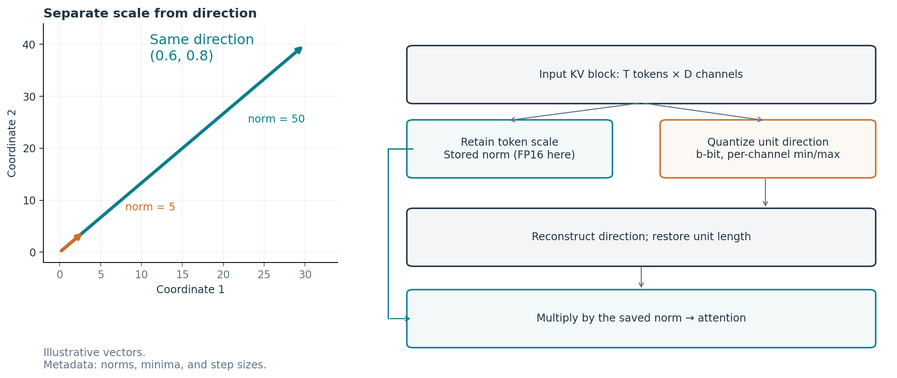
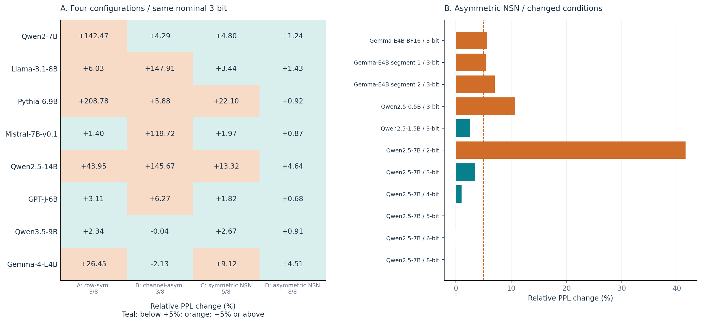
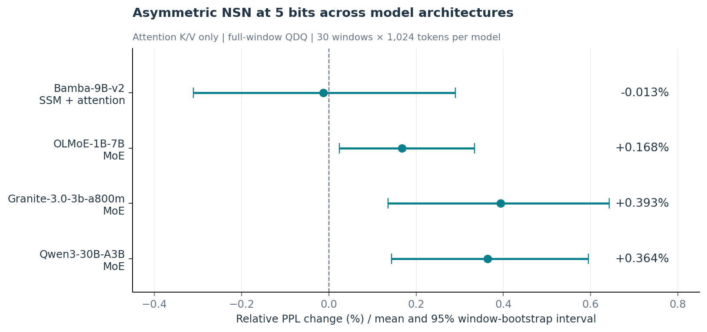
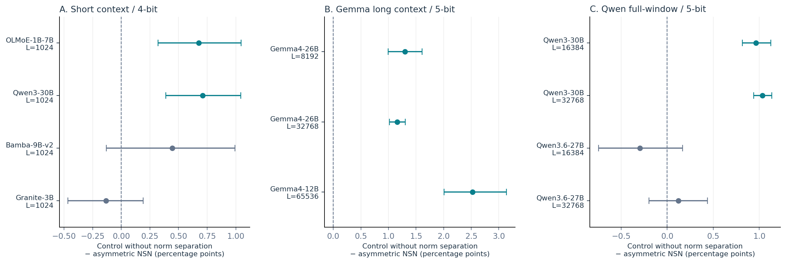
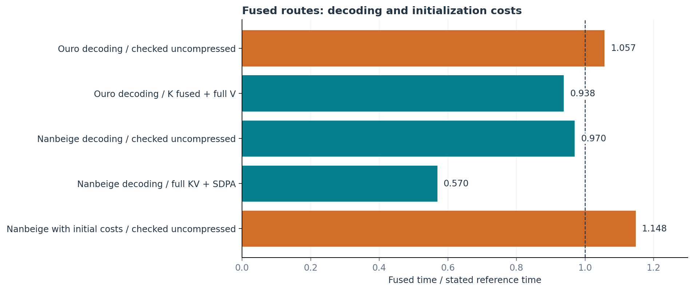
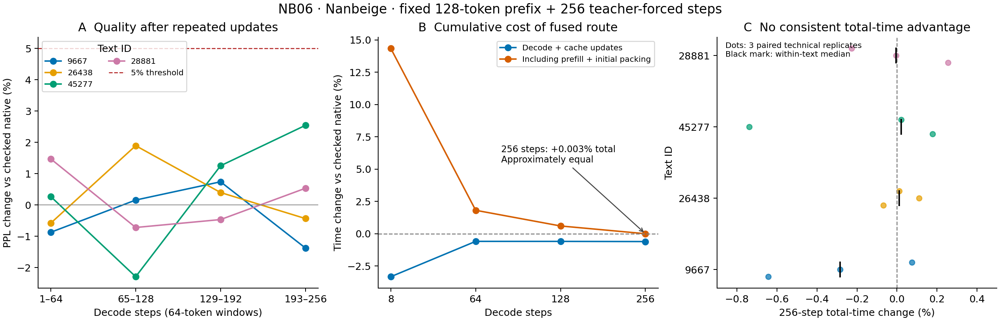

# NSN：ノルムと方向を分けるKV量子化

## 方式の構成、適用条件、圧縮状態からの利用費用

**Kentaro Sato**  
独立研究者（Independent Researcher）  
連絡先：info@metaclan.jp  
2026年10月29日 · 日本語版 v2.0  
本版のDOI: [10.5281/zenodo.23938878](https://doi.org/10.5281/zenodo.23938878)

## 要旨

非対称NSNは、KVベクトルの大きさ（ノルム）を別に保存し、方向をチャネル別に非対称量子化して、復元後に再正規化する方式である。本稿では、PPL悪化が5%の診断目安内に収まる設定を「品質を保てる設定」と呼び、その設定と、KV保存量の削減を実行上の利益へつなぐ際の条件・費用を調べる。表現は入力区画の統計だけで構成し、量子化器の追加学習や別の校正コーパスを使わない。

3bitの四方式比較では、非対称NSNだけが主条件の8モデルすべてでPPL悪化を5%未満に収めた。SSM＋attentionおよびMoE構成の4モデルでも3・4・5bitを比較し、精度を重視した5bit設定での適用を示した。さらに、OuroとNanbeigeという二つの再帰型Transformerへ実packed 3bit表現を接続した。各4文章のteacher-forcing評価では、Ouroの各255予測に加え、Nanbeigeは初回の各8予測から同じ4文章の各256予測へ評価を延ばした。圧縮更新を含む後者の評価でも既定の5%診断目安を満たし、終端KV保存量の削減率はOuroで67.68%、Nanbeigeの延長評価で64.39%だった。

同じ復元算術を使う橋渡し対照では、全長の復元配列を作る経路より、attention内部で復元する融合経路が短時間だった。その短縮は実モデルの圧縮経路間比較にも残った。Nanbeigeでは、初期費用込みの非圧縮との時間差は8 stepから256 stepへの継続で縮まり、256 stepではほぼ同時間だった。forward側の節約の大部分は、初期圧縮と繰り返す圧縮更新の費用と釣り合った。品質を保つ設定と、復元・検査・初期処理・更新まで含めて利点が残る実行条件を対応づけることで、圧縮表現の採用を品質・容量・費用の三面から判断できる。

**キーワード：** KVキャッシュ、ノルム分離、低bit量子化、再帰型Transformer、融合attention、推論費用

## 1. はじめに

言語モデルが一つ先のtokenを予測するとき、毎回すべての過去の入力を計算し直す必要はない。Transformerでは、既に計算したkey（K）とvalue（V）を保存し、新しいquery（Q）と組み合わせて使う。この保存領域がKVキャッシュである。Kは過去のどこへ注目するかを決める計算に、Vは注目の重みに応じて情報を取り出す計算に使われる。保存量を減らせれば、限られたGPUメモリで長い文脈や多くの要求を扱う余地が増える。

量子化は、細かい浮動小数の値を少数の代表値へ丸める方法である。例えば3bitなら一つの整数は8通りしか取らない。その代わり、16bitの値をそのまま保存するより符号部分を小さくできる。ただし、丸めで失った情報は完全には戻らず、代表値の幅やノルムなどの補助情報も保存しなければならない。さらに、小さく保存した値をattentionで利用できる形へ戻す処理にも時間とメモリがかかる。

本稿で扱う**非対称NSN**は、KVベクトルを「大きさ」と「向き」に分けて圧縮する、著者の提案手法である。まず、各tokenのベクトルをその長さ（L2ノルム）で割り、長さ1の方向へそろえる。ノルムは別に保存し、方向成分は座標（チャネル）ごとの最小値から最大値までを少数の整数へ写す。この目盛りを零中心の対称範囲に固定しないことを「非対称」と呼ぶ。使うときは整数から方向成分を復元し、丸めによってずれた長さを再び1にそろえてから、保存ノルムを掛ける。こうしてtoken間の大きさの違いと方向の符号化を分けて扱う。

本稿の中心課題は、**非対称NSNが品質を保てる設定を示し、その容量削減を実行上の利益へつなぐ条件と障害を調べること**である。品質を満たす構成を選ぶところから、その表現を保存してattentionで使うところまでを一続きに評価する。

貢献は二つある。第一に、四方式比較から非対称NSNを選ぶ根拠を示し、bit幅、モデル構成、文脈長、適用位置を変えた結果から適用範囲を具体化する。K/V診断は、その条件差を説明する機序仮説を支える。第二に、実packingから復元・検査・融合までの費用を測り、同じ復元算術を使う橋渡し対照と実モデル比較によって、容量削減と利用時の利益が結び付く箇所を特定する。

本文は、非対称NSNの仕組み（§2）と共通の評価方法（§3）を説明した後、品質を保てる設定（§4）、圧縮表現を使う費用（§5）、両者を合わせた実モデル評価（§6）へ進む。関連研究との構成上の違いは§7で整理する。既公開NSN［12］と追加評価の資料対応は付録D.5、原記録・検証・再生成の入口は付録Dにまとめる。

## 2. KV圧縮とNSNの仕組み

### 2.1 KとVは、どこで使われるか

一つのattention headに注目する。過去tokenの位置を \(t\)、headの次元を \(D\) とすると、query \(Q\) と各key \(K_t\) の内積からscoreを計算し、softmaxで重み \(p_t\) に変換する。

\[
a_t=Q^\top K_t/\sqrt D,\qquad
p_t=\frac{\exp(a_t)}{\sum_u\exp(a_u)},\qquad
c=\sum_t p_tV_t.
\]

softmaxはscoreを合計1の重みへ変える処理であり、\(c\) が過去情報の重み付き和になる。Kの変化は重みの付け方を、Vの変化は取り出す情報を変える。したがって、KとVに同じ大きさの数値誤差が入っても、予測への影響が同じとは限らない。

保存すべきKVの概算量は、通常の密なキャッシュでは、batch数、KVを持つ層数、KV head数、文脈長、head次元、一要素のbyte数の積に、K/Vの2倍を掛けたものになる。再帰型Transformerは同じ層の重みを深さ方向に繰り返し使うが、周回ごとにKVを別に保持する実装では、KVの保存場所も周回数に応じて増える。重みの共有とKVの共有は別の設計である。

### 2.2 ベクトルの「大きさ」と「向き」を別に持つ

ベクトル \(x=(3,4)\) と \(x'=(30,40)\) を考える。長さ、すなわちL2ノルムはそれぞれ5と50だが、長さで割った方向はどちらも \((0.6,0.8)\) になる。このように、数値の差には「方向が違う」ことによる差と、「同じ方向を大きくした」ことによる差が含まれる。

非対称NSNでは、この大きさをtokenごとに別保存し、残った方向を量子化する。元のKVをそのままチャネル別に量子化する場合、大きなノルムのtokenがチャネル範囲を広げれば、小さなノルムのtokenを表す目盛りは相対的に粗くなる。ノルム分離は、方向の量子化からこの尺度差を取り除く役割を持つ。

次に、方向の各チャネル、すなわち各座標について、区画内の最小値と最大値へ目盛りを配分する。token内の全座標を一つの範囲へ収める方式に対し、チャネル別の範囲は座標ごとの分布に合わせられる。さらに非対称の範囲を使うことで、零を中心とする対称範囲ではなく、そのチャネルが実際に占める区間を符号化する。\(b\) bitなら \(2^b\) 段階を使い、3bitでは8段階、5bitでは32段階になる。

方向を丸めると、その長さも1からずれる。復元方向を再び長さ1へそろえてから保存ノルムを掛ける再正規化は、方向量子化に伴う長さのずれを整える処理である。以上が、ノルム保存・チャネル別非対称量子化・再正規化を組み合わせる設計上の理由である。§4.1では、この組合せと実測した構成差を結び付ける。



**図1　非対称NSNの処理と各段階の役割。** 矢印は説明用のベクトル。ノルムを別に保持し、方向の各チャネルへ \(b\)-bitの符号を配分する。復元方向を正規化して保存ノルムを戻す。FP16補助情報は本稿の実packed実装の設定である。

### 2.3 数式で表す

一つのKV headから取り出した区画を \(X\in\mathbb{R}^{T\times D}\) とする。\(T\) は区画に含むtoken数、\(D\) は一ベクトルの次元である。token位置 \(t\)、チャネル \(j\) について、

\[
n_t=\lVert x_t\rVert_2,\qquad d_{tj}=x_{tj}/\max(n_t,\epsilon)
\]

と分解する。bit幅を \(b\)、最大符号を \(L=2^b-1\) とし、チャネルごとの最小値と刻み幅を

\[
m_j=\min_t d_{tj},\qquad
s_j=(\max_t d_{tj}-m_j)/L
\]

で定める。整数符号は

\[
z_{tj}=\operatorname{clip}_{[0,L]}
\left(\operatorname{round}\frac{d_{tj}-m_j}{s_j}\right)
\]

となる。\(s_j=0\) のチャネルは \(z_{tj}=0\) とする。符号 \(z\) はattentionのquery \(Q\) と区別して記す。

実保存では補助情報にも丸めが入る。本稿の3bit実packed実装では、FP32で計算した \(n,m,s\) をFP16へ保存し、復元時にFP32へ読み戻す。この値を \(\bar n,\bar m,\bar s\) とすると、

\[
\bar n=\operatorname{FP32}(\operatorname{FP16}(n)),\quad
\bar m=\operatorname{FP32}(\operatorname{FP16}(m)),\quad
\bar s=\operatorname{FP32}(\operatorname{FP16}(s)),
\]

\[
\widetilde d_{tj}=\bar m_j+\bar s_jz_{tj},\qquad
\widehat x_t=\operatorname{cast}
\left(\bar n_t\frac{\widetilde d_t}
{\max(\lVert\widetilde d_t\rVert_2,\epsilon)}\right)
\]

で戻す。\(\operatorname{cast}\) はattentionが受け取る浮動小数形式への丸めである。ノルム0の入力は0へ戻す。大きさは有限精度で保存したノルムから再構成する。

### 2.4 計算の核と、実装ごとの違い

コード1は、一般のbit幅を持つ非対称NSNを3bitで具体化した、再帰型二モデルの参照量子化・復元である。入力の末尾2軸は64 token × 128次元、計算途中はFP32、補助情報の保存はFP16とする。入力は非有限値や保存範囲の検査を通過したものを対象とする。

**コード1　NSNの3bit量子化・復元（関数本体10行）**

```python
import torch

def nsn_int3_qdq(x):
    a = x.float()
    n = torch.linalg.vector_norm(a, dim=-1, keepdim=True)
    d = a / n.clamp_min(1e-12)
    m = d.amin(dim=-2, keepdim=True)
    s = (d.amax(dim=-2, keepdim=True) - m) / 7
    q = ((d - m) / torch.where(s == 0, torch.ones_like(s), s)).round().clamp(0, 7).to(torch.uint8)
    n, m, s = (t.half().float().contiguous() for t in (n, m, s))
    d = (m + s * q.float().contiguous()).contiguous()
    y = n * (d / torch.linalg.vector_norm(d, dim=-1, keepdim=True).clamp_min(1e-12))
    return torch.where(n == 0, torch.zeros_like(y), y).to(x.dtype)
```

コードは符号を作って浮動小数へ戻すQDQ（quantize–dequantize）を示す。符号を隙間なく詰めるbit packing、キャッシュ更新、入力検査、attention kernelは別の処理である。保存形式も実験により異なり、Ouro／Nanbeige接続では3bit符号をbit packingし、QK score単体の部品評価（§5.2）では符号一つをuint8一要素で保持する。融合経路では復元算術の配置や還元順序も変わるため、後述の同算術対照と数値検査で評価した。

量子化器自身は入力区画の統計だけを使い、学習されたcodebookや別コーパスによる校正を必要としない。一方、適切なbit幅や区画を選ぶためのモデル別評価は必要である。本研究で方式を探索した過程も、その評価に含まれる。

### 2.5 符号・補助情報・末尾を含む保存量

3bitという呼称は整数符号の幅を表す。ノルム \(T\) 個、最小値と刻み幅を各 \(D\) 個、すべてFP16で持つと、byte境界のpaddingを要しない区画の保存量は

\[
B_{\mathrm{block}}=bTD/8+2(T+2D)+B_{\mathrm{header}}
\]

となる。64×128の3bit区画では、符号3,072 byte、補助情報640 byte、header 12 byteで、合計3,724 byte、実効3.63671875 bit/要素である。FP16の同区画16,384 byteに対して小さいが、3/16という単純な比にはならない。高精度のまま残す末尾があれば、キャッシュ全体の削減率はさらに変わる。

## 3. 比較の設計と評価方法

### 3.1 構成、適用条件、利用費用を別に測る

品質を保てる設定と、その表現を使う費用を評価するため、構成・適用条件・保存と利用の三つの比較群を用いる（表1）。各群は個別に設計・取得した探索結果であり、対照、bit幅、評価単位を保って集計する。

**表1　比較群と測定対象**

|比較群|主な対象|介入と評価単位|中心の指標|
|---|---|---|---|
|構成比較|8モデルと条件変更の追試|保存済みprefix KVへの四方式。WikiText-2の短い窓|非圧縮比PPL、構成間の差|
|適用条件比較|SSM＋attention・MoE等、1,024〜65,536 token|3・4・5bit、ノルム分離の有無を含む方式群、区画・高精度末尾・適用位置。各30窓|窓別PPL変化の平均と対応差|
|保存・利用比較|合成部品、Qwen2／Llama、Ouro／Nanbeige|実packing、復元方法、入力検査、融合、実モデルへの接続|実byte数、数値整合、PPL、時間、メモリ|

比較に用いた実装条件は付録C、保存記録からの再集計・数値検証の範囲は付録Dに示す。

### 3.2 構成比較の材料と採点条件

WikiText-2 test split［1］の非空行を結合し、先頭48,000文字をtoken化した。1,024 tokenの窓を512ずつ進め、最大10窓を用いる。先頭512 tokenをprefillし、そのKVを量子化して後半512予測を採点する。最初の正解tokenに対するlogitsは圧縮前に計算されるため、各窓で圧縮後のattentionを通る採点は残り511予測である。K/V両側へ各方式を適用する。

### 3.3 bit幅とモデル構成、区画・適用位置の比較

モデル構成への適用比較では、Bamba-9B-v2（SSM＋attention）と、OLMoE-1B-7B、Granite-3.0-3b-a800m、Qwen3-30B-A3B（MoE）のattentionのK/V投影出力を対象にした。MoEはtokenごとに選ばれたexpertで処理する構成である。各モデル内のattention KVを量子化し、SSM状態やexpert重みは維持する。1024-token全窓から範囲を求めるQDQ品質評価を用いた。ここで測るのは窓全体から範囲を推定した表現の品質であり、オンラインのcache圧縮で同じ品質が成立することを示す評価ではない。逐次運用は§6の実packed接続で短区間を別途評価する。

この比較では、同じ4モデル・評価窓でINT3・INT4・INT5を測定している。整数符号はそれぞれ8・16・32段階となり、bit幅を増やすと符号量と引き換えに細かい目盛りを使える。元の設計ではINT5を精度重視の保守的な候補に置いた。本稿はその既存結果から5bitを共通の高精度側設定として詳しく示し、3・4bitの結果も表6に併記する。

方式群の比較では、次の二つの処理を用いる。

- **非対称NSN（以下の比較表ではNSN）：** K/Vともtokenごとのノルムを分け、方向をチャネル別に非対称量子化する。復元後に方向を再正規化し、保存ノルムを掛ける。
- **ノルム分離なしの比較方式（plain）：** 元のベクトルを直接、Kはチャネル別、Vは各token・head内で非対称量子化する。ノルムの別保存と復元後の再正規化を行わない。こちらも量子化方式であり、非圧縮の基準とは別である。

両方式とも非対称量子化を使う。構成比較のB（§4.1）はK/Vともチャネル別だったのに対し、plainのVはtoken別である。全窓条件に加え、Kを128-token区画で処理する条件、末尾128 tokenを保持する条件、モデルにKのRMS正規化がある場合にその後へ介入する条件を比べた。RMS正規化はベクトルの尺度を調整するモデル内の処理であり、その前後で量子化対象の分布が変わる。

この比較でNSN側VはKと同じ区画・末尾規則を使い、plain側Vは全tokenへtoken別量子化を行う。NSNの主要演算はFP32、plainの範囲・復元演算の一部は入力dtypeである。Kの介入位置はRoPE前で、§3.2のcache介入はRoPE後となる。したがって、ここで測るのはK/V処理、末尾規則、中間精度を含む方式群の差である。実装の対応は付録C.1にまとめる。

各モデル・設定は固定seedの30窓を用い、窓ごとの相対PPL変化を平均する。表中の「plain−NSN」は方式名ではなく、同じ窓での「plainの相対PPL変化 − 非対称NSNの相対PPL変化」を表す。単位は百分率どうしの差であるポイント（pp）で、正なら非対称NSN側のPPL変化が小さい。窓単位の5,000回再標本化による元の95%百分位区間を再現する。窓にはtoken範囲の重複があり、この窓bootstrap区間は30独立文章の推定とは区別する。具体的な重複数とseedは付録A.2・C.5に示す。

### 3.4 再帰型二モデルへの実packed接続

Ouro-1.4BとNanbeige4.2-3B-Baseは層の重みを再利用するモデルである［2, 3］。本比較では重みをBF16に保ち、周回・層ごとのK/Vを別々に圧縮する。Ouroは8周、24層、16 query／KV headを用いる。Nanbeigeは2周・44のKV保存位置、48 query headに対して8 KV headを持つGQA（grouped-query attention）で、6個のquery headが同じKV headを参照する。両者のhead次元は128である。

**表2　初回の実packed二モデル比較の固定条件（継続評価は§3.4.1）**

|項目|Ouro|Nanbeige|
|---|---|---|
|材料|PG19 training splitの4文章|同splitの別の4文章|
|prefill|768 token|128 token|
|主品質|各255予測|各8予測|
|同一文章の技術反復|2回|3回|
|初期の圧縮済みtoken|704|64|
|追加圧縮|64 tokenずつ3回|主区間ではなし|
|終端の圧縮済み／高精度末尾|896／127 token|64／72 token|
|圧縮経路の対照|K内部復元＋V全量復元|K/V全量復元＋SDPA|

PG19は書籍を単位とするデータセットである［4］。使用文章は本研究の先行試験で使っていなかったもので、モデルの事前学習時にも未見であったことを意味しない。取得した冒頭を固定tokenizerで`add_special_tokens=False`としてtoken化し、前書きや空白の独自除去は行わない。

入力の正解token列を各経路へ同じように与えるteacher forcingを用いる。モデル自身が生成した文章を次の入力へ戻す評価ではない。Ouroの主計時は初期と診断捕捉位置の和集合を除いた240位置、Nanbeigeは圧縮後の8位置とする。初期処理を含む値ではprefill、初期圧縮、逐次処理を足す。

### 3.4.1 同じ文章で継続と圧縮更新を評価する

初回のNanbeige比較と同じ4文章・初期128 tokenを使い、teacher forcingの継続を256 stepへ延ばした。復元算術、融合kernel、64-token区画、数値予算、モデル・tokenizerの固定版を継承する。先頭385 tokenを使い、予測対象は0始まりの添字129–384の256個とした。取得本文のhashと旧入力137 tokenの一致を、モデル重みをロードする前に確認した。これは新たな4文章ではなく、同じ材料の継続・更新を調べる比較である。

初期圧縮は先頭64 token。各forwardで新KVをBF16末尾へ追記し、attentionと予測を終えた後、step 64・128・192・256で古い64 tokenを追加圧縮する。既存のpacked区画は変更しない。終端は圧縮320＋BF16末尾64 tokenとなる。4回の更新を費用と保存量へ含め、そのうち最初の3回は後続attentionでの利用まで観測した。

非圧縮、全量復元＋SDPA、GQA融合を各文章3技術反復で測定した。全256、最初8、重ならない64予測×4区間の品質と、8・64・128・256 step時点の累積時間を取得前に固定した。全方式でforwardとその後の処理を同じ境界で計時し、非圧縮の後処理は無処理対照とする。「更新込みdecode」は両者の和、「初期費用込み」はさらにprefillと初期圧縮を足した値である。診断用捕捉・証拠保存は計時外とし、時間の集約は文章内3対応比の中央値、次に4文章の中央値とした。初回8予測の値と継続評価の値は別の測定として報告する。

### 3.5 品質、保存量、時間の読み方

品質は、正解tokenへモデルが与えた確率から負の対数尤度（NLL）を求め、その平均を指数へ戻したperplexity（PPL）で測る。低いほど、この評価列の正解tokenへ高い確率を与えたことを表す。相対変化は

\[
r=100\left(\frac{\mathrm{PPL}_{\mathrm{quant}}}{\mathrm{PPL}_{\mathrm{base}}}-1\right)
\]

で、正が悪化、負が改善である。PPLが5%増えたことは、正答率が5ポイント低下したこととは異なる。

構成比較では保存された集計PPLの比、適用条件比較では窓別相対変化の平均を使う。実packed二モデルは、同じ文章の技術反復を独立材料へ加えず、4文章を等重みでNLL差を平均して相対PPLへ戻す。この三つを一つの総合PPLへ合算しない。5%は構成比較と二モデル診断の品質目安であり、統計的非劣性を検定した値ではない。別の0.5%基準は付録Aで判定式を明示する。

保存量は整数符号・補助情報・header・末尾の実byte数で測る。GPUのallocatedはtensor等へ割り当てた領域、reservedはallocatorが確保した領域で、両者もKVそのものの保存量とは異なる。時間はwarmup後の部品、モデルの逐次処理、初期圧縮込みを分ける。後二つのモデル比較は入力検査を含む経路同士であり、最速のnative実装一般との比較ではない。

## 4. 品質：非対称NSNを選ぶ根拠と適用範囲

品質側の評価では、まず四方式の成績から非対称NSNを選ぶ根拠を示し、bit幅・モデル・適用条件によってその範囲を具体化する。最後のK/V診断は、条件による違いを説明する補助証拠として位置づける。

### 4.1 四方式の比較から非対称NSNを選ぶ理由

比較したのは、ノルムを分けずに元のKVを量子化する二方式と、ノルムを別保存して方向を量子化する二方式である。各方式を8モデルのK/V両側へ適用し、同じモデルの非圧縮に対するPPL変化で比較した。

四方式は表3の組合せである。対称量子化は零を中心に−3〜3の7段階、非対称量子化は最小値から最大値を0〜7の8段階で表す。いずれも名目3bitだが、符号数と補助情報量が異なる。

**表3　構成比較の方式**

|方式|ノルム分離|量子化範囲を求める軸|整数の範囲|復元方向の再正規化|
|---|---|---|---|---|
|A：行別対称|なし|各tokenのベクトル内|−3〜3|なし|
|B：チャネル別非対称|なし|同じチャネルのtoken間|0〜7|なし|
|C：対称NSN|あり|方向の同じチャネルのtoken間|−3〜3|あり|
|D：非対称NSN|あり|方向の同じチャネルのtoken間|0〜7|あり|

非対称NSNは、比較した四方式のうち唯一、主条件の8モデルすべてでPPL悪化を5%未満に収めた（表4・図2左）。対称NSNは5モデル、行別対称とノルム分離なしのチャネル別非対称は各3モデルだった。同じ名目3bitでも、これらの構成が扱えたモデル範囲には大きな差があった。

**表4　四方式の相対PPL変化（%、同一モデルの非圧縮を基準）**

| モデル | A：行別対称 | B：チャネル別非対称 | C：対称NSN | D：非対称NSN |
| --- | --- | --- | --- | --- |
| Qwen2-7B | +142.471 | +4.294 | +4.804 | +1.236 |
| Llama-3.1-8B | +6.030 | +147.912 | +3.441 | +1.435 |
| Pythia-6.9B | +208.777 | +5.879 | +22.103 | +0.924 |
| Mistral-7B-v0.1 | +1.402 | +119.720 | +1.974 | +0.868 |
| Qwen2.5-14B | +43.949 | +145.665 | +13.323 | +4.644 |
| GPT-J-6B | +3.107 | +6.271 | +1.821 | +0.683 |
| Qwen3.5-9B | +2.341 | -0.037 | +2.665 | +0.913 |
| gemma-4-E4B | +26.451 | -2.132 | +9.118 | +4.515 |
| ＋5%未満 | 3/8 | 3/8 | 5/8 | 8/8 |

この比較の単位は構成全体である。量子化軸、ノルム分離、範囲、符号数、再正規化が組み合わさって変わるため、各要素の単独効果は分離していない。以下では、構成ごとの到達範囲を採用判断の根拠とする。

ノルム分離なしのチャネル別非対称（B）は、チャネルごとの範囲を使うだけでは全8モデルを覆えなかった。LlamaではBの＋147.912%に対し、非対称NSN（D）は＋1.435%だった。この差は、token間の大きさの変動を方向の量子化から分けるという設計の動機に対応する。Vノルム変動とBの悪化の順位相関（付録A.1）も、尺度差による範囲干渉という説明と整合する。

一方、ノルム分離と再正規化を含む対称NSN（C）でも、Pythiaでは＋22.103%だった。同じモデルのDは＋0.924%であり、方向をどの範囲・符号数で表すかも構成選択に関わる。方向のチャネルが占めるmin/maxへ目盛りを配分する非対称NSNは、この組合せで主条件の全モデルを覆った。

Qwen3.5とGemmaではBのPPLがDより低かった。Dを採用する根拠は、比較したモデル集合を共通の品質目安内に収めた適用範囲の広さにある。ノルム保存、方向の符号化、再正規化という各処理の役割と、構成全体のこの観測を併せて設計を評価する。



**図2　四方式の品質と、非対称NSNの条件別品質。** 左は表4の8モデル×4方式で、セル内は相対PPL変化（%）、色は＋5%未満か否かを示す。右は表5の条件別評価で、破線は＋5%。右のモデル・材料・bit幅は各行に表示した。

### 4.2 bit幅と評価条件に応じた品質

主条件で得た品質がどこまで続くかを、bit幅・dtype・モデルサイズ・材料区間を変えた結果で確認する。

Gemmaの主条件は＋4.515%だったが、BF16の比較では＋5.632%、別区間では＋5.521%と＋7.052%になった。後者は最大30窓という設定に対し、保存された採点token数に対応する実取得が20窓と22窓だった。Qwen2.5-0.5Bの非対称INT3も＋10.755%で、同1.5Bの＋2.484%とは異なる。

**表5　主条件の外で確認した適用範囲**

| 対象・条件 | 方式 | 相対PPL % | 採点単位 |
| --- | --- | --- | --- |
| Gemma-4-E4B/bf16 | 非対称NSN 3bit | +5.632 | 最大10窓・取得数未記載 |
| Gemma-4-E4B 別区間1 | 非対称NSN 3bit | +5.521 | 20窓／10,240予測 |
| Gemma-4-E4B 別区間2 | 非対称NSN 3bit | +7.052 | 22窓／11,264予測 |
| Qwen2.5-0.5B | 非対称NSN 3bit | +10.755 | 最大10窓・取得数未記載 |
| Qwen2.5-1.5B | 非対称NSN 3bit | +2.484 | 最大10窓・取得数未記載 |
| Qwen2.5-7B | 非対称NSN 2bit | +41.536 | 最大10窓・取得数未記載 |
| Qwen2.5-7B | 非対称NSN 3bit | +3.474 | 最大10窓・取得数未記載 |
| Qwen2.5-7B | 非対称NSN 4bit | +1.035 | 最大10窓・取得数未記載 |
| Qwen2.5-7B | 非対称NSN 5bit | -0.017 | 最大10窓・取得数未記載 |
| Qwen2.5-7B | 非対称NSN 6bit | +0.065 | 最大10窓・取得数未記載 |
| Qwen2.5-7B | 非対称NSN 8bit | +0.021 | 最大10窓・取得数未記載 |

Qwen2.5-7Bの同一モデル内のbit幅比較では、2bitの＋41.536%から、3bitの＋3.474%、4bitの＋1.035%、5bitの−0.017%へ変わった。6bitと8bitもそれぞれ＋0.065%、＋0.021%だった。非対称NSNではbit幅を精度と符号量の選択に使える。この評価では3bit以上で5%目安に収まり、別のモデル・dtype・材料区間の成績と併せて採用条件を判断できる。


### 4.3 bit幅を調整して複合モデル内のattention KVへ適用する

異なる計算構成への適用を確かめるため、同じ非対称NSNをSSM＋attentionのBambaとMoE系3モデルで3・4・5bitに変えて比較した（表6）。共通の5%目安で平均を見ると、3bitではGraniteとQwen3が目安を超え、4bitでは4モデルとも目安内だった。5bitの平均相対PPL変化は−0.013〜＋0.393%となった（図3）。精度を優先する5bitの結果と、より少ない符号bitでの結果を並べることで、モデルに応じた精度と符号量の選択肢が見える。

**表6　非対称NSNのbit幅・モデル構成別の平均相対PPL変化（全窓QDQ、各1024-token窓×30）**

| モデル | 構成 | 3bit 平均 % | 4bit 平均 % | 5bit 平均 % | 5bit 窓bootstrap 95%区間 % |
| --- | --- | --- | --- | --- | --- |
| Bamba-9B-v2 | SSM＋attention | +0.424 | +0.501 | -0.013 | [-0.310, +0.291] |
| OLMoE-1B-7B | MoE | +4.671 | +0.886 | +0.168 | [+0.024, +0.334] |
| Granite-3.0-3b-a800m | MoE | +14.222 | +1.940 | +0.393 | [+0.135, +0.643] |
| Qwen3-30B-A3B | MoE | +5.345 | +1.058 | +0.364 | [+0.144, +0.595] |

各bit幅では同じ処理を4モデルへ適用している。INT5は共通の精度重視設定としての適用例であり、複合モデルで最低限必要なbit幅を表すものではない。5bitの4平均はいずれも±0.5%内だった。表の区間は5bitに対応し、区間を含む読み方と既存の帯判定は付録A.2にまとめる。



**図3　INT5非対称NSNの適用結果。** 点は窓別相対PPL変化の平均、線は窓bootstrap 95%区間。各行のモデル内attention K/Vへ同じ5bit設定を適用した。0は非圧縮と同じPPL変化、正は悪化を表す。

### 4.4 長さと適用位置を変えた比較は、方式群の条件依存を示す

bit幅に加え、区画・高精度末尾・適用位置を組み合わせた設定でも品質を比較する。表7は、これらを変えた比較で採用された設定と成績を示す。短区間ではOLMoEとQwen3の対応差の区間が正で、BambaとGraniteは0を含んだ。長いGemmaの3条件では、NSN側の相対PPL変化が小さい。

**表7　採用設定での相対PPLと方式群の差**

| モデル＠長さ | bit | 設定 | 非対称NSN % | plain（ノルム分離なし）% | plain − NSN 差 pp | 差の窓bootstrap 95%区間 |
| --- | --- | --- | --- | --- | --- | --- |
| OLMoE-1B-7B@1024 | 4 | 128区画＋高精度末尾 | +0.447 | +1.124 | +0.677 | [+0.321, +1.047] |
| Qwen3-30B@1024 | 4 | 128区画・末尾＋K正規化後 | +0.072 | +0.783 | +0.711 | [+0.388, +1.044] |
| Bamba-9B-v2@1024 | 4 | 128区画＋高精度末尾 | +0.429 | +0.874 | +0.445 | [-0.131, +0.993] |
| Granite-3B@1024 | 4 | 128区画＋高精度末尾 | +0.724 | +0.592 | -0.133 | [-0.465, +0.192] |
| Gemma4-26B@8192 | 5 | 128区画・末尾＋K正規化後 | -0.024 | +1.273 | +1.296 | [+0.993, +1.610] |
| Gemma4-26B@32768 | 5 | 128区画・末尾＋K正規化後 | +0.074 | +1.234 | +1.160 | [+1.016, +1.305] |
| Gemma4-12B@65536 | 5 | 128区画・末尾＋K正規化後 | -0.243 | +2.282 | +2.526 | [+2.006, +3.139] |

差は「ノルム分離なしの比較方式 − 非対称NSN」（pp）。短区間は4bit、Gemma長区間は5bit。設定欄はK側の処理を表す（V側は§3.3）。OLMoEは正規化後のplain条件が30窓すべて非有限となったため、高精度末尾を持つ一つ前の設定を採用した。

別の全窓・INT5比較では、Qwen3の16,384／32,768長で正の差が残り、Qwen3.6の同じ長さでは差の区間が0を含んだ（図4）。この対照から、方式群の差が残るモデル・長さを特定できる。



**図4　ノルム分離なしの比較方式（plain）と非対称NSNの窓別相対PPL差。** 点は平均、線は元の窓bootstrapの95%区間。正はNSN側の変化が小さい。各枠にbit幅と適用条件を示す。

NSN方式群のPPL変化が小さかった条件と、差を分離できなかった条件を並べることで、方式の対象範囲を具体化できる。Vのノルム分散と品質悪化の相関は、その条件差を説明する候補の一つであり、付録Aへ示す。

### 4.5 K/V診断で、品質変化の内訳を調べる

ここでは適用範囲を説明する補助診断として、誤差がKとVのどちらから入るかを分けて調べる。

Gemmaの別区間診断では、ノルムを分けないB方式をKだけ、Vだけ、両側へ適用した。Kだけの場合は二つの区間ともPPLが改善し、相対変化は−2.029%と−0.959%だった。Vだけの場合は−0.512%と＋0.399%で、方向が区間によって変わった。両側では−2.339%と−1.103%だった（付録A.5）。この観測は、両側を量子化した集計値だけでは、どちら側で何が変わったかを説明できないことを示す。

一方、Ouroの8周・NSN3によるprefixだけの切り分けでは、KのみのPPL悪化は＋0.491%、Vのみは＋0.173%だった。正解tokenの損失はK側でやや大きかったが、全語彙分布のKLではV側が大きかった。モデル、方式、評価対象によって内訳が変わるため、K/Vの順位を一つに固定するより、誤差がattentionへ入る経路を分けて説明することが有用である。§8.1では、この違いをattention内の誤差経路から検討する。

## 5. 実装：保存量の削減を利用費用へつなぐ

品質を保つ表現を選んだ後も、整数を詰めて保存し、attentionへ渡すまでの処理が必要になる。本節では、補助情報を含む保存量、復元と検査の費用、計算への融合を順に比較し、圧縮の利益を左右する実装上の要因を調べる。

### 5.1 保存量と復元値を、実packingで確認する

実packingの合成測定では、2048×128の区画を符号とFP16補助情報で保存すると、実効3.140625 bit/要素だった。ここではheaderを持たない。モデル形状へ拡大した保存量はFP16比80.371%減になる。一方、64×128の区画を使う実モデルでは3.63671875 bit/要素で、さらに非圧縮末尾が残る。区画を短くすると補助情報の割合が増えるため、同じ3bit符号でも保存量は変わる。

整数符号のpack/unpackは元の整数へ戻せるが、補助情報の保存丸めまで含む復元は、模擬QDQとbit一致するとは限らない。合成検査では223,471/262,144要素が不一致、最大絶対差は0.005859375だった。モデルPPLでは、実packedと模擬QDQの差の絶対値はQwen2で0.000247、Llamaで0.000197だった。

この組合せは、復元値に差があってもPPLの差が小さい場合を示す。整数保存、復元算術、最終予測を分けて点検することで、保存による変化がどこに残ったかを把握できる。

### 5.2 復元方法と検査方法が、利用費用を変える

表8は、既存のpacked prefixを使うモデルの逐次処理で復元経路を比較し、非圧縮基準と並べたものである。復元はheadごと、層内head一括、一括復元のコンパイルという三つの実装で行う。

**表8　モデル逐次処理での復元経路比較（ms/token、初期packingを除く）**

| モデル | 非圧縮 | head別復元 | head一括復元 | compiled復元 |
| --- | --- | --- | --- | --- |
| Qwen2-7B | 13.61 | 33.52 | 18.17 | 13.94 |
| Llama-3.1-8B | 14.29 | 64.86 | 19.64 | 14.90 |

A100上の3技術反復の中央値。prefillは1,024 token、50逐次stepを計時した。通常は事前5step、compiled経路は10stepをwarmupするため、計時開始時のcache長も異なる。

合成入力のQK score部品比較では、融合したNSN5経路のFP16経路に対する処理時間も形状に依存した。Gemma形状は15/15対応セルでNSN5経路がFP16経路より短く、FP16/NSN5時間比の中央値は1.494だった。Qwen形状は7/16、中央値0.993だった。

入力検査にも費用がある。保存入力18点に対し、有限値検査をまとめたTriton経路は個別の検査経路より短く、対応比の中央値で検査単体77.68%、圧縮読み出し全体38.78%の短縮を示した。合成fixture64条件×3方式で検出対象を照合した範囲の結果である。検査を外すのでなく、その実行のまとめ方を変えることで短縮できた。

### 5.3 同じ復元値を使い、融合の費用を比較する

融合を評価する際、従来の復元器と融合kernelで算術まで変わると、処理の配置を変えた効果と復元値の変化が混ざる。そこで、同じpacked Vを使う三経路を置いた。

1. 従来の復元器で全長Vを作り、attentionへ渡す。
2. 融合と同じ区画単位の復元算術で全長Vを作り、attentionへ渡す。
3. 同じ区画単位の算術をattention内部で実行し、全長Vを作らず利用する。

二番目を**同じ復元算術を使う橋渡し対照**と呼ぶ。三番目は二番目より時間が28.280%短く、全長の復元V配列を必要としなかった。これは2文章から得た6主試料に対し、同じquery・試料の対応比を集約した値である。従来復元器との差は41.721%だったが、そちらには復元算術の違いも含まれる。

橋渡しと融合は、検査した入力でV・context・出力の一致を確認した。数値参照、許容値、確認した入力範囲は付録Bへ示す。この対照は、同じ圧縮表現を利用する経路の費用を切り分ける。

## 6. 実モデルで、品質・容量・利用費用を合わせて評価する

部品で得た短縮がモデル全体でも残るかを、OuroとNanbeigeへの実packed接続で確かめる。同じ実行の品質、終端KV保存量、逐次処理時間、初期費用込みの時間を対応づける。

### 6.1 実packed表現から後続予測へ接続できた

両モデルで、周回・層・headの対応を保ち、実3bit符号から後続予測へ接続できた。Ouroでは4文章各255予測、Nanbeigeでは4文章各8予測を評価し、固定した評価窓で融合のPPL悪化は5%目安内だった。文章を等重みで集約した相対PPLは−0.547%、＋1.526%である。各文章の値は付録Aに示す。

**表9　初回の二モデル比較の結果**

| 測定量 | Ouro | Nanbeige |
| --- | --- | --- |
| 文章×予測 | 4×255 | 4×8 |
| 融合の相対PPL % | -0.547 | +1.526 |
| 非圧縮→圧縮KV byte | 1,609,039,872 → 520,077,312 | 24,510,464 → 15,597,824 |
| 終端KV削減率 | 67.678% | 36.363% |
| 圧縮対照比の逐次処理時間 % | -6.162 | -43.040 |
| 非圧縮比の逐次処理時間 % | +5.722 | -2.984 |

終端KVは実storageであり、補助情報と高精度末尾を含む。Ouroの終端には圧縮896 tokenと高精度127 token、Nanbeigeには圧縮64 tokenと高精度72 tokenが含まれる。二つの削減率の差は、この圧縮割合の違いも反映する。

### 6.2 融合の短縮が残る範囲と初期費用

Ouroの融合経路は、Kを内部復元しVを全量復元する圧縮対照より6.162%短かった。一方、入力検査付きの非圧縮よりは5.722%長かった。NanbeigeではK/Vを全量復元してSDPAへ渡す圧縮対照より43.040%短く、検査付き非圧縮よりもdecodeは2.984%短かった。

しかし、Nanbeigeのprefill＋初期圧縮＋8逐次stepを足した時間は非圧縮より14.765%長い。短い後続区間では、逐次処理の削減だけでは初期費用を埋められなかった。OuroとNanbeigeで圧縮対照が異なるため、6.162%と43.040%は同じ介入のモデル別効果量ではない。



**図5　融合経路の時間を、各行に記した対照で割った比。** 1より小さいと融合が短い。Ouroは主240位置、Nanbeigeは圧縮後8位置を計時する。最下段だけはprefillと初期圧縮を含む。Ouroは8対応比、Nanbeigeは文章内3対応比を先にまとめた4文章の集約値。

### 6.3 KVの保存量と、GPU全体のpeakを分ける

終端KVの67.678%／36.363%削減は、そのままGPU全体のpeak削減率にはならない。モデル重み、復元・attentionの一時配列、圧縮前のprefillが残るためである。Ouroの融合経路ではdecodeのallocated peakが非圧縮より約24.36%減ったが、reservedは増えた。Nanbeigeではprefillを含む記録上のallocated peakは変わらず、decode peakの減少も小さかった。

したがって、保存量の小さい表現を得た段階と、目的のワークロードをより小さいGPUで実行できる段階は区別して測定できる。今回の実装では前者の削減と、後者を制約する区間を同時に観測した。

### 6.4 圧縮更新を続けると、初期費用との差は縮まる

**同じ4文章を256予測まで延ばしても品質目安とKV削減は成立したが、初期・更新費用込みの総時間は検査付き非圧縮とほぼ同じだった。** 融合の4文章を等重みとした相対PPLは全256予測で+0.152%、終盤64で+0.308%。両圧縮経路とも全文章・全指定窓で5%目安内だった。

**表9a　継続評価：融合対非圧縮の相対PPL変化**

|PG19 ID|全256予測|終盤64予測|
|---|---:|---:|
|9667|−0.339%|−1.374%|
|26438|+0.317%|−0.432%|
|45277|+0.429%|+2.545%|
|28881|+0.203%|+0.535%|
|4文章集約|+0.152%|+0.308%|

集約行は文章ごとの平均NLLを等重みで平均してから相対PPLへ変換した。全256と最初8予測は対象tokenが異なるため、両者の差を「長くすれば品質が改善する」効果とはしない。

**表9b　継続評価：累積CUDA時間の対応比による変化（%）**

|継続step|更新込みdecode／非圧縮|初期費用込み／非圧縮|更新込みdecode／全量復元|
|---|---:|---:|---:|
|8|−3.323%|+14.334%|−43.219%|
|64|−0.589%|+1.815%|−42.632%|
|128|−0.592%|+0.602%|−42.598%|
|256|−0.604%|+0.003%|−42.500%|

この表の全行は同じ継続実行から取り、初回の8予測比較とのrun間差を長さの効果に使わない。256 stepの初期費用込み比は1.000032で、文章中央値は短い2冊・長い2冊、全12反復では短い6・長い6だった。固定4時点の集約比は1未満にならなかったが、256 stepの+0.003%という小さい差は**ほぼ同時間という記述**として扱い、速度優位や統計的同等性を示す値とはしない。

保存記録の加算可能な平均内訳（4文章×3反復の事後記述）では、融合forwardは非圧縮より296.27 ms短かった。一方、初期圧縮54.71 msと後処理233.15 ms（非圧縮は1.64 ms）が加わり、forward側の節約の大部分と釣り合った。融合後処理の230.99 ms、99.07%は4更新stepに集中した。この内訳は費用の所在を示し、主指標の対応中央値を置換しない。

終端KVは69,206,016から24,642,816 byte（66.000から23.501 MiB）へ、64.392%減少した。融合のdecode allocated peakも42.089 MiB低かったが、全工程allocated peakはprefill時の8,197.590 MiBで3方式とも同じだった。**継続によって初期費用は薄まる一方、圧縮更新の費用は繰り返し発生する。** 容量削減を実行上の利益へ変える条件は、読み出しと更新を合わせて評価できる。



**図6　同じ4文章で測った品質と継続費用。** 左：重ならない64予測区間ごとの融合対非圧縮PPL変化。破線は5%診断目安。中央：固定した8・64・128・256 stepの更新込みdecodeと初期費用込み時間の変化。横軸は測定時点を等間隔に置く。右：256 step総時間の全12対応比と文章別中央値。点と中央値は技術反復の記述であり、区間推定ではない。

## 7. 関連研究と本稿の位置づけ

### 7.1 大きさと方向を分けたKV表現

非対称NSNの特徴は、token別ノルム保存、方向のチャネル別min/maxによるscalar量子化、復元後の再正規化を、入力区画の統計だけで構成する点にある。関連する大きさ・方向の表現と、符号化する対象や単位を比較する。

MiniCacheは隣接層で似た方向を補間・共有し、各層のノルムを戻す［13］。PolarQuantはランダムな前処理の後にベクトルを極座標へ変換し、得られた角度を量子化する［14］。TurboQuantは単位方向の回転とscalar codebookを用い、非単位ベクトルではノルムを別保存する。MSE向けと内積推定向けの構成を区別する［15］。FibQuantはノルムheaderを持つ固定長表現で、回転した方向を小ベクトルのcodebookへ写す［17］。OCTOPUSは全体ノルムを分け、回転後の三つ組に八面体座標を用いる［24］。

**表10　大きさ・方向を扱う関連手法との概念比較**

|研究|大きさ・方向の扱い|主な圧縮操作|NSNとの比較軸|
|---|---|---|---|
|MiniCache［13］|方向とノルムを分ける|隣接層の方向を補間・共有|深さ方向の共有と、各区画の低bit化|
|PolarQuant［14］|半径と角度へ変換|再帰的な極座標変換後の角度量子化|角度表現と、直交座標の方向成分|
|TurboQuant［15］|非単位ノルムを別保存|回転とscalar codebook、目的に応じた残差処理|固定codebookと、入力区画のmin/max|
|FibQuant［17］|ノルムheaderと単位方向|回転後の小ベクトルを共通codebookで符号化|vector符号化とscalar符号化、補助情報を含む保存量|
|OCTOPUS［24］|全体ノルムと部分方向を分ける|回転後の三つ組を八面体座標で符号化|別座標表現と、attention内での復元費用|
|非対称NSN［12］・本稿|token別ノルムを保存|方向をチャネル別min/maxで整数化し、復元後に再正規化|回転・学習codebookなしの構成、bit幅とモデル構成への適用、実保存と費用|

これらの共通点を踏まえ、本稿は著者の非対称NSNについて、構成を選ぶ理由と適用範囲を実測で示し、圧縮表現の保存からattention内での利用までを評価する。

### 7.2 量子化軸と、何の誤差を抑えるか

KIVIはKをチャネル別、Vをtoken別に量子化し、高精度末尾を併用する［5］。KVQuantはKの適用位置、非一様表現、外れ値処理を扱う［6］。QuaRotは回転を重み・活性値・KVへ展開し［19］、Coupled Quantizationは複数チャネルをまとめて符号化する［21］。NSNの区画統計に基づくscalar構成を、回転やvector codebookを含む方式と比較する際は、これらの変更も比較条件になる。

誤差の評価対象も異なる。QJLはKのsketchから内積を推定する［18］。AsymKVはK/Vの誤差経路を調べ、層ごとに異なる精度を割り当てる［20］。NOVA-KVはqueryなどの校正統計を使い、attention積を保つ変換を設計する［22］。KVarNはHadamard回転とtoken／channel両軸の分散正規化を組み合わせ、自己回帰decodingにおけるtokenの尺度誤差を扱う［16］。分散正規化と、各tokenのL2ノルムを保存して戻すNSNは別の処理である。これらは、本稿のK/V切り分けと機序仮説を、誤差の発生箇所と評価対象に沿って検討する比較相手になる。

### 7.3 圧縮表現を計算に使う費用

FlashAttentionはattentionのメモリ転送を減らす計算順を示し［7］、FlashInferは異なるcache形式とattention処理を実行するためのtemplateやruntimeを扱う［23］。圧縮値の復元と計算の融合はKIVIにもあり［5］、OCTOPUSもpacked値をTriton attention内で復元する［24］。SPHERICAL KVはKの角度符号上で類似度を計算する経路を扱い、NSNの直交座標値を局所復元する経路とは異なる［25］。

本稿では、同じ復元算術を使う橋渡し対照で算術変更と配置変更を分け、入力検査と初期圧縮を含む実モデル費用へ接続した。KVの実保存量、復元中の一時配列、allocated／reserved／peak、逐次処理と初期費用込みの時間を別に測ることで、今回のNSN実装で利点が残る区間を示す。

### 7.4 再帰型Transformerへの適用

Hyperloopは周回の統計を使う重み量子化、LoopQは重み・活性値側の量子化を扱う［8, 9］。Liは重み誤差が再帰へ入る位置と、校正で参照する周回の違いを調べる［26］。KV側では、Looped Latent Attentionが周回間の共有低次元表現を使い［10］、FlashLoopは周回間残差と更新省略・融合読み出しを組み合わせる［11］。

本稿の接続は、モデル重みを維持し、各周回・層のKVへ同じNSN規則を別々に適用する。周回をまたぐ表現共有とは別の適用軸である。周回ごとに保持するKVを小さくし、その場で復元して使う経路として、これらの研究と比較できる。

## 8. 考察と適用範囲

### 8.1 構成の到達範囲とK/Vの誤差経路

四方式比較で非対称NSNが全8モデルを覆い、INT5では異なるモデル構成のattention KVへ適用できた。§2.2・§4.1で述べた尺度差の分離と方向分布に合わせた目盛り配分は、この構成を説明する機序仮説である。Vノルム変動との相関はその補助観測となる。各要素の寄与をさらに分けるには、同じモデル内でノルム変動や範囲を操作した比較が必要になる。

各K/V診断では、量子化規則を固定したまま適用先をKまたはVに変えると、予測への影響が異なった。Kは参照先の重みを変え、Vはその重みで混ぜる内容を変える。Kのscore変化が全tokenに共通ならsoftmaxで消え、相対scoreが変われば重みの配分が動く。Vの誤差も重みによって小さくなったり相殺されたりする。この局所的な関係を付録A.4の式で示す。

AsymKVは検討した条件でK側量子化誤差への感度が高いことを報告し［20］、NOVA-KVはqueryなどを使う歪みの評価を設計へ組み込む［22］。本稿のGemmaとOuroでも、PPLと全語彙KLで内訳が異なった。K/Vの感度は、モデル・方式・適用位置と、どの誤差を測るかを組にして捉えられる。

GemmaのKのみ量子化でPPLが改善したことには、Kへの摂動が注意の集中を緩めるという説明候補がある。ただし、該当記録はattention entropyや集中度を測っていない。これは注意配分の正則化という未検証仮説であり、score差と重みの変化を同時に記録する次の診断へつながる。KVarNの逐次的な量子化履歴と生成課題の評価［16］も、誤差蓄積を点検する比較軸になる。

### 8.2 利用上の利点は、三つの条件を満たす必要がある

第一に、圧縮した表現からの予測品質が用途の基準に収まること。第二に、補助情報と末尾を含む保存量が目的に合うこと。第三に、復元・検査・初期圧縮・更新の費用を含めたワークロード全体で、その保存量の利点を利用できること。今回の系列は、この三つが同時には成立しない条件を具体的に示した。

同算術の橋渡しは第二段階から第三段階への検討を助ける。表現や品質の変更で速くなったのか、同じ値を計算へ渡す方法が変わったのかを区別できるからである。さらに、入力検査も計時へ含めれば、理想的なkernel単体と検査付き経路の差を明示できる。

### 8.3 次に確かめる利用条件

次の比較では、実効保存量を合わせた外部方式、K/Vと構成要素の切り分け、長い逐次利用・batch・GPU条件への拡張を扱う。外部方式との同一環境での性能順位は本稿では未測定である。比較にはノルム、min/max、codebook、回転情報、高精度末尾を保存予算へ含め、校正・重み変更の有無と、初期処理から逐次利用までの計時範囲をそろえる。

実packed比較はbatch 1のteacher-forcing診断であり、Nanbeigeでは初期128 tokenから256 step継続し、繰り返す圧縮更新を含む費用まで測定した。次は、新blockの圧縮・連結・検査の費用を切り分ける比較、数千token文脈、自由生成や下流課題を目的に応じて選べる。同じ4文章での継続評価は材料数を増やすものではなく、今回より長い区間の償却点は未測定である。

## 9. 結論

非対称NSNは、ノルムを別保存し、方向をチャネル別に非対称量子化して再正規化する構成によって、調べた複数のbit幅・モデル構成で予測品質を保つ選択肢を示した。主条件の3bit比較では8モデルを共通の5%目安内に収め、bit幅や適用条件を変えた比較から、その採用範囲を具体化した。

この品質上の選択肢を実packed表現へ移すと、二つの再帰型Transformerで、測定した短区間の品質を目安内に保ちながらKV保存量を削減できた。橋渡し対照によって、Vの復元算術を固定した利用経路の比較が可能になり、融合による短縮は実モデルの圧縮経路間比較にも残った。

実行上の利益を決めるのは、削減したKVを使い続ける費用である。Nanbeigeでは8 stepから256 stepへ継続すると初期費用込みの時間差は縮まったが、繰り返す更新費用も含めた256 stepの合計は非圧縮とほぼ同じだった。GPU全体のpeakには圧縮前のprefillも残った。**非対称NSNの品質を保てる設定と、初期処理・更新・読み出しを通して容量削減の利益が残る利用条件を対応づけて選ぶ**ことが、本稿の実測から得られる設計上の指針である。

## 10. データ可用性・著者の役割

本稿の図表は保存済み記録から再生成し、原値の位置とhashへの入口を付録Dへ対応づけた。公開候補には固定したコード・記録・図表と別配布の保存配列を収録した。著者作成の論文・図・データはCC BY 4.0、コードはApache-2.0とし、第三者資料には元の条件を適用する（[利用条件](../../LICENSES.md)）。リポジトリは[https://github.com/metaSATOKEN/nsn](https://github.com/metaSATOKEN/nsn)。公開範囲と別配布ZIPの提供状況は[README](../../README.ja.md)に記録する。Zenodoで本版のDOI [10.5281/zenodo.23938878](https://doi.org/10.5281/zenodo.23938878) を予約した。既公開NSNの版と本稿の採用範囲は付録D.5に示す。

研究設計・結果の解釈・最終判断はKentaro Satoが担当し、コード作成、集計、文書化にはLLM支援を用いた。数値の照合には決定論的検証器と保存出力の再計算を用いた。検証の実施範囲と再現手順は付録D.3に示す。公開テキストと既存モデルを用いる計算実験で、新規の人間参加者を対象とした研究ではない。本研究は著者個人の自己資金で実施し、外部からの資金提供を受けていない。著者に申告すべき利益相反はない。

## 参考文献

1. Merity, S., Xiong, C., Bradbury, J., and Socher, R. *Pointer Sentinel Mixture Models.* 2016. WikiTextの出所。[一次資料](https://arxiv.org/abs/1609.07843).
2. Zhu, R.-J., et al. *Scaling Latent Reasoning via Looped Language Models.* arXiv:2510.25741v5, 2026（初版2025）。[一次資料](https://arxiv.org/abs/2510.25741v5).
3. Nanbeige Lab, et al. *Nanbeige4.2-3B: Unlocking Agentic Capabilities in a Compact Model.* arXiv:2607.22083v2, 2026。[一次資料](https://arxiv.org/abs/2607.22083v2).
4. Rae, J. W., Potapenko, A., Jayakumar, S. M., Hillier, C., and Lillicrap, T. P. *Compressive Transformers for Long-Range Sequence Modelling.* 2019。材料の出所：[PG19公式説明](https://github.com/google-deepmind/pg19).
5. Liu, Z., Yuan, J., et al. *KIVI: A Tuning-Free Asymmetric 2bit Quantization for KV Cache.* 2024。参照本文v1。[一次資料](https://arxiv.org/html/2402.02750v1).
6. Hooper, C., et al. *KVQuant: Towards 10 Million Context Length LLM Inference with KV Cache Quantization.* NeurIPS 2024。参照本文arXiv:2401.18079v6, 2025。[一次資料](https://arxiv.org/html/2401.18079v6).
7. Dao, T., Fu, D. Y., Ermon, S., Rudra, A., and Ré, C. *FlashAttention: Fast and Memory-Efficient Exact Attention with IO-Awareness.* arXiv:2205.14135v2, 2022。[一次資料](https://arxiv.org/abs/2205.14135v2).
8. Zeitoun, A., Torroba-Hennigen, L., and Kim, Y. *Hyperloop Transformers.* arXiv:2604.21254v3, 2026。[一次資料](https://arxiv.org/html/2604.21254v3).
9. Fang, R., Chen, H.-W., and Chen, M.-S. *LoopQ: Quantization for Recursive Transformers.* arXiv:2605.16343v1, 2026。[一次資料](https://arxiv.org/html/2605.16343v1).
10. O’Neill, J., and Reid, F. *Looped Latent Attention: Cross-Loop KV Compression for Looped Transformers.* arXiv:2607.15456v2, 2026。[一次資料](https://arxiv.org/html/2607.15456v2).
11. Yang, W., and Liu, S. *FlashLoop: Fast and Memory-Efficient Looped Transformers via Lazy Updates.* arXiv:2609.29812v2, 2026。[一次資料](https://arxiv.org/html/2609.29812v2).

12. Sato, K. *Norm Separation is Necessary: A Minimalist Calibration-Free INT3 Recipe for KV Cache Quantization.* Zenodo preprint, v1.0.0, 2026. DOI: [10.5281/zenodo.19724817](https://doi.org/10.5281/zenodo.19724817).

13. Liu, A., et al. *MiniCache: KV Cache Compression in Depth Dimension for Large Language Models.* arXiv:2405.14366v2, 2024. [一次資料](https://arxiv.org/html/2405.14366v2).
14. Han, I., Kacham, P., Karbasi, A., Mirrokni, V., and Zandieh, A. *PolarQuant: Quantizing KV Caches with Polar Transformation.* arXiv:2502.02617v1, 2025. [一次資料](https://arxiv.org/html/2502.02617v1).
15. Zandieh, A., Daliri, M., Hadian, M., and Mirrokni, V. *TurboQuant: Online Vector Quantization with Near-optimal Distortion Rate.* arXiv:2504.19874v1, 2025. [一次資料](https://arxiv.org/html/2504.19874v1).
16. Muller, L. K., et al. *KVarN: Variance-Normalized KV-Cache Quantization Mitigates Error Accumulation in Reasoning Tasks.* arXiv:2606.03458v1, 2026. [一次資料](https://arxiv.org/html/2606.03458v1).
17. Lee, N., and Kim, Y. *FibQuant: Universal Vector Quantization for Random-Access KV-Cache Compression.* arXiv:2605.11478v1, 2026. [一次資料](https://arxiv.org/html/2605.11478v1).
18. Zandieh, A., Daliri, M., and Han, I. *QJL: 1-Bit Quantized JL Transform for KV Cache Quantization with Zero Overhead.* arXiv:2406.03482v1, 2024. [一次資料](https://arxiv.org/html/2406.03482v1).
19. Ashkboos, S., et al. *QuaRot: Outlier-Free 4-Bit Inference in Rotated LLMs.* arXiv:2404.00456v1, 2024. [一次資料](https://arxiv.org/html/2404.00456v1).
20. Tao, Q., Yu, W., and Zhou, J. *AsymKV: Enabling 1-Bit Quantization of KV Cache with Layer-Wise Asymmetric Quantization Configurations.* arXiv:2410.13212v1, 2024. [一次資料](https://arxiv.org/html/2410.13212v1).
21. Zhang, T., Yi, J., Xu, Z., and Shrivastava, A. *KV Cache is 1 Bit Per Channel: Efficient Large Language Model Inference with Coupled Quantization.* arXiv:2405.03917v1, 2024. [一次資料](https://arxiv.org/html/2405.03917v1).
22. Fernández-Menduiña, S., et al. *Spend Bits Where Queries Look: KV Cache Vector Quantization with Attention-Preserving Transforms.* arXiv:2608.04074v1, 2026. [一次資料](https://arxiv.org/html/2608.04074v1).
23. Ye, Z., et al. *FlashInfer: Efficient and Customizable Attention Engine for LLM Inference Serving.* arXiv:2501.01005v1, 2025. [一次資料](https://arxiv.org/html/2501.01005v1).
24. Boss, M., Voleti, V., Donné, S., and Vainer, S. *OCTOPUS: Optimized KV Cache for Transformers via Octahedral Parametrization Under optimal Squared error quantization.* arXiv:2605.21226v1, 2026. [一次資料](https://arxiv.org/html/2605.21226v1).
25. Chauhan, A., et al. *SPHERICAL KV: Angle-Domain Attention and Rate-Distortion Retention for Efficient Long-Context Inference.* arXiv:2605.18856v1, 2026. [一次資料](https://arxiv.org/html/2605.18856v1).
26. Li, N. *Quantizing Looped Transformers: Feedback Exposure and Calibration Blindness.* arXiv:2609.30820v1, 2026. [一次資料](https://arxiv.org/html/2609.30820v1).

## 付録A　補助結果と評価単位

### A.1 ノルム分散との関係

構成比較の8モデルについて、3区間で記録された最初の層のtoken別ノルムの変動係数をモデルごとに平均し、B方式のPPL悪化との順位相関を求めた。VではSpearman \(\rho=0.881\)、Kでは \(\rho=0.286\) だった。モデル・構造・分布の違いも同時に含む8点の探索的相関であり、Vノルムの変動だけを操作して得た因果関係ではない。元の全ノルム配列は保存JSONから省かれており、ここで再計算したのは保存統計間の対応である。

変動係数は標準偏差／平均で、ここでは最初の層のheadを含むtoken別ノルムのばらつきを表す。3区間はtoken開始位置0・8,192・16,384から各1,024 tokenである。表A1の係数は百分率にせず示す。Gemmaの値は小さいが0ではない。

**表A1　ノルム変動とB方式の品質変化**

| モデル | Kノルムの変動係数 | Vノルムの変動係数 | Bの相対PPL % |
| --- | --- | --- | --- |
| Llama-3.1-8B | 0.210181 | 0.560496 | +147.912 |
| Mistral-7B-v0.1 | 0.345315 | 0.528247 | +119.720 |
| Qwen2.5-14B | 0.133867 | 0.602329 | +145.665 |
| GPT-J-6B | 0.253932 | 0.335173 | +6.271 |
| Qwen2-7B | 0.472053 | 0.471767 | +4.294 |
| Pythia-6.9B | 0.250074 | 0.346684 | +5.879 |
| Qwen3.5-9B | 0.0335523 | 0.241647 | -0.037 |
| Gemma-4-E4B | 5.5175e-05 | 2.47568e-05 | -2.132 |

ノルム統計とPPLは別の診断で測ったモデル単位の対応である。V側の相関が高いことは、B方式の全損失をVが生じさせたという配分推定にはならない。

### A.2 0.5%という基準の違い

表6のNSNの4平均は±0.5%内で、区間全体が同帯内なのはBambaとOLMoEの2/4だった。GraniteとQwen3は上限が＋0.5%を超える。plain方式のQwen3-30Bは平均＋0.621%、95%区間［＋0.256, ＋1.015］だった。平均値、区間全体、区間上限の判定を分ける。また、長区間コードの`in_band`は区間上限が＋0.5%未満という条件で、区間全体が±0.5%に入る条件とは異なる。本稿の比較表では値と区間を直接示す。

短区間採用設定の2モデルで差の区間が0を含むことも、方式の同等性を示すものではない。区間の計算単位は窓であり、例えば65,536 tokenのGemmaでは全435窓対中211対がtoken範囲を共有する。この重複は§3.3の窓bootstrapの解釈に対応する。

### A.3 実packed二モデルの文章別品質

**表A2　実packed二モデルの文章別品質**

| モデル | PG19 ID | 予測数 | 非圧縮PPL | 融合PPL | 相対変化 % |
| --- | --- | --- | --- | --- | --- |
| Ouro | 38233 | 255 | 13.511404 | 13.388516 | -0.910 |
| Ouro | 57533 | 255 | 9.419985 | 9.475571 | +0.590 |
| Ouro | 3921 | 255 | 7.848236 | 7.861095 | +0.164 |
| Ouro | 58192 | 255 | 8.516335 | 8.344860 | -2.013 |
| Nanbeige | 9667 | 8 | 1.735868 | 1.748765 | +0.743 |
| Nanbeige | 26438 | 8 | 1.480436 | 1.482638 | +0.149 |
| Nanbeige | 45277 | 8 | 28.972401 | 30.287877 | +4.540 |
| Nanbeige | 28881 | 8 | 1.218774 | 1.227694 | +0.732 |

各文章の技術反復はOuro2回、Nanbeige3回で、同一入力での安定性を点検する。Ouroの評価窓は全255予測と事前固定した終盤窓を区別して検査した。評価位置と集約規則は付録C.2–C.3に示す。

### A.4 KとVの誤差がattentionへ入る経路

一つのhead・一つのqueryを考える。位置 \(t\) のK/Vを \(K_t,V_t\)、queryを \(Q\)、head次元を \(d\) とすると、score \(a_t\)、重み \(p_t\)、出力 \(c\) は

\[
a_t=\frac{Q^\top K_t}{\sqrt d},\qquad
p=\operatorname{softmax}(a),\qquad
c=\sum_t p_tV_t
\]

である。Vだけを \(V_t+\delta V_t\) に変え、Q/Kを固定したときは、厳密に

\[
\delta c_V=\sum_t p_t\delta V_t,\qquad
\|\delta c_V\|\le\sum_t p_t\|\delta V_t\|
\]

となる。重みの小さい位置の誤差は小さく寄与し、複数位置の誤差は相殺も起こす。Vの誤差が常にそのままの大きさで出力へ現れるわけではない。

Kだけを変え、Q/Vを固定したとき、\(\delta a_t=Q^\top\delta K_t/\sqrt d\) と置くと、一次近似は

\[
\delta p\simeq[\operatorname{diag}(p)-pp^\top]\delta a,\qquad
\delta c_K\simeq\sum_t p_t\left(\delta a_t-\sum_u p_u\delta a_u\right)V_t
=\sum_t p_t\delta a_t(V_t-c)
\]

となる。全scoreへの共通の加算はsoftmaxの不変性により厳密に消える。一方、queryに沿ったKの誤差がtokenごとに異なり、参照先のVにも差があれば、出力は変わる。この式はqueryの大きさ、重みの分布、Vの広がりがK誤差の影響を変えることを示す。

softmaxの各対角微分 \(p_t(1-p_t)\le1/4\) を、そのままJacobian全体の作用素ノルムの上限として使うことはできない。例えば \(p=(1/2,1/2)\) のJacobianは対角が1/4、非対角が−1/4で、スペクトルノルムは1/2である。本稿では「Kの誤差はsoftmaxによって常に十分減衰する」という一般化を採らず、上の誤差経路で説明する。

これらは固定した入力に対する一つのattentionの関係である。実モデルでは量子化後の出力が次の層やtokenのqueryも変えるため、この局所式だけからモデルPPLの大小や改善の符号は決まらない。

### A.5 K/Vを分けた既存の観測

**表A3　Gemma-4-E4BのB方式INT3切り分け（BF16）**

| 区間 | 実取得窓数 | 非圧縮PPL | Kのみ % | Vのみ % | K/V両側 % |
| --- | --- | --- | --- | --- | --- |
| SEG1 | 20 | 17.1327 | -2.029 | -0.512 | -2.339 |
| SEG2 | 22 | 13.4497 | -0.959 | +0.399 | -1.103 |

相対変化は各区間の保存された非圧縮PPLを基準とする。WikiText-2 testの文字範囲0〜48,000と48,000〜96,000を用い、1,024 token窓・stride512・各窓512予測。最大30窓に対して実取得は20／22窓で、区間間に同じ分母を仮定しない。片側条件では他方を非圧縮に保つ。Bはノルム分離のないチャネル別非対称方式であり、DのNSNとの比較や実packed速度測定とは別である。

表の百分率は保存PPLから再計算した。区間1のB-V-onlyは、保存PPLの差が−0.0877である一方、原JSONの別欄`delta`は−0.0876となっている。本表はPPL欄を基準とし、原記録の値は変更しない。Kのみの改善量と両側の改善量の比が約87%であったことは記述できるが、相互作用を含む比較であり、「改善の87%をKが因果的に説明した」とは解釈しない。

**表A4　Ouro-1.4BのNSN3切り分け（8周、prefixのみ）**

| 対象 | 相対PPL % | 平均KL |
| --- | --- | --- |
| NATIVE | +0.000 | — |
| K_ONLY | +0.491 | 0.002251747 |
| V_ONLY | +0.173 | 0.002525606 |
| KV | +0.644 | 0.003690246 |

8冊に同じ4条件を各1回実行した32軌道で、各255予測を用いた。先頭768 tokenのうち704 tokenを選択した側だけ模擬量子化し、直近64 tokenと後続のKVは非圧縮とした。これはBF16配列へ復元して保持する方式で、表9の実packed・継続圧縮・未使用4文章とは別の先行診断である。

相対PPLは8冊のNLL差を等重みで平均して指数へ戻した値、KLは非圧縮から各条件への全語彙分布の平均差である。K−Vの平均NLL差は＋0.003178806 nats/tokenで、取得前の分類幅±0.005の内側だった。各冊の差は正6冊・負2冊であり、平均の方向を全材料の順位へ広げない。ここでは既存の検証済み集計を継承し、新しいGPU実行や全logitsの再検証は行っていない。

### A.6 C/Dの補助集計

初出のC/D保存値から求めた、モデルごとの絶対ΔPPL減少率の平均は66.03%だった。これは非圧縮からのPPL差の減少率であり、PPL全体の減少率とは異なる。後続表へ丸めて再録された値は初出値と末尾桁が異なる場合がある。本稿の構成比較は初出の保存値を基準に再集計した。

## 付録B　数値検証：何を参照として一致を調べたか

### B.1 量子化による品質変化と、実装の整合性

非圧縮の元KVと圧縮KVを使うモデルのPPL差は、量子化を含む予測への影響を測る。一方、融合kernelの数値検査では、**同じ量子化入力から復元した値**を参照する。これは復元・積和・丸めの実装整合性であり、量子化損失がゼロであることを調べる検査ではない。

次表で \(e\) は候補−参照、\(\mathrm{RMS}\) は二乗平均平方根を表す。表中の \(q_j\) はquery成分であり、コード1で整数符号を表す変数`q`とは区別する。今回二モデルの予算は取得前に固定したものを採用し、後から結果に合わせて緩和しない。

**表B1　実モデル接続の数値参照と固定条件**

|対象|参照・誤差尺度|取得前の条件|
|---|---|---|
|復元K/V|同じpacked入力を凍結復元器で戻したBF16値 \(X^*\)。token内最大差とhead内RMS差|各tokenで \(\max_j\lvert e_{tj}\rvert\le10^{-6}+2^{-7}\max_j\lvert X^*_{tj}\rvert\)、各headで \(\mathrm{RMS}(e)\le10^{-6}+2^{-8}\mathrm{RMS}(X^*)\)|
|QK score|実Qと復元後のKによるFP64内積。\(s_t^*=\sum_j q_jk^*_{tj}/\sqrt{128}\)、\(A_t=\sum_j\lvert q_jk^*_{tj}\rvert/\sqrt{128}\)|各要素で \(\lvert e_t\rvert\le10^{-6}+2^{-7}A_t\)、各headで \(\mathrm{RMS}_t(e)\le10^{-6}+2^{-8}\mathrm{RMS}_t(s^*)\)|
|context|保存されたFP32 scoreをFP64 softmaxへ渡した \(p_t\) と、当該経路の復元V。\(c_j^*=\sum_t p_tv_{tj}\)、\(A_j=\sum_t\lvert p_tv_{tj}\rvert\)|各要素で \(\lvert e_j\rvert\le2\times10^{-6}+2\times10^{-6}A_j\)|
|Ouroの参照Vまで含むcontext|同じ \(p_t\) と凍結復元V \(v^*\)。上の \(A_j\) に、\(B_j=\sum_t p_t\lvert v_{tj}-v^*_{tj}\rvert\) を追加|各要素で \(\lvert e_j\rvert\le2\times10^{-6}+2\times10^{-6}A_j+B_j\)|
|NanbeigeのSDPA出力|各SDPA経路が実際に使う復元K/Vと実QからFP64でattentionを計算。\(A_j=\sum_t\lvert p_t^*v_{tj}\rvert\)|各要素で \(\lvert e_j\rvert\le10^{-6}+2^{-7}A_j\)、各headで \(\mathrm{RMS}(e)\le10^{-6}+2^{-8}\mathrm{RMS}(A)\)|
|融合の最終BF16出力・再演|保存FP32 contextをBF16へ丸めた値、および同じ入力の通常呼出し・実forward出力|対応する配列のbit一致|
|token NLL|保存logitsをFP64 log-sum-expで再計算。OuroはBF16の保存bit、NanbeigeはFP32配列から読む|Ouro：絶対差 \(\le2\times10^{-5}\)。Nanbeige：\(\lvert a-b\rvert\le\max(10^{-12},10^{-12}\max(\lvert a\rvert,\lvert b\rvert))\)|

Ouroのscore参照Kは凍結復元器、Nanbeigeの融合score参照Kは当該融合経路で復元したKであり、後者の凍結復元器との差は復元検査で別に扱う。GQAの参照も同じ6対1のhead対応を使う。contextの参照は保存scoreから作るため、score自体の誤差はQK検査で分けて点検する。

### B.2 数値検査で確認した範囲

Ouroは主192点、Nanbeigeは16点の実Q診断で、各参照に対する固定予算の超過はなかった。点数は文章・技術反復・位置・slotの組合せである。同算術の橋渡しとのbit一致は、V部品の正常16fixtureと保存入力・query36条件、Ouro主192点で確認した。Nanbeigeでは橋渡しと融合の復元K/Vが16点で一致したが、SDPAと融合のattention算術までbit一致を要求していない。

**表B2　実Qに対する主要経路の観測最大絶対差**


|検査対象|Ouro：主192点|Nanbeige：16点|
|---|---:|---:|
|凍結復元器に対するV|0.00390625|0.0078125|
|凍結復元器に対するK|この表では別集計なし|0.015625|
|QK scoreのFP64参照との差|0.0163139|0.00000352161|
|保存score・当該Vによるcontext参照との差|0.000000460004|0.00000398752|
|参照Vまで含むcontextの差|0.0000143115|独立の判定としては置かない|
|Nanbeige SDPAのFP64参照との差（両復元経路）|該当なし|0.0657810|

これらは表B1の異なる尺度付き条件で判定した値であり、二モデルの最大絶対差を精度順位として比較しない。

token NLLのCPU照合は、Ouro8,925予測で最大差3.901×10⁻¹⁴、Nanbeige432予測で7.106×10⁻¹⁵だった。これはgate等を含む数値照合件数で、本文の品質評価の分母とは別である。工程別の最大差は表B2、検証器と原記録への入口は付録D.1–D.2に対応づけた。

先行する未成立記録と後続確認の関係は付録D.4にまとめる。

### B.3 継続評価の数値検査と保存範囲

Nanbeige継続評価（NB06）は、表B1の参照と予算をそのまま使った。4文章×step 1・65・193・256×slot 0・43の32点で実Qを捕捉し、全点が成立した。下表は保存された診断からの最大値であり、いずれも表B1の尺度付き閾値内だった。

**表B3　継続評価の実Q32点における最大絶対差**

|検査対象／参照|最大絶対差|
|---|---:|
|K復元／凍結復元器|0.0625|
|V復元／凍結復元器|0.0078125|
|QK score／当該復元KのFP64参照|3.5216029e-06|
|context／保存score・当該VのFP64参照|2.4317108e-06|
|両SDPA経路／各経路のFP64参照|0.060067921|

同算術の橋渡しと融合のK/V復元、融合contextのBF16丸め、通常呼出しと実forwardの再演は一致した。SDPAと融合出力のbit一致は要求しない。

主比較は4文章×3方式×3反復の36系列。公式経路との一致、診断、全長warmupを含めた全60系列・15,420 forwardも完了した。全位置のFP64損失成分（最大logit、指数和、正解logit）と全語彙logit hashを保存し、成分からNLLを再計算した。FP32の全語彙生logitsを保存したのは、step 0・1・8・64・65・129・193・256×48非warmup系列の384行であり、この範囲で生logitsからの照合も行った。その他の位置は成分とhashの点検であり、生logitsからの再計算範囲には含めない。同方式3反復は全位置のlogit hashが一致した。

4冊は9667・26438・45277・28881。モデル・tokenizer revisionと前処理は初回Nanbeige比較と同じで、先頭385 tokenを固定し、初期0–127、主予測129–384とした（prefillの予測先128は主品質から除外）。step 64・128・192・256のforward後に追加圧縮し、全方式で後処理を計時に含める。末尾の更新も終端保存量と費用へ含むが、その更新後の予測は測定していない。原入力・予算・実装・原結果は下記の証拠入口から辿れる。

## 付録C　実装・材料・集約の固定条件

### C.1 三つの比較系列の違い

|項目|構成比較|方式群の適用条件比較|今回の実packedモデル|
|---|---|---|---|
|入力|WikiText-2 testの固定先頭|WikiText-2 testから固定seedの窓|PG19 training splitの固定書籍冒頭|
|KV処理位置|prefill後のcache、KはRoPE後|K投影またはK正規化後、RoPE前。Vは投影出力|各モデルのattention接続点|
|NSNの計算|元のQDQ。実保存用FP16メタデータ丸めとは区別|ノルム・方向をFP32で処理|FP32で符号化→FP16メタデータ保存→FP32復元|
|末尾|512 tokenのprefixを介入|A2/A3はKとNSN側Vで末尾を低bit化しない。plain側Vは全tokenにtoken別量子化|高精度tailを残し、必要時に64 token区画を追加圧縮|
|対照|A/B/C/Dの構成全体|K/V方式群。末尾規則・中間精度も方式間で異なる|検査付き非圧縮、圧縮復元経路、融合経路|
|終点|集計PPL|30窓の相対PPLと対応差|短区間PPL、実storage、逐次・初期込み時間、GPUメモリ|

方式群比較の設定名A0～A3は本文の四量子化方式A～Dとは別である。本文では前者を「全窓」「128区画」「末尾保持」「K正規化後」と記述した。ローカル結果の`kivi`キーはplain比較実装で、公式KIVI全体の再実行を表さない。

実装上、NSN側Vは`quant_k_nsn(..., cfg, ...)`、plain側Vは`quant_v_per_token(...)`へ進み、後者へ区画・末尾のcfgが渡らない。NSNの主演算はFP32、plainは入力dtypeを含む。本文§3.3と同じ比較条件である。

### C.2 実モデルの環境と入力

主実モデル測定はNVIDIA RTX PRO 6000 Blackwell Server Edition、PyTorch 2.11.0+cu128、CUDA 12.8、Triton 3.6.0、TransformersはOuro 4.56.2、Nanbeige 4.45.1で行った。下表のrevisionはモデルとtokenizerの双方を固定する。

PG19の候補一覧はrevision `4d28bd77e66947ad3835cf78ed7aaeb4dd87ad8b` に結び付けた。実テキストは `https://storage.googleapis.com/deepmind-gutenberg/train/{book_id}.txt` から取得した。固定候補・seed・除外条件は付録D.2の取得前計画と各 `selection_lock.json`、実際の原URL・本文hash・token列・token hashは下記の原記録に保存した。

|モデル|4文章のbook ID|tokenizer固定revision|入力・評価対象|
|---|---|---|---|
|Ouro|38233, 57533, 3921, 58192|`fcfcfbc429c7b10ee73dfc718033351d8936d2a8`|先頭1024 token。prefill入力の添字0〜767、主予測の正解token添字769〜1023（255個）。prefillの予測先768は主品質から除く|
|Nanbeige|9667, 26438, 45277, 28881|`4a38e817c14b9f2c4b69b1e05cbda90395872f6b`|先頭137 token。prefill入力の添字0〜127、主予測の正解token添字129〜136（8個）。prefillの予測先128は主品質から除く|

- Ouro：[materials](../../runs/loop-kv-ac08-20261002-095022-41c2554c/materials.json)／[selection lock](../../runs/loop-kv-ac08-20261002-095022-41c2554c/selection_lock.json)／[選定・token化コード](../../scripts/loop_kv_ac08_materials.py)。
- Nanbeige：[materials](../../runs/loop-kv-nb05-20261003-090604-18baabf5/materials.json)／[selection lock](../../runs/loop-kv-nb05-20261003-090604-18baabf5/selection_lock.json)／[選定・token化コード](../../scripts/loop_kv_nb05_materials.py)。

取得bytesをUTF-8でdecodeし、`add_special_tokens=False, truncation=True`、`max_length=1024`または137でtoken化した。取得後に冒頭・前書きを除去したり、空白を独自に整形したり、chat templateやBOS／EOSを手作業で加えたりしていない。tokenizer内の正規化は固定版の動作に従う。Ouroは固定revisionの `AutoTokenizer` の既定設定、Nanbeigeは `use_fast=False, legacy=True` で読み込んだ。今回から前処理を変更したものではない。

主品質のtoken列とraw logitsの保存対象は同じ件数ではない。例えばNanbeigeの保存logitsは、prefillの1予測を含む9予測×48系列をCPU照合した。主品質の8予測と、数値整合性の9予測を混ぜない。

### C.3 計時位置・追加圧縮・集約

ここで (L) はforwardで処理済みのtoken数、すなわちattention時のKV長。token配列の添字は0から数える。

|Ouroの集合|KV長 (L)|個数|
|---|---|---:|
|decode全体|769〜1023|255|
|最初の除外位置|769〜776|8|
|捕捉による除外位置|769, 831, 833, 895, 897, 959, 961, 1023|8|
|二つの除外集合の共通要素|769|1|
|主計時|decode全体から二つの除外集合の和集合を引く|240|
|forward後の追加圧縮|832, 896, 960|3|

[固定入力JSON](../../scripts/loop_kv_ac08_inputs.json)の `timed_lengths`／`capture_lengths`／`flush_post_lengths`と一致する。圧縮が走る832・896・960は主計時に含まれる。全255予測を品質に使い、240位置を主時間に使う。捕捉は各位置のslot 0・95・191。除外位置を変えて数値を作り直してはいない。

圧縮更新は[Ouroの基底cache](../../scripts/loop_kv_pk01_cache.py)と[Nanbeige cache](../../scripts/loop_kv_nb05_packed.py)の `post_prefill`／`post_decode` に従う。処理順の要約は次のとおり。

```text
prefill: 非圧縮KVでattention → モデル出力
post_prefill: 末尾64 token以上を残し、古い完全64-token区画を圧縮
各decode:
    新K/VをBF16末尾へ追記
    packed prefixとBF16末尾を使ってattention → モデル出力
    post_decode: 末尾が128 token以上なら、古い64 tokenを圧縮
    新しい末尾は残りのBF16値として保持
```

Ouroはprefill 768 tokenの後に704 tokenを圧縮する。L=832のattention時には圧縮704＋末尾128、そのforward後に圧縮768＋末尾64となる。同様にL=896・960で64 tokenずつ追加し、L=1023の終端は圧縮896＋末尾127。FORWARDとPOSTを別計時し、主時間では両者を足す。prefillと初期圧縮は主時間から分け、初期費用込みの指標へ含める。

初回のNanbeige比較（NB05）はprefill 128 token後に64 tokenを圧縮し、8回のdecode後は圧縮64＋末尾72。この初回比較では追加圧縮の条件へ達しない。decodeだけの短縮と、初期圧縮を含む時間の増加が両立するのは、この短い利用区間での結果である。


§3.5の文章単位集約では、文章別NLL差を等重みで平均し、`100 × expm1(mean ΔNLL)`で相対PPLを得る。時間は別々に求めた中央値を割るのでなく、対応する実行の時間比を集約する。Ouroは8対応比の中央値、Nanbeigeは各文章の3対応比の中央値から4文章の中央値を求める。

### C.4 復元経路と、検査・同期の位置

表9は以下の**検査付き経路一式**を比較する。同じ名称の「融合」でも変更範囲が異なる。計時外に検査を移して得た短縮ではない。

|モデル・経路|復元算術とattention|入力・出力検査とホスト確認の位置|
|---|---|---|
|Ouro `NATIVE`|BF16 K/V。公式SDPA呼出し|decode位置と全許可maskを確認。Q/K・Vの構造／有限性、attention出力の有限性を確認|
|Ouro `PACKED_GROUPED`|Kをattention内で復元。Vは凍結RF01復元器で全長配列にする。専用QK・softmax・V合成|V全量復元後の有限性確認。Q・K補助情報／tail・復元Vを集約検査し、flagをホストで確認。融合計算のflagと最終出力を確認|
|Ouro `PACKED_KV_FUSED`|K/Vを区画単位で内部復元。V復元には融合用算術を使う|Q・K/Vのpacked構造、補助情報／tailの有限性を検査。計算flagと出力を確認。外側のモデル接続部でも出力有限性を確認|
|Nanbeige `NATIVE`|BF16 K/VをGQA用に6倍対応づけしてSDPAへ渡す|Q・K/Vの共通構造／有限性検査、集約flagをホスト確認、出力有限性を確認|
|Nanbeige `PACKED_SDPA`|PyTorchの符号展開と参照NSN復元でK/V全長配列を作り、GQA対応づけ後SDPAへ渡す|NATIVEと共通のraw入力検査・flag確認。復元／出力を検査|
|Nanbeige `GQA_FUSED`|Q headをKV headへ6対1に対応づけ、K/Vを区画内復元してattentionを計算|共通raw入力検査後、partial／merge kernelのflagと出力を確認|

Ouroの経路は[モデル接続](../../scripts/loop_kv_ac08_attention.py)、[入力集約検査](../../scripts/loop_kv_iv01_kernel.py)、[V融合](../../scripts/loop_kv_vf01_kernel.py)、[V入力検査](../../scripts/loop_kv_vf01_checks.py)、[RF01復元](../../scripts/loop_kv_rf01_kernel.py)に対応する。Nanbeigeは[モデル接続](../../scripts/loop_kv_nb05_attention.py)、[kernel経路](../../scripts/loop_kv_nb05_kernel.py)、[共通検査](../../scripts/loop_kv_nb05_checks.py)に対応する。

Nanbeigeの `TILE_SDPA` は、融合と同じ算術で全長K/Vを作ってSDPAへ渡す**局所診断の橋渡し**であり、本文表9の主モデル比較の一群ではない。Ouroの橋渡しもV復元算術をそろえた部品比較として§5.3に分けた。

`bool(tensor)`、位置の `item()`、有限性flagの確認にはGPUの結果をCPUへ返す待ちが含まれる。CUDA eventとwall時間の区切りは、[AC08実行器](../../scripts/loop_kv_ac08.py)と[Nanbeige計時器](../../scripts/loop_kv_nb05_measure.py)で管理し、計測開始前と終了時に同期する。証拠のCPUコピー・ファイル保存は当該時間の外に置く。経路ごとに復元算術・検査対象・呼出し数が異なるため、表9からV全量配列の除去だけの因果効果を取り出さない。

SDPAは**自動選択、個別backend未同定**。Ouroの[実行設定](../../runs/loop-kv-ac08-20261002-095022-41c2554c/execution_settings.json)はflash／efficient／math／cuDNNの有効化状態を記録するが、各呼出しで選ばれたbackendではない。Nanbeigeの[環境記録例](../../runs/loop-kv-nb05-20261003-090604-18baabf5/books/b0/environment.json)もPyTorch default方針までを記録する。保存された診断から選択backendを推定で補わない。

### C.5 旧系列の材料と再集計

旧構成比較はWikiText-2 testの先頭48,000文字から最大10窓を採り、区間と予測数は§3.2に記した。Gemma別区間の実取得数は表A3のとおり。後続のdtype診断でQwen3.5の条件ラベルはfp16／bf16と異なるが、実記録は両方BF16である。旧主条件の要求dtypeはFP16であり、実dtype未記録のセルまで後続診断で埋めない。

方式群比較の30窓は、WikiText-2 testから原seed 20260510で選定した。bootstrapは5,000回で、品質にseed＋1、E5の対応差に＋2、他の対応差に＋7を用いた。区間の解釈は§3.3に従う。重複数と窓別値は付録D.1の機械表に対応づける。

旧実験のモデルrevision、GPU、依存環境を全runで再構成できる記録は揃っていない。方式群比較の再評価3ファイルにはTransformers 5.12.1の記録があるが、これは他系列の環境を特定する根拠にはならない。保存値の再集計と、完全な同一環境での再実行を分けて示す。

## 付録D　証拠対応と再生成

### D.1 本稿の表から原値への対応

方法と数値の解釈に必要な条件は、本文と付録A–Cに記した。以下のリンクは公開候補内の資料を指す。大きな保存配列は別配布ZIPから新しい作業コピーへ復元する。[実行手順](../../RUNNING.md)と[再現手順](../../REPRODUCIBILITY.md)に、照合・復元・科学的再計算の入口を分けて示す。

[本文用JSON](data/paper-data-v0.5-2026-10-08.json)は今回の掲載値・選択行・元値の位置を持つ。[全抽出機械表](data/extraction-v0.1/evidence-tables.json)は、掲載しなかった条件と未成立セルも含む。配列名と行の`origin.source`／`origin.pointer`／`origin.sha256`を辿れば、原JSONの位置と版を確認できる。`source`は取得時の識別子であり、現在の配置とは異なる場合がある。[対応表](../../metadata/source-layout.json)または研究ルートからの `.venv/bin/python -B tools/source_layout.py --resolve 識別子` で現在の保存先を確認する。

|本文・図表|抽出機械表の配列／追加参照|証拠の粒度|
|---|---|---|
|§2、図1、コード1|[継承した参照関数](code/nsn_int3_core.py)、[旧方式コード](../../src/nsn/quantize.py)、[旧保存コード](../../src/nsn/cache.py)|図1のベクトルは説明用。10行は今回の実packed系列の参照QDQで、全世代の算術が同一という意味ではない|
|§4.1、表4、図2左|`legacy_ablation`、`legacy_primary`|保存集計PPLから再算出。後続再録を新しいrunへ加えない|
|§4.2、表5、図2右|`legacy_boundaries`、`legacy_blocked`|主条件外のdtype・材料区間・サイズ・bit幅。Phi-3の接続不能は品質失敗と分ける|
|§4.3、表6、図3|`sadp_quality`の`e5_holdout_oracle / nsn_int3, nsn_int4, nsn_int5`|4モデル各30窓。表6はK/Vの3/4/5bit全窓QDQ平均、区間と図3は5bit。原JSON・実装は付録D.2へ|
|§4.4、表7、図4|`sadp_quality`、`sadp_paired`、`sadp_verdicts`|窓別値から平均・原bootstrapを再現。NSN/plainのK/V両方が変わる|
|付録A.1–A.2、表A1|`norm_dispersion`、`window_overlap`、`sadp_quality`|相関は8モデル。窓の重複・帯判定の違いを明示|
|§5.1|`storage`、`packed_ppl`、抽出`summary.packed_roundtrip_sanity`|合成tensorのpacking量とモデルPPLの差。旧storageをGPU全体の実測としない|
|§5.2、表8|`legacy_latency`、`kernel_cells`、`kernel_summary`|3技術反復の中央値、QK部品480セル。QK部品評価のcodeはuint8であり5bitstreamではない|
|§5.2の入力検査|[既存本文データ](../loop-kv/data/paper-data-v0.3-2026-10-08.json)の`input_validation`、[IV01原run](../../runs/loop-kv-iv01-20261001-142907-0c002415/)|18保存入力の対応時間比、64 fixture×3方式。今回新たにGPUで再実行していない|
|§5.3の橋渡し|`bridge`、[VF01原run](../../runs/loop-kv-vf01-20261002-072452-1d1c10c0/)|原540計時から元のquery・試料内集約を再現。主試料6は2文章由来|
|§6、表9、図5、付録A.3|`loop_quality`、`loop_timing`、`loop_memory`、`loop_nb05_raw_summaries`|Ouro4文章×2技術反復、Nanbeige4文章×3技術反復。対応比の集約と実storage|
|付録B、表B1–B2|[数値監査](../loop-kv/data/numerical-audit-v0.4-2026-10-03.json)、[数値照合コード](../loop-kv/code/extract_numerical_audit_v0_4.py)|固定参照・尺度付き予算・実Q最大差。保存logitsのCPU照合を継承|
|§4.5・付録A.5、表A3|`legacy_boundaries`のGemma切り分け、[原JSON](../../data/configuration/phase21_gemma_b_anomaly_probe.json)|保存PPLからの再計算。別欄deltaとの末尾桁差を注記|
|§4.5・付録A.5、表A4|[Ouro切り分けの既存照合](../../runs/loop-kv-kv01-20260930-110929-fe60928a/offline-verification.json)|8冊・模擬量子化。既存検証済み集計の継承|
|§7、参考文献|§7で引用した一次資料|指定版と比較対象。外部研究との数値的優越性を測った比較ではない|

### D.2 計画・原run・検証器

3・4・5bit比較の表6は[保存結果](../../data/applicability/e5_holdout_oracle.json)と[実行コード](../../experiments/applicability/phase_e5_holdout_oracle.py)に対応する。`nsn_k`とK/V投影hookが適用対象を定める。本文用データの`int5_applicability`と`architecture_bitwidth_comparison`から各モデルの原位置とhashを辿れる。

- **AC08**：[設計](../../plans/loop-kv-ac08-design-v0.1-2026-10-02.md)／[取得前カード](../../plans/prespecified/loop-kv-ac08-v0.1-2026-10-02.md)／[検証器](../../scripts/verify_loop_kv_ac08.py)。
- **NB05**：[設計](../../plans/public/loop-kv-nb05-design-v0.1-2026-10-03.md)／[取得前カード](../../plans/public/loop-kv-nb05-v0.1-2026-10-03.md)／[検証器](../../scripts/verify_loop_kv_nb05.py)。
- **VF01**：[設計](../../plans/public/loop-kv-vf01-design-v0.1-2026-10-02.md)／[取得前カード](../../plans/public/loop-kv-vf01-v0.1-2026-10-02.md)／[検証器](../../scripts/verify_loop_kv_vf01.py)。
- **IV01**：[設計](../../plans/loop-kv-iv01-design-v0.1-2026-10-01.md)／[取得前カード](../../plans/prespecified/loop-kv-iv01-v0.1-2026-10-01.md)／[検証器](../../scripts/verify_loop_kv_iv01.py)。

数値の閾値は各検証器がimportする契約・数値モジュールと入力JSONに保持され、配布時hashと照合されている。AC08の公式逐次経路への一致、VF01の橋渡し一致、NB05のGQA数値予算は別の条件である。

主結果の保存先は、Ouroが[AC08](../../runs/loop-kv-ac08-20261002-095022-41c2554c/)、Nanbeigeが[NB05](../../runs/loop-kv-nb05-20261003-090604-18baabf5/)、橋渡し部品が[VF01](../../runs/loop-kv-vf01-20261002-072452-1d1c10c0/)、入力検査が[IV01](../../runs/loop-kv-iv01-20261001-142907-0c002415/)である。各runの`summary.json`、状態記録、manifestとhash一覧から配布版へ辿れる。検証器が結果ファイルを書き出す場合があるため、再実行には原runの作業コピーを使う。

OuroのK/V切り分けは、[固定設計](../../plans/public/loop-kv-kv01-design-v0.1-2026-09-30.md)、[取得前カード](../../plans/public/loop-kv-kv01-v0.1-2026-09-30.md)、[検証器](../../scripts/verify_loop_kv_kv01.py)、[元run](../../runs/loop-kv-kv01-20260930-110929-fe60928a/)を保持する。元のK−V分類は`WITHIN_BAND`のままで、今回の機序説明によって変更しない。

### D.3 図表の再計算

[再計算手順](../../REPRODUCIBILITY.md)に従い、保存した測定値から両論文の図表をCPUで再生成する。図1は表現の概念図、図2–5は初回の測定、図6はNB06の継続評価に対応する。

**保存値からの再集計。** 旧PPL集計、窓値、時間の抽出は次の入口で行う。CPU版PyTorchも必要となる。原実験フォルダの外へ出力する。

```bash
.venv/bin/python -B papers/nsn-integrated/code/extract_existing_evidence.py \
  --research-root . --output-dir /tmp/nsn-integrated-extraction-check
```

元の抽出では1,732照合・不一致0を確認した。公開用の再集計では非同梱の旧文書hash照合2件を除いた1,730照合を維持し、数値検査は省いていない（[再現手順](../../REPRODUCIBILITY.md)）。372原ファイルのhashは[source-manifest](data/extraction-v0.1/source-manifest.json)、135結果の対象／保留区別は[catalog](data/extraction-v0.1/result-catalog.json)、2,640窓値は[window-values](data/extraction-v0.1/window-values.json)にある。照合件数は研究の標本数ではなく、全135結果を完全監査したという意味でもない。

**元実験の数値検証とGPU再実行。** 構成比較は保存集計PPLを、適用条件比較は保存窓値を再集計した。実packed二モデルでは元のtoken別logits検証を引き継ぎ、保存step記録・時間・storageとの対応を照合した。初期の構成比較は、全runの元logits・依存環境・モデルrevisionが揃っているわけではない。

付録Bのraw logits照合は、同一プロジェクト内の別実装検証器による確認であり、第三者による独立追試ではない。本稿の集計で全系列のraw logitsを新たに読み直したわけではない。固定モデルと環境を必要とする元のGPU実行、保存値からの再集計、掲載図表の再生成を区別し、上記の入口から再現できる範囲を示す。

### D.4 未成立記録の扱い

OLMoEの正規化後plainの30/30非有限と、派生判定改訂に基づく表7の設定採用、4未実行構成を原記録へ対応づける。QK部品比較の全480セルと5件のOOMは付録D.1の機械表に保持する。

初期のBF16一括入力／逐次入力の一致検査では11比較中8件が元の閾値外だった。後の同一逐次経路での一致は、別の対照条件で確認した結果である。V部品の非連続入力fixtureが実際には連続だった不備は、その原runを未成立のまま残し、後続の9正常・9非連続入力で別途確認した。後続試験の成立を過去の結果へ書き戻していない。

原記録にあるMMLU・needleは今回は未監査で、本文の品質評価へ加えていない。公開準備の状態は§10に記す。

### D.5 既公開結果と本稿で統合する資料の対応

NSNという方式名は、初出論文「Norm Separation is Necessary」に由来する。既公開版は文献［12］のZenodo v1.0.0である。DOIは特定の公開版を指す`10.5281/zenodo.19724817`を用い、全版をまとめる親DOIと区別する。取得した公開PDFは、研究フォルダの`modeq/paper/nsn.pdf`とbyte単位で一致した。公開メタデータ、ファイルのchecksum、採用箇所の照合を[版対応記録](../../metadata/publication-provenance/README.md)に保存した。

|資料群と公開状況|今回用いた証拠|本稿での位置づけ|
|---|---|---|
|既公開NSN［12］、v1.0.0|四方式の品質、条件変更、ノルム変動、GemmaのK/V診断、旧実packing・復元計時|§4.1–4.2、§4.5のGemma、§5.1、表8、付録A.1・A.5の該当部分を保存ログから再集計。新たな標本として数え直さない|
|これまで未公開だった適用条件・計算部品の評価|INT5のモデル構成別適用、モデル・長さ・適用位置による方式群比較、QK score部品|§4.3–4.4・表6–7・図3–4、および§5.2の形状別部品比較として採用|
|本研究で追加したLooped Transformer系列|OuroのK/V切り分け、実packed保存、入力検査、同算術の橋渡し、Ouro／Nanbeigeのモデル比較|§4.5のOuro、§5.2の入力検査、§5.3、§6、付録A–Cの実モデル評価として採用。統合稿の執筆時に新規実行した試験ではない|

公開PDFの§5.1–5.4、§6.1–6.2、§7と、ローカルの対応する原稿・保存値から採用範囲を確認した。公開済みのMMLU・needle評価もあるが、今回の再集計対象には加えていない。既報の結果を使う際も、構成要素の普遍的必要性やK/V機序に関する解釈は、そのまま継承せず本稿の比較範囲と付録A.4の式に合わせた。

### D.6 継続評価の証拠と追補の再生成

本文の継続評価はNB06として取得前に固定した。[設計](../../plans/loop-kv-nb06-design-v0.1-2026-10-08.md)、[取得前カード](../../plans/prespecified/loop-kv-nb06-v0.1-2026-10-08.md)、[入力契約](../../plans/loop-kv-nb06-input-contract-v0.1-2026-10-08.json)、[実装](../../scripts/loop_kv_nb06.py)、[固定検証器](../../scripts/verify_loop_kv_nb06.py)、[原結果](../../runs/loop-kv-nb06-20261008-075410-5621380a/summary.json)、[入力token](../../runs/loop-kv-nb06-20261008-075410-5621380a/materials.json)に対応する。

[結果再集計](../../reports/nb06-results-v0.1-2026-10-08.json)のquality・timing・mean_additive_cost_cuda_msが、本文の品質表、累積時間表、記述的費用内訳の入口である。[再集計コード](../../scripts/analyze_loop_kv_nb06_results.py)は原stepから値を照合する。32実Q点の診断は原summaryのbooks[].actual_q、メモリはbooks[].memory_peak_bytesとterminal_kv_bytesから確認できる。[照合記録](../../data/validation/nb06/verification-summary.json)と[本文用NB06数値表](data/numerical-audit-nb06-v0.1-2026-10-08.json)も保持する。

[再計算手順](../../REPRODUCIBILITY.md)に従い、保存logitsを照合し、継続評価の表と図6を再生成する。同じ4文章で、旧NB05との品質・時間のプールは行わない。原ZIP SHA256は2ef013414a6a7130bb55ddd0ff32328698b965a1f3347fa023b2400d5d2246fa、原summary SHA256は6da2ac29e8490ef5a36364b5637ce56d47bc00554605674a38f3ec93bd4ddc8a。
