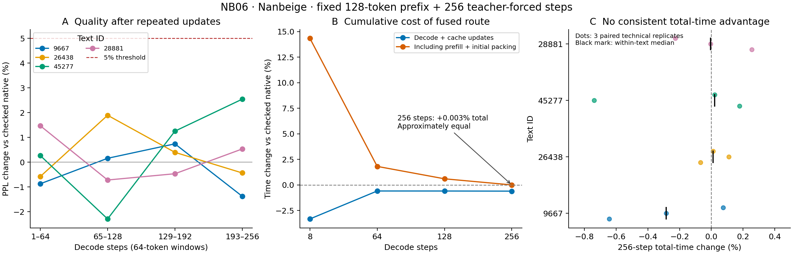

# NB06：圧縮更新を伴う256 step継続の結果

2026-10-08。run `loop-kv-nb06-20261008-075410-5621380a`。**全60系列・15,420 forward完了、別実装のオフライン照合でもPASS_MODEL_CONNECTION。**

**継続区間を8から256 stepへ延ばし、途中の圧縮更新を繰り返しても、今回の4文章では品質の5%目安を満たした。終端KVは64.392%減。融合は全量復元より速い一方、非圧縮に対しては初期・追加圧縮込みでほぼ同時間だった。**

| 主な結果 | 観測 |
|---|---|
| 融合の相対PPL・全256予測 | 4文章を一度ずつ集約して **+0.152%** |
| 各文章の全256 / 終盤64の最大悪化 | **+0.429% / +2.545%**（各4/4で5%以内） |
| 終端KV実storage | **66.000 → 23.501 MiB、64.392%減** |
| 融合 / 全量復元・decode＋追加圧縮 | **42.500%短縮** |
| 融合 / 非圧縮・decode＋追加圧縮 | **0.604%短縮** |
| 融合 / 非圧縮・prefill＋初期圧縮＋decode＋追加圧縮 | **+0.003%**、実質的に同程度 |
| GPU allocatedの全工程peak | **8,197.590 MiBで3方式同じ** |

時間の主集約は、同じ文章・同じ反復の対応比を3反復で中央値にし、その4文章の中央値を取ったCUDA event値。比較相手は入力検査付きの実装。wallも同方向で、256 stepの総時間差は+0.004%。以下の費用分解のみ加算できる平均を使う。

## 1. 固定条件と完了範囲

Nanbeige4.2-3B-Base、BF16、batch 1、44 cache slot（22層×2周）、Q48/KV8/head128。RTX PRO 6000 Blackwell Server Edition、torch2.11.0+cu128、Triton3.6.0、transformers4.45.1。同じ4冊・最初の128 tokenからteacher forcingで256 step、終端cache長384。計測フェーズの記録時間は約15.9分（環境準備・モデル取得・照合・ZIPを含まない）。

非圧縮、圧縮＋全量復元SDPA、圧縮＋GQA融合を各3技術反復。公式一致、診断、全長warmupを加えて60系列。64-token blockのNSN3と64 token以上のBF16末尾を保持し、step64/128/192/256の4回追加圧縮。最後の圧縮も費用と保存量に含み、その後のattention利用まで確認した更新は3回。既存blockの再量子化・材料の差替えはない。

## 2. 品質：全体でも終盤でも5%目安内

表は融合対非圧縮の相対PPL。負値は予測損失の低下を表す。

| PG19 ID | 全256 | 最初8 | 1–64 | 65–128 | 129–192 | 193–256 |
|---|---:|---:|---:|---:|---:|---:|
| 9667 | -0.339% | +0.743% | -0.869% | +0.159% | +0.742% | -1.374% |
| 26438 | +0.317% | +0.149% | -0.577% | +1.895% | +0.399% | -0.432% |
| 45277 | +0.429% | +4.540% | +0.268% | -2.289% | +1.254% | +2.545% |
| 28881 | +0.203% | +0.732% | +1.472% | -0.717% | -0.464% | +0.535% |

4文章集約PPLは非圧縮8.536475、全量復元8.551620、融合8.549434。融合の終盤64集約は+0.308%。全量復元の全256集約は+0.177%。両圧縮経路とも、全文章・全指定窓で5%以内だった。全256の平均が小さいことだけに依存せず、終盤を別に確認できた。

最初8予測の融合集約+1.526%と全256の+0.152%は評価するtoken集合が違う。「長くすると品質が改善する」という因果比較ではない。同方式3反復は全logit hashが一致した。

## 3. 時間：初期費用との差は縮まったが、優位とは判定しない

| 継続step | 融合/非圧縮：decode＋追加圧縮 | 融合/非圧縮：初期費用込み | 融合/全量復元：decode＋追加圧縮 |
|---|---:|---:|---:|
| 8 | -3.323% | +14.334% | -43.219% |
| 64 | -0.589% | +1.815% | -42.632% |
| 128 | -0.592% | +0.602% | -42.598% |
| 256 | -0.604% | +0.003% | -42.500% |

8 stepで+14.334%だった初期費用込みの差は、256 stepで+0.003%まで縮まった。取得前の「集約比が1未満」には固定4点のどこでも到達しなかった。一方、256 stepでは文章中央値が非圧縮より短いもの2冊・長いもの2冊、反復も短い6/12・長い6/12である。**この結果の読み方は「ほぼ同時間」であり、明確な低速化や高速化の実証ではない。**

| PG19 ID | 256 step総時間差の対応中央値 | 3技術反復の範囲 | 融合が短い反復 |
|---|---:|---:|---:|
| 9667 | -0.2842% | -0.6428〜+0.0739% | 2/3 |
| 26438 | +0.0119% | -0.0693〜+0.1105% | 1/3 |
| 45277 | +0.0213% | -0.7386〜+0.1767% | 1/3 |
| 28881 | -0.0054% | -0.2278〜+0.2553% | 2/3 |

### 保存記録による費用分解（記述的な事後分析）

単位ms。4文章×3反復の算術平均なので列を加算できる。上の主集約を置換しない。

| 方式 | prefill | 初期圧縮 | 256 forward | 256 post処理 | 合計 |
|---|---:|---:|---:|---:|---:|
| 非圧縮（検査付き） | 29.82 | 0.00 | 9061.10 | 1.64 | 9092.56 |
| 圧縮＋全量復元SDPA | 29.92 | 54.63 | 15411.89 | 232.71 | 15729.15 |
| 圧縮＋融合 | 29.78 | 54.71 | 8764.84 | 233.15 | 9082.48 |

融合のforward部分は非圧縮より平均約296.27 ms短い。その一方、4回の圧縮更新を含むpost処理は233.15 ms（非圧縮1.64 ms）、初期圧縮は54.71 ms。融合postのうち約230.99 ms、99.07%が4更新stepに集まる。**記録上、forward側の節約の大部分と釣り合う追加費用が圧縮更新・初期圧縮にある。** 個々の圧縮演算の因果寄与までは、この工程集計では分解していない。

平均内訳の合計では融合がわずかに短いが、主集約の対応中央値は+0.003%。集約方法を結果に合わせて取り替えず、どちらからも大きな総時間優位を読み取らない。次に速度を改善するなら、継続長だけを増やすより、追加blockの圧縮・連結費用を切り分ける根拠が得られた。

## 4. 保存量とGPU peak

単位MiB（2^20 byte）。全4文章・全3主反復で各値は同じ。

| 方式 | 終端KV実storage | decode allocated peak | 全工程 allocated peak | 全工程 reserved peak |
|---|---:|---:|---:|---:|
| 非圧縮（検査付き） | 66.000 | 8,127.397 | 8,197.590 | 8,306.000 |
| 圧縮＋全量復元SDPA | 23.501 | 8,094.909 | 8,197.590 | 8,262.000 |
| 圧縮＋融合 | 23.501 | 8,085.308 | 8,197.590 | 8,256.000 |

圧縮経路の終端は24,642,816 byte。コード10,813,440、補助情報2,252,800、header42,240、BF16末尾11,534,336の和で、実storageと一致する。非圧縮69,206,016 byteとの差は42.499 MiB。

融合のdecode allocated peakは非圧縮より42.089 MiB低いが、全工程peakはprefillが支配して同じ。KVの64.4%削減をGPU全体の64.4%削減とは扱わず、保存量と各工程のpeakを分けて示す。

## 5. 照合と取得前予想

- ZIP全303ファイルのSHA256と、配布した29ソースの一致を確認。原ZIPは225,291,002 byte（約214.854 MiB）。
- 配布前固定のNumPy検証器で公式/NATIVE全位置logit・終端KV一致、経路、全step実storage、追加blockと既存block不変性、同方式反復、warmup後のcache不変を再照合。
- 固定32点の実Q数値検査は全点成立。融合と橋渡し対照のK/V復元は同一、工程別固定予算内。これは全位置の生KV保存とは異なる。
- 全15,420位置の保存損失成分を再計算。固定384行の全語彙logitsからの検算も既存検証器が実施。非保存位置の生logitsは復元できず、損失成分とhashを点検する範囲。
- ローカル再計算とColab集計に42個の微小な派生浮動小数差、最大3.553e-15。固定比較規則内で同一判定。原summaryを書き換えていない。

| 取得前予想 | 今回 |
|---|---|
| H1：4文章の接続・保存・固定数値・反復安定 | 成立 |
| H2：融合の全256/終盤64が全4文章で5%以内 | 成立 |
| H3：256 step融合decodeが全量復元より短い | 成立、42.500%短縮 |
| 非圧縮への総時間償却 | 方向予想なし。固定4点の集約では1未満なし、256でほぼ同時間 |

## 6. 結果の解釈と測定範囲

今回加わった証拠は、**同じ材料で継続を延ばし、圧縮更新を繰り返した実経路でも、短区間の品質とKV削減が保たれた**こと。融合を使うと全量復元の費用を抑えられるが、非圧縮との総時間差は更新費用も含めて評価する必要があることも確認した。

範囲は4文章、128＋256 token、batch 1、teacher forcing、一つのGPU/実装。技術反復と部分窓を独立文章数へ加えず、旧NB05とのプール、p値・区間推定、未測定長への償却点外挿は行わない。長い自由生成や数千token文脈の結論とは分ける。

**推奨は、ここで追加結果をチェックポイントへ整理すること。** 校了本文への追記は次の改訂で判断できる。速度改善を続ける場合の次候補は、新blockの圧縮・連結に絞った部品診断。現時点では新実験や実装変更を実行していない。

[固定設計](../plans/loop-kv-nb06-design-v0.1-2026-10-08.md) / [原結果](../runs/loop-kv-nb06-20261008-075410-5621380a/summary.json) / [再集計JSON](nb06-results-v0.1-2026-10-08.json) / [再集計コード](../scripts/analyze_loop_kv_nb06_results.py) / [照合記録](../data/validation/nb06/verification-summary.json)
